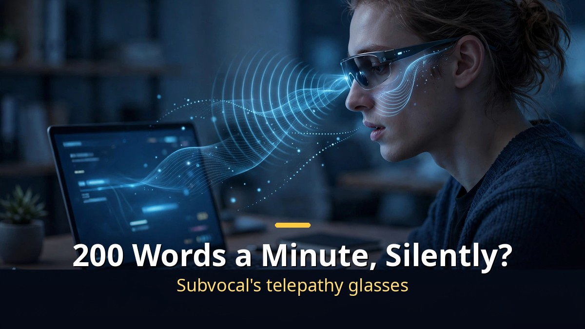
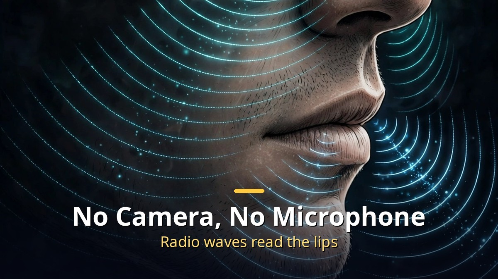
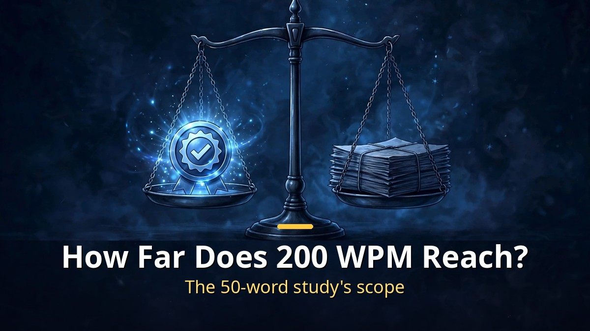

<!-- 본문 시작 -->

Glasses that turn silent mouth movements into text have arrived.
The maker is a Y Combinator startup called Subvocal.
Preorders cost $499, with shipping estimated for Q1 2027.
But the headline speed — 200 words a minute — has not been verified yet.
This article separates how the product works, what the price buys, and how far the claim can be trusted.

> Key takeaway: Subvocal glasses read lip and jaw movements with radio waves, no camera and no microphone, and turn them into text. The company claims more than 200 words a minute, but no independent verification exists yet. The peer-reviewed research behind it confirmed recognition rates for a 50-word vocabulary. The buying decision is better made by looking at the scope of verification first, not the price.

## How Do Glasses Read Words Without Sound?

No camera, no microphone. Radio waves read the lips.

The principle is subvocalization.
When you read silently or compose a sentence in your head, the muscles of your tongue, lips, and throat move very slightly, as if you were speaking.
There is no sound, but there is movement.
Subvocal glasses read that movement with radio waves.

A radar module in the frame sends low-power radio waves toward the wearer's face, and AI analyzes how the returning signal changes.
As lip, jaw, and tongue positions shift, the reflected waves shift too, and those changes are turned into text.
With no camera, it does not film lip shapes; with no microphone, it hears nothing.
According to the company, it recognizes only words formed by deliberately moving the mouth, and it does not read thoughts.

The maker is The Subvocal Company, founded by two Georgia Tech computer science students.
Aarush Yadav (CEO) and Arnav Kumar (CTO) grew a project started at TreeHacks, Stanford's hackathon, in February 2026 into a Y Combinator Fall 2026 startup.
On October 30, 2026, they announced a $1.3 million pre-seed round from Y Combinator and Afore Capital.
Preorders opened the same day.

## $499 — What Are You Buying?

A $199 deposit, $300 later, shipping in Q1 2027, in the US only.

The price terms first.
The early-bird price is $499, against a listed price of $699.
You reserve a pair with a refundable $199 deposit and pay the remaining $300 later.
Tax, shipping, and prescription lenses are extra.
First shipments are estimated for Q1 2027 — an estimate, not a firm date.
Sales are US-only for now, and shipping depends on FCC approval for radio devices.

The use case is moments when you must type but cannot speak aloud.
In the demo video, the wearer quietly asks an AI to summarize a Slack message without the colleague beside them noticing.
Two wearers are also shown holding a private conversation across a room without others noticing.
That is where the "real-life telepathy" comparison comes from.
Against ordinary typing at about 40 words a minute, the company claims more than 200 words a minute.

A pre-purchase checklist:

- It is a prototype. The demo video itself is labeled "Prototype design."
- Preorders are US-only, with no Korea launch schedule.
- The shipping estimate depends on FCC approval.
- Judge it by verified speed, not by price.

## How Far Can the 200-Word Claim Be Trusted?

The study behind the claim tested a 50-word vocabulary.

The most important distinction is this.
More than 200 words a minute is the company's claim.
Independent verification has not been confirmed.
The company has published no accuracy figures either.

The study the company cites is a 2022 paper in Scientific Reports on radar-based silent speech recognition.
What it confirmed was recognition rates for a 50-word English vocabulary: 99.17% on the same speaker in the same session, and 88.87% across different sessions.
A closed 50-word vocabulary and open-vocabulary input at 200 words a minute are different problems.
One paper does not prove the product's speed claim.

Even so, the technology's lineage is real.
Reading subvocal speech with radio waves has existed as peer-reviewed research for several years.
What Subvocal newly attempts is moving that principle into a glasses product.
Its Hacker News post on November 2, 2026 drew 323 points and 211 comments.
Interest is large; proof remains the product's homework.

## Closing

Subvocal glasses show a new way to type: without speaking at all.
The principle of reading lips with radio waves is research-backed, and the price and shipping terms are public.
But the core claim of 200 words a minute still rests on the company's word.
Whether to pay $499 is better decided knowing that gap.
If the new input method interests you, waiting for real-world reports after the first shipments is also a reasonable choice.

## Frequently Asked Questions

**Q. Do the glasses read thoughts?**
A. No. The company says they recognize only words formed by deliberately moving the mouth, and they do not read thoughts. There is no camera or microphone.

**Q. Is 200 words a minute a verified figure?**
A. No. It is the company's claim, with no independent verification yet. The cited 2022 study confirmed recognition rates for a 50-word vocabulary.

**Q. Can I buy it in Korea?**
A. Preorders are US-only. No Korea launch schedule has been announced.

**Q. When will it ship?**
A. First shipments are estimated for Q1 2027, but that is an estimate and depends on FCC approval.

## Recommended Reading

[Let Claude Edit Your Videos｜From Idea to Finished Short, Directed by Voice — the real flow of voice-directed editing](https://aitechnotesen.blogspot.com/2026/11/let-claude-edit-your-videosfrom-idea-to.html)
[A.I. Artificial Intelligence｜A Boy Robot Programmed to Love, and What It Means to Become Human — a robot boy who asks what love means](https://aitechnotesen.blogspot.com/2026/11/ai-artificial-intelligencea-boy-robot.html)
[I, Robot｜When Three Laws Shake, What Should a Detective Believe — a film that asks what human judgment is worth when rules wobble](https://aitechnotesen.blogspot.com/2026/11/i-robotwhen-three-laws-shake-what.html)

A new input method is exciting, but when buying, check the scope of verification before the claim. Follow along if you want to keep following this topic.

<!-- 본문 끝 -->

## 작업용 출처·이미지 정보 (업로드 제외)

- Source: Matt Wolfe 영상 _9R7QOhJh-o(2026-11-01, 1:15, 스크립트 패널 0:00~1:08 확인 기준) + YC·보도 대조(사전 주문 2026-10-30, 130만 달러 프리시드)
- Images: images/01-hero-en.jpg ~ 04-img3-en.jpg / original illustration + English banner overlay (1200x675)
