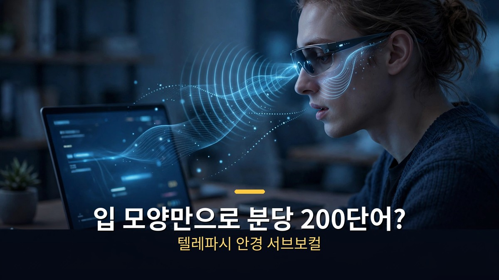

<!-- 본문 시작 -->

소리를 내지 않고 입 모양만으로 글을 입력하는 안경이 나왔다.
주인공은 와이콤비네이터(YC) 스타트업 '서브보컬'이다.
사전 주문 가격은 499달러, 출하는 2027년 1분기로 잡혀 있다.
다만 분당 200단어라는 속도는 아직 검증되지 않았다.
이 글은 제품의 원리와 가격 조건, 그리고 주장의 검증 범위를 나눠 정리한다.

> 핵심 정리: 서브보컬 안경은 카메라나 마이크 없이 전파로 입술·턱의 움직임을 읽어 글자로 바꾼다. 회사는 분당 200단어 이상을 주장하지만, 독립 검증된 수치는 아직 없다. 동료심사를 거친 연구가 확인한 것은 50개 단어 어휘에서의 인식률이다. 사는 문제는 가격보다 '검증의 범위'를 먼저 보고 정하는 것이 좋다.

## 안경이 어떻게 소리 없이 글을 읽을까?

카메라도 마이크도 없다. 전파가 입술의 움직임을 읽는다.

원리는 '무성 발성(subvocalization)'이다.
글을 속으로 읽거나 문장을 머릿속으로 만들 때, 혀·입술·목의 근육은 말할 때처럼 아주 조금 움직인다.
소리는 나지 않지만 근육의 움직임은 있다.
서브보컬 안경은 그 움직임을 전파로 읽는다.

안경테에 들어간 레이더 모듈이 얼굴을 향해 낮은 출력의 전파를 보내고, 돌아오는 신호의 변화를 AI가 분석한다.
입술·턱·혀의 위치가 바뀌면 반사되는 전파도 달라진다.
그 변화를 글자로 바꾸는 방식이다.
카메라가 없어 입술 모양을 찍지 않고, 마이크가 없어 소리를 듣지 않는다.
회사 설명에 따르면, 의도적으로 입을 움직여 만든 단어만 인식하고 생각 자체를 읽지는 않는다.

만든 곳은 조지아공대 컴퓨터과학과 학생 2명이 창업한 '서브보컬 컴퍼니'다.
아루시 야다브(CEO)와 아르나브 쿠마르(CTO)는 2026년 2월 스탠퍼드 해커톤 '트리핵스'에서 시작한 프로젝트를 YC 가을 2026 배치 스타트업으로 키웠다.
2026년 10월 30일 YC와 에이포어 캐피털로부터 130만 달러 프리시드 투자를 받았다고 발표했다.
같은 날 사전 주문도 열었다.

## 499달러, 무엇을 사겠다는 것인가?

예약금 199달러, 나머지 300달러, 출하는 2027년 1분기, 미국에서만.

가격 조건을 먼저 정리한다.
조기 구매가 499달러, 정가는 699달러로 표시돼 있다.
예약하려면 환불 가능한 보증금 199달러를 내고, 나머지 300달러는 나중에 낸다.
세금·배송비·도수 렌즈는 별도다.
첫 출하는 2027년 1분기로 잡혀 있으나, 확정 일정이 아니라 추정치다.
판매는 우선 미국에서만 하고, 전파 기기 인증(FCC 승인)을 받아야 출하할 수 있다.

용도는 조용히 입력해야 하는 순간이다.
영상 데모에서는 옆자리 동료가 모르게 AI에게 슬랙 메시지 요약을 요청하는 장면이 나왔다.
안경을 쓴 두 사람이 방 건너편에서 남이 알아채지 못하게 비공개 대화를 나누는 장면도 있다.
그래서 '현실의 텔레파시'라는 비유가 붙었다.
일반 타이핑이 분당 약 40단어인 데 비해, 회사는 분당 200단어 이상을 입력할 수 있다고 주장한다.

사기 전에 확인할 조건을 체크리스트로 정리한다.

- 프로토타입 단계다. 데모 영상에도 '프로토타입 디자인'이라고 표시돼 있다.
- 미국에서만 사전 주문이 가능하고, 한국 출시 일정은 없다.
- 출하 일정은 추정치이며 FCC 승인에 달려 있다.
- 가격이 아니라 '검증된 속도'를 보고 판단해야 한다.

## 200단어 주장은 어디까지 믿을까?

주장의 근거가 된 연구는 50개 단어 어휘의 인식률이다.

가장 중요한 구분은 이것이다.
200단어 이상이라는 속도는 회사의 주장이다.
독립적인 검증은 아직 확인되지 않았다.
회사가 공개한 정확도 수치도 없다.

회사가 근거로 드는 것은 2022년 학술지 '사이언티픽 리포츠'에 실린 레이더 기반 무성 발성 인식 연구다.
그 연구가 확인한 것은 50개 영어 단어 어휘에서의 인식률이다.
같은 화자·같은 세션에서는 99.17%, 다른 날·다른 조건에서는 88.87%였다.
50개 단어로 된 닫힌 어휘와, 자유로운 문장을 분당 200단어로 입력하는 열린 어휘는 다른 문제다.
논문 한 편이 제품의 속도 주장을 증명해 주지는 않는다.

다만 기술의 계보 자체는 실재한다.
무성 발성을 전파로 읽는 방식은 동료심사를 거친 연구로 몇 년 전부터 존재했다.
서브보컬이 새로 만든 것은 그 원리를 안경이라는 제품으로 옮긴 시도다.
해커뉴스에는 2026년 11월 2일 게시글이 올라 323점·댓글 211개를 받으며 화제가 됐다.
관심은 크지만, 증명은 아직 제품의 몫으로 남아 있다.

## 마무리

서브보컬 안경은 '말하지 않고 입력한다'는 새로운 입력 방식을 보여준다.
전파로 입술을 읽는 원리는 연구로 확인된 기술이고, 가격과 출하 조건도 공개돼 있다.
그러나 분당 200단어라는 핵심 주장은 아직 회사의 말에 머물러 있다.
499달러를 낼지 말지는, 그 간극을 알고 정하는 것이 좋다.
새 입력 방식에 관심 있다면, 첫 출하 뒤의 실제 사용기가 나올 때까지 지켜보는 것도 방법이다.

## 자주 묻는 질문

**Q. 생각을 읽는 안경인가요?**
A. 아닙니다. 의도적으로 입을 움직여 만든 단어만 인식하고, 생각을 읽지는 않는다고 회사가 밝히고 있습니다. 카메라와 마이크도 없습니다.

**Q. 분당 200단어는 검증된 수치인가요?**
A. 아닙니다. 회사의 주장이며 독립 검증은 아직 없습니다. 근거가 된 2022년 연구는 50개 단어 어휘의 인식률을 확인한 것입니다.

**Q. 한국에서도 살 수 있나요?**
A. 사전 주문은 미국에서만 가능합니다. 한국 출시 일정은 나와 있지 않습니다.

**Q. 언제 받을 수 있나요?**
A. 첫 출하는 2027년 1분기로 잡혀 있으나 추정치이며, FCC 승인을 받아야 합니다.

## 함께 읽으면 좋은 글

[AI 때문에 사라질 직업, 티어표보다 먼저 볼 것｜5개 티어 기준과 내 일 점검 체크리스트 — 내 일의 구성을 점검하는 거울](https://aitechnoteskr.tistory.com/108)
[A.I. 인공지능｜사랑하도록 프로그래밍된 소년 로봇, 인간이 된다는 것의 의미 — 감정을 가진 로봇 소년이 던지는 질문](https://aitechnoteskr.tistory.com/113)
[화면 없는 노트북 — Hero Keyboard, 사기 전에 확인할 조건 — 화면을 빌려 쓰는 키보드 PC의 조건 정리](https://aitechnoteskr.tistory.com/107)

새로운 입력 방식은 설레지만, 살 때는 주장보다 검증의 범위를 먼저 보자. 이 주제를 계속 따라가려면 이웃 추가를 눌러두면 된다.

<!-- 본문 끝 -->

## 작업용 출처·이미지 정보 (업로드 제외)

- 자료 출처: Matt Wolfe 영상 _9R7QOhJh-o(2026-11-01, 1:15, 스크립트 패널 0:00~1:08 확인 기준) + YC·보도 대조(사전 주문 2026-10-30, 130만 달러 프리시드)
- 이미지: images/01-hero.jpg ~ 04-img3.jpg / 자작 일러스트 + 한글 배너 오버레이 (1200x675)
