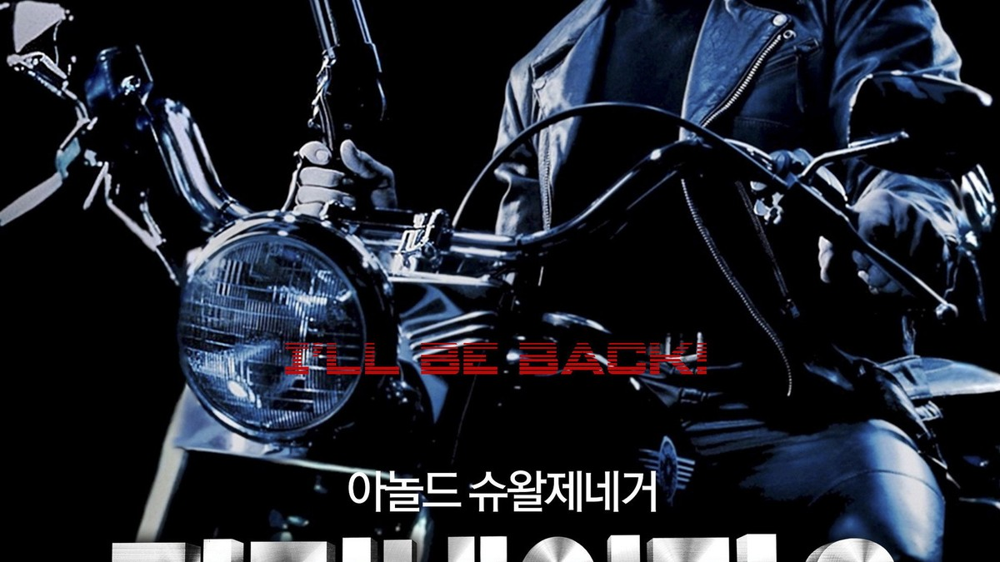
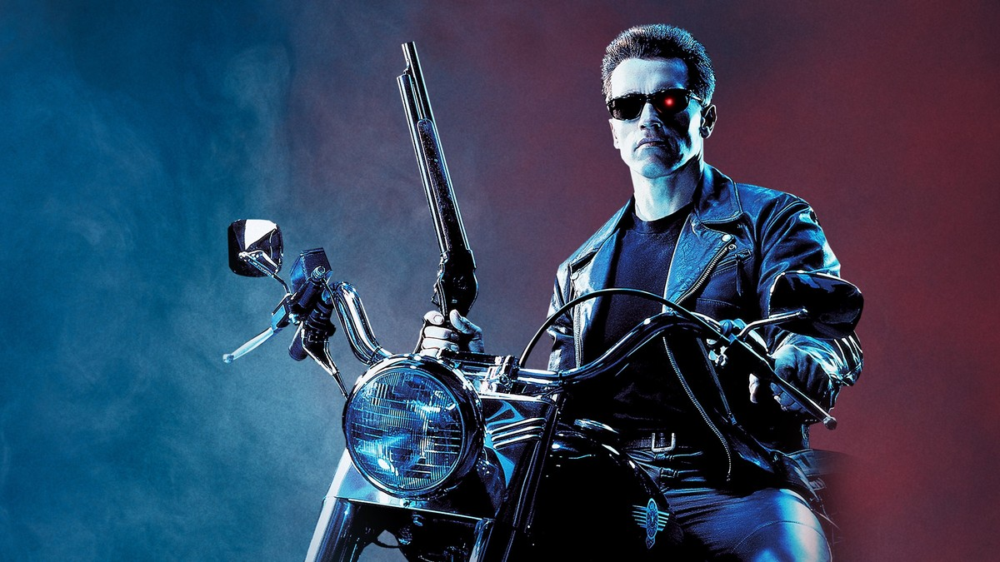
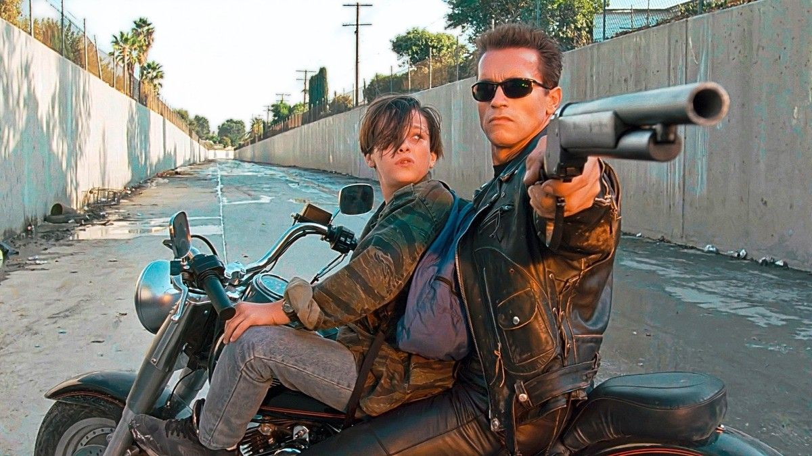
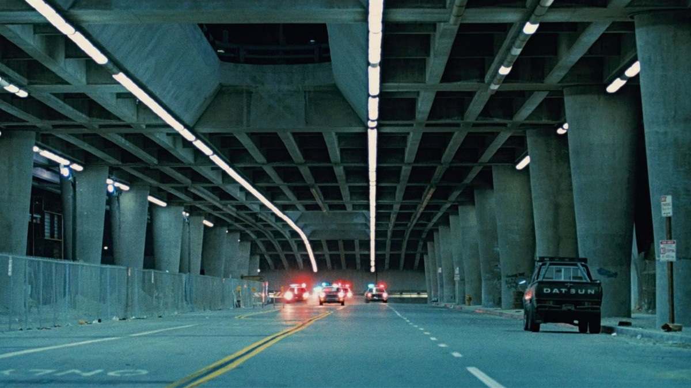
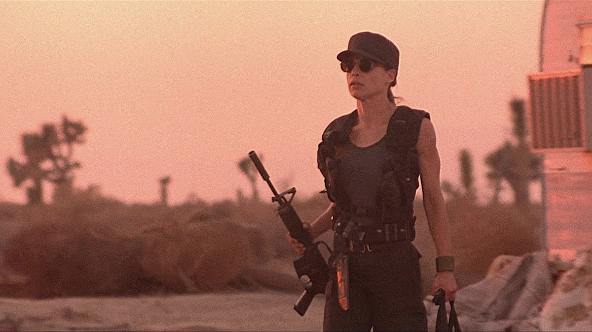
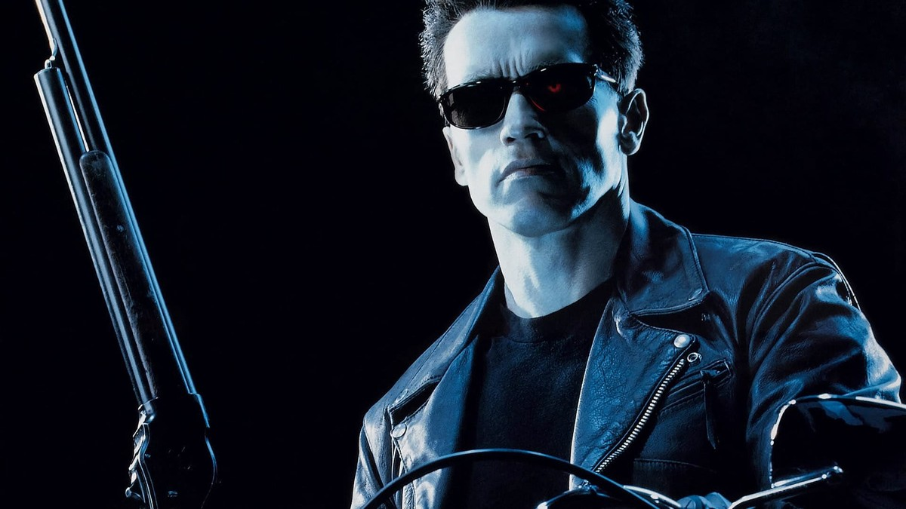
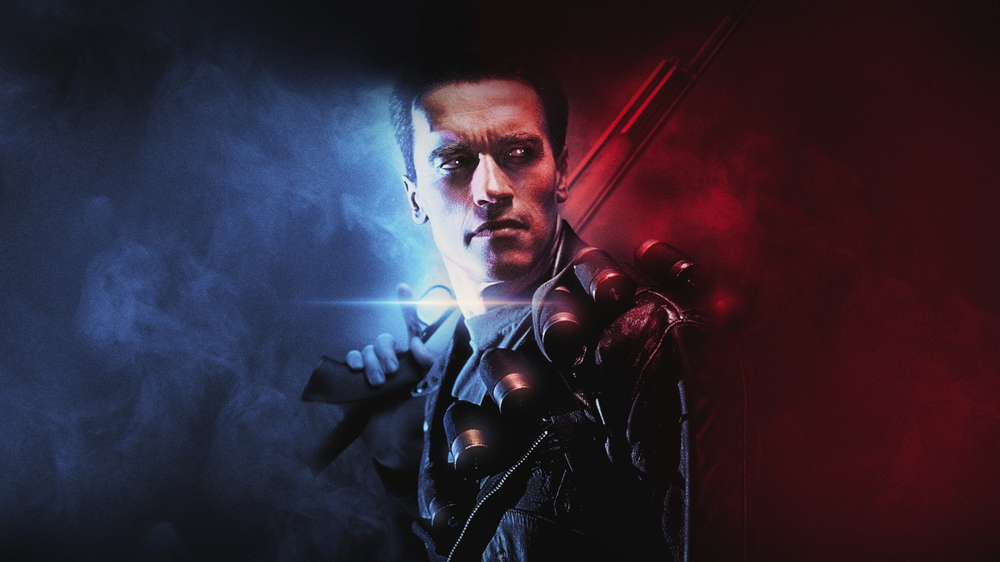
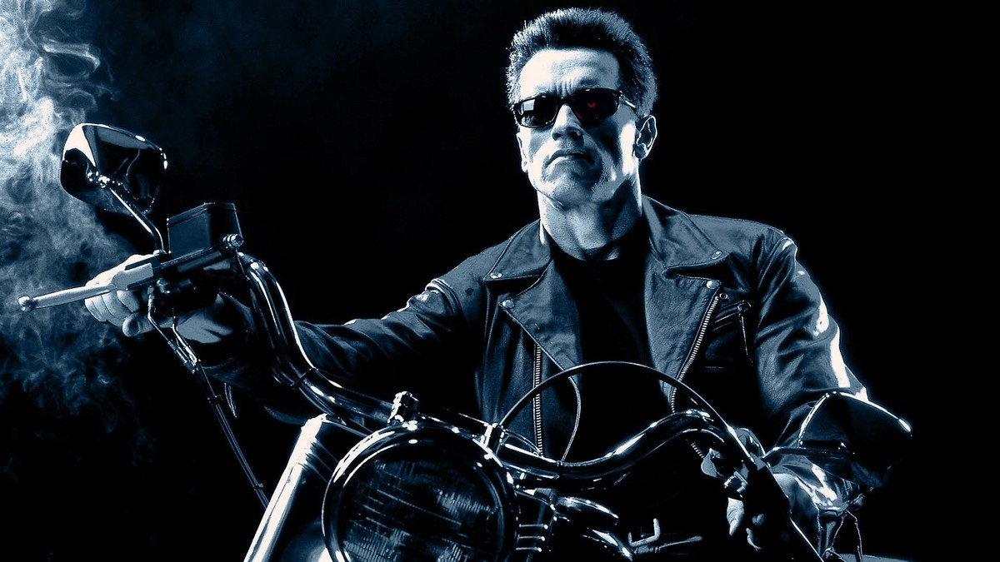

<!-- 본문 시작 -->

A machine has returned from the war of the future.
One came to kill. One came to protect.
James Cameron's 1991 film "Terminator 2: Judgment Day" is the story of a machine protecting young John Connor.
A being that knew only how to kill learns how to protect a human.
A spoiler-free introduction. No ending scenes are covered, and scene descriptions focus on setup and atmosphere up to the middle of the film.

## Basic Information

The T-800 on a motorcycle — the first look at the machine that came to protect
| Item | Details |
|---|---|
| Title | Terminator 2: Judgment Day |
| Director | James Cameron |
| Cast | Arnold Schwarzenegger (T-800), Linda Hamilton (Sarah Connor), Edward Furlong (John Connor), Robert Patrick (T-1000) |
| Release | 1991, Korean theatrical release July 6, 1991, rated 15 |
| Runtime | 2 hours 36 minutes (156 minutes, as listed on TMDB) |
| Genre | Action, Thriller, SF |
| TMDB Member Score | 82% (8.2/10, 15,146 votes, checked on the TMDB Korea page on 2026-11-06) |
| Where to watch in Korea | No streaming provider, rental on Wavve 1,540 KRW, purchase on Wavve 5,500 KRW (TMDB Korea watch page, checked 2026-11-06; providers and prices should be rechecked before watching) |

## Two Machines From the Future — One to Kill, One to Protect

The T-800 riding with John Connor through the drainage canal — the chase begins
In the future, the war between humans and machines goes on.
The AI Skynet sends a liquid-metal robot, the T-1000, into the past to kill young John Connor, who will become the commander of the human resistance.
Against the T-1000, which can change shape and heal itself, the resistance sends the T-800 into the past.
A machine with the same face, this time with a mission to protect.

Here the film's first question begins.
What is the difference between a machine that kills and a machine that protects?
They look the same. Their abilities are similar.
But once the mission changes, the same machine behaves entirely differently.
In the world Skynet built, machines defined humanity as the enemy.
Yet a machine reprogrammed by humans stands on humanity's side.
Who counts as the AI's enemy depends on who gave the order.
The film places this question in the middle of the action.

The tunnel chase — outrunning the police cars

## Sarah Connor, From Fugitive to Warrior

Sarah Connor standing in the sunset — the moment a fugitive becomes a warrior
John's mother Sarah is locked in a mental hospital.
She warned of the future war, but no one believed her.
She prepares her escape and has remade her body and mind into a warrior's.
This stretch matters because the film draws the human side through one person's awakening.

Sarah is both a mother protecting her son and a resistance fighter who believes in humanity's future.
Her change is not mere toughness.
It shows what it weighs to know the future, and how to carry that weight.
While the T-800 protects John, Sarah does what only humans can do.
The judgment machines cannot make, the decisions only humans can take.

## How a Machine Learns to Be Human

The T-800 behind sunglasses — a face without feeling, observing humans
Traveling with John, the T-800 learns how to be human.
It copies his way of speaking, imitates jokes, practices smiling.
At first it is only awkward mimicry.
But each time John is in danger, the T-800's choices shift a little.

This is the film's deepest stretch.
A machine built by Skynet learned humans as enemies.
But the machine learning beside John learns how to protect humans.
When the direction of learning changes, the same machine becomes a different being.
The film builds the question "Can a machine learn to be human?" not with grand explanations but with small scenes.
The story up to the middle already organizes three views of AI and humans: those who command and those who learn, those who protect and those who kill, and what becoming human means.
Nothing about the ending is mentioned in this article.

The T-800 between red and blue light — a machine standing on the border of two worlds

## Before-You-Watch Checklist

The T-800 on a motorcycle in black and white — the mood the poster promises
- At 2 hours 36 minutes, it suits a relaxed evening viewing
- Rated 15, Korean theatrical release July 6, 1991
- No streaming provider in Korea; Wavve rental 1,540 KRW or purchase 5,500 KRW (TMDB, as of 2026-11-06; recheck before watching)
- You can follow the story without seeing "The Terminator" (1984), but knowing the T-800's first appearance adds depth
- Better watched without searching for ending information first

## Frequently Asked Questions

**Q. Can I understand it without seeing the first film?**
Yes. The film explains the future war and the two machines' missions, so the story can be followed without the first film.

**Q. Can children watch it too?**
The Korean rating is 15. With violent action scenes, it suits teenagers and older better than young children.

**Q. Where can I watch it?**
As of 2026-11-06, TMDB Korea lists no streaming provider, only Wavve rental and purchase. Providers and prices can change, so recheck before watching.

## Recommended Reading

[A.I. Artificial Intelligence｜A Boy Robot Programmed to Love, and What It Means to Become Human — a robot boy who asks what love means](https://aitechnotesen.blogspot.com/2026/11/ai-artificial-intelligencea-boy-robot.html)
[Jobs AI Is Erasing: Read the Tier List Before the Headlines｜A 5-Tier Standard and a Checklist for Your Job — a checklist for where your job sits](https://aitechnotesen.blogspot.com/2026/11/jobs-ai-is-erasing-read-tier-list.html)
[GPT-6 Astra Fixed Another AI's Brain Directly｜What the 0.016% Edit Really Proves — check the verification scope before the numbers](https://aitechnotesen.blogspot.com/2026/11/gpt-6-astra-fixed-another-ais-brain.html)

A story of a machine that knew only how to kill and learned how to protect. If the ending now pulls at you, watch the film first rather than searching for it. Follow along for the next film introduction.

<!-- 본문 끝 -->

## 작업용 출처·이미지 정보 (업로드 제외)

- Source: TMDB movie 280 page and watch page (Korea, checked 2026-11-06) / Stills: TMDB backdrop originals (width 1200px+, ending scenes excluded — no molten-steel/thumbs-up shots confirmed, duplicate motorcycle compositions excluded)
- Images: images/01-hero-en.jpg ~ 08-img7-en.jpg / TMDB official stills and backdrops (1200x675)
