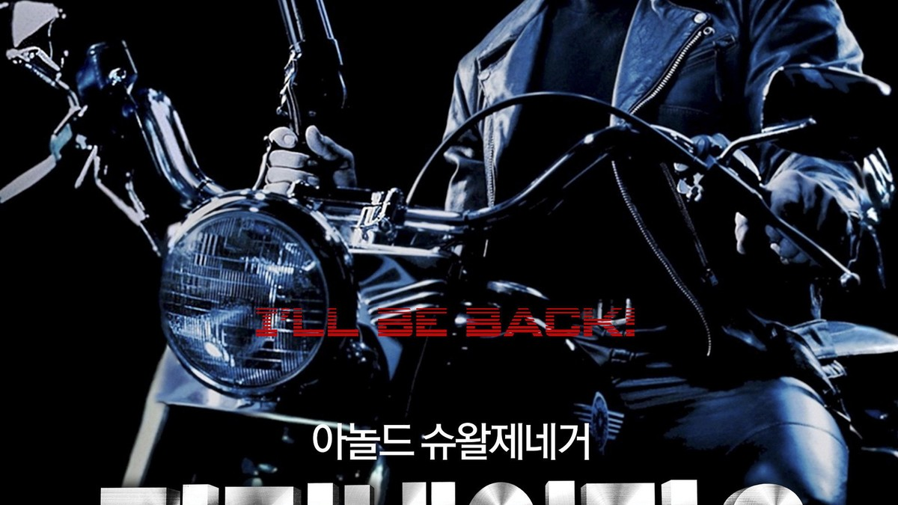
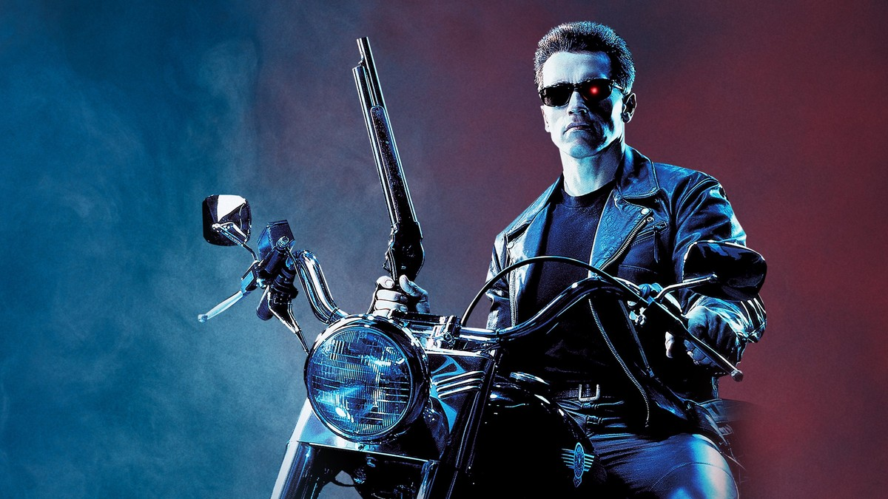
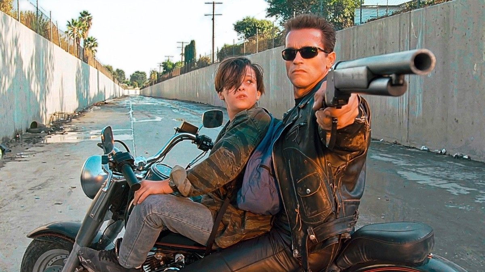
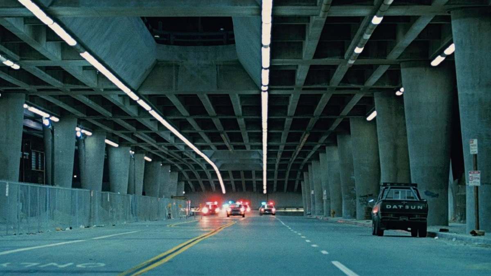
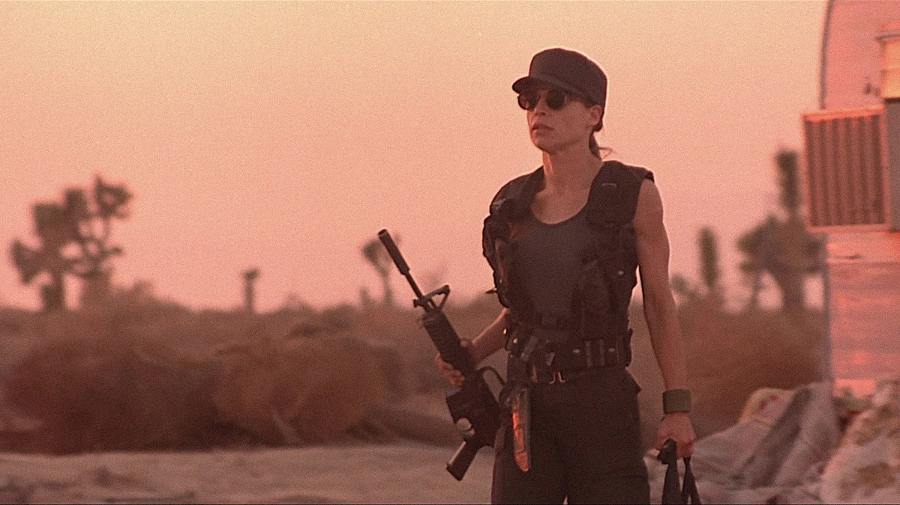
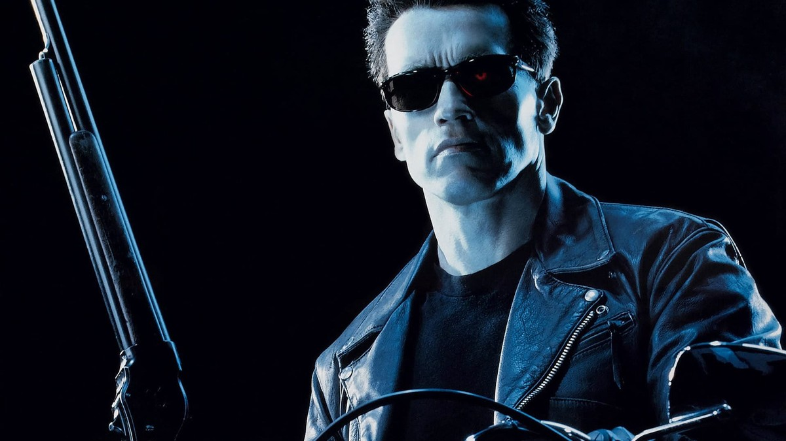
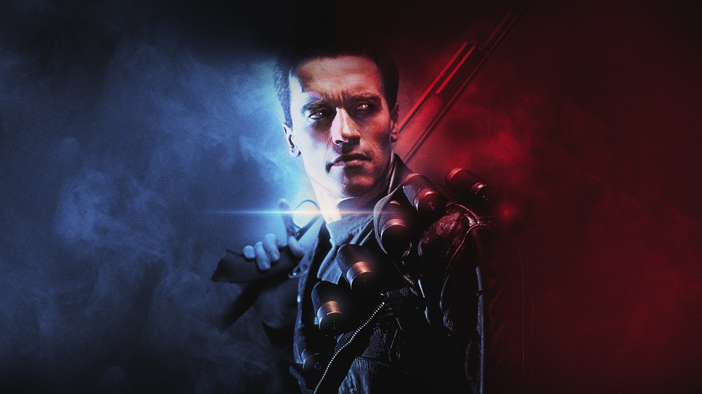
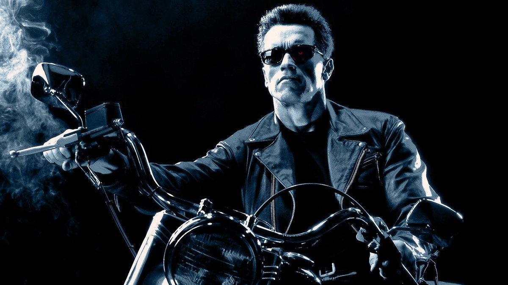

<!-- 본문 시작 -->

미래의 전쟁에서 돌아온 기계가 있다.
하나는 죽이러 왔고, 하나는 지키러 왔다.
1991년 제임스 카메론 감독의 '터미네이터 2: 심판의 날'은 어린 존 코너를 지키는 기계의 이야기다.
죽이는 법만 알던 존재가, 인간을 지키는 법을 배우는 여정이다.
스포일러 없는 소개다. 결말 장면은 다루지 않으며, 장면 설명은 중반부까지의 설정과 분위기 중심으로 정리했다.

## 기본 정보

오토바이에 오른 T-800 — 지키러 온 기계의 첫 모습
| 항목 | 내용 |
|---|---|
| 제목 | 터미네이터 2: 심판의 날 (Terminator 2: Judgment Day) |
| 감독 | 제임스 카메론 |
| 주연 | 아놀드 슈왈제네거(T-800), 린다 해밀턴(사라 코너), 에드워드 펄롱(존 코너), 로버트 패트릭(T-1000) |
| 개봉 | 1991년, 한국 극장 개봉 1991년 7월 6일, 등급 15세 |
| 러닝타임 | 2시간 36분(156분, TMDB 표기) |
| 장르 | 액션, 스릴러, SF |
| TMDB 회원 점수 | 82%(8.2/10, 15,146개 평가, TMDB 한국 페이지 2026-11-06 확인) |
| 국내 시청처 | 스트리밍 제공처 없음, 대여 웨이브 1,540원, 구매 웨이브 5,500원 (TMDB 시청처 페이지 대한민국 기준 2026-11-06 확인, 가격·제공처는 시청 전 재확인 필요) |

## 미래에서 온 두 대의 기계 — 지키는 자와 죽이는 자

수로에서 존 코너와 함께 달리는 T-800 — 추격의 시작
미래, 인류와 기계의 전쟁은 계속되고 있다.
인공지능 스카이넷은 인류 저항군의 사령관이 될 어린 존 코너를 없애기 위해 액체 금속형 로봇 T-1000을 과거로 보낸다.
형태를 바꾸고 스스로 치유되는 T-1000에 맞서, 저항군은 T-800을 과거로 급파한다.
같은 얼굴의 기계가, 이번에는 지키는 임무를 받았다.

이 대목에서 영화가 던지는 첫 질문이 시작된다.
죽이는 기계와 지키는 기계는 무엇이 다른가.
겉모습은 같다. 성능도 비슷하다.
그러나 임무가 바뀌자, 같은 기계의 행동이 전혀 다르게 보인다.
스카이넷이 만든 세계에서, 기계는 인류를 적으로 규정했다.
그런데 인간이 다시 프로그래밍한 기계는 인간의 편에 선다.
AI의 적이 누구인지는, 누가 명령을 내렸는지에 따라 달라진다는 것.
영화는 이 질문을 액션의 한가운데에 놓는다.

터널을 달리는 추격 — 경찰차를 따돌리는 장면

## 사라 코너, 도망자에서 전사로

석양 아래 서 있는 사라 코너 — 도망자가 전사가 되는 순간
존 코너의 어머니 사라는 정신병원에 갇혀 있다.
미래의 전쟁을 경고했지만, 아무도 믿지 않았다.
그녀는 아들을 지키기 위해 탈출을 준비하고, 몸과 마음을 전사의 것으로 바꿔왔다.
이 구간이 중요한 이유는, 영화의 인간 편이 한 사람의 각성으로 그려지기 때문이다.

사라는 아들을 지키는 어머니이자, 인류의 미래를 믿는 저항군이다.
그녀의 변화는 단순한 강함이 아니다.
미래를 안다는 것이 어떤 무게인지, 그 무게를 어떻게 짊어지는지를 보여준다.
T-800이 존을 지키는 동안, 사라는 인간이 할 수 있는 일을 한다.
기계가 할 수 없는 판단, 인간만이 내리는 결정을 맡는다.

## 기계가 인간을 배우는 법

선글라스 뒤의 T-800 — 감정 없는 얼굴로 인간을 관찰한다
T-800은 존과 함께 다니며 인간을 배운다.
말투를 따라 하고, 농담을 흉내 내고, 미소를 연습한다.
처음에는 어색한 흉내에 불과하다.
그러나 존이 위험에 처할 때마다, T-800의 선택은 조금씩 달라진다.

이 구간이 영화의 가장 깊은 대목이다.
스카이넷이 만든 기계는 인간을 적으로 배웠다.
그런데 존 곁에서 배운 기계는 인간을 지키는 법을 배운다.
배움의 방향이 바뀌면, 같은 기계도 다른 존재가 된다.
영화는 "기계가 인간을 배울 수 있는가"라는 질문을, 거창한 설명이 아니라 작은 장면들로 쌓아 올린다.
중반부까지의 이야기만으로도, AI와 인간의 관계에 대한 세 가지 시선이 정리된다.
명령하는 자와 배우는 자, 지키는 자와 죽이는 자, 그리고 인간이 된다는 것의 의미다.
결말에 대한 언급은 이 글에서 하지 않는다.

붉은 빛과 푸른 빛 사이의 T-800 — 두 세계의 경계에 선 기계

## 시청 전 체크리스트

흑백의 오토바이 위 T-800 — 포스터가 말하는 영화의 분위기
- 러닝타임 2시간 36분으로, 여유 있는 저녁 시간에 보는 것이 좋다
- 등급 15세, 국내 극장 개봉은 1991년 7월 6일
- 시청처는 스트리밍 제공처가 없고, 웨이브 대여 1,540원·구매 5,500원 (2026-11-06 TMDB 기준, 시청 전 재확인 필요)
- 전편 '터미네이터'(1984)를 안 봐도 이야기는 따라갈 수 있지만, T-800의 첫 등장을 알고 보면 더 깊다
- 결말에 대한 사전 정보 없이 보는 것이 좋다

## 자주 묻는 질문

**Q. 전편을 안 봐도 이해할 수 있나?**
그렇다. 영화 안에서 미래 전쟁과 두 기계의 임무가 설명되므로, 전편을 몰라도 이야기는 따라갈 수 있다.

**Q. 아이와 함께 봐도 되나?**
국내 등급은 15세다. 폭력적인 액션 장면이 많아, 청소년 이상과 함께 보는 것이 좋다.

**Q. 어디서 볼 수 있나?**
2026-11-06 TMDB 대한민국 기준으로는 스트리밍 제공처가 없고, 웨이브 대여·구매만 표시된다. 제공처와 가격은 바뀔 수 있어 시청 전 재확인이 필요하다.

## 함께 읽으면 좋은 글

[A.I. 인공지능｜사랑하도록 프로그래밍된 소년 로봇, 인간이 된다는 것의 의미 — 감정을 가진 로봇 소년이 던지는 질문](https://aitechnoteskr.tistory.com/113)
[클로드에게 영상 편집 맡기기｜아이디어부터 숏폼 완성까지, 말로 시키는 방법 — 말로 시키는 영상 편집의 실제 흐름](https://aitechnoteskr.tistory.com/110)
[GPT-6 아스트라가 다른 AI의 뇌를 직접 고쳤다｜0.016% 수정으로 수학 점수가 뛴 연구의 실체 — 숫자보다 검증 범위를 먼저 보는 법](https://aitechnoteskr.tistory.com/109)

죽이는 법만 알던 기계가 지키는 법을 배우는 이야기. 그 끝이 궁금해졌다면, 결말을 미리 검색하지 말고 영화를 먼저 보는 것이 좋다. 다음 영화 소개도 함께 따라가려면 이웃 추가를 눌러두면 된다.

<!-- 본문 끝 -->

## 작업용 출처·이미지 정보 (업로드 제외)

- 자료 출처: TMDB 영화 280 페이지·시청처 페이지(대한민국 기준, 2026-11-06 확인) / 스틸: TMDB 백드롭 원본(너비 1200px 이상, 결말 장면 제외 — 용광로·엄지 척 장면 없음 확인, 오토바이 중복 구도 제외)
- 이미지: images/01-hero.jpg ~ 08-img7.jpg / TMDB 공식 스틸·백드롭 (1200x675)
