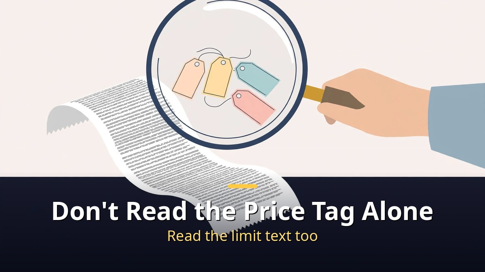
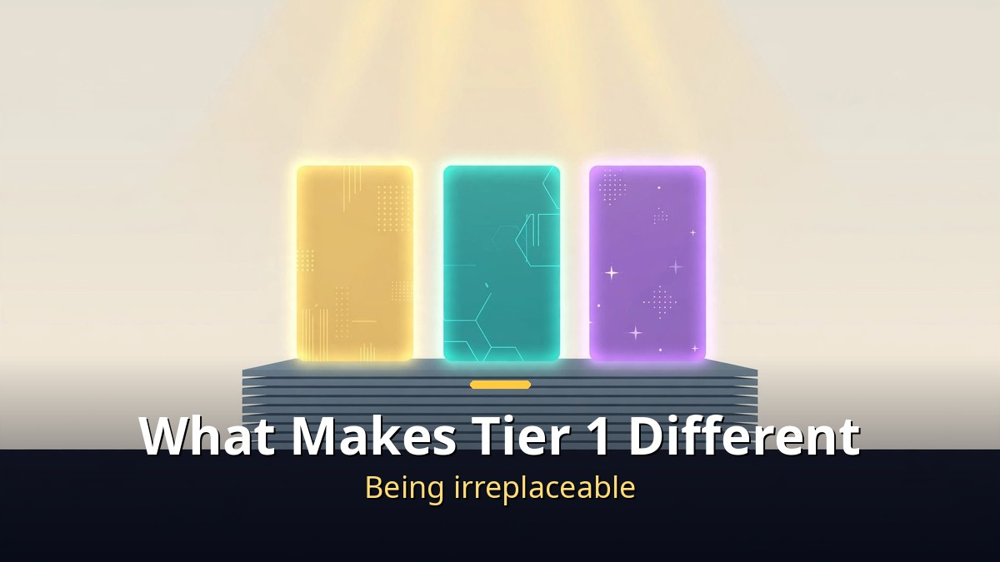

<!-- 본문 시작 -->

One person now pays almost 1 million won a month for AI subscriptions.
Claude, ElevenLabs, Higgsfield, ChatGPT, and more.
As the year ends, one question remains: "Do I really need all of this?"
So all 19 AI subscriptions people talk about most were checked one by one on their official pricing pages, and ranked on a single tier list.
This post does not copy that table as-is. It sorts it by price, replaceability, and overlapping payments.

> Key takeaway: Rank 19 AI subscriptions by value for money, and the expensive ones do not rise to the top. Tier 1 is Claude Max, Google AI Pro, and ElevenLabs. The $6-a-month ElevenLabs Starter takes first place because it is the cheapest way to unlock commercial use rights. Famous, pricey subscriptions sit lower for a different reason: they can be replaced for free, or they charge you twice for the same thing.

## How were the 19 AI subscriptions ranked?

Do not read the price tag alone. Read the usage-limit fine print with it.

First, the criteria.
The table is built to save money.
There are five criteria.
Value for money carries the most weight: how much can you do with one month's fee.
Then come replaceability by a free plan or another service, quality of results, reviews from YouTubers, and how easy it is to pay in won and use in Korean.

All prices were checked on November 5, 2026, on each service's official pricing page.
Dollars are converted at 1,341 won per dollar.
YouTuber reviews were gathered from 33 videos, Korean and international.
The interesting part: when asked "if you could keep only one," the answers split cleanly.
Some said ChatGPT, some said Claude, some said Gemini.
So this table is not ranked by fame, but only by the criteria above.

| Tier | Service | Monthly price | One-line reason |
|---|---|---|---|
| Tier 1 | ElevenLabs Starter | $6 (about 8,000 won) | The cheapest door to commercial use rights and voice cloning |
| Tier 1 | Google AI Pro | 29,000 won | Same price, but Gemini + 2 TB + Flow + NotebookLM |
| Tier 1 | Claude Max | $110 (about 147,000 won) | 5x Pro usage + $100 of API credit a month |
| Tier 2 | GitHub Copilot Pro | $10 | $15 of credit + other companies' coding agents |
| Tier 2 | Claude Pro | $22 (about 30,000 won) | Best for writing, but its limit runs out fast |
| Tier 2 | ChatGPT Plus | 29,000 won | The widest range of things it can do; overkill for chat alone |
| Tier 2 | Suno Pro | 15,000 won | Almost no replacement if you sell the songs you make |
| Tier 3 | Kling Standard | $10 (first month $6.99) | The cheapest entry among video AI tools |
| Tier 3 | Ritton | Free | A Korean company, easy to use in Korean, a free alternative |
| Tier 3 | ChatGPT Go | 13,000 won | Cheaper than half of Plus, but ads may be included |
| Tier 3 | Typecast Basic | 9,500 won | About 60 minutes a month, commercial use allowed, pay in won |
| Tier 3 | Canva Pro | 99,000 won a year (about 8,250 won a month) | Closer to paying for templates and photos than for AI |
| Tier 4 | Midjourney Basic | $10 | Pretty pictures, but no free tier and unlimited starts at $30 |
| Tier 4 | Higgsfield Starter | $19 (up to $375) | Many models in one place, but the bill climbs fast as you use more |
| Tier 4 | Grok (inside X) | Plus about 10,000 won to Ultra 295,000 won | Worth it only if you use X a lot |
| Tier 5 | Runway Standard | $15 (about 20,000 won) | 625 credits make 52 seconds of video on the latest model; many replacements |
| Tier 5 | Perplexity Pro | $20 | The free plan's basic search is effectively unlimited |
| Tier 5 | Notion AI | Plus 14,000 won | AI is still a trial; the agent needs Business at 30,000 won |
| Tier 5 | Cursor | $8 | The most confusing price structure; the cheap plan only runs Grok models |

The numbers are as of November 5, 2026.
Pricing changes often.
This table has a shelf life, which we will come back to below.

## What makes the three Tier 1 subscriptions different?

Tier 1 is not about being cheap. It is about being irreplaceable.

First is Claude Max.
At $110 a month, about 147,000 won, it is not cheap.
But it offers five times the usage of Pro, access to the highest model, and $100 of API credit every month.
For someone who uses Claude all day, there is nothing to replace it with.
A new Ultra plan at $220 a month sits above it.

Second is Google AI Pro.
It costs 29,000 won a month, exactly the same as ChatGPT Plus.
But what you get is different.
Gemini comes with 2 TB of storage, Google Flow credits for making videos, and the NotebookLM tool.
For the same 29,000 won, Google gives you the most.
That is why it is Tier 1.

The last of Tier 1, and first in this table, is ElevenLabs.
Its cheapest Starter plan is $6 a month, about 8,000 won.
That price includes commercial use rights and voice cloning.
The free plan has no commercial use rights, so if you want to use a voice somewhere, this $6 is the cheapest way in.
If you only need Korean voices, the Tier 3 Typecast is a good alternative.

Tier 2 is worth a look too.
GitHub Copilot Pro costs $10 a month and includes $15 worth of credit, and it can also use other companies' coding agents such as Claude Code and Codex.
Reviewers said to pick it if the budget is tight.
The downside is that it only takes payment in English and in dollars.
Claude Pro is $22 a month, or $18 a month if paid annually.
Many said Claude is the best for writing.
The downside is the usage limit.
It runs out fastest, and some said a plan in the 20,000-won range is not enough.
ChatGPT Plus is 29,000 won a month.
It covers the widest range: image making, deep research, Codex, scheduled tasks.
But everyday chat works on the free plan too.
For people who only chat, there is a replacement, so it stays in Tier 2.

## Where is the money leaking through overlap?

Finding what overlaps matters more than finding what is missing from the table.

While building the table, three combinations stood out that many people pay for twice without noticing.
First is Cursor and Grok.
Look at the X subscription pricing table now: from the cheapest Plus plan up, Cursor, Grok, and X Premium benefits sit in one table.
If you pay for Cursor and Grok separately, check your payment history first.

Second is video AI.
Runway's pricing page lists Kling, Seedance, and Nano Banana together, and Higgsfield's page also lists Seedance and Nano Banana.
If you pay for Runway and also pay for Kling separately, you may be paying twice for the same company's model.
How to choose a video model is covered separately in [Same Prompt, 8 AI Video Models｜Why the Winner Split, and How to Choose](https://aitechnotesen.blogspot.com/2026/11/same-prompt-8-ai-video-modelswhy-winner.html).

Third is ChatGPT Plus and Google AI Pro.
Each is 29,000 won a month, so together they are 58,000 won.
But both services work for everyday chat on their free versions too.
If you pay for both, keep the one you use most often and use the free version for the other.

Usage limits matter as much as price.
Claude's official pricing page says the free and Pro plans have limits every five hours and every week.
Max gives five times Pro, and Ultra gives ten times Pro per week.
Gemini also says it has limits that refill every five hours, plus a weekly limit.
So even a plan in the 20,000-won range can hit a limit if you use it all day.
Read the price tag and the limit text together.

The official pages also list ways to save money.
First, student benefits.
Google says students can use AI Plus free for one year, GitHub Copilot has a separate verified student plan, and Perplexity offers a discounted Education Pro for students and educators.
Second, free allowances.
GitHub Copilot Free gives 2,000 completions a month, ElevenLabs Free gives 10,000 credits a month, and Typecast starts you with 3,000 credits, about five minutes.
But the free versions of ElevenLabs and Suno have no commercial use rights.
If you plan to publish what you make, check that part first.
Third, annual discounts.
Claude Pro drops to $18 a month when paid annually, Suno Pro drops to 12,000 won a month, and Midjourney and Runway are 20% cheaper annually.
If one service is certain to be used every day, annual payment is the easiest discount.

One last thing to remember.
This table has a shelf life.
YouTuber Eric Misho said five months ago that the top-ranked subscription then is one to cancel now.
So think twice before paying for a full year at once.
And there is a twist in the 1-million-won total.
Part of that ChatGPT spending is not a subscription at all, but the API, a pay-as-you-go plan.
Inside OpenAI, the cheapest and most expensive models differ 100 times in input price.
A monthly flat rate is not the only way to pay.
In April, MBC News reported overseas coverage saying the era of unlimited use for $20 a month, the so-called "AI pass" era, is coming to an end.

## Closing

The first thing to do after making the table was to open the card statement.
Counting how many subscriptions are charged is enough to see next month's bill.
Nobody needs all 19.
If you keep only one, what would it be? The criteria for choosing that one is the real use of this table.
Prices change, and the top rank changes too.
But the rule stays the same: one thing you use often, with no overlap.
Start by checking how many AI subscriptions are on this month's card statement.

## Frequently asked questions

**Q. If I keep only one of the 19, which should it be?**
A. Start from what you do. Claude for heavy writing, Google AI Pro for search and organizing together, ElevenLabs for selling voice work. The deciding question is not price, but "can the free version replace it?"

**Q. When were the prices in the table checked?**
A. November 5, 2026, on each service's official pricing page. Dollars are converted at 1,341 won per dollar. Prices change often, so check the official page again before paying.

**Q. When is the free version enough?**
A. For everyday chat, the free versions of ChatGPT and Gemini can be enough. For search alone, Perplexity's free plan offers effectively unlimited basic search. But commercial use is often blocked on free plans, so check the terms if you plan to publish what you make.

**Q. Is annual payment always cheaper?**
A. If one service is certain to be used every day, yes. Claude Pro, Suno, Midjourney, and Runway offer annual discounts. But the table's shelf life is about six months, so think twice before paying a full year at once.

## Recommended Reading

[A 109M Model Beat a 72B One?｜What Yann LeCun's JEPA Paper Really Proves — and Its Limits — the verification scope behind the small model's win](https://aitechnotesen.blogspot.com/2026/11/a-109m-model-beat-72b-onewhat-yann.html)
[A.I. Artificial Intelligence｜A Boy Robot Programmed to Love, and What It Means to Become Human — a robot boy who asks what love means](https://aitechnotesen.blogspot.com/2026/11/ai-artificial-intelligencea-boy-robot.html)
[I, Robot｜When Three Laws Shake, What Should a Detective Believe — a film that asks what human judgment is worth when rules wobble](https://aitechnotesen.blogspot.com/2026/11/i-robotwhen-three-laws-shake-what.html)

Check this month's card statement for how many AI subscriptions are charged. Follow along if you want to keep following this topic.

<!-- 본문 끝 -->

## 작업용 출처·이미지 정보 (업로드 제외)

- Source: 혼잡스 영상 zRwKtokyNeU(2026-11-06, 10:05, 스크립트 패널 0:00~10:00 확인 기준) + 가격 2026-11-05 공식 요금 페이지 기준(영상 확인)
- Images: images/01-hero-en.jpg ~ 04-img3-en.jpg / original illustration + English banner overlay (1200x675)
