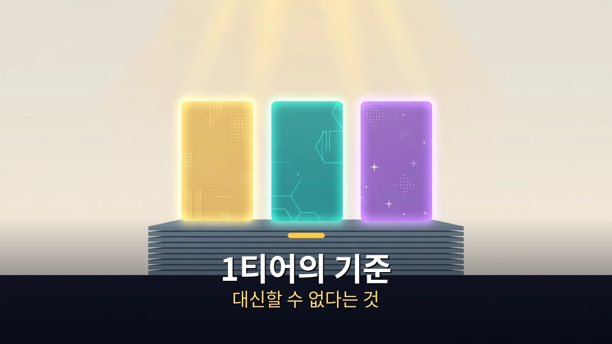
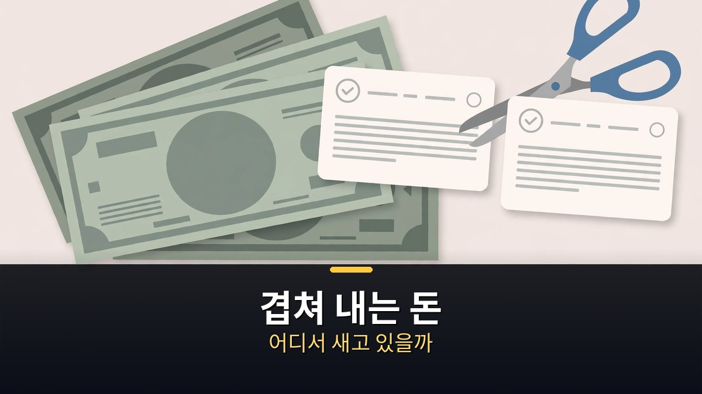

<!-- 본문 시작 -->

한 달 AI 구독료로 거의 100만 원을 내는 사람이 있다.
클로드, 일레븐랩스, 힉스필드, 챗GPT까지.
연말이 되자 "이거 정말 다 필요한 걸까"라는 질문이 남았다.
그래서 사람들이 많이 이야기하는 AI 구독 19개를 전부 공식 요금 페이지에서 확인하고, 한 장의 티어표로 줄을 세웠다.
이 글은 그 표를 그대로 옮기지 않고, 가격·대체 가능성·겹치는 결제를 기준으로 정리한다.

> 핵심 정리: 19개 AI 구독을 가성비 순으로 줄 세우면, 비싼 것이 위로 가지 않는다. 1티어는 클로드 맥스, 구글 AI 프로, 일레븐랩스다. 월 6달러짜리 일레븐랩스가 1등인 이유는, 상업 이용권을 가장 싸게 열어주기 때문이다. 반대로 비싸고 유명한 구독이 아래에 있는 이유는 따로 있다. 무료로 대신할 수 있거나, 같은 돈을 두 번 내는 구조이기 때문이다.

## AI 구독 19개는 어떤 기준으로 줄을 세웠을까?

가격표만 보지 말고, 한도 문구까지 같이 봐야 한다.

먼저 기준부터 밝힌다.
표는 '돈 아끼는 쪽'에 맞춰 만들었다.
기준은 다섯 가지다.
가장 무게를 많이 둔 것은 가성비다.
한 달 요금으로 할 수 있는 일이 얼마나 많은가다.
그다음은 무료나 다른 서비스로 대신할 수 있는가, 결과물이 얼마나 좋은가, 유튜버들의 평가가 어떤가, 한국에서 원화로 결제하고 한국어로 쓰기 편한가다.

가격은 전부 2026년 11월 5일에 공식 요금 페이지에서 본 값이다.
달러는 1달러에 1,341원으로 계산했다.
유튜버 평가는 국내외 영상 33편을 모아서 봤다.
재밌는 것은 "하나만 고르라면 무엇이냐"는 질문에 답이 딱 갈렸다는 점이다.
챗GPT를 고르는 사람, 클로드를 고르는 사람, 제미나이를 고르는 사람이 다 있었다.
그래서 이 표는 유명한 순서가 아니라, 위의 기준으로만 줄을 세웠다.

| 티어 | 서비스 | 월 요금 | 한 줄 이유 |
|---|---|---|---|
| 1티어 | 일레븐랩스 스타터 | 6달러(약 8,000원) | 상업 이용권+목소리 복제를 가장 싸게 여는 문 |
| 1티어 | 구글 AI 프로 | 29,000원 | 같은 값에 제미나이+2TB+플로우+노트북LM까지 |
| 1티어 | 클로드 맥스 | 110달러(약 147,000원) | 프로의 5배 사용량+월 100달러 API 크레딧 |
| 2티어 | 깃허브 코파일럿 프로 | 10달러 | 15달러어치 크레딧+다른 코딩 에이전트까지 |
| 2티어 | 클로드 프로 | 22달러(약 3만 원) | 글쓰기 최강, 단 사용 한도가 빨리 닳는다 |
| 2티어 | 챗GPT 플러스 | 29,000원 | 할 수 있는 일이 가장 넓다, 대화만 하면 과하다 |
| 2티어 | 수노 프로 | 15,000원 | 노래를 상업적으로 쓰려면 대신할 곳이 거의 없다 |
| 3티어 | 클링 스탠더드 | 10달러(첫 달 6.99달러) | 영상 AI 중 입구가 가장 싸다 |
| 3티어 | 리튼 | 무료 | 한국 회사, 한국어 바로 쓰기 편한 무료 대안 |
| 3티어 | 챗GPT Go | 13,000원 | 플러스의 반값보다 싸다, 단 광고가 포함될 수 있다 |
| 3티어 | 타입캐스트 베이직 | 9,500원 | 월 약 60분, 상업 이용 가능, 원화 결제 |
| 3티어 | 캔바 프로 | 연 99,000원(월 8,250원꼴) | AI보다 템플릿·사진 값에 가깝다 |
| 4티어 | 미드저니 베이직 | 10달러 | 그림은 예쁘지만 무료 단계가 없고 무제한은 30달러부터 |
| 4티어 | 힉스필드 스타터 | 19달러(최대 375달러) | 여러 모델을 한 곳에서, 단 쓸수록 요금이 빨리 오른다 |
| 4티어 | 그록(X 구독 내) | 플러스 약 1만 원~울트라 29만 5,000원 | X를 많이 쓰는 사람에게만 괜찮다 |
| 5티어 | 런웨이 스탠더드 | 15달러(약 2만 원) | 625크레딧으로 최신 모델 영상 52초, 대신할 곳이 많다 |
| 5티어 | 퍼플렉시티 프로 | 20달러 | 무료 플랜도 기본 검색은 사실상 무제한이다 |
| 5티어 | 노션 AI | 플러스 1만 4,000원 | AI는 아직 체험판, 에이전트는 비즈니스 3만 원부터 |
| 5티어 | 커서 | 8달러 | 요금 구조가 가장 헷갈린다, 싼 요금제는 그록 모델만 |

표의 숫자는 2026년 11월 5일 기준이다.
요금제는 자주 바뀐다.
이 표도 유효기간이 있다.
아래에서 유효기간 얘기를 다시 한다.

## 1티어 3개는 무엇이 달라서 위에 있을까?

1티어의 기준은 싸다는 것이 아니라, 대신할 수 없다는 것이다.

첫 번째는 클로드 맥스다.
한 달 110달러, 우리 돈 약 14만 7,000원이라 싸지는 않다.
하지만 프로보다 사용량이 다섯 배이고, 가장 높은 모델까지 쓸 수 있다.
매달 100달러어치 API 크레딧도 들어 있다.
클로드를 하루 종일 쓰는 사람에게는 이걸 대신할 것이 없다.
위로 한 달 220달러짜리 울트라도 새로 생겼다.

두 번째는 구글 AI 프로다.
가격은 한 달 29,000원, 챗GPT 플러스와 똑같다.
그런데 받는 것이 다르다.
제미나이에 2TB 저장 공간, 영상을 만드는 구글 플로우 크레딧, 노트 도구까지 같이 들어 있다.
같은 29,000원이라면 받는 양은 구글이 가장 많다.
그래서 1티어다.

1티어의 마지막, 이번 표의 1등은 일레븐랩스다.
가장 싼 스타터가 한 달 6달러, 우리 돈 8,000원 정도다.
이 값에 상업적으로 쓸 권리와 목소리 복제까지 들어 있다.
무료 플랜에는 상업적으로 쓸 권리가 없어서, 목소리를 어디에 쓰려면 이 6달러가 가장 싸게 문을 여는 길이다.
한국어 목소리만 필요하다면 3티어의 타입캐스트도 좋은 대안이다.

2티어도 짚을 만하다.
깃허브 코파일럿 프로는 한 달 10달러에 15달러어치 크레딧이 들어 있고, 클로드 코드나 코덱스 같은 다른 회사 코딩 에이전트도 쓸 수 있다.
예산이 적다면 이걸 고르라는 평가가 있었다.
아쉬운 점은 영어와 달러로만 결제한다는 것이다.
클로드 프로는 한 달 22달러, 1년을 한 번에 내면 한 달 18달러꼴이다.
글쓰기는 클로드가 가장 낫다는 평가가 많았다.
아쉬운 점은 사용 한도다.
한도가 가장 빨리 바닥난다는 지적이 있었고, 2만 원대 요금제로는 부족하다는 말도 나왔다.
챗GPT 플러스는 한 달 29,000원이다.
그림 만들기, 심층 리서치, 코덱스, 예약 작업까지 할 수 있는 일이 가장 넓다.
그런데 무료로도 일상 대화는 된다.
대화만 하는 사람에게는 대신할 거리가 있다는 뜻이다.
그래서 2티어에 머물렀다.

## 겹쳐 내는 돈은 어디서 새고 있을까?

표에서 빠진 것을 찾는 것보다, 겹쳐 내는 것을 찾는 것이 먼저다.

표를 만들다 보니, 많은 사람이 모르고 겹쳐서 내고 있을 조합이 세 가지 보였다.
첫 번째는 커서와 그록이다.
지금 X 구독 요금표를 보면 가장 싼 플러스부터 커서와 그록, X 프리미엄 혜택이 한 표 안에 같이 들어 있다.
커서와 그록을 따로따로 결제하고 있다면 결제 내역부터 한 번 보시기 바란다.

두 번째는 영상 AI다.
런웨이 요금표에는 클링과 시댄스, 나노 바나나가 같이 들어 있고, 힉스필드 요금표에도 시댄스와 나노 바나나가 있다.
런웨이를 내면서 클링을 또 따로 내고 있다면, 같은 회사 모델에 두 번 돈을 내고 있는 셈일 수 있다.
영상 모델을 고르는 기준은 [같은 프롬프트로 8개 AI 영상 모델을 돌렸더니｜1위가 갈린 이유와 고르는 법](https://aitechnoteskr.tistory.com/115)에서 따로 정리했다.

세 번째는 챗GPT 플러스와 구글 AI 프로다.
둘 다 한 달 29,000원이라 같이 내면 58,000원이다.
그런데 두 서비스 모두 무료 버전으로도 일상 대화는 된다.
둘 다 내고 있다면 정말 자주 쓰는 하나만 남기고 나머지는 무료로 써도 충분할 수 있다.

가격만큼 중요한 것이 사용 한도다.
클로드 공식 요금표에는 무료와 프로 모두 5시간마다, 그리고 매주 한도가 있다고 적혀 있다.
맥스는 프로의 다섯 배, 울트라는 매주 프로의 열 배다.
구글 제미나이도 5시간마다 새로 채워지는 한도와 주간 한도가 있다고 안내한다.
그러니까 2만 원대 요금제라도 하루 종일 쓰면 한도에 걸릴 수 있다.
가격표만 보지 말고 한도 문구까지 같이 봐야 한다.

돈을 아끼는 방법도 공식 페이지에 적혀 있었다.
먼저 학생 혜택이다.
구글은 학생이라면 AI 플러스를 1년간 무료로 쓸 수 있다고 안내하고, 깃허브 코파일럿도 인증된 학생용 플랜이 따로 있다.
퍼플렉시티 역시 학생과 교육자에게 할인된 에듀케이션 프로를 안내하고 있다.
두 번째는 무료 한도다.
깃허브 코파일럿 무료는 한 달 2,000번 자동 완성, 일레븐랩스 무료는 한 달 1만 크레딧, 타입캐스트는 처음에 3,000크레딧, 약 5분 분량을 준다.
다만 일레븐랩스와 수노의 무료 버전은 상업적으로 쓸 권리가 없다.
만든 것을 어딘가에 올릴 생각이라면 이 부분은 꼭 확인해야 한다.
세 번째는 연간 결제 할인이다.
클로드 프로는 1년을 한 번에 내면 한 달 18달러꼴로 내려가고, 수노 프로도 1년으로 내면 한 달 12,000원꼴이다.
미드저니와 런웨이도 연간으로 내면 20% 싸다.
매일 쓰는 것이 확실한 하나라면 연간 결제가 가장 쉬운 할인이다.

마지막으로 하나만 기억하자.
이 표도 유효기간이 있다.
해외 유튜버 에릭 미쇼는 5개월 전에 1등이던 구독을 지금은 끊으라고 했다.
그래서 1년치를 한 번에 결제하기 전에는 한 번 더 생각해 보는 것이 좋다.
그리고 한 달 100만 원에는 반전이 하나 있다.
그중 챗GPT는 사실 구독이 아니라 API, 그러니까 쓴 만큼 내는 방식이다.
같은 오픈AI 안에서도 가장 싼 모델과 가장 비싼 모델은 입력 가격이 100배 차이 난다.
한 달 정액만 구독이 아니라, 쓴 만큼 내는 길도 있다는 뜻이다.
올해 4월 MBC 뉴스도 한 달 20달러면 무제한으로 쓰던 이른바 'AI 패스 시대'가 막을 내리고 있다는 해외 보도를 전했다.

## 마무리

표를 만들고 나서 제일 먼저 한 일은 카드 내역을 열어보는 것이었다.
몇 개가 나가는지 세어보는 것만으로, 다음 달에 낼 돈이 보인다.
19개를 다 쓸 필요는 없다.
하나만 남긴다면 무엇을 남길지, 그 하나를 고르는 기준이 이 표의 진짜 용도다.
가격은 바뀌고, 1등도 바뀐다.
그래도 "내가 자주 쓰는 것 하나에, 겹치지 않게"라는 기준은 그대로 쓸 수 있다.
이번 달 카드 내역에서 AI 구독이 몇 개 나가는지, 한 번 확인해 보는 것으로 시작하면 된다.

## 자주 묻는 질문

**Q. 19개 중 하나만 남긴다면 무엇을 남겨야 하나요?**
A. 용도부터 정해야 한다. 글을 많이 쓰면 클로드, 검색·정리를 함께 쓰면 구글 AI 프로, 목소리를 상업적으로 쓰면 일레븐랩스다. 하나를 고르는 기준은 가격이 아니라 "무료로 대신할 수 없는가"다.

**Q. 표의 가격은 언제 기준인가요?**
A. 2026년 11월 5일에 각 서비스 공식 요금 페이지에서 확인한 값이다. 달러는 1달러에 1,341원으로 계산했다. 요금제는 자주 바뀌니 결제 전에 공식 페이지를 다시 확인하는 것이 좋다.

**Q. 무료로도 충분한 경우는 어떤 경우인가요?**
A. 일상 대화만 한다면 챗GPT·제미나이 무료 버전으로 충분할 수 있다. 검색만 한다면 퍼플렉시티 무료 플랜의 기본 검색이 사실상 무제한이다. 다만 상업 이용은 무료 플랜에서 안 되는 경우가 많으니, 만든 것을 공개할 생각이라면 이용 조건을 확인해야 한다.

**Q. 연간 결제가 무조건 싼가요?**
A. 매일 쓰는 것이 확실한 하나라면 그렇다. 클로드 프로·수노·미드저니·런웨이에 연간 할인이 있다. 다만 표의 유효기간이 6개월 안팎이라, 1년치를 한 번에 결제하기 전에는 한 번 더 생각해 보는 것이 좋다.

## 함께 읽으면 좋은 글

[작은 모델이 거대 모델을 이겼다고?｜얀 르쿤 JEPA 논문, 숫자부터 따져보자 — 작은 모델이 이긴 숫자 뒤의 검증 범위](https://aitechnoteskr.tistory.com/114)
[화면 없는 노트북 — Hero Keyboard, 사기 전에 확인할 조건 — 화면을 빌려 쓰는 키보드 PC의 조건 정리](https://aitechnoteskr.tistory.com/107)
[A.I. 인공지능｜사랑하도록 프로그래밍된 소년 로봇, 인간이 된다는 것의 의미 — 감정을 가진 로봇 소년이 던지는 질문](https://aitechnoteskr.tistory.com/113)

이번 달 카드 내역에서 AI 구독이 몇 개 나가는지 꼭 한 번 확인해 보시기 바란다. 이 주제를 계속 따라가려면 이웃 추가를 눌러두면 된다.

<!-- 본문 끝 -->

## 작업용 출처·이미지 정보 (업로드 제외)

- 자료 출처: 혼잡스 영상 zRwKtokyNeU(2026-11-06, 10:05, 스크립트 패널 0:00~10:00 확인 기준) + 가격 2026-11-05 공식 요금 페이지 기준(영상 확인)
- 이미지: images/01-hero.jpg ~ 04-img3.jpg / 자작 일러스트 + 한글 배너 오버레이 (1200x675)
