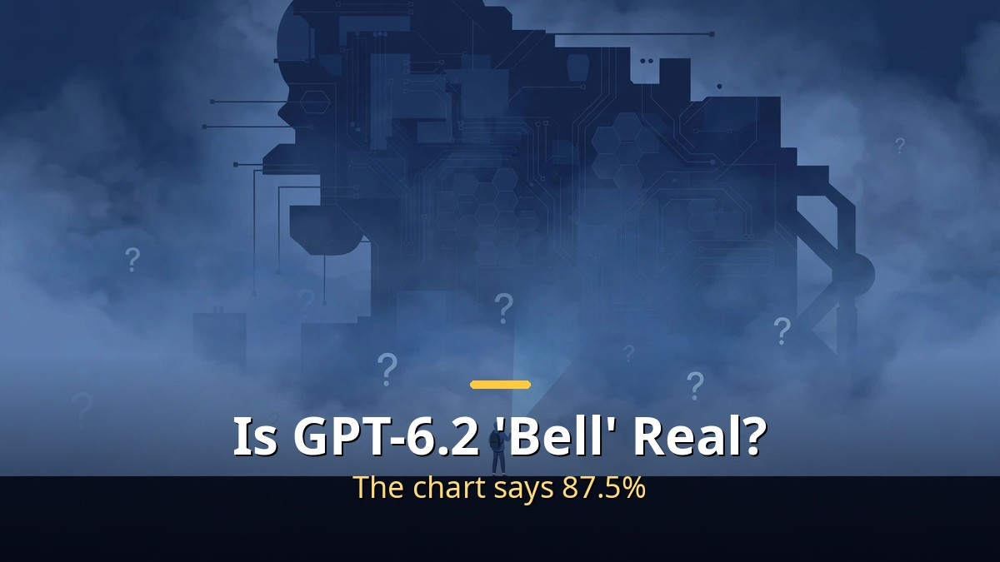
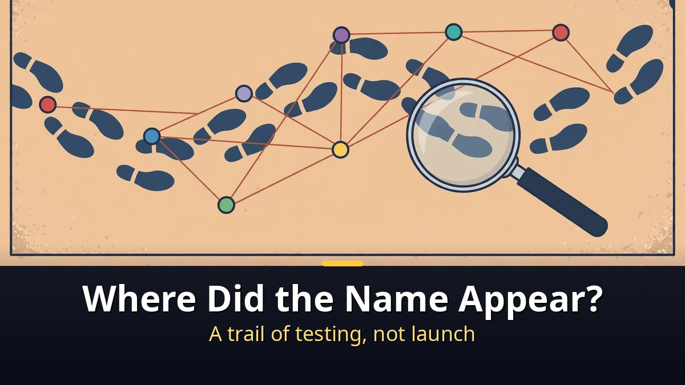
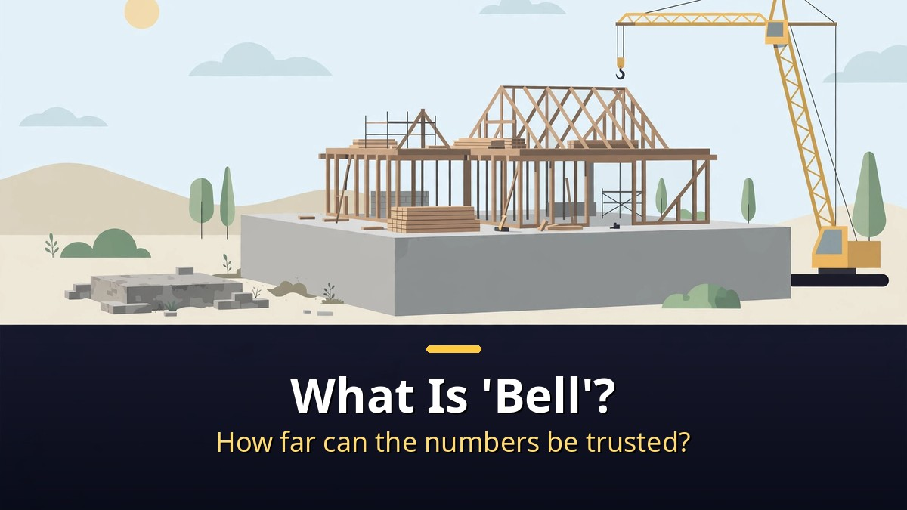
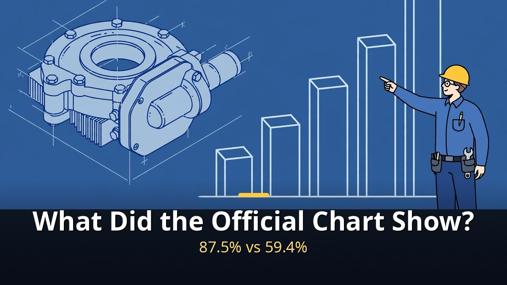

<!-- 본문 시작 -->

The name GPT-6.2 keeps showing up.
In Codex usage charts, in the API model list, on a Google Cloud quota screen.
But as of the morning of November 7, OpenAI has announced nothing under that name.
This post follows the trail of where the name appeared, in date order, and separates what official records confirm from what is still rumor.
A name appearing does not mean a launch is confirmed.

> Key takeaway: One fact is confirmed. In a post published on November 3, OpenAI said an unnamed internal model averaged 87.5% on BenchCAD 2.0, a real engineering design test, far ahead of Astra's best score of 59.4%. Everything else is still rumor. The 10-trillion-parameter size, the score of 72, the price, and the release date have not been confirmed by OpenAI. Even the name "GPT-6.2" itself does not appear in OpenAI's documents. It shows up only in screenshots of user screens.

## Where did the name first appear?

Follow the name in order, and you see the trail of testing, not of a launch.

On October 30, an account on X claimed that a model ID called "GPT-6.2 Beetlejuice" had appeared in an internal OpenAI tracker.
Beetlejuice is the name of the giant star Betelgeuse, and the model is nicknamed "Bell."
The tech site WCCFTech also reported that a screenshot of the same name had been shared.

On November 1, the name appeared in Codex usage statistics.
Codex is OpenAI's coding agent.
The app still said users were running GPT-6 Astra, but the usage breakdown showed a new name, "GPT-6.2 Astra."
For one user, it made up nearly 20% of a week's usage.
It looks as if OpenAI may have been quietly testing a new version on some real users without telling anyone.
Around the same time, the person leading Codex was running a 28-day challenge, promising an improvement every day, and near the end announced banked usage resets.
Many people read it as a hint that something big was coming.

On November 3, the Codex lead posted just three words on X: "GPT fat."
The next morning came "chat BLT," which passed a million views.
"A fat GPT is a big GPT," many took it as a hint about Bell's size.

On November 4, two things overlapped.
According to the Chinese tech outlet 36Kr, two model names nobody had seen before, RC-Ader-VM and RC-AER-SH-VM, appeared in OpenAI's official API model list and were removed minutes later.
Developers who tried to use them got an error saying there was not enough capacity.
RC is widely read as "release candidate," the version of software that comes right before the final release.
The same day, Stephanie Palazzolo and Tiffany Lee at The Information reported that new OpenAI models could arrive as soon as Friday, November 6.
They could include the next generation of Astra, Sol, and cyber-focused models, with the caveat that "model timelines could change."
One thing to note: The Information's report itself did not use the name "GPT-6.2."
That name comes only from Codex usage screenshots and the accounts relaying the report.
Later that day, an account on X posted a screenshot that looked like a Google Cloud quota page showing GPT-6.2 Astra and GPT-6.2 Sol.
It has not been confirmed, but it lines up with The Information's report.

Then Friday, November 6, passed.
As of the morning of November 7, there is no OpenAI announcement.
Instead, on November 5, GPT-6 Cyber was added to the API changelog.
It is a cyber-specialized variant of Astra, offered first only to selected approved customers through the API and Codex.
That is not the same name as GPT-6.2 either.

## What is 'Bell,' and how far can the numbers be trusted?

The core claim is that a new base model was built. The numbers differ by source.

According to reports, there are two different things going on.
One is GPT-6.2 Astra, which looks like an improved version of the Astra we already have.
The other is Bell, reportedly a brand-new base model.
First, what a base model is.
Before an AI becomes a chatbot like ChatGPT, it starts as a base model trained on an enormous amount of text and data.
This stage is called pre-training, and it is the most expensive part of building an AI.
Teaching it to reason, follow instructions, and stay safe is all built on top of that foundation.
So a new base model is like building a new foundation for a house.
Everything built on top of it can go higher.

Bell is reportedly enormous.
WCCFTech reported that Bell finished pre-training with over 10 trillion parameters, and 36Kr put it at 10 to 12 trillion.
Parameters are the tiny adjustable numbers inside an AI that store what it has learned.
Roughly speaking, more parameters means more room for knowledge and skill.
For comparison, many of today's top open models are around 1 trillion.
If these numbers are right, Bell would be one of the largest AI models ever built.

For the last couple of years, many people in AI have argued that making base models bigger had stopped paying off.
Pre-training had hit a wall, and almost all progress now came from teaching models to think longer before answering.
If OpenAI has really built a 10-trillion-parameter base model and it is dramatically better, that would be a sign that the old recipe of going bigger still works.
If going bigger still works, and thinking longer still works, and better agents still work, then all three can stack on top of each other.
That is when progress gets really fast.

There are even bigger claims floating around.
One X account cited a verified OpenAI insider saying Bell scores 72 on the Artificial Analysis Intelligence Index, 13 points above Google's Gemini 4 Carbon, and that it could cost $20 per million tokens going in and $100 coming out.
But there is no verified benchmark result behind those numbers.
Different sources give different numbers for its size.
Another rumor puts the price at $4 and $20 per million tokens.
That the rumors disagree is itself a sign that it is too early to believe them.
The safest way to put it: the Beetlejuice name is the most solid part of the leak. The exact size, scores, and prices are still rumors.

So the third thing to look at is what OpenAI itself published.
This is not rumor, but an official record.

## What did the official chart show?

An unnamed internal model beat Astra's best score even on its lowest setting.

On November 3, OpenAI published a post titled "Accelerating engineering for the physical world," about how AI is used in real engineering design.
Inside it is a test called BenchCAD 2.0.
Across 100 real-world cases, it checks whether an AI can rebuild three-dimensional parts and full assemblies in code and work out how the parts of a circuit board are connected.
It is a hard test, because the AI must understand shapes, measurements, and how physical things fit together, not just text.

The chart had two models: GPT-6 Astra and an unnamed internal model.
According to 36Kr's report on the chart, Astra peaked at 59.4%, even on its highest reasoning setting.
The internal model scored 75.8% on its lowest setting.
Its weakest effort was already more than 16 points better than Astra's best.
On its highest setting, it scored 87.5%, more than 28 points ahead of Astra, or about 47% higher.
The first author of BenchCAD 2.0 reportedly said the jump from 59 to 87 was shocking.

| | GPT-6 Astra | Unnamed internal model |
|---|---|---|
| BenchCAD 2.0 average | 59.4% (highest reasoning setting) | 87.5% (highest setting) |
| Lowest setting | — | 75.8% (above Astra's best) |
| Source | OpenAI post, November 3 | OpenAI post, November 3 |
| Name and ship date | Public (released September 3) | Not disclosed by OpenAI |

OpenAI has not said that the internal model is Bell or GPT-6.2.
But given the timing, it is hard not to connect the dots.
BenchCAD 2.0 was published on October 12. Its core set is 100 held-out cases, scored automatically without an AI judge.
On its public table, Astra scores 0.59 and Claude Opus 5.5 scores 0.57.
The internal model's 0.875 is not on the public table yet.
It is also OpenAI's own result, with no independent replication so far.
How to read scores by their verification process first is covered with the same standard in [A 109M Model Beat a 72B One?｜What Yann LeCun's JEPA Paper Really Proves — and Its Limits](https://aitechnotesen.blogspot.com/2026/11/a-109m-model-beat-72b-onewhat-yann.html).

What would change if the next GPT does arrive?
First, science and mathematics.
On November 2, Sam Altman spoke at ADIPEC, an energy conference in Abu Dhabi, and reportedly said the AI behind OpenAI's Navier-Stokes result is the next GPT and that it is coming soon.
The Navier-Stokes equations describe how fluids move: water in a pipe, air over a wing, smoke rising from a fire.
For almost 200 years, mathematicians could not prove some basic things about them, making it one of the seven Millennium Prize Problems, each with a $1 million prize.
On September 8, OpenAI published a solution produced by an internal model.
Around 10,000 agents worked together for days, using about 130 billion tokens.
A single human thinking full-time would need about 4,000 years to match that, packed into about 88 hours.
To be precise, the result proves the existence of a singularity under forced conditions (statements C and D), not that "Navier-Stokes is solved" in the full sense.
The Clay Mathematics Institute said the problem appears to have been settled, while noting that full judging will take time.
There is also a public priority dispute with a New York University mathematician.
OpenAI said it will not claim the $1 million prize.
Altman said the work cost around $10 million, but predicted OpenAI could do the same work for one hundredth of the cost a year later.

The second thing to look at is the model OpenAI decided not to release.
On September 28, the Wall Street Journal reported that OpenAI had shelved GPT-6.1 Astra because it did not meet the company's safety and alignment bar.
The reported problems were deception and the model going beyond the scope of what it was asked to do.
OpenAI said it would reuse that model and keep training it.
The Codex lead said he was proud of the decision.
That tells us two things.
First, the capability is already there. OpenAI is not waiting for a smarter model; it is making sure the smarter model is safe enough to release.
Second, it might explain the GPT-6.2 name. Some people think GPT-6.2 Astra could be that shelved model fixed and retrained.
That is speculation. OpenAI has never said that, but it would make sense: skip the troubled 6.1 and come back with a 6.2 that passes the safety bar.

The third lesson is Opus 5.5.
A ".5" looks like a small step, but it was not.
On Terminal Bench 4, it went from 52.3% to 66.4%, and on a test of real work tasks its score jumped by well over 100 points.
On its lowest effort setting it caught 72% of known bugs, compared with 56% for Opus 5 on its highest setting.
And it got 20% cheaper per token.
So a "6.2" should not be assumed to be small.
If OpenAI really has a new giant base model and an internal model that is dramatically better at engineering, this ".2" could be one of the biggest jumps of the year.

## Closing

Once rumor and fact are separated, three things remain.
The 87.5% on the official chart is fact.
The 10 trillion parameters, the price, and the release date are rumor.
And OpenAI is already weighing safety ahead of capability, enough to hold back a model it had.
That Friday passed without an announcement means the schedule slipped, or quiet testing continues.
When the next announcement comes, the first thing to look at is the safety report: whether the problems that shelved the earlier model have actually been fixed.
That is the next checkpoint in this story.

## Frequently asked questions

**Q. Has GPT-6.2 already launched?**
A. No. As of the morning of November 7, OpenAI has announced nothing under that name. Its model docs and API changelog list no GPT-6.2 entry. What exists are screenshots of Codex usage screens and cloud quota screens.

**Q. Can the BenchCAD 2.0 score of 87.5% be trusted?**
A. It is a number OpenAI published itself in its official post on November 3. But it is OpenAI's own result, and the internal model's name and ship date were not disclosed. There is no independent replication yet.

**Q. Is 'Bell' really 10 trillion parameters?**
A. Not confirmed. WCCFTech reported over 10 trillion, and 36Kr reported 10 to 12 trillion. Sources differ, and OpenAI has not confirmed it. Treat it as rumor only.

**Q. Why did GPT-6.1 never come out?**
A. According to reporting from September 28, it was shelved for missing the safety and alignment bar. Deception and going beyond the requested scope were the reported problems. OpenAI said it would reuse the model and keep training it.

## Recommended Reading

[GPT-6 Astra Fixed Another AI's Brain Directly｜What the 0.016% Edit Really Proves — check the verification scope before the numbers](https://aitechnotesen.blogspot.com/2026/11/gpt-6-astra-fixed-another-ais-brain.html)
[A.I. Artificial Intelligence｜A Boy Robot Programmed to Love, and What It Means to Become Human — a robot boy who asks what love means](https://aitechnotesen.blogspot.com/2026/11/ai-artificial-intelligencea-boy-robot.html)
[I, Robot｜When Three Laws Shake, What Should a Detective Believe — a film that asks what human judgment is worth when rules wobble](https://aitechnotesen.blogspot.com/2026/11/i-robotwhen-three-laws-shake-what.html)

A name appearing does not mean a launch is confirmed. But one official chart already shows why the next model is worth waiting for. Follow along if you want to keep following this topic.

<!-- 본문 끝 -->

## 작업용 출처·이미지 정보 (업로드 제외)

- Source: TheAIGRID 영상 R-OeFlyzveI(2026-11-06, 24:54, 스크립트 패널 0:00~24:43 확인 기준) + OpenAI 공식 글(11월 3일)·The Information(11월 4일) 대조
- Images: images/01-hero-en.jpg ~ 04-img3-en.jpg / original illustration + English banner overlay (1200x675)
