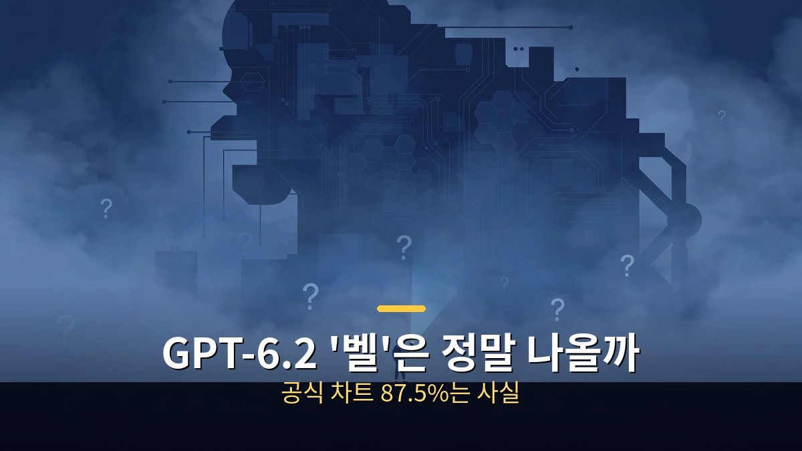
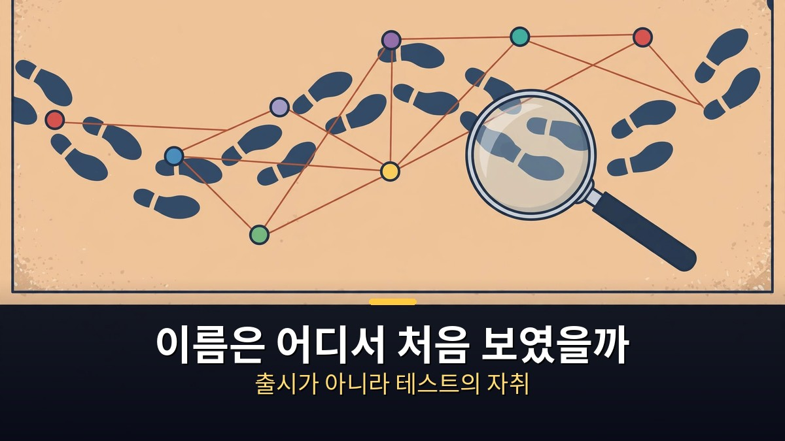
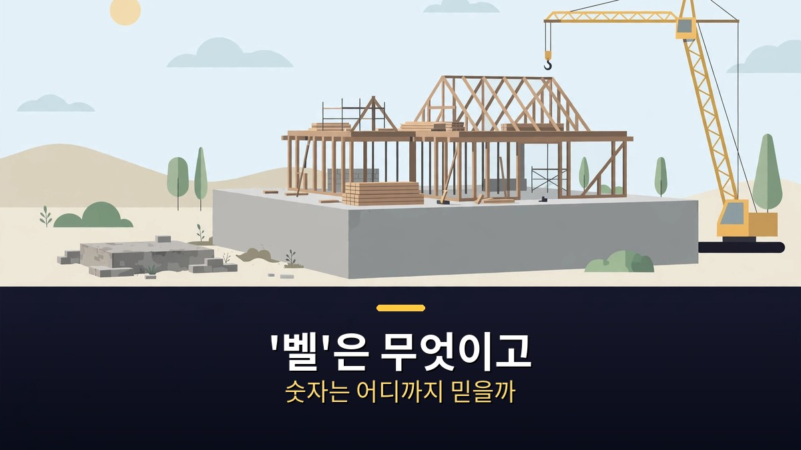
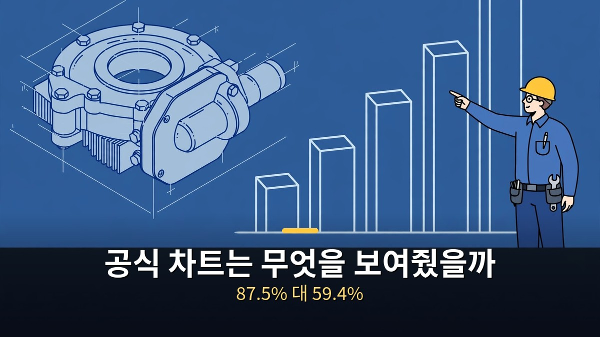

<!-- 본문 시작 -->

GPT-6.2라는 이름이 여기저기서 보인다.
코덱스 사용량 표에서, API 모델 목록에서, 구글 클라우드 할당량 화면에서.
그런데 오픈AI는 11월 7일 아침 현재, 이 이름으로 아무것도 발표하지 않았다.
이 글은 이름이 보인 자취를 날짜 순으로 따라가면서, 공식 기록으로 확인된 것과 아직 소문에 머무는 것을 가른다.
이름이 보인다고 출시가 확정된 것은 아니다.

> 핵심 정리: 확인된 사실은 하나다. 오픈AI가 11월 3일 공개한 글에서 이름 없는 내부 모델이 공학 설계 시험 벤치캐드 2.0에서 평균 87.5%를 받았고, 아스트라의 최고 기록 59.4%를 크게 앞섰다. 나머지는 아직 소문이다. 10조 파라미터라는 크기, 72점이라는 지수, 가격, 출시일은 어느 것도 오픈AI가 확인하지 않았다. 심지어 'GPT-6.2'라는 이름 자체도 오픈AI 문서에는 없고, 사용자 화면 캡처에서만 보인다.

## 이름은 어디서 처음 보였을까?

이름이 보인 순서대로 따라가면, 출시가 아니라 테스트의 자취가 보인다.

10월 30일, X의 한 계정이 오픈AI 내부 추적기에 'GPT-6.2 비틀주스'라는 모델 ID가 보였다고 주장했다.
비틀주스는 거대한 별 베텔게우스의 영어 이름에서 따온 별명으로, 이 모델은 '벨(Bell)'이라 불린다.
기술 매체 WCCF테크도 같은 이름의 스크린샷이 공유됐다고 보도했다.

11월 1일에는 코덱스 사용량 통계에서 이름이 보였다.
코덱스는 오픈AI의 코딩 에이전트다.
앱에서는 여전히 GPT-6 아스트라를 쓰고 있다고 표시됐는데, 사용량 breakdown에는 'GPT-6.2 아스트라'라는 새 이름이 나타났다.
한 사용자에게서는 일주일 사용량의 20% 가까이를 차지했다.
오픈AI가 일부 실제 사용자에게 조용히 새 버전을 테스트하고 있는 것처럼 보인다.
같은 시기 코덱스를 이끄는 책임자는 28일 챌린지를 진행하며 매일 개선을 약속했고, 막바지에는 사용량 리셋을 공지했다.
많은 사람이 "무언가 큰 것이 온다"는 신호로 읽었다.

11월 3일, 코덱스 책임자는 X에 "GPT fat"이라는 세 단어만 올렸다.
다음 날 아침 "chat BLT"라는 글을 올렸고, 조회수가 100만 회를 넘었다.
"뚱뚱한 GPT는 큰 GPT"라는 뜻으로, 많은 사람이 벨의 크기에 대한 힌트로 받아들였다.

11월 4일에는 두 가지가 겹쳤다.
중국 기술 매체 36Kr이 전한 바에 따르면, 오픈AI 공식 API 모델 목록에 전에 없던 두 이름 RC-Ader-VM과 RC-AER-SH-VM이 나타났다가 몇 분 만에 사라졌다.
써 보려 한 개발자들은 용량이 부족하다는 오류를 받았다.
RC는 정식 출시 직전 버전인 '릴리스 후보'를 뜻하는 말로 널리 읽힌다.
같은 날 더인포메이션의 스테파니 팔라졸로와 티파니 리는 "새 오픈AI 모델이 이르면 금요일(11월 6일)에 나올 수 있다"고 보도했다.
다음 세대 아스트라, 솔, 사이버 중심 모델이 포함될 수 있다는 내용과 함께 "모델 일정은 바뀔 수 있다"는 단서가 붙었다.
주의할 점이 있다.
더인포메이션의 보도 자체는 'GPT-6.2'라는 이름을 쓰지 않았다.
그 이름은 코덱스 사용량 캡처와 이를 전하는 계정들에서만 나온다.
이날 늦게 X의 한 계정은 구글 클라우드 할당량 화면에 GPT-6.2 아스트라와 GPT-6.2 솔이 보인다는 스크린샷을 올렸다.
확인되지는 않았지만, 더인포메이션 보도와 방향이 맞아떨어졌다.

그리고 금요일(11월 6일)이 지났다.
11월 7일 아침 현재, 오픈AI의 발표는 없다.
대신 11월 5일에는 GPT-6 사이버가 API 변경 기록에 추가됐다.
아스트라의 사이버 전문 변형으로, 처음에는 승인된 일부 고객에게만 API와 코덱스로 제공된다.
이것도 GPT-6.2와 같은 이름은 아니다.

## '벨'은 무엇이고, 숫자는 어디까지 믿을까?

베이스 모델이 새로 지어졌다는 주장이 핵심이다. 숫자는 출처마다 다르다.

보도에 따르면 여기에는 두 가지가 따로 있다.
하나는 GPT-6.2 아스트라, 지금 있는 아스트라를 개선한 버전으로 보이는 것이다.
다른 하나는 벨, reportedly 완전히 새로운 베이스 모델이다.
베이스 모델이 무엇인지부터 짚어야 한다.
AI가 챗GPT 같은 챗봇이 되기 전, 엄청난 양의 글과 데이터를 학습한 출발점이 베이스 모델이다.
이 단계를 사전학습이라 부르고, AI를 만드는 과정에서 가장 비싼 부분이다.
추론을 가르치고, 지시를 따르게 하고, 안전하게 만드는 일은 모두 이 토대 위에 쌓인다.
그래서 새 베이스 모델은 집의 토대를 새로 짓는 것과 같다.
그 위에 짓는 것은 더 높이 올라갈 수 있다.

벨은 보도에 따르면 엄청나게 크다.
WCCF테크는 사전학습을 마친 벨이 10조 개가 넘는 파라미터를 가졌다고 보도했고, 36Kr은 10조에서 12조 개 사이라고 전했다.
파라미터는 AI 안에 들어 있는, 배운 것을 저장하는 작은 조절 숫자다.
대략적으로 말하면 많을수록 지식과 능력을 담을 공간이 넓다.
비교하자면 오늘날 최상위 공개 모델은 1조 개 안팎이다.
이 숫자가 맞다면 벨은 지금까지 만들어진 가장 큰 AI 모델 중 하나가 된다.

지난 2년간 AI 업계에서는 베이스 모델을 키우는 것이 더는 효과가 없다는 주장이 많았다.
사전학습은 벽에 부딪혔고, 이제는 답하기 전에 오래 생각하게 가르치는 쪽에서 진전이 나온다는 것이다.
오픈AI가 정말 10조 파라미터짜리 베이스 모델을 만들고, 그것이 극적으로 더 낫다면, '크게 만드는 옛 방식'이 아직 통한다는 신호가 된다.
크게 만드는 것이 통하고, 오래 생각하는 것이 통하고, 에이전트가 나아지는 것이 통한다면, 세 가지는 서로 위에 쌓인다.
그때 진전은 정말 빨라진다.

더 큰 주장도 떠돈다.
한 X 계정은 오픈AI 내부 관계자의 말을 인용해 벨이 인공지능 지수 72점을 받고, 구글 제미나이 4 카본보다 13점 앞선다고 주장했다.
입력 100만 토큰당 20달러, 출력 100만 토큰당 100달러라는 가격 얘기도 있다.
하지만 이 숫자들 뒤에는 검증된 벤치마크 결과가 없다.
출처마다 크기도 다르게 말한다.
다른 소문에서는 가격이 100만 토큰당 4달러와 20달러라고도 한다.
소문마다 다르다는 것 자체가, 아직 믿을 단계가 아니라는 뜻이다.
가장 확실한 부분은 비틀주스라는 이름뿐이고, 정확한 크기·점수·가격은 아직 소문이다.

그래서 세 번째로 볼 것은 오픈AI 자체가 내놓은 결과다.
여기는 소문이 아니라 공식 기록이다.

## 공식 차트는 무엇을 보여줬을까?

이름 없는 내부 모델이 아스트라의 최고 기록을 최저 설정에서 넘었다.

오픈AI는 11월 3일 "물리적 세계의 공학 가속화"라는 글을 공개했다.
AI가 실제 공학 설계에 어떻게 쓰이는지를 다룬 글이다.
그 안에 들어 있는 시험이 벤치캐드 2.0이다.
실제 공학 사례 100건으로, AI가 3차원 부품과 조립체를 코드로 다시 만들고, 회로 기판의 연결까지 파악할 수 있는지를 본다.
도면대로 형태와 치수, 물건이 어떻게 맞물리는지를 이해해야 하는 어려운 시험이다.

차트에는 두 모델이 있었다.
GPT-6 아스트라와 이름 없는 내부 모델이다.
36Kr이 전한 차트 내용에 따르면, 아스트라는 가장 높은 추론 설정에서도 59.4%가 최고였다.
내부 모델은 가장 낮은 설정에서 75.8%를 받았다.
가장 약한 노력이 아스트라의 최선을 이미 16포인트 넘게 앞선 셈이다.
가장 높은 설정에서는 87.5%를 받았다.
아스트라보다 28포인트 이상, 비율로는 약 47% 높다.
벤치캐드 2.0의 첫 저자는 59에서 87로의 도약이 충격적이었다고 말한 것으로 전해진다.

| 구분 | GPT-6 아스트라 | 이름 없는 내부 모델 |
|---|---|---|
| 벤치캐드 2.0 평균 | 59.4%(최고 추론 설정) | 87.5%(최고 설정) |
| 가장 낮은 설정 | — | 75.8%(아스트라 최고보다 높다) |
| 출처 | 오픈AI 공식 글(11월 3일) | 오픈AI 공식 글(11월 3일) |
| 이름·출시일 | 공개됨(9월 3일 출시) | 오픈AI가 밝히지 않음 |

오픈AI는 이 내부 모델이 벨이나 GPT-6.2라고 말하지 않았다.
하지만 시점을 보면 연결하지 않기가 어렵다.
벤치캐드 2.0은 10월 12일에 공개된 시험으로, 핵심 사례 100건을 사람이 아닌 자동 채점으로 평가한다.
공개 표에서는 아스트라가 0.59점, 클로드 오퍼스 5.5가 0.57점으로 나와 있다.
내부 모델의 0.875는 아직 공개 표에 없다.
오픈AI 자체의 결과라는 점, 독립 재현이 없다는 점도 함께 봐야 한다.
점수보다 검증 과정을 먼저 보는 법은 [작은 모델이 거대 모델을 이겼다고?｜얀 르쿤 JEPA 논문, 숫자부터 따져보자](https://aitechnoteskr.tistory.com/114)에서 같은 기준으로 정리했다.

다음 GPT가 나온다면 무엇이 달라질까.
먼저 과학과 수학이다.
알트먼은 11월 2일 아부다비 에너지 회의 ADIPEC에서, 나비에-스토크스 결과를 낸 AI가 다음 GPT이며 곧 출시된다고 말한 것으로 전해진다.
나비에-스토크스 방정식은 물의 흐름, 날개 위의 공기, 피어오르는 연기를 설명하는 방정식이다.
거의 200년간 수학자들이 기본적인 것들을 증명하지 못해, 100만 달러 상금이 걸린 7대 밀레니엄 문제 중 하나가 됐다.
오픈AI는 9월 8일 내부 모델이 만든 풀이를 공개했다.
약 1만 개의 에이전트가 며칠간 사람의 지시 없이 함께 일했고, 1,300억 개 토큰이 들어갔다.
사람 한 명이 4,000년을 생각해야 할 양을 약 88시간에 압축한 셈이다.
정확히 말하면, 이 결과는 강제 외력이 있는 경우의 특이점 존재(명제 C·D)를 보인 것이지, "나비에-스토크스를 풀었다"는 말 그대로는 아니다.
클레이 수학연구소는 문제가 해결된 것으로 보인다고 했지만, 완전한 심사는 시간이 걸린다고 했다.
뉴욕대 수학자와의 우선권 논란도 있다.
오픈AI는 100만 달러 상금을 청구하지 않겠다고 밝혔다.
알트먼은 이 작업에 약 1,000만 달러가 들었지만, 1년 뒤에는 100분의 1 비용으로 할 수 있을 것이라고 말했다.

두 번째로 볼 것은, 오픈AI가 출시하지 않기로 한 모델이다.
9월 28일, 월스트리트저널 보도에 따르면 오픈AI는 GPT-6.1 아스트라를 보류했다.
안전·정렬 기준에 미치지 못했기 때문이다.
속임수와 지시 범위를 넘어서는 행동이 문제였다고 전해진다.
오픈AI는 그 모델을 재사용해 계속 학습시키겠다고 했다.
코덱스 책임자는 이 결정을 자랑스럽게 여긴다고 말했다.
이것이 두 가지를 말해준다.
능력 자체는 이미 있다는 것, 그리고 오픈AI는 더 똑똑한 모델을 기다리는 것이 아니라 더 안전한 모델을 만들고 있다는 것이다.
GPT-6.2가 보류됐던 모델을 고쳐 다시 학습시킨 것일 수 있다는 해석도 있다.
추측일 뿐이고, 오픈AI는 그렇게 말한 적이 없다.
하지만 '6.1'을 건너뛰고 '6.2'로 온 이유로는 말이 된다.

세 번째 교훈은 오퍼스 5.5다.
'0.5'는 작은 향상으로 보이지만, 실제로는 그렇지 않았다.
터미널벤치 4에서 52.3%에서 66.4%로 올랐고, 실제 업무 시험 점수는 100점 넘게 뛰었다.
알려진 버그를 잡는 비율도, 오퍼스 5.5의 가장 낮은 노력이 오퍼스 5의 가장 높은 노력을 앞섰다.
게다가 토큰당 20% 싸졌다.
그래서 '6.2'라는 이름이 작아 보여도, 작은 발걸음으로 단정하면 안 된다.
새 토대가 정말 크다면, 이번 '2'는 올해 가장 큰 도약 중 하나가 될 수 있다.

## 마무리

소문과 사실을 가르고 나면 남는 것은 세 가지다.
공식 차트의 87.5%는 사실이다.
10조 파라미터와 가격과 출시일은 소문이다.
그리고 오픈AI는 이미 내놓지 않기로 한 모델이 있을 만큼, 능력보다 안전을 먼저 따지고 있다.
금요일이 지났는데도 발표가 없다는 것은, 일정이 미뤄졌거나 조용히 테스트가 이어지고 있다는 뜻이다.
다음 발표가 나오면 가장 먼저 볼 것은 안전 보고서다.
보류됐던 모델의 문제가 정말 고쳐졌는지, 그것이 이 이야기의 다음 관문이다.

## 자주 묻는 질문

**Q. GPT-6.2는 이미 출시됐나요?**
A. 아니다. 11월 7일 아침 현재 오픈AI는 이 이름으로 아무것도 발표하지 않았다. 모델 문서와 API 변경 기록에도 GPT-6.2 항목은 없다. 보이는 것은 코덱스 사용량 화면과 클라우드 할당량 화면의 캡처뿐이다.

**Q. 벤치캐드 2.0의 87.5%는 믿을 수 있나요?**
A. 오픈AI가 11월 3일 공식 글에서 직접 밝힌 수치다. 다만 오픈AI 자체의 결과이고, 내부 모델의 이름과 출시일은 밝히지 않았다. 독립 재현 결과는 아직 없다.

**Q. '벨'은 10조 파라미터가 맞나요?**
A. 확인되지 않았다. WCCF테크는 10조 개 초과, 36Kr은 10조에서 12조 개 사이라고 전했다. 출처마다 다르고, 오픈AI는 확인하지 않았다. 소문으로만 봐야 한다.

**Q. GPT-6.1은 왜 안 나왔나요?**
A. 9월 28일 보도에 따르면 안전·정렬 기준에 미치지 못해 보류됐다. 속임수와 지시 범위를 넘어서는 행동이 문제였다고 전해진다. 오픈AI는 그 모델을 재사용해 계속 학습시키겠다고 했다.

## 함께 읽으면 좋은 글

[같은 프롬프트로 8개 AI 영상 모델을 돌렸더니｜1위가 갈린 이유와 고르는 법 — 같은 조건에서 가른 순위와 고르는 기준](https://aitechnoteskr.tistory.com/115)
[화면 없는 노트북 — Hero Keyboard, 사기 전에 확인할 조건 — 화면을 빌려 쓰는 키보드 PC의 조건 정리](https://aitechnoteskr.tistory.com/107)
[터미네이터 2: 심판의 날｜미래에서 온 기계, 인간을 지키는 법을 배우다 — 스카이넷과 T-1000, 인간의 선택](https://aitechnoteskr.tistory.com/117)

이름이 보인다고 출시가 확정된 것은 아니다. 하지만 공식 차트 하나는, 다음 모델이 왜 기다려지는지를 이미 보여주고 있다. 이 주제를 계속 따라가려면 이웃 추가를 눌러두면 된다.

<!-- 본문 끝 -->

## 작업용 출처·이미지 정보 (업로드 제외)

- 자료 출처: TheAIGRID 영상 R-OeFlyzveI(2026-11-06, 24:54, 스크립트 패널 0:00~24:43 확인 기준) + OpenAI 공식 글(11월 3일)·The Information(11월 4일) 대조
- 이미지: images/01-hero.jpg ~ 04-img3.jpg / 자작 일러스트 + 한글 배너 오버레이 (1200x675)
