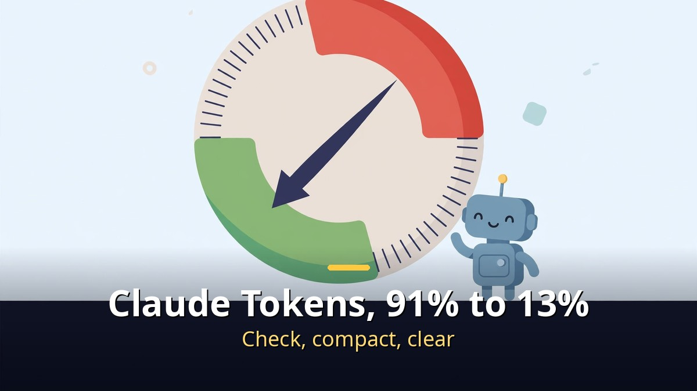
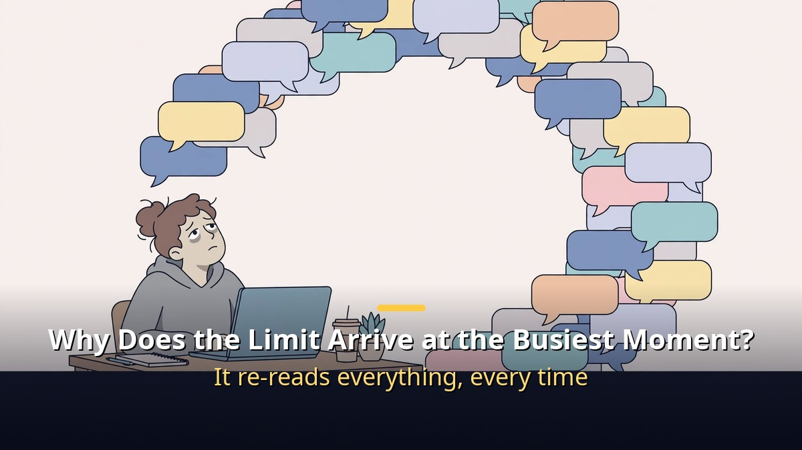
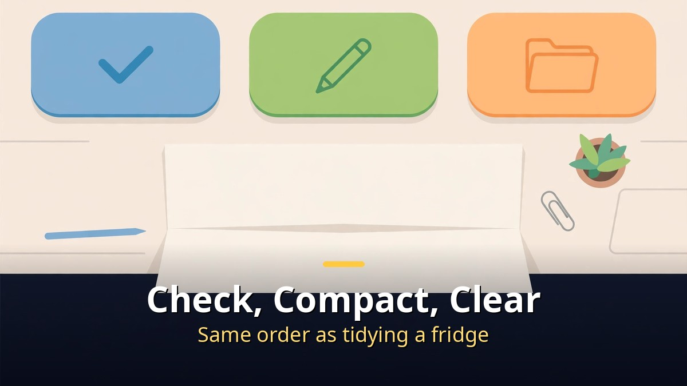
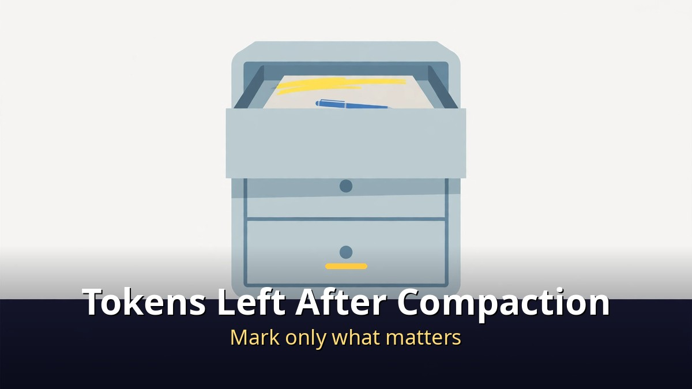

<!-- 본문 시작 -->

In Claude Code, a conversation window filled up to 914,000 of 1,000,000 tokens.
91%.
One or two more messages, and automatic compaction would have started.
After compaction, the number read 128,513 tokens, about 13%.
If that were a diet ad, suspicion would come first.
This post follows that process and explains how three commands cut tokens, and how to manage the tokens that remain after compaction.

> Key takeaway: There are exactly three moves. Check, compact, and clear. Use /context to see how full the window is, category by category. Use /compact to fold a long conversation into a single summary. When the work changes, use /clear to open a fresh conversation. In the measured test, one compaction cut 914,000 tokens to 128,000. The biggest drop came from the conversation itself, and compaction only shrinks the conversation. What was read from files stays.

## Why does the limit always arrive at the busiest moment?

Every message makes Claude re-read the whole conversation from the start.

A token is a piece of text Claude reads and writes.
The more you use, the faster the limit runs out.
You know the feeling: work is going well, then it stops at the limit.
Something decided earlier is forgotten, and Claude answers as if hearing it for the first time.
As the conversation grows, answers get slower.
Then suddenly it compacts the conversation on its own, without telling you what disappeared.
The limit always arrives at the busiest moment.

Why does that happen?
Because with every message, Claude re-reads the conversation from the beginning.
The longer the conversation, the more there is to re-read.
The new answer is this small, and what gets re-read is this large.
Re-reading is cheap per token.
But it piles up, and by this week the limit was already more than half gone.
It re-reads everything from the start, every time.
Diligent, and expensive.
That is where this post starts.

One thing to note first.
The three commands below are about Claude Code, the tool used from a terminal window by typing commands as text.
If you only use the app, the same idea applies: save what matters as a note, and continue in a new conversation.
The principle is the same: keep the conversation window light.

## How do check, compact, and clear work?

Check, compact when it grows long, clear when the work changes. Same order as tidying a fridge.

First is checking.
One line, `/context`, shows how full the conversation window is, category by category.
It works like a scale.
In the test, the window was almost full, and most of it was the conversation so far.

Second is folding.
One line, `/compact`, folds a long conversation into a single summary.
Then the amount to re-read drops sharply.
But small details get forgotten.
So it is better to write what matters into a file first.
After folding, continue from that note.
You can add instructions after `/compact` to choose what the summary keeps, for example `/compact keep the current file list and the failing test names`.

Third is clearing.
`/clear` opens a new conversation.
Use it when one job is done and another begins.
It does not read the previous conversation at all, so it is the lightest of all.
In short: check, compact when it grows long, clear when the work changes.

| Command | What it does | When to use it |
|---|---|---|
| `/context` | Shows window usage by category | When you want to see how full it is |
| `/compact` | Replaces a long conversation with one summary | When the same task continues but the history is long |
| `/clear` | Starts a new conversation, empty | When you switch to unrelated work |

Now, does it really shrink?
When the window was almost full, only 1% remained before auto-compact.
One or two more messages would have started automatic compaction.
The numbers before compaction were written down: 914,000 of 1,000,000 tokens, of which the conversation was 887,000.
After compaction, `/context` was run again.
Before, it was 914,000, or 91%.
Now it is 128,513, about 13%.
The biggest drop came from the conversation.
That is because compaction only shrinks the conversation.
That is the whole journey from 91 to 13.

How to direct Claude by voice is covered as a real workflow in [Let Claude Edit Your Videos｜From Idea to Finished Short, Directed by Voice](https://aitechnotesen.blogspot.com/2026/11/let-claude-edit-your-videosfrom-idea-to.html).

## How do you cut the tokens that remain after compaction?

Even after compaction, quite a lot of what was read from files remained.

The first three tips are about Claude Code.
The last one works in the app too.
First, the side window.
Ask a quick question in a side window.
That question and its answer do not stay in the main conversation, so the main conversation does not grow.
But the side window also reads the conversation once.
It is not free.

Second, delegating with a goal.
Give an end condition, and it checks by itself until it finishes.
That cuts needless back-and-forth.
But a vague instruction such as "make it nice" keeps it spinning and uses more tokens instead.
A concrete condition is the way to save tokens.

Third, compacting early.
Set a threshold with `/autocompact 500k`, and it folds before the window fills up.
It stays light all the time.
Compaction happens a little more often instead.
You can also attach it to one launch, such as `claude --autocompact 300k`.
The threshold can be set between 100K and 1M tokens.

Last is about files.
Even after compaction, quite a lot of what was read from files remained.
Saving something to a file does not mean every file must keep being read.
Mark only the important part of the saved files, and read only that part.
So write only what matters right now at the top of the file.
Read that first, and give the rest clear titles so they are read only when needed.
It is all free.
That is why nobody does it.

Finally, something matters more than the three features.
New features keep pouring out, and new AIs keep pouring out too.
What matters is setting things up to fit your own way of working.
When a new feature comes out, do not rush to use it. Talk with the AI instead: "A new feature came out. Should we use it? Does it overlap with what we have?"
Compaction is the same.
What was tried today worked well, but only because the habit of writing down what matters as a note was already there, so there was nothing to worry about.
Features arrive every week.
Chasing every one only wears out the limit.
Your working style and your goal: that is the core.

## Closing

The core of the token diet is not the three commands, but their order.
First check, compact when it grows long, clear when the work changes.
And the habit that matters most is writing down what matters as a note before compacting.
Once that order becomes habit, the limit stops arriving at the busiest moment.
Next time, before the window fills up, try typing `/context` once.
Once you can see the number, you can choose.

## Frequently asked questions

**Q. Does /compact erase the whole conversation?**
A. Not everything. A long conversation becomes a single summary. Small details can be forgotten, though. So write down what matters in a file before compacting.

**Q. What is /context?**
A. A command that shows how full the conversation window is, category by category: conversation, files, tool output, and more. It works like a scale.

**Q. What is the difference between automatic and manual compaction?**
A. Automatic compaction happens on its own when the limit is nearly reached. Manual compaction happens when you choose the moment. With `/autocompact`, you can set a threshold so it folds early instead of waiting until the window is full.

**Q. Can I save tokens using only the app?**
A. Yes. Save what matters as a note and continue in a new conversation. That follows the same principle. Do not drag a long conversation on; when the work changes, open a new conversation. That is the surest way.

## Recommended Reading

[200 Words a Minute Without a Sound?｜Subvocal's Telepathy Glasses and the $499 Question — the unverified claim and the confirmed price](https://aitechnotesen.blogspot.com/2026/11/200-words-minute-without-soundsubvocals.html)
[A.I. Artificial Intelligence｜A Boy Robot Programmed to Love, and What It Means to Become Human — a robot boy who asks what love means](https://aitechnotesen.blogspot.com/2026/11/ai-artificial-intelligencea-boy-robot.html)
[I, Robot｜When Three Laws Shake, What Should a Detective Believe — a film that asks what human judgment is worth when rules wobble](https://aitechnotesen.blogspot.com/2026/11/i-robotwhen-three-laws-shake-what.html)

Check, compact, clear. Three moves are all you need to remember. Follow along if you want to keep following this topic.

<!-- 본문 끝 -->

## 작업용 출처·이미지 정보 (업로드 제외)

- Source: 오후다섯씨 영상 X2FUntuozPc(2026-11-06, 7:10, 스크립트 패널 0:00~7:07 확인 기준) + 클로드 코드 문서 대조(/context·/compact·/clear·/autocompact)
- Images: images/01-hero-en.jpg ~ 04-img3-en.jpg / original illustration + English banner overlay (1200x675)
