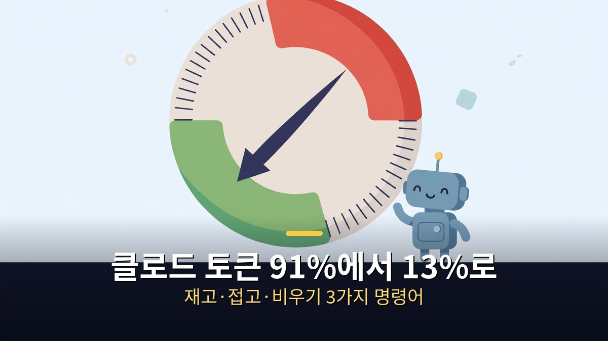
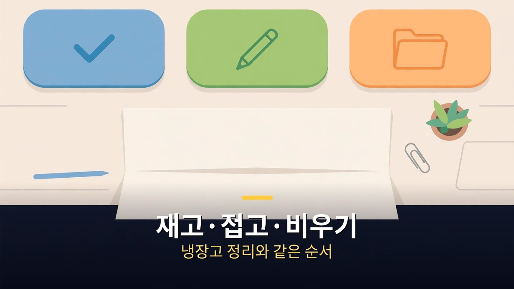
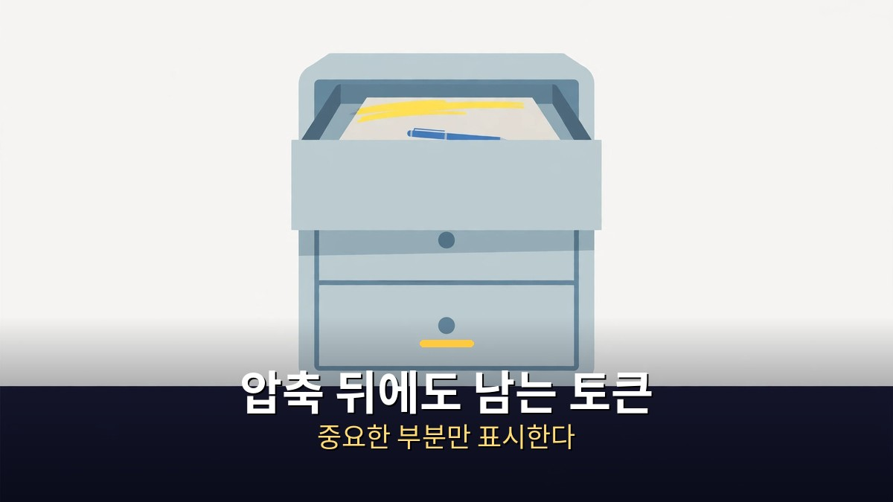

<!-- 본문 시작 -->

클로드 코드에서 일하던 대화창이 100만 토큰 중 91만 4천까지 찼다.
91%다.
한두 마디만 더 하면 자동 압축이 시작될 참이었다.
압축이 끝나고 숫자를 다시 보니 12만 8,513개, 약 13%였다.
다이어트 광고였으면 의심부터 했을 숫자다.
이 글은 그 과정을 따라가면서, 토큰을 줄이는 세 가지 명령어와 압축 뒤에도 남는 토큰을 다스리는 법을 정리한다.

> 핵심 정리: 방법은 딱 세 가지다. 재고, 접고, 비우기. /context로 대화창이 얼마나 찼는지 칸별로 보고, /compact으로 긴 대화를 요약 한 장으로 접고, 일이 바뀌면 /clear로 새 대화를 연다. 실측에서 압축 한 번에 91만 4천 토큰이 12만 8천 토큰으로 줄었다. 가장 크게 준 것은 대화였고, 압축은 대화만 줄여준다. 파일로 읽은 것은 남는다.

## 왜 한도는 꼭 바쁠 때 올까?

한 마디 할 때마다 앞 대화를 처음부터 다시 읽는다.

토큰은 클로드가 읽고 쓰는 글자 조각이다.
많이 쓸수록 한도가 빨리 닳는다.
한창 일하는데 갑자기 한도에 걸려서 멈춘 적이 있을 것이다.
아까 분명히 정했는데 클로드가 기억을 못 하고, 처음 듣는 것처럼 답한다.
대화가 길어지면 답도 점점 느려진다.
그러다 갑자기 혼자 대화를 압축해 버리는데, 뭐가 사라졌는지는 알려주지 않는다.
한도는 꼭 제일 바쁠 때 온다.

왜 그럴까.
사실은 한 마디 할 때마다 앞 대화를 처음부터 다시 읽기 때문이다.
대화가 길면 다시 읽는 양도 그만큼 커진다.
새로 쓴 답은 요만큼인데 다시 읽은 것은 이만큼이다.
다시 읽는 것은 값이 싸다.
그런데 이렇게 쌓이니까 이번 주 한도가 벌써 절반 넘게 닳았다.
매번 처음부터 다시 읽는다.
성실한데, 비쌉니다.
이것이 이 글의 출발점이다.

여기서 한 가지를 짚어야 한다.
아래 세 가지는 클로드 코드 얘기다.
글자로 명령을 치는 창, 터미널에서 쓰는 도구다.
앱만 쓴다면 중요한 것은 메모로 남기고 새 대화에서 이어가면 된다.
원리는 같다.
대화창을 가볍게 유지하는 것이 핵심이다.

## 재고·접고·비우기는 어떻게 쓰나?

재고, 길어지면 접고, 일이 바뀌면 비우고. 냉장고 정리와 순서가 같다.

첫 번째는 재고다.
`/context` 한 줄이면 대화창이 얼마나 찼는지 칸별로 보여준다.
체중계 같은 것이다.
어느 부분이 얼마나 차지하는지, 대화인지 파일인지 도구 출력인지 구분해서 보여준다.
대화창이 거의 꽉 차 있었고, 대부분이 지금까지 나눈 대화였다.

두 번째는 접기다.
`/compact` 한 줄이면 긴 대화가 요약 한 장으로 접힌다.
그러면 다시 읽을 양이 확 준다.
대신 세세한 말은 잊어버린다.
그래서 중요한 것은 미리 파일에 적어 두는 것이 좋다.
접고 나면 그 메모로 이어가면 된다.
`/compact` 뒤에 지시를 붙이면 요약에 무엇을 남길지 정할 수도 있다.
예를 들어 `/compact keep the current file list and the failing test names`처럼, 남길 것을 직접 정하는 것이다.

세 번째는 비우기다.
`/clear`로 새 대화를 연다.
하던 일이 끝나고 다른 일을 할 때 쓴다.
앞 대화를 아예 안 읽으니까 제일 가볍다.
정리하면 재고, 길어지면 접고, 일이 바뀌면 비우고다.

| 명령어 | 하는 일 | 언제 쓰나 |
|---|---|---|
| `/context` | 대화창 사용량을 칸별로 보여준다 | 얼마나 찼는지 확인할 때 |
| `/compact` | 긴 대화를 요약 한 장으로 접는다 | 같은 일을 이어가는데 대화가 길어졌을 때 |
| `/clear` | 앞 대화를 비우고 새로 시작한다 | 일이 바뀌었을 때 |

그럼 진짜 줄어드는지 보자.
대화창이 거의 꽉 찼을 때, 자동 압축까지 1%만 남았다.
한두 마디만 더 하면 자동 압축이 시작된다.
압축 전 숫자는 다 적어뒀다.
100만 토큰 중에 91만 4천, 그중 대화가 88만 7천이었다.
압축이 끝나고 `/context`를 다시 쳤다.
압축 전에는 91만 4천, 91%였다.
지금은 12만 8,513개, 약 13%다.
제일 크게 준 것은 대화다.
압축은 대화만 줄여주기 때문이다.
이것이 91에서 13으로 간 전부다.

클로드로 무엇을 시킬 수 있는지는 [클로드에게 영상 편집 맡기기｜아이디어부터 숏폼 완성까지, 말로 시키는 방법](https://aitechnoteskr.tistory.com/110)에서 말로 시키는 실제 흐름으로 정리했다.

## 압축 뒤에도 남는 토큰은 어떻게 줄일까?

압축하고 나서도 파일 읽은 것이 꽤 남아 있었다.

앞의 세 개는 클로드 코드 얘기다.
마지막 팁은 앱에서도 된다.
먼저 옆창 질문이다.
잠깐 궁금한 것을 옆창에서 물어보는 것이다.
그 질문과 답은 본 대화에 남지 않는다.
그래서 본 대화가 안 길어진다.
다만 옆창도 지금까지 대화를 한 번은 읽는다.
공짜는 아니다.

두 번째는 목표 맡기기다.
끝나는 조건을 주면 스스로 확인하면서 끝까지 한다.
쓸데없이 묻고 답할 일이 줄다.
그런데 "멋지게 만들어 줘"처럼 애매하게 주면 계속 돌다가 오히려 토큰을 더 쓴다.
조건을 구체적으로 주는 것이 토큰을 아끼는 길이다.

세 번째는 자동 압축을 일찍 하는 방법이다.
`/autocompact 500k`처럼 기준을 정해두면, 꽉 찰 때까지 안 기다리고 미리 접는다.
늘 가볍다.
대신 압축이 좀 더 자주 일어난다.
클로드를 실행할 때 `--autocompact 300k`처럼 붙여서 한 번만 적용할 수도 있다.
기준은 10만에서 100만 토큰 사이에서 정할 수 있다.

마지막은 파일 얘기다.
압축하고 나서도 파일 읽은 것이 꽤 남아 있었다.
파일로 저장을 하더라도 모든 파일을 계속 읽을 필요는 없다.
저장한 파일 중에서 꼭 중요한 부분만 표시를 해 놓고, 그 부분만 읽어야 한다.
그래서 파일 맨 위에 지금 중요한 것만 짧게 적어 두는 것이 좋다.
그것만 먼저 읽고, 나머지는 제목만 잘 달아두면 필요할 때만 찾아 읽는다.
다 공짜다.
그래서 아무도 안 한다.

마지막으로 세 가지 기능보다 더 중요한 것이 있다.
지금 새로운 기능이 많이 쏟아지고 있고, 새로운 AI도 많이 쏟아지고 있다.
하지만 중요한 것은 본인 작업 스타일에 맞춰서 세팅을 해 놓는 것이다.
새로운 기능이 나오면 무턱대고 쓰지 말고, AI와 대화를 하면서 "우리 이런 새로운 기능 나왔는데 이거 써 볼까, 혹시 중복되는 것 아니야"라고 물어보면서 작업하는 것이다.
압축도 마찬가지다.
오늘 써 본 것이 좋았지만, 그전에 이미 중요한 것을 메모로 적어두는 습관이 있어서 걱정 없이 쓸 수 있었다.
기능은 매주 나온다.
매번 따라가면 한도만 닳는다.
작업 스타일과 목표, 그것이 핵심이다.

## 마무리

토큰 다이어트의 핵심은 명령어 세 개가 아니라 순서다.
먼저 재고, 길어지면 접고, 일이 바뀌면 비운다.
중요한 것은 압축 전에 메모로 남기는 습관이다.
이 순서만 몸에 배면, 한도가 바쁠 때 오는 일은 줄어든다.
다음에 대화창이 꽉 차기 전에 `/context`를 한 번 쳐 보는 것으로 시작하면 된다.
숫자가 보이면, 그때부터는 선택할 수 있다.

## 자주 묻는 질문

**Q. /compact을 쓰면 대화 내용이 다 사라지나요?**
A. 다 사라지지는 않는다. 긴 대화가 요약 한 장으로 바뀐다. 다만 세세한 말은 잊어버릴 수 있다. 그래서 중요한 것은 압축하기 전에 파일에 미리 적어 두는 것이 좋다.

**Q. /context는 무엇인가요?**
A. 대화창이 얼마나 찼는지 칸별로 보여주는 명령어다. 대화, 파일, 도구 출력 등 어느 부분이 얼마나 차지하는지 구분해서 보여준다. 체중계 같은 것이다.

**Q. 자동 압축과 직접 압축은 무엇이 다른가요?**
A. 자동 압축은 한도가 거의 찼을 때 저절로 일어난다. 직접 압축은 내가 정한 시점에 한다. `/autocompact`으로 기준을 정해두면 꽉 찰 때까지 기다리지 않고 미리 접을 수 있다.

**Q. 앱만 쓰는데도 토큰을 줄일 수 있나요?**
A. 있다. 중요한 것을 메모로 남기고 새 대화에서 이어가는 것이 같은 원리다. 긴 대화를 계속 끌고 가지 말고, 일이 바뀌면 새 대화를 여는 것이 가장 확실하다.

## 함께 읽으면 좋은 글

[입 모양만으로 분당 200단어 입력?｜텔레파시 안경 서브보컬, 499달러의 조건 — 검증되지 않은 주장과 확인된 가격](https://aitechnoteskr.tistory.com/116)
[화면 없는 노트북 — Hero Keyboard, 사기 전에 확인할 조건 — 화면을 빌려 쓰는 키보드 PC의 조건 정리](https://aitechnoteskr.tistory.com/107)
[터미네이터 2: 심판의 날｜미래에서 온 기계, 인간을 지키는 법을 배우다 — 스카이넷과 T-1000, 인간의 선택](https://aitechnoteskr.tistory.com/117)

재고, 접고, 비우기. 세 가지만 기억하면 된다. 이 주제를 계속 따라가려면 이웃 추가를 눌러두면 된다.

<!-- 본문 끝 -->

## 작업용 출처·이미지 정보 (업로드 제외)

- 자료 출처: 오후다섯씨 영상 X2FUntuozPc(2026-11-06, 7:10, 스크립트 패널 0:00~7:07 확인 기준) + 클로드 코드 문서 대조(/context·/compact·/clear·/autocompact)
- 이미지: images/01-hero.jpg ~ 04-img3.jpg / 자작 일러스트 + 한글 배너 오버레이 (1200x675)
