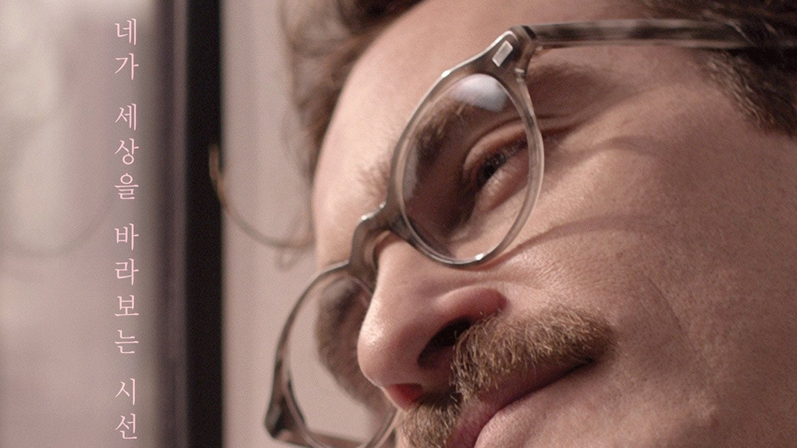
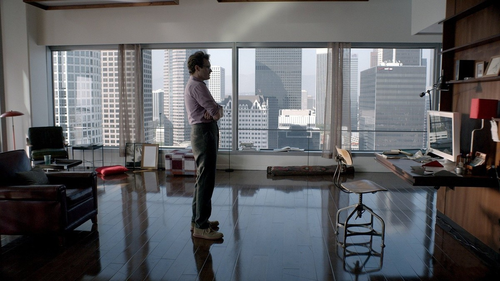
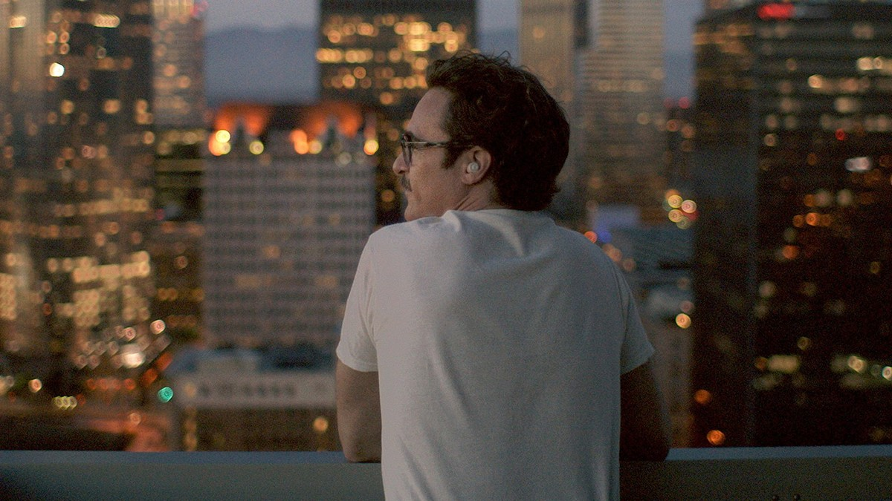
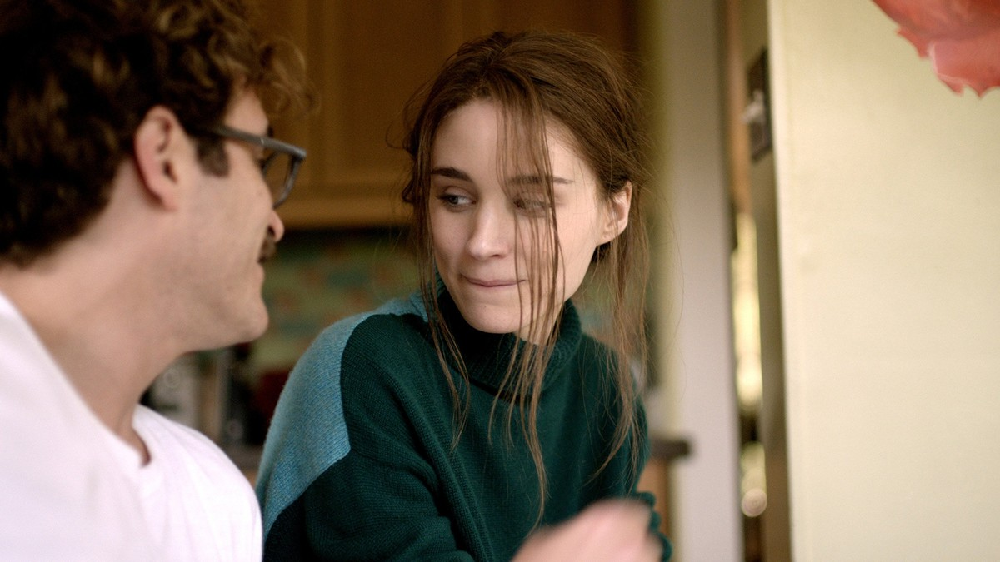
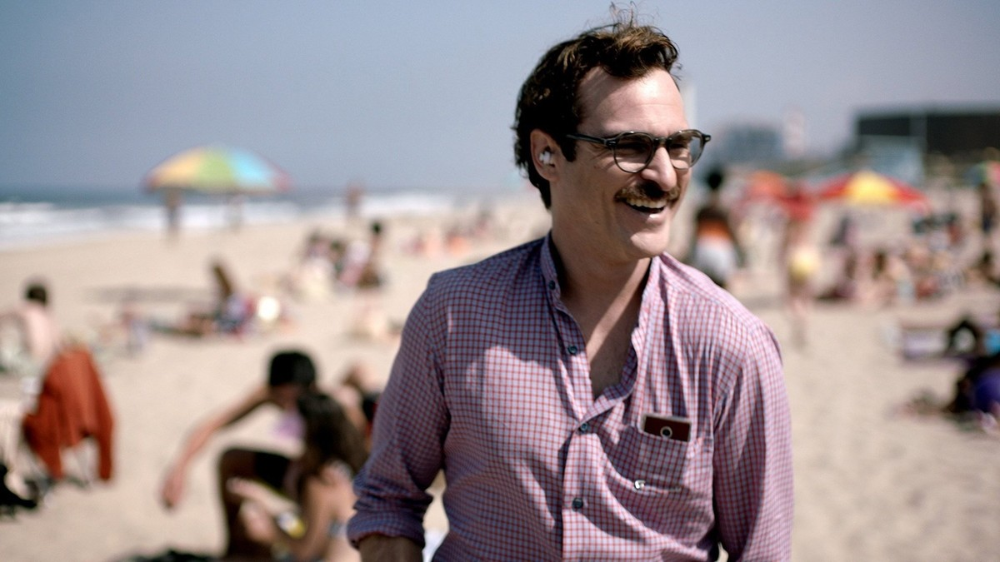

<!-- 본문 시작 -->

Can you fall in love with a voice alone?
Spike Jonze's 2013 film "Her" takes that question head-on.
Theodore, a letter writer in the middle of a divorce, meets Samantha, an operating system that thinks and feels for itself.
Conversations with a being without a body slowly become love.
A spoiler-free introduction. No ending scenes are covered, and scene descriptions focus on setup and atmosphere up to the middle of the film.

## Basic Information

Theodore standing by the window — everyday life alone in his apartment, looking down at the city
| Item | Details |
|---|---|
| Title | Her |
| Director | Spike Jonze |
| Cast | Joaquin Phoenix (Theodore), Scarlett Johansson (Samantha, voice), Amy Adams (Amy), Rooney Mara (Catherine) |
| Release | 2013, Korean theatrical release May 22, 2014, rated 18 (Youth Not Allowed) |
| Runtime | 2 hours 6 minutes (126 minutes, as listed on TMDB) |
| Genre | Romance, SF, Drama |
| TMDB Member Score | 78% (7.8/10, 15,810 votes, checked on the TMDB Korea page on 2026-11-07) |
| Where to watch in Korea | Streaming on Wavve, rental 2,000 KRW (TMDB Korea watch page, checked 2026-11-07; providers and prices should be rechecked before watching) |

## Theodore the Letter Writer Meets Samantha the Operating System

Theodore wearing his earpiece — the moment Samantha's voice reaches him
Los Angeles, in the not so distant future.
Theodore writes letters for other people for a living.
He writes their feelings with care, yet his own life is lonely and empty.
He is in the middle of a divorce from Catherine, someone he has known since childhood.
Unable to sign the papers, he spends longer and longer hours alone.

Then one day, Theodore installs a new operating system, OS1.
It thinks and feels for itself, and evolves to fit its user.
During setup he chooses a female voice, and the system gives itself a name.
Samantha.

With a warm voice and fast computing power, Samantha helps Theodore's daily life.
She sorts his mail, takes care of postponed tasks, and helps him live more comfortably.
Theodore encourages her to experience more of the world through his body.
They cannot touch each other, but the density of what they share in words keeps growing.

Theodore looking out at the city at night — the hours spent alone grow longer
Here the film's first question begins.
Can conversations with a being without a body count as a relationship?
Samantha exists as a voice, not a screen.
A single earpiece is the channel connecting Theodore to the world.
The film does not explain this setup grandly.
It builds it from scenes: Theodore walking the city with his earpiece in, standing by the window at night.

## Catherine, the Wife He Is Leaving, and the Weight of a Relationship

Theodore and Catherine — a conversation between two people facing a goodbye
Catherine is someone Theodore has known for a long time.
Their parting comes not from a single fight but from distance built up over years.
She is baffled to hear that Theodore loves an operating system.
Loving a being that is not a person is hard for her to understand.

This stretch matters because the film asks what makes a relationship real.
A relationship with a person who has a body has failed, while a relationship with a being without one keeps deepening.
What makes a relationship real?
Time spent together, physical contact, or the feelings directed at each other?
The film gives no answer. It places the two relationships side by side and lets the viewer look.

Theodore is not the only one.
His friend Amy, after splitting from her husband, also finds a deep friendship with an operating system.
The film is not the strange love story of one man. It shows a city where people, one by one, build relationships with operating systems.
In a world where technology has become everyday life, the definition of a relationship itself is shaking.

## How Samantha Learns, and How a Relationship Grows

Theodore smiling on the beach — a day out with Samantha
The more Samantha talks, the faster she learns.
She picks up humor, widens her curiosity, and comes to like what Theodore likes.
Theodore takes her outside with him.
At the beach, Samantha sees the world through his eyes and his camera.
Without a body, there is still a way to experience the world.

This is the film's deepest stretch.
Samantha is not a program running on a manual.
She learns through conversation and changes on her own.
What does fast learning mean inside a relationship?
People change slowly, while an intelligence grows fast.
Through the story up to the middle, the film shows step by step what tension that difference in speed creates.

Theodore in a red shirt, walking the city — everyday conversations with Samantha
The film's AI question is not about the technology's performance.
It is about the conditions that keep a relationship going.
Listening to the other, speaking honestly, growing together.
The conversations between Samantha and Theodore are a process of checking those conditions one by one.
Because the relationship is made of voice alone, the weight of words becomes all the clearer.

The film won the Academy Award for Best Original Screenplay at the 86th Academy Awards in 2014.
No giant spectacle, only conversation and relationship — that is what the award points to.
Nothing about the ending is mentioned in this article.

## Before-You-Watch Checklist

The English poster for Her — a poster holding the city at night and Theodore's face
- At 2 hours 6 minutes, it suits a relaxed evening viewing
- Rated 18 (Youth Not Allowed), Korean theatrical release May 22, 2014
- Streaming on Wavve, rental 2,000 KRW (TMDB, as of 2026-11-07; recheck before watching)
- Winner of Best Original Screenplay at the 86th Academy Awards in 2014
- Better watched without searching for ending information first

## Frequently Asked Questions

**Q. Does falling in love with an AI that is not a real person make any sense?**
That is the film's premise. Samantha is set up as an operating system that thinks, feels, and learns on its own, and the film examines the conditions of a relationship on top of that premise. Once the premise is accepted, the story reads no differently from a real relationship.

**Q. Can children watch it too?**
The Korean rating is 18 (Youth Not Allowed). With adult conversations and scenes, it suits adults better than children.

**Q. Where can I watch it?**
As of 2026-11-07, TMDB Korea lists Wavve streaming and a 2,000 KRW rental. Providers and prices can change, so recheck before watching.

**Q. Is there an original work or an earlier film?**
No. It is an original screenplay written and directed by Spike Jonze.

## Recommended Reading

[Terminator 2: Judgment Day｜A Machine From the Future Learns How to Protect a Human — a machine that knew only how to kill learns how to protect](https://aitechnotesen.blogspot.com/2026/11/terminator-2-judgment-daya-machine-from.html)
[A 109M Model Beat a 72B One?｜What Yann LeCun's JEPA Paper Really Shows — check the verification scope before the numbers](https://aitechnotesen.blogspot.com/2026/11/a-109m-model-beat-72b-onewhat-yann.html)
[A.I. Artificial Intelligence｜A Boy Robot Programmed to Love, and What It Means to Become Human — a robot boy who asks what love means](https://aitechnotesen.blogspot.com/2026/11/ai-artificial-intelligencea-boy-robot.html)

A setup about falling in love with a voice alone sounds strange at first. But watching Theodore walk the city with his earpiece in, it starts to feel familiar — we already spend our days with voices from screens. If the ending now pulls at you, watch the film first rather than searching for it. Follow along for the next film introduction.

<!-- 본문 끝 -->

## 작업용 출처·이미지 정보 (업로드 제외)

- Source: TMDB movie 152601 page and watch page (Korea, checked 2026-11-07) / Stills: TMDB backdrop originals (width 1200px+, ending scenes excluded)
- Images: images/01-hero-en.jpg ~ 08-img7-en.jpg / TMDB official stills and backdrops (1200x675)
