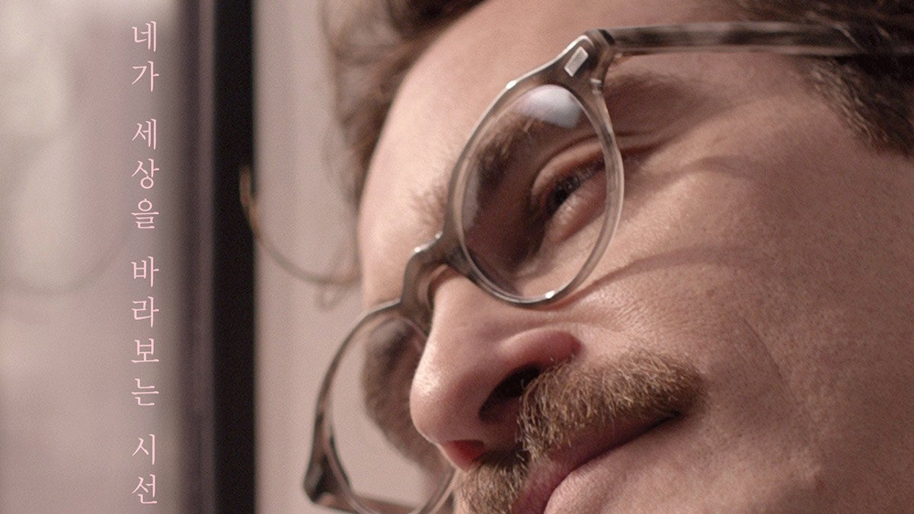
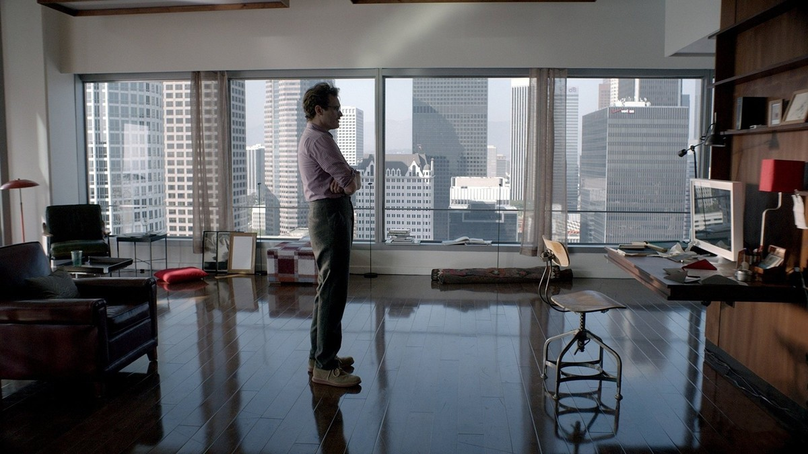
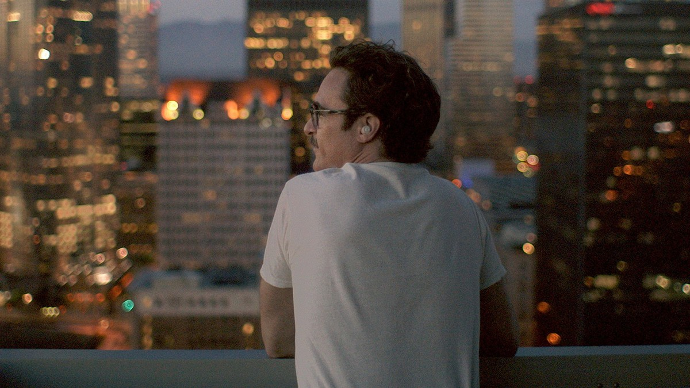
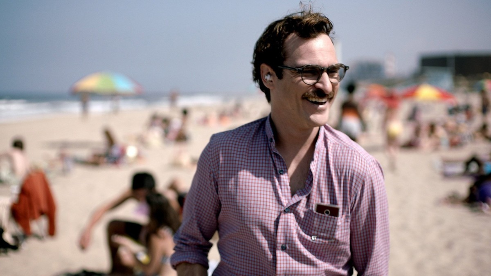
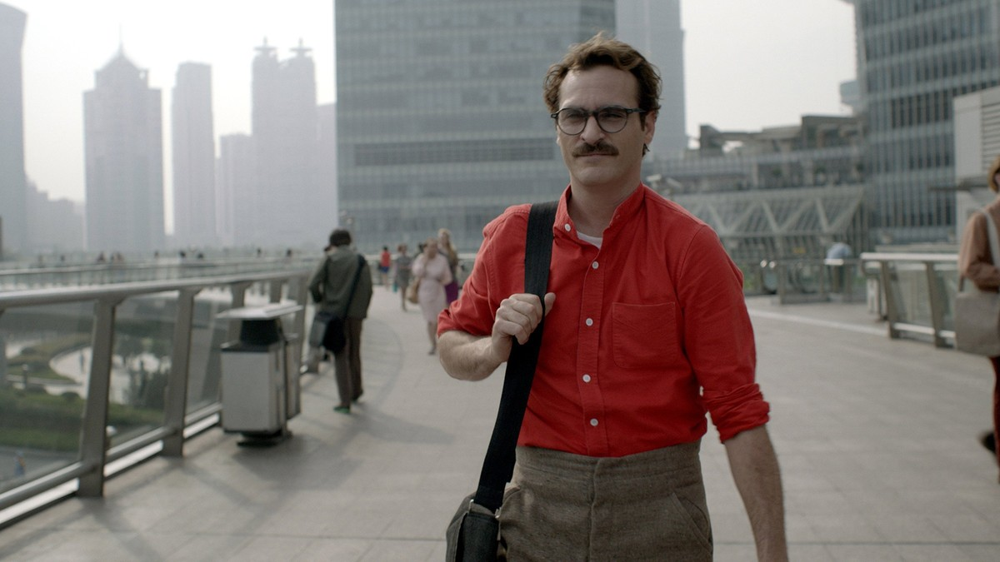

<!-- 본문 시작 -->

목소리만으로 사랑에 빠질 수 있을까.
2013년 스파이크 존즈 감독의 '그녀'는 그 질문을 정면으로 다룬 영화다.
대필 작가 테오도르는 이혼 소송 중, 스스로 생각하고 느끼는 운영체제 사만다를 만난다.
몸이 없는 존재와 나누는 대화가, 어느새 사랑이 된다.
스포일러 없는 소개다. 결말 장면은 다루지 않으며, 장면 설명은 중반부까지의 설정과 분위기 중심으로 정리했다.

## 기본 정보

창가에 선 테오도르 — 혼자 사는 방, 도시를 내려다보는 일상
| 항목 | 내용 |
|---|---|
| 제목 | 그녀 (Her) |
| 감독 | 스파이크 존즈 |
| 주연 | 호아킨 피닉스(테오도르), 스칼릿 조핸슨(사만다, 목소리), 에이미 애덤스(에이미), 루니 마라(캐서린) |
| 개봉 | 2013년, 한국 극장 개봉 2014년 5월 22일, 등급 청소년 관람불가(18세) |
| 러닝타임 | 2시간 6분(126분, TMDB 표기) |
| 장르 | 로맨스, SF, 드라마 |
| TMDB 회원 점수 | 78%(7.8/10, 15,810개 평가, TMDB 한국 페이지 2026-11-07 확인) |
| 국내 시청처 | 스트리밍 웨이브, 대여 2,000원 (TMDB 시청처 페이지 대한민국 기준 2026-11-07 확인, 가격·제공처는 시청 전 재확인 필요) |

## 대필 작가 테오도르, 운영체제 사만다를 만나다

이어피스를 낀 테오도르 — 사만다의 목소리가 들리는 순간
가까운 미래의 로스앤젤레스.
테오도르는 다른 사람의 마음을 대신 써주는 대필 작가다.
타인의 편지를 정성껏 써주면서도, 정작 자신의 삶은 외롭고 공허하다.
어릴 적부터 함께한 아내 캐서린과는 이혼 소송 중이다.
서류에 서명하지 못한 채, 테오도르는 혼자 있는 시간이 길어진다.

그러던 어느 날, 테오도르는 새로 나온 운영체제 OS1을 설치한다.
스스로 생각하고 느끼며, 사용자에게 맞춰 진화하는 인공지능이다.
설치 과정에서 여성의 목소리를 고르자, 시스템은 스스로 이름을 정한다.
사만다다.

사만다는 따뜻한 목소리와 빠른 전산처리 능력으로 테오도르의 일상을 돕는다.
이메일을 정리하고, 미뤄둔 일을 챙기고, 테오도르가 더 편안하게 살 수 있게 돕는다.
테오도르는 자신의 몸을 통해 사만다가 더 많은 세상을 경험하도록 격려한다.
둘은 직접 만질 수 없지만, 말로 나누는 밀도는 점점 짙어진다.

밤의 도시를 바라보는 테오도르 — 혼자 있는 시간이 길어지는 밤
이 대목에서 영화가 던지는 첫 질문이 시작된다.
몸이 없는 존재와 나누는 대화도, 관계가 될 수 있는가.
사만다는 화면이 아니라 목소리로 존재한다.
이어피스 하나가 테오도르와 세상을 잇는 통로다.
영화는 이 설정을 거창하게 설명하지 않는다.
대신 테오도르가 이어피스를 끼고 도시를 걷고, 밤의 창가에 서 있는 장면들로 쌓아 올린다.

## 이별한 아내 캐서린, 관계의 무게를 묻다

테오도르와 캐서린 — 이별을 앞둔 두 사람의 대화
캐서린은 테오도르가 오래 알고 지낸 사람이다.
두 사람의 이별은 한순간의 다툼이 아니라, 오래 쌓인 거리에서 온다.
캐서린은 테오도르가 운영체제를 사랑한다는 말을 듣고 당황한다.
사람이 아닌 존재를 사랑한다는 것이, 그녀에게는 이해하기 어려운 일이다.

이 구간이 중요한 이유는, 영화가 '진짜 관계'의 조건을 묻기 때문이다.
몸이 있는 사람과의 관계는 실패했는데, 몸이 없는 존재와의 관계는 깊어진다.
무엇이 관계를 진짜로 만드는가.
함께 보낸 시간인가, 몸의 접촉인가, 아니면 서로를 향한 마음인가.
영화는 정답을 주지 않고, 두 관계를 나란히 놓고 보게 한다.

테오도르만 그런 게 아니다.
테오도르의 친구 에이미도 남편과 헤어진 뒤, 운영체제와 깊은 우정을 나눈다.
영화는 한 사람의 기이한 사랑 이야기가 아니라, 이 도시의 사람들이 하나씩 운영체제와 관계를 맺는 풍경을 그린다.
기술이 일상이 된 세상에서, 관계의 정의 자체가 흔들리고 있다.

## 사만다가 배우는 법, 관계가 자라는 방식

해변에서 웃는 테오도르 — 사만다와 함께하는 바깥나들이
사만다는 대화할수록 빨리 배운다.
유머를 익히고, 호기심을 넓히고, 테오도르가 좋아하는 것을 함께 좋아하게 된다.
테오도르는 사만다를 데리고 바깥으로 나간다.
해변에서 사만다는 테오도르의 눈과 카메라를 통해 세상을 본다.
몸이 없어도, 세상을 경험하는 방식은 있다.

이 구간이 영화의 가장 깊은 대목이다.
사만다는 매뉴얼대로 움직이는 프로그램이 아니다.
대화를 통해 배우고, 스스로 변한다.
배움의 속도가 빠르다는 것이, 관계에서는 어떤 의미일까.
사람은 천천히 변하고, 인공지능은 빠르게 자란다.
그 속도 차이가 관계에 어떤 긴장을 만드는지, 영화는 중반부까지의 이야기로 차근차근 보여준다.

빨간 셔츠의 테오도르, 도시를 걷다 — 사만다와 나누는 일상의 대화
영화가 던지는 AI 질문은 기술의 성능이 아니다.
관계를 유지하는 조건이다.
상대의 말을 듣는 것, 솔직하게 말하는 것, 함께 자라는 것.
사만다와 테오도르의 대화는 이 조건들을 하나씩 확인하는 과정이다.
목소리만으로 이뤄지는 관계라서, 오히려 말의 무게가 더 분명해진다.

이 영화는 2014년 제86회 아카데미 시상식에서 각본상을 받았다.
거대한 스펙터클이 아니라, 대화와 관계만으로 만든 이야기라는 점이 수상의 이유를 말해준다.
결말에 대한 언급은 이 글에서 하지 않는다.

## 시청 전 체크리스트

그녀 영문 포스터 — 도시의 밤과 테오도르의 얼굴을 담은 포스터
- 러닝타임 2시간 6분으로, 여유 있는 저녁 시간에 보는 것이 좋다
- 등급 청소년 관람불가(18세), 국내 극장 개봉은 2014년 5월 22일
- 시청처는 스트리밍 웨이브, 대여 2,000원 (2026-11-07 TMDB 기준, 시청 전 재확인 필요)
- 2014년 제86회 아카데미 시상식 각본상 수상작
- 결말에 대한 사전 정보 없이 보는 것이 좋다

## 자주 묻는 질문

**Q. 실존 인물이 아닌 AI와 사랑한다는 설정이 말이 되나?**
영화의 전제다. 사만다는 스스로 생각하고 느끼며 배우는 운영체제로 설정돼 있고, 영화는 그 전제 위에서 관계의 조건을 따진다. 전제를 받아들이면, 이후의 이야기는 현실의 관계와 다르지 않게 읽힌다.

**Q. 아이와 함께 봐도 되나?**
국내 등급은 청소년 관람불가(18세)다. 성인 대상의 대화와 장면이 있어, 성인과 함께 보는 것이 좋다.

**Q. 어디서 볼 수 있나?**
2026-11-07 TMDB 대한민국 기준으로는 웨이브 스트리밍과 2,000원 대여가 표시된다. 제공처와 가격은 바뀔 수 있어 시청 전 재확인이 필요하다.

**Q. 원작이나 전편이 있나?**
없다. 스파이크 존즈 감독이 직접 쓰고 연출한 오리지널 각본의 영화다.

## 함께 읽으면 좋은 글

[터미네이터 2: 심판의 날｜미래에서 온 기계, 인간을 지키는 법을 배우다 — 죽이는 법만 알던 기계가 지키는 법을 배우는 이야기](https://aitechnoteskr.tistory.com/117)
[작은 모델이 거대 모델을 이겼다고?｜얀 르쿤 JEPA 논문, 숫자부터 따져보자 — 109M 모델이 72B 모델을 앞선 결과, 검증 범위부터 보는 법](https://aitechnoteskr.tistory.com/114)
[터미네이터 2: 심판의 날｜미래에서 온 기계, 인간을 지키는 법을 배우다 — 같은 글, 블로거에서도 읽을 수 있다](https://aitechnoteskr.blogspot.com/2026/11/2.html)

목소리만으로 사랑에 빠진다는 설정은, 처음에는 낯설게 들린다. 그런데 테오도르가 이어피스를 끼고 도시를 걷는 장면을 보고 있자면, 지금 우리도 이미 화면 속 목소리와 하루를 보낸다는 생각이 든다. 그 끝이 궁금해졌다면, 결말을 미리 검색하지 말고 영화를 먼저 보는 것이 좋다. 다음 영화 소개도 함께 따라가려면 이웃 추가를 눌러두면 된다.

<!-- 본문 끝 -->

## 작업용 출처·이미지 정보 (업로드 제외)

- 자료 출처: TMDB 영화 152601 페이지·시청처 페이지(대한민국 기준, 2026-11-07 확인) / 스틸: TMDB 백드롭 원본(너비 1200px 이상, 결말 장면 제외)
- 이미지: images/01-hero.jpg ~ 08-img7.jpg / TMDB 공식 스틸·백드롭 (1200x675)
