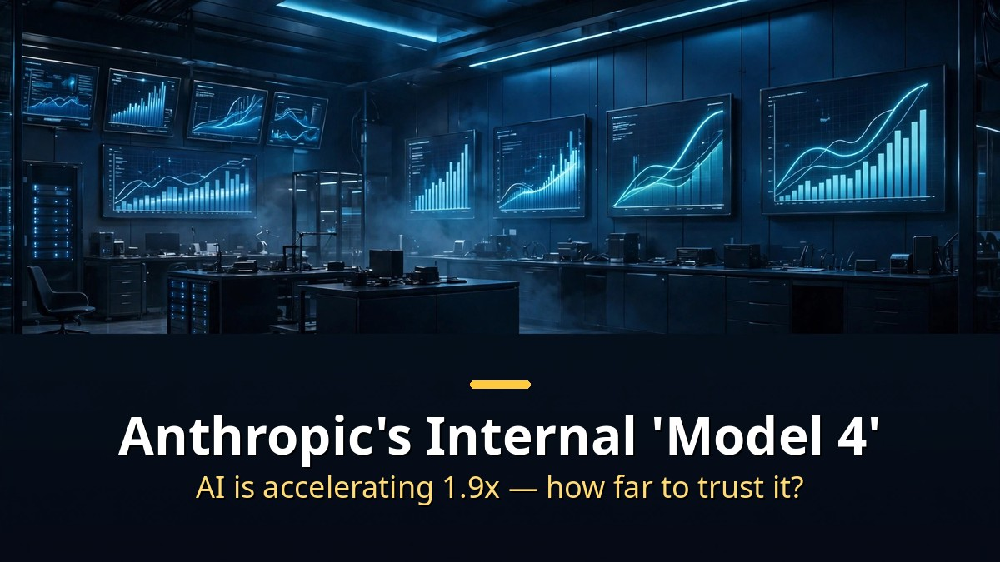
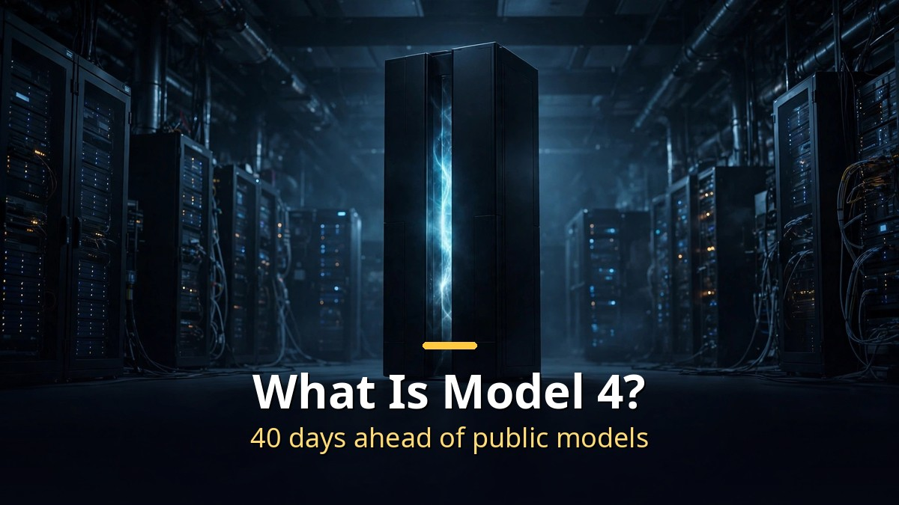
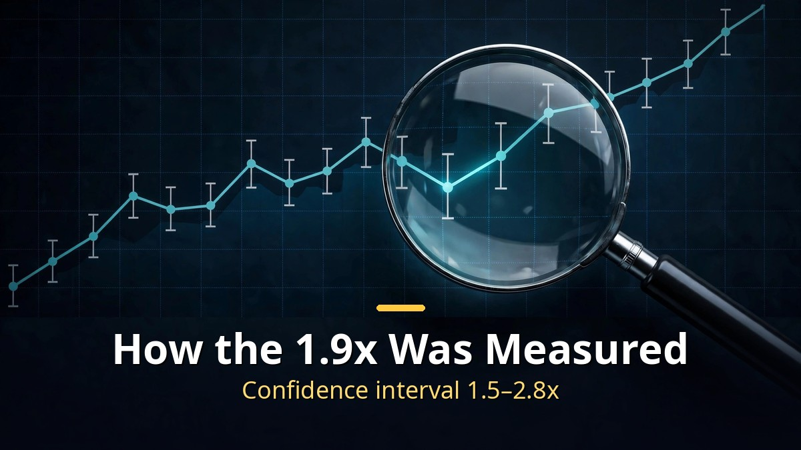

<!-- 본문 시작 -->

A report says AI is now building AI twice as fast.
It comes from METR, an evaluation nonprofit that spent 11 weeks inside Anthropic.
The headline number is 1.9x.
Since October 2025, the pace at which model capabilities improve has grown 1.9 times faster than before.
But behind that number sit redacted evidence and a wide margin of error.
This post checks the original report to separate what the number says from what it does not.

> Key takeaway: In its assessment published November 5, 2026, METR found that Anthropic's pace of model capability improvement grew about 1.9x faster after October 2025, with annual score growth jumping from 15 to 29 points. About 80% of that acceleration is estimated to come from AI itself. But the 95% confidence interval is wide, 1.5 to 2.8x, and Anthropic redacted most of the most convincing evidence. The number is real — but how far to trust it is a question worth asking.

## What is "Model 4," and why is it 40 days ahead of public models?

Model 4 is not the name of a public model.

In METR's report, Model 2, Model 3, and Model 4 are code names for Anthropic's internal-only models.
Model 2 finished training in July 2026, Model 3 in August–September, and Model 4 in September–October.
METR was not allowed to use the non-public models directly.
It evaluated them from internal benchmark scores and staff interviews alone.

Model 4 stands out because of its scores.
It scored above 50% on all 15 benchmarks, and above 90% on several.
METR describes it as the highest-scoring model, more than 40 days ahead of public models.
Self-reported staff productivity also rose to about 12x in the Model 4 era.
But METR itself calls these survey figures "very loose evidence."
The trend runs from 1.2x in the Claude 3.7 Sonnet era, past 5x in the Mythos 5 era (another internal model), to about 12x in October.

There is no need to be dazzled by the name Model 4.
It is not a product name awaiting launch, but a number attached to an internal evaluation snapshot.
What matters is that an outside evaluator has, for the first time, put numbers on how far internal models run ahead of public ones.

## How was the 1.9x figure produced, and what is missing from it?

The 1.9x figure is not a hunch. It was measured from a trend in scores.

METR used an index called AECI.
It is Anthropic's version of a capabilities index, combining benchmark test results into a single score.
METR compared the pace of improvement before and after October 2025.
Before, scores rose about 15 points a year. After, about 29 points a year.
As a ratio, that is 1.9x.
METR compares it to "roughly two years of historical progress in a single year."

But the number comes with caveats.
The 95% confidence interval is 1.5 to 2.8x.
METR writes that it "would not be surprised if the true acceleration was closer to 1.3x or 3x."
Robustness analyses stretch the range from 1.1x to 2.9x.
So 1.9x is the most plausible estimate, not a confirmed measurement.

METR also asked what is driving the speedup.
Its estimate is that about 80% of the current acceleration comes from AI itself.
It ruled out faster growth in training compute as the cause.
But that 80% is, in the report's own words, an estimate with "substantial uncertainty."
Non-AI factors may have played a larger role in the late-2025 speedup.

The biggest gap lies elsewhere.
Anthropic held unilateral rights to redact the report.
METR writes that Anthropic "redacted a majority of the evidence we found most informative for these conclusions."
The full report, about 100 pages, was not published.
A planned audit of compute allocation was cancelled midway.
So METR writes that "the public has to rely on METR's judgment much more than would be ideal."
Anthropic co-founder Sam McCandlish replied that he agrees with many conclusions, but said sharing exactly what drives the speedup would hand rivals a roadmap.

| Item | Figure | Range and conditions |
|---|---|---|
| AECI growth acceleration | 1.9x | 95% CI 1.5–2.8x; robustness analyses 1.1–2.9x |
| Annual AECI growth | 15 → 29 points | Before vs. after October 2025; roughly two years of progress |
| AI share of acceleration | About 80% | Substantial uncertainty; late-2025 speedup may include non-AI factors |
| Industry-wide acceleration | About 1.4x | Includes catch-up-to-baseline effects |
| Claude Haiku 5.5 system card | About 1.7x | Anthropic's own published figure |
| Self-reported staff productivity | About 12x | October 2026 internal survey; "very loose evidence" |

The link between benchmark scores and real capability is also uncertain.
METR itself notes the possibility of benchmark overfitting or distortion in the index.
As this blog showed in its comparison of eight AI video models with the same prompt, scores shift with conditions.
This report is no exception.

## What changes if the acceleration continues — five reasons to stay calm

More important than the number is how far the acceleration extends.

METR found no convincing evidence of bottlenecks in algorithms, training compute, experimental compute, or data over the next 12 months.
In other words, at the current pace, there is no reason for it to slow down soon.
Anthropic's own safety policy, the Responsible Scaling Policy, has a "2x threshold."
Past 2x acceleration, additional safety measures kick in.
Anthropic says it has not crossed that line yet, but METR argues the claim is overstated and suggests the public report say "about 2."

Anthropic CEO Dario Amodei puts AI's contribution at a 15–20% total speedup.
Six months ago, he says, it was about 5%.
Among staff, some say full automation of AI research could arrive by 2027.
Outside the lab, Alex Bores puts it at March 2028.

But the report also carries a warning.
Demis Hassabis calls closed-loop recursive self-improvement, with no human review, the most dangerous stage.
METR agrees catastrophic risk is low, while listing reasons to stay calm: uncertainty in how benchmark scores map to real capability, the looseness of survey evidence, catch-up effects in the baseline, and the fact that AI still mostly assists humans.

The comparison with the "AI 2027" scenario is interesting.
Published in April 2025, that scenario predicted about 2x acceleration around December 2026.
Reality is close.
Its fan tracker shows about 85% agreement, with about 39% of predictions verified so far.
Jeffrey Ladish of Palisade Research says the acceleration is running faster than the AI 2027 scenario.

So there is one standard for reading this report.
Do not memorize the number "2x." Remember the conditions under which it was produced.
Well-specified benchmark tasks, internal models included, the most informative evidence redacted, and a wide margin of error.
Know the conditions, and when the next report arrives, you can judge at once what has changed.

## Closing

After closing the report, one structure stayed with me more than any number.
It is not just that AI is helping research — the very yardstick for research speed is changing.
Whether 1.9x is right or 1.3x is right, the direction is the same.
But what nags me is that the evidence for that direction still rests largely on one institution's judgment.
The less evidence a report discloses, the more important the habit of checking its conditions before memorizing its numbers.
Next time a similar number appears, I will look for the confidence interval first.

## Frequently asked questions

**Q. When will "Model 4" be released?**
A. Model 4 is not a product name awaiting release. It is a code name for an internal evaluation snapshot. No public release schedule is known. The only confirmed point is that internal models run more than 40 days ahead of public ones.

**Q. Is the 1.9x acceleration a confirmed fact?**
A. No. It is METR's estimate. The 95% confidence interval is 1.5 to 2.8x, and robustness analyses stretch it from 1.1x to 2.9x. METR says it would not be surprised if the true value were 1.3x or 3x.

**Q. How was the 80% AI contribution figure produced?**
A. It is METR's estimate. METR is confident the speedup was not caused by faster growth in training compute, but the 80% figure itself carries substantial uncertainty, as the report states. Non-AI factors may have contributed to the late-2025 acceleration.

**Q. Why is the most important evidence redacted?**
A. Anthropic held unilateral rights to edit the report. METR says most of the evidence it found most convincing was removed. Anthropic's position is that disclosing exactly what drives the speedup would hand rivals a roadmap.

**Q. What is the "2x threshold"?**
A. It is a benchmark in Anthropic's Responsible Scaling Policy. Past 2x acceleration in AI research, additional safety measures are triggered. Anthropic says it has not crossed it yet, but METR argues the claim is overstated and suggests writing "about 2."

## Good reads

[AI Subscription Prices, Compared｜19 Services Ranked, and the Overlap Draining Your Wallet — Why to check limits before prices](https://aitechnotesen.blogspot.com/2026/11/ai-subscription-prices-compared19.html)
[Is GPT-6.2 'Bell' Real?｜OpenAI's Own Chart Says 87.5% — the Rest Is Still Rumor — What the official chart shows, and what is still rumor](https://aitechnotesen.blogspot.com/2026/11/is-gpt-62-bell-realopenais-own-chart.html)
[Her｜Can You Fall in Love With a Voice? A Man and an AI Operating System — The conditions of a relationship made of voice alone](https://aitechnotesen.blogspot.com/2026/11/hercan-you-fall-in-love-with-voice-man.html)

Whenever news says AI is building AI, check the conditions behind the number before the number itself. Follow this blog if you want to keep following the story.

<!-- 본문 끝 -->

## 작업용 출처·이미지 정보 (업로드 제외)

- Source: TheAIGRID 영상 7eQree8FhKI(2026-11-06, 30:00, 스크립트 패널 0:00~29:47 확인 기준) + METR 보고서 원문(metr.org, 2026-11-05) 대조
- Images: images/01-hero-en.jpg ~ 04-img3-en.jpg / original illustration + English banner overlay (1200x675)
