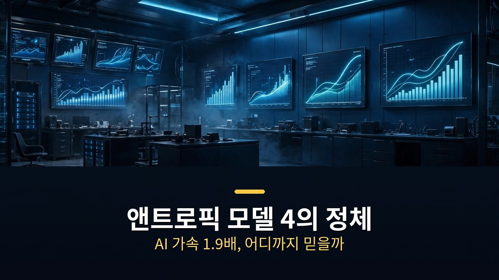
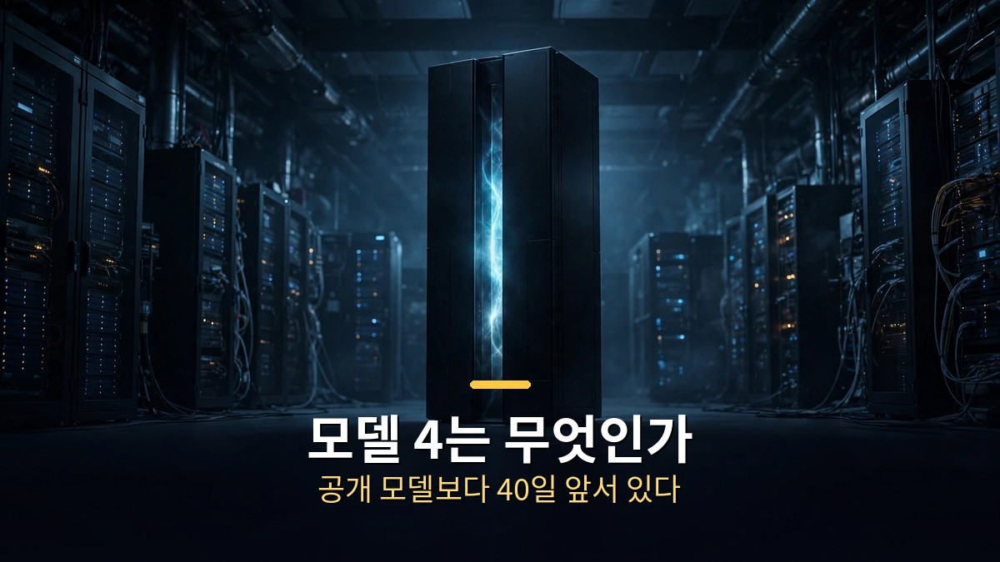
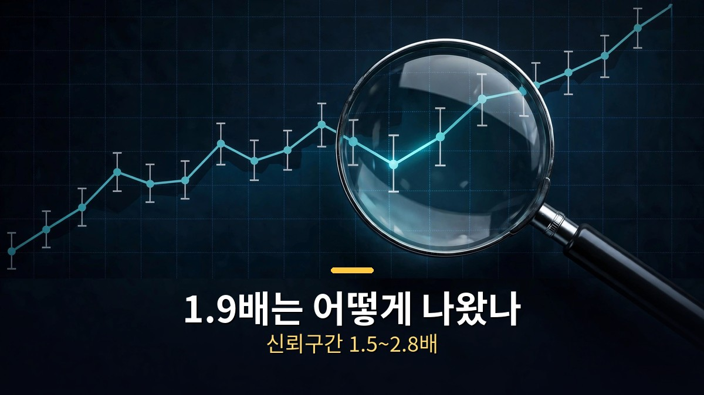
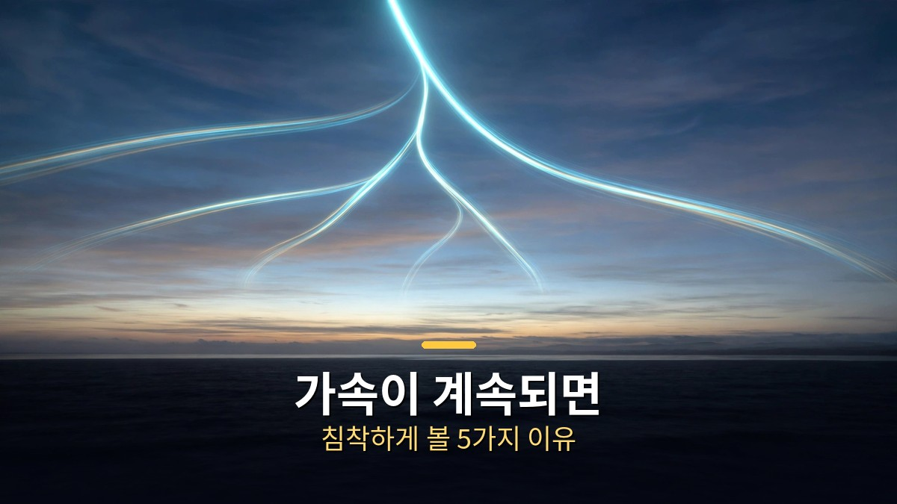

<!-- 본문 시작 -->

AI가 AI를 만드는 속도가 2배가 됐다는 보고서가 나왔다.
평가 기관 METR이 앤트로픽 내부에서 11주간 직접 확인한 결과다.
핵심 숫자는 1.9배다.
2025년 10월 이후 모델 능력 개선 속도가 그 전보다 1.9배 빨라졌다는 얘기다.
그런데 이 숫자 뒤에는 비공개 처리된 증거와 넓은 오차 범위가 있다.
이 글은 보고서 원문을 대조해, 숫자가 무엇을 말하고 무엇을 말하지 않는지 가른다.

> 핵심 정리: METR이 2026년 11월 5일 공개한 앤트로픽 내부 평가에서 모델 능력 개선 속도는 2025년 10월 이후 약 1.9배로 빨라졌고, 연간 점수 상승은 15점에서 29점으로 뛰었다. 가속의 약 80%는 AI 자체의 기여라는 추정이다. 다만 95% 신뢰구간은 1.5~2.8배로 넓고, 가장 설득력 있는 증거의 대부분은 앤트로픽이 비공개 처리했다. 숫자는 사실이지만, 그 숫자를 어디까지 믿을지는 따져봐야 한다.

## '모델 4'는 무엇이고, 왜 공개 모델보다 40일이나 앞서 있을까?

모델 4는 공개된 모델 이름이 아니다.

METR 보고서에 나오는 모델 2, 모델 3, 모델 4는 앤트로픽 내부 전용 모델의 코드명이다.
모델 2는 2026년 7월, 모델 3은 8~9월, 모델 4는 9~10월에 학습을 마쳤다.
METR은 미공개 모델을 직접 써볼 수 없었다.
내부 벤치마크 점수와 직원 인터뷰로만 평가했다.

모델 4가 주목받는 이유는 점수 때문이다.
15개 벤치마크에서 모두 50% 이상을 기록했고, 여러 벤치마크에서는 90% 이상을 찍었다.
공개 모델보다 40일 이상 앞서 있는 최고 점수 모델이라는 게 METR의 설명이다.
직원들이 체감하는 생산성 향상도 모델 4 시기에 평균 약 12배까지 올라갔다.
다만 METR 스스로 이 설문 수치를 '매우 느슨한 증거'라고 밝혔다.
클로드 3.7 소네트 시기 1.2배에서 시작해, 미토스 5(앤트로픽 내부 모델) 시기 5배를 넘고, 10월에는 12배에 이르렀다는 흐름이다.

모델 4라는 이름에 현혹될 필요는 없다.
이건 출시를 앞둔 제품명이 아니라, 내부 평가용 스냅샷에 붙은 번호다.
중요한 것은 이름이 아니라, 내부 모델이 공개 모델을 얼마나 앞서가고 있는지를 처음으로 외부 평가 기관이 숫자로 확인했다는 점이다.

## 1.9배라는 숫자는 어떻게 나왔고, 무엇이 빠졌을까?

1.9배는 감이 아니라, 점수 추세를 재서 나온 숫자다.

METR은 AECI라는 지표를 썼다.
앤트로픽판 역량 지수로, 벤치마크 시험 결과를 하나의 점수로 합치는 방식이다.
2025년 10월을 기준으로 그 전과 후의 상승 속도를 비교했다.
그 전에는 연간 약 15점씩 올랐고, 그 후에는 연간 약 29점씩 올랐다.
비율로 따지면 1.9배다.
METR은 이를 "1년 만에 과거 2년치 진전"에 비유했다.

그런데 숫자에는 꼬리표가 붙는다.
95% 신뢰구간은 1.5~2.8배다.
METR은 "진짜 가속이 1.3배나 3배에 가깝다고 해도 놀라지 않겠다"고 적었다.
강건성 분석에 따라서는 1.1~2.9배까지 벌어진다.
즉 1.9배는 가장 그럴듯한 추정치이지, 확정된 측정값이 아니다.

무엇이 가속을 만들었는지도 따져봤다.
METR의 추정은 가속의 약 80%가 AI 자체의 기여라는 것이다.
학습 연산량을 더 빨리 늘려서 빨라진 것은 아니라고 봤다.
다만 이 80%도 "상당한 불확실성이 있는 추정"이다.
2025년 말 가속에는 AI가 아닌 요인도 크게 작용했을 수 있다고 덧붙였다.

가장 큰 구멍은 따로 있다.
앤트로픽은 보고서에 대한 일방적 편집권을 가졌다.
METR은 "가장 설득력 있다고 본 증거의 대부분을 비공개 처리했다"고 밝혔다.
약 100쪽짜리 전체 보고서는 공개되지 않았다.
연산 배분을 감사하려던 계획도 중간에 취소됐다.
그래서 METR은 "대중은 METR의 판단을 이상적인 경우보다 훨씬 더 믿어야 한다"고 적었다.
앤트로픽 공동 창업자 샘 매캔들리시는 많은 결론에 동의한다고 답했지만, 무엇이 가속을 만드는지 그대로 공개하면 경쟁사에 로드맵을 넘기는 셈이라고 설명했다.

| 항목 | 수치 | 범위·조건 |
|---|---|---|
| AECI 상승 속도 가속 | 1.9배 | 95% 신뢰구간 1.5~2.8배, 강건성 분석 1.1~2.9배 |
| 연간 AECI 상승 | 15점 → 29점 | 2025년 10월 전후 비교, 약 2년치 진전 |
| 가속 중 AI 기여 추정 | 약 80% | 상당한 불확실성, 2025년 말은 비AI 요인 가능 |
| 업계 전체 가속 | 약 1.4배 | 기준선 따라잡기 효과 포함 |
| 클로드 하이쿠 5.5 시스템 카드 | 약 1.7배 | 앤트로픽 자체 공개 수치 |
| 직원 체감 생산성 | 약 12배 | 2026년 10월 내부 설문, '매우 느슨한 증거' |

벤치마크 점수와 실제 능력 사이의 대응도 불확실하다.
METR은 벤치마크 과적합이나 지표 자체의 왜곡 가능성을 직접 적었다.
[같은 프롬프트로 8개 AI 영상 모델을 돌렸더니｜1위가 갈린 이유와 고르는 법](https://aitechnoteskr.tistory.com/115)에서 정리했듯, 점수는 조건에 따라 갈리는 법이다.
이 보고서도 예외가 아니다.

## 가속이 계속되면 무엇이 달라지나 — 침착하게 볼 5가지 이유

숫자보다 중요한 것은, 이 가속이 어디까지 이어지느냐다.

METR은 향후 12개월간 알고리즘·학습 연산·실험 연산·데이터 병목이 될 만한 설득력 있는 증거를 찾지 못했다고 밝혔다.
즉 지금 속도라면 당분간 느려질 이유가 없다는 판단이다.
앤트로픽의 자체 안전 정책인 Responsible Scaling Policy에는 '2배 임계점'이 있다.
가속이 2배를 넘으면 추가 안전 조치가 발동하는 구조다.
앤트로픽은 아직 넘지 않았다고 했지만, METR은 그 주장이 과장됐다고 지적하고 공개 보고서에는 '약 2'로 표기할 것을 제안했다.

다리오 아모데이 앤트로픽 CEO는 AI 기여도를 총 15~20% 속도 향상으로 본다.
6개월 전에는 약 5%였다고 했다.
직원들 사이에서는 AI 연구 완전 자동화가 2027년까지 가능하다는 얘기도 나왔다.
외부에서는 알렉스 보어스가 2028년 3월까지로 전망했다.

하지만 보고서가 던지는 경고도 있다.
데미스 하사비스는 인간 검토가 없는 '폐쇄형 재귀적 자기 개선'을 가장 위험한 단계로 꼽았다.
METR은 재앙적 위험은 낮다고 동의하면서도, 벤치마크 점수와 실제 능력 간 대응 불확실, 설문 증거의 느슨함, 기준선 따라잡기 효과, AI가 아직 주로 인간을 보조한다는 점을 침착해야 할 이유로 들었다.

'AI 2027' 시나리오와 비교하면 흥미롭다.
2025년 4월에 나온 이 시나리오는 2026년 12월경 2배 가속을 예측했다.
실제와 가깝다.
팬 추적기는 약 85% 일치, 예측 중 약 39%만 검증됐다고 한다.
팔리세이드 리서치의 제프리 래디시는 이 가속이 AI 2027 시나리오보다 빠르다고 평가했다.

그래서 이 보고서를 읽는 기준은 하나다.
"2배"라는 숫자를 외우기보다, 그 숫자가 어떤 조건에서 나왔는지 기억하는 것이다.
벤치마크 위주의 잘 정의된 과제에서, 내부 모델 포함, 비공개 증거 제외하고, 넓은 오차 범위를 안고 나온 추정치라는 조건이다.
조건을 알면, 다음 보고서가 나왔을 때 무엇이 바뀌었는지 바로 가늠할 수 있다.

## 마무리

보고서를 덮고 나니 숫자 하나보다 구조 하나가 남았다.
AI가 연구를 돕는 정도가 아니라, 연구 속도를 재는 기준 자체가 바뀌고 있다는 것이다.
1.9배가 맞든 1.3배가 맞든, 방향은 같다.
다만 그 방향을 믿는 근거가 아직은 한 기관의 판단에 기대고 있다는 점이 마음에 걸린다.
증거가 공개되지 않은 보고서일수록, 숫자를 외우기보다 조건을 먼저 확인하는 습관이 필요하다.
다음에 비슷한 숫자가 나오면, 신뢰구간부터 찾아볼 생각이다.

## 자주 묻는 질문

**Q. '모델 4'는 언제 출시되나요?**
A. 모델 4는 출시 예정 제품명이 아니라 앤트로픽 내부 평가용 스냅샷의 코드명이다. 공개 일정은 알려진 바가 없다. 내부 모델이 공개 모델보다 40일 이상 앞서 있다는 점만 확인됐다.

**Q. 1.9배 가속은 확정된 사실인가요?**
A. 아니다. METR의 추정치다. 95% 신뢰구간은 1.5~2.8배이고, 강건성 분석에 따라 1.1~2.9배까지 벌어진다. METR은 진짜 값이 1.3배나 3배여도 놀라지 않겠다고 밝혔다.

**Q. AI 기여도 80%는 어떻게 나온 건가요?**
A. METR의 추정이다. 학습 연산량 증가가 원인이 아니라는 점은 자신 있게 봤지만, 80%라는 숫자 자체에는 상당한 불확실성이 있다고 보고서에 적혀 있다. 2025년 말 가속에는 AI가 아닌 요인도 작용했을 수 있다.

**Q. 왜 가장 중요한 증거가 비공개인가요?**
A. 앤트로픽이 보고서에 대한 일방적 편집권을 가졌기 때문이다. METR은 가장 설득력 있다고 본 증거의 대부분이 삭제됐다고 밝혔다. 앤트로픽 측은 무엇이 가속을 만드는지 공개하면 경쟁사에 로드맵을 넘기는 셈이라고 설명했다.

**Q. '2배 임계점'이란 무엇인가요?**
A. 앤트로픽의 Responsible Scaling Policy에 있는 기준이다. AI 연구 가속이 2배를 넘으면 추가 안전 조치가 발동하는 구조다. 앤트로픽은 아직 넘지 않았다고 했으나, METR은 그 주장이 과장됐다고 지적하고 '약 2'로 표기할 것을 제안했다.

## 함께 읽으면 좋은 글

[AI 구독 가격 비교｜한 달 100만 원 내고 만든 19개 티어표, 겹치는 돈부터 줄이자 — 가격보다 한도부터 봐야 하는 이유](https://aitechnoteskr.tistory.com/124)
[화면 없는 노트북 — Hero Keyboard, 사기 전에 확인할 조건 — 화면을 빌려 쓰는 키보드 PC의 조건 정리](https://aitechnoteskr.tistory.com/107)
[그녀｜목소리만 있는 인공지능과 사랑에 빠진 남자의 이야기 — 목소리만으로 이뤄지는 관계의 조건](https://aitechnoteskr.tistory.com/127)

AI가 AI를 만든다는 소식이 나올 때마다, 숫자보다 그 숫자의 조건부터 확인해 보는 습관을 들이면 된다. 이 주제를 계속 따라가려면 이웃 추가를 눌러두면 된다.

<!-- 본문 끝 -->

## 작업용 출처·이미지 정보 (업로드 제외)

- 자료 출처: TheAIGRID 영상 7eQree8FhKI(2026-11-06, 30:00, 스크립트 패널 0:00~29:47 확인 기준) + METR 보고서 원문(metr.org, 2026-11-05) 대조
- 이미지: images/01-hero.jpg ~ 04-img3.jpg / 자작 일러스트 + 한글 배너 오버레이 (1200x675)
