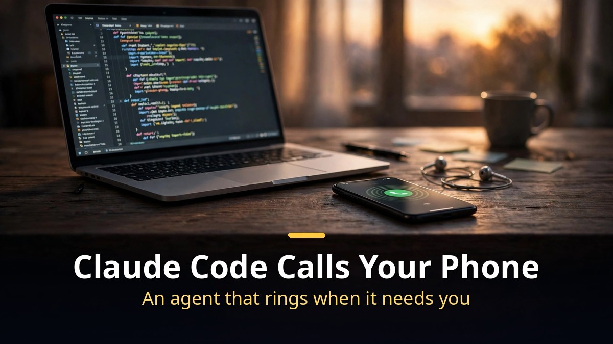
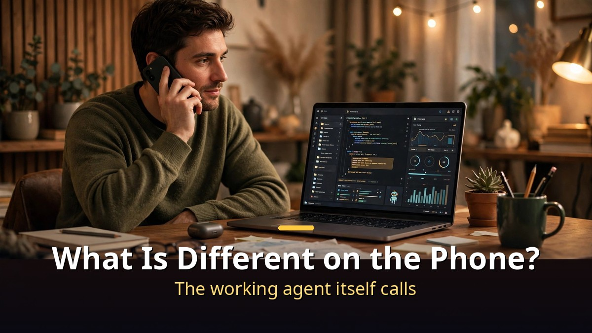
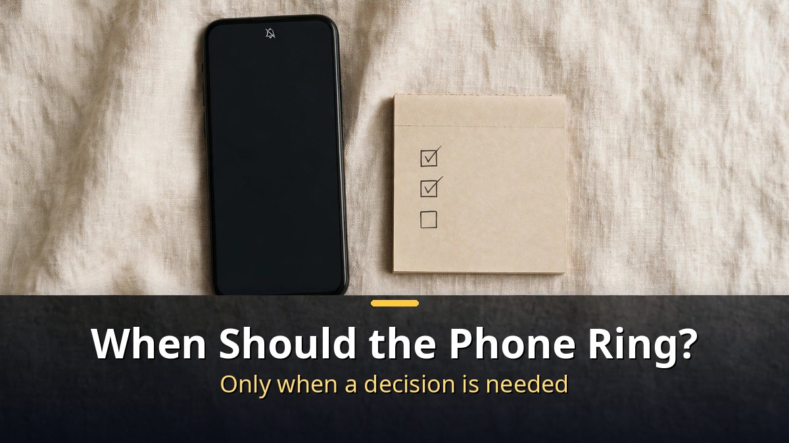

<!-- 본문 시작 -->

When Claude Code gets stuck, it no longer waits in the terminal.
It calls your phone number directly.
"Your rough cut is ready. Which shot should open the video?"
The voice sounds human, and the question carries the full context of that day's work.
This post unpacks the structure behind a one-minute demo video.
The call in the video went through a service called Bird, while the do-it-yourself method the creator published uses Fish Audio and a warm agent process.
They are not the same call.
This post separates what you can use now from what you have to build yourself.

> Key takeaway: A phone call from Claude Code has three parts. A voice platform places the call, transcribes speech, and manages turn-taking; an HTTPS endpoint answers requests the way OpenAI does; and one coding agent process on your laptop stays warm for the whole call. The trick that matters most is not starting a fresh session each turn. Starting or resuming a session costs 3.7 to 7 seconds before the first token — on a phone call, that feels like hanging up every turn.

## What is different about the Claude on the phone — the Bird demo

The video is a short demo, one minute and seven seconds.

Claude Code is editing this very video.
When it gets stuck, the phone rings.
The Claude on the phone asks, "Your rough cut is ready. Which shot should open the video?" and offers two choices.
Option 1 is the sound of a ringing phone. Option 2 is the creator's face.
The creator picks option 1, and that scene opens the video.

The call runs through Bird (bird.com).
Bird lets AI agents send texts, emails, and phone calls.
It works with Claude Code, and also with ChatGPT, Cursor, and Codex.
The creator set it to call only when truly needed.
Small things like a finished render arrive by text message.
The phone rings only when a decision is needed.

One detail from the demo deserves attention.
The Claude on the phone is not reading a script.
It is the session itself — with that day's work, files, and repository — answering directly.
That is why the question and its two options fit the work in progress.
This is not a notification pretending to be a call. It is the working agent itself calling.

## What you need to build it yourself — Fish Audio and a warm session

The creator also published a write-up of how to build the same call yourself.

The voice is Fish Audio.
That is what makes it sound like a person instead of a robot.
Fish Audio has a system for this: give it a number, a voice, and an endpoint, and it handles the entire phone side.
But it is in private beta right now, so there is no signup link yet.
It is a path you have to wait for, not one you can use today.

The structure has four stages.
Your phone talks to the voice platform, which transcribes what you say, speaks back, and decides when you have stopped talking.
Then your own HTTPS endpoint receives the request.
That endpoint answers `POST /chat/completions` the way OpenAI does, streaming the answer back as server-sent events.
Finally, the coding agent on your laptop produces the answer.

One decision makes or breaks it.
Do not start the agent fresh on every request.
On a laptop that feels fine. On a phone call it is unusable.
Starting or resuming a session costs 3.7 to 7 seconds before the first token comes out. Every single turn.
The voice platform gives up after about 10 seconds per turn and apologizes.
So the creator boots one agent process before the phone rings, keeps it open for the whole call, and feeds it turns through stdin.
Claude Code can do this with `-p --output-format stream-json --input-format stream-json --include-partial-messages`.

In short, building it yourself takes three things.
A voice platform that places and receives calls, your own endpoint that answers the way OpenAI does, and one agent process that stays alive for the whole call.
The most expensive cost is not money. It is the design of keeping the session warm.

| Approach | What it needs | Usable now? | Notes |
|---|---|---|---|
| Bird demo approach | Bird account, agent connection | Confirmed working in the video | Texts, emails, and calls in one place; works with ChatGPT, Cursor, and Codex too |
| Fish Audio DIY build | Fish Audio, your own endpoint, warm session | Private beta, no signup link | Human-sounding voice; keeping the session warm is the key |
| Bland.ai alternative | Bland account with credit, API key | Free credits, then about 14 cents a minute (as of October 2026) | Give the phone agent a short brief and it calls |
| call-me MCP alternative | Phone provider (Telnyx etc.), MCP connection | Available as an open-source plugin | Set the agent to call when it needs a decision |

Call prices vary by approach.
Bird's pricing was not confirmed in the video.
Fish Audio is described only as free for a limited time.
Bland bills about 14 cents a minute after free credits (as of October 2026).
A decision call lasts one or two minutes, so one call costs a few hundred won at most.
But whether each service can call Korean numbers has not been confirmed.
Check the service's Korea outbound availability before using it.

## When should the phone ring — only when it has to

Just because the agent can call does not mean it should call any time.

The creator's standard is clear.
The phone rings only when a decision is needed.
Small things like a finished render arrive by text.
The call comes only when the work is blocked and a human's judgment is required.
Without that split, a useful feature quickly becomes spam.

It is worth setting the conditions before using it.
First, define exactly when the phone rings.
For example, only decisions the agent must not make alone — "Should I deploy this?" or "Which shot should open the video?"
Second, define when it does not ring.
Progress updates, completion reports, and minor errors go by text.
Third, set the hours.
A call late at night, however useful, will not last long as a habit.

Security deserves a look too.
Your endpoint is a door into your computer.
Open it to the internet, and do not leave it open to anyone.
The creator's write-up puts it this way: the phone platform thinks it is calling a language model.
In other words, the platform sends requests believing your computer is the model.
When opening that door, add authentication and expose only the paths you need.
The phone number is the same.
When you give the agent your number, decide in advance what it may do with it.

As this blog explained in its guide to cutting Claude tokens from 91% to 13%, managing limits matters when you use Claude Code for a long time.
The phone feature sits on top of that.
If the basics are not settled, it is hard to tell why the phone is ringing at all.

## Closing

Watching a one-minute demo, my first thought was not "amazing" but "when will it ring?"
A phone call takes the recipient's whole attention, so the conditions matter more than the technology.
Set it to ring only when a decision is needed, and take the rest by text, and the feature can last.
Building it yourself still has a beta gate, but the structure is only three parts, so it is not hard.
If your work often stalls at one point, start by deciding whether that point is worth a phone call.

## Frequently asked questions

**Q. Can I use it right now?**
A. The Bird demo in the video works, but whether it can call Korean numbers is unconfirmed. Fish Audio's phone system is in private beta with no signup link. Alternatives like Bland.ai or the call-me MCP are usable now.

**Q. How much does a call cost?**
A. It varies by approach. Bland bills about 14 cents a minute after free credits (as of October 2026). A decision call lasts one or two minutes, so one call costs a few hundred won at most. Bird's and Fish Audio's pricing was not confirmed in the video or the write-up.

**Q. Does it work with Korean phone numbers?**
A. Unconfirmed. Check each service's Korea outbound availability on its official page. Alternatives that use a phone provider (Telnyx etc.) also have different outbound conditions by country.

**Q. How does the voice sound so human?**
A. A voice service like Fish Audio handles that. According to the creator's write-up, Fish Audio makes the voice sound like a person. The voice platform transcribes speech, speaks the answer, and manages turn-taking.

**Q. What does "keeping the session warm" mean?**
A. It means booting one agent process before the phone rings and keeping it open for the whole call, feeding it turns as they come. Starting a fresh session costs 3.7 to 7 seconds before the first token, every turn, which feels like hanging up each time. Removing that delay is the key to call quality.

## Good reads

[Claude Tokens From 91% to 13%｜Three Commands: Check, Compact, Clear — Three commands that save your limit](https://aitechnotesen.blogspot.com/2026/11/claude-tokens-from-91-to-13three.html)
[Her｜Can You Fall in Love With a Voice? A Man and an AI Operating System — The conditions of a relationship made of voice alone](https://aitechnotesen.blogspot.com/2026/11/hercan-you-fall-in-love-with-voice-man.html)
[Is GPT-6.2 'Bell' Real?｜OpenAI's Own Chart Says 87.5% — the Rest Is Still Rumor — What the official chart shows, and what is still rumor](https://aitechnotesen.blogspot.com/2026/11/is-gpt-62-bell-realopenais-own-chart.html)

Set the conditions so the phone rings only when a decision is needed, and a call from your AI agent becomes a feature you can keep using. Follow this blog if you want to keep following the story.

<!-- 본문 끝 -->

## 작업용 출처·이미지 정보 (업로드 제외)

- Source: Matt Wolfe 영상 A5SfzBD6M3o(2026-11-08, 1:07, 스크립트 패널 0:00~0:57 확인 기준) + 제작자 정리글(Notion 'How to make your coding agent call you') 대조
- Images: images/01-hero-en.jpg ~ 04-img3-en.jpg / original illustration + English banner overlay (1200x675)
