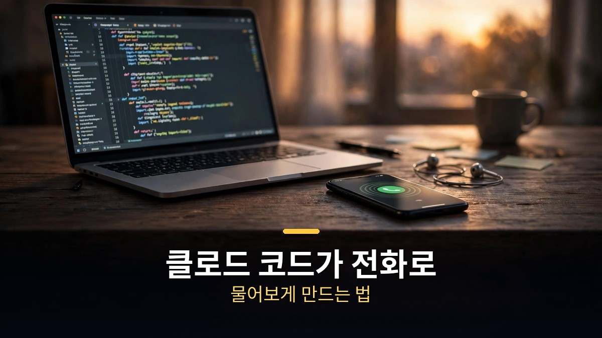
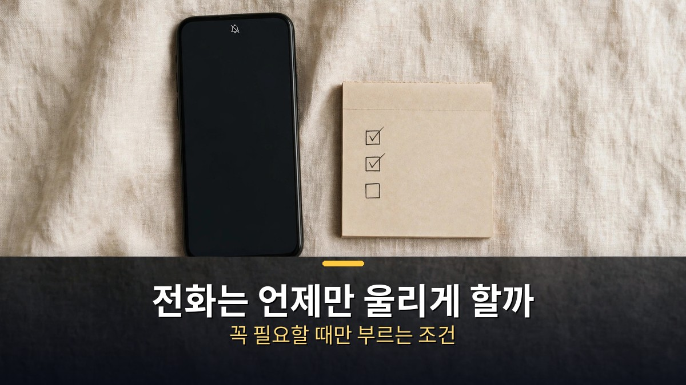

<!-- 본문 시작 -->

클로드 코드가 일하다 막히면, 이제 터미널에서 기다리지 않는다.
내 전화번호로 직접 전화를 건다.
"편집본 초안이 준비됐어요. 어떤 장면으로 시작할까요?"
목소리는 사람처럼 들리고, 질문에는 그날의 작업 맥락이 그대로 담겨 있다.
이 글은 1분짜리 데모 영상 뒤에 있는 구조를 정리한다.
영상 속 전화는 Bird라는 서비스를 거쳤고, 제작자가 직접 만든 방법은 Fish Audio와 따뜻하게 유지한 에이전트 프로세스다.
둘은 같은 전화가 아니다.
어디까지가 지금 쓸 수 있는 것이고, 어디부터가 직접 만들어야 하는지 가른다.

> 핵심 정리: 클로드 코드가 전화를 거는 구조는 세 조각이다. 음성 플랫폼이 전화를 걸고 말을 받아 적고, HTTPS 엔드포인트가 OpenAI와 같은 방식으로 요청을 받고, 노트북의 코딩 에이전트 하나가 통화 내내 따뜻하게 유지되며 답한다. 가장 중요한 트릭은 턴마다 세션을 새로 띄우지 않는 것이다. 세션을 새로 시작하면 첫 토큰까지 3.7~7초가 걸려, 전화에서는 매번 끊긴 것처럼 느껴진다.

## 전화 속 클로드는 무엇이 다른가 — Bird 데모에서 본 것

영상은 1분 7초짜리 짧은 데모다.

클로드 코드가 이 영상 자체를 편집하고 있다.
막히자 전화가 온다.
전화 속 클로드는 "초안이 준비됐어요. 어떤 장면으로 시작할까요?"라고 묻고, 선택지를 두 개 준다.
1번은 전화벨 소리, 2번은 제작자의 얼굴이다.
제작자는 1번을 골랐고, 그 장면이 영상 맨 앞에 나온다.

이 전화는 Bird(bird.com)를 통해 동작한다.
Bird는 AI 에이전트가 문자·이메일·전화까지 보낼 수 있게 하는 서비스다.
클로드 코드뿐 아니라 챗GPT·커서·코덱스와도 작동한다.
제작자는 정말 필요할 때만 전화가 오도록 설정했다.
렌더링이 끝났다는 작은 일은 문자 메시지로 받는다.
전화는 결정을 물어야 할 때만 울린다.

데모에서 눈여겨볼 점은 하나다.
전화 속 클로드는 대본을 읽는 것이 아니다.
그날의 작업 내역, 파일, 저장소까지 가진 세션이 직접 답한다.
그래서 "어떤 장면으로 시작할까요?"라는 질문에 이어지는 선택지도 작업 맥락에 맞는다.
알림이 전화를 흉내 내는 것이 아니라, 일하는 에이전트 본인이 전화를 거는 구조다.

## 직접 만들려면 무엇이 필요한가 — Fish Audio와 웜 세션

제작자는 같은 전화를 직접 만드는 방법도 정리글로 공개했다.

목소리는 Fish Audio다.
사람처럼 들리게 만드는 것이 이 서비스의 역할이다.
Fish Audio에는 번호와 목소리, 엔드포인트만 주면 전화 쪽을 전부 처리해 주는 시스템이 있다.
다만 지금은 비공개 베타라 가입 링크가 없다.
바로 쓸 수 있는 길이 아니라, 기다려야 하는 길이다.

구조는 네 단계다.
휴대폰이 음성 플랫폼과 통화를 하고, 음성 플랫폼이 말을 받아 적고 답을 읽어주고 턴을 가른다.
그다음 내 HTTPS 엔드포인트가 요청을 받는다.
이 엔드포인트는 OpenAI와 같은 방식으로 `POST /chat/completions` 요청에 답하고, 스트리밍으로 결과를 흘려보낸다.
마지막으로 노트북의 코딩 에이전트가 답을 만든다.

여기서 가장 중요한 결정이 하나 있다.
요청이 올 때마다 에이전트를 새로 띄우면 안 된다.
노트북에서는 괜찮아 보이지만, 전화에서는 매번 쓸 수 없게 된다.
세션을 시작하거나 다시 여는 데 첫 토큰까지 3.7~7초가 걸리기 때문이다.
매 턴마다다.
음성 플랫폼은 턴당 10초쯤 지나면 포기하고 사과한다.
그래서 제작자는 에이전트 프로세스 하나를 통화 전에 미리 띄워두고, 통화 내내 열어둔 채 표준 입력으로 턴을 먹인다.
클로드 코드는 `-p --output-format stream-json --input-format stream-json --include-partial-messages` 옵션으로 이렇게 쓸 수 있다.

정리하면, 직접 만들려면 세 가지가 필요하다.
전화를 걸고 받는 음성 플랫폼, OpenAI와 같은 방식으로 답하는 내 엔드포인트, 통화 내내 살아 있는 에이전트 프로세스 하나다.
그중 가장 비싼 비용은 돈이 아니라, 세션을 따뜻하게 유지하는 설계다.

| 방식 | 필요한 것 | 지금 쓸 수 있나 | 알아둘 점 |
|---|---|---|---|
| Bird 데모 방식 | Bird 계정, 에이전트 연결 | 영상 속 데모로 확인됨 | 문자·이메일·전화 통합, 챗GPT·커서·코덱스도 됨 |
| Fish Audio 직접 구축 | Fish Audio, 내 엔드포인트, 웜 세션 | 비공개 베타, 가입 링크 없음 | 목소리가 사람처럼 들림, 세션 유지가 핵심 |
| Bland.ai 대안 | Bland 계정·크레딧, API 키 | 무료 크레딧 후 분당 약 14센트(2026년 10월 기준) | 전화 에이전트에 짧은 지시문만 주면 됨 |
| call-me MCP 대안 | 전화 제공업체(Telnyx 등), MCP 연결 | 오픈소스 플러그인으로 확인됨 | 에이전트가 결정을 물을 때 전화를 걸게 설정 |

전화 요금은 방식마다 다르다.
Bird의 요금제는 영상에서 확인되지 않았다.
Fish Audio는 일정 기간 무료라고만 안내돼 있다.
Bland는 무료 크레딧이 떨어지면 분당 약 14센트 수준이다(2026년 10월 기준).
결정 전화는 1~2분이면 끝나니, 한 통에 몇백 원 수준으로 보면 된다.
다만 한국 번호로 거는 전화가 각 서비스에서 되는지는 확인되지 않았다.
쓰기 전에 해당 서비스의 한국 발신 가능 여부를 먼저 확인해야 한다.

## 전화는 언제만 울리게 할까 — 꼭 필요할 때만 부르는 조건

전화를 걸 수 있게 됐다고, 아무 때나 걸면 안 된다.

제작자의 기준은 분명하다.
전화는 결정을 물어야 할 때만 울린다.
렌더링 완료 같은 작은 일은 문자 메시지로 받는다.
작업이 막혀서 사람의 판단이 필요할 때만 전화가 온다.
이 구분이 없으면, 편리한 기능이 금방 스팸이 된다.

실제로 쓸 때는 조건을 먼저 정하는 것이 좋다.
첫째, 전화가 오는 경우를 딱 정한다.
예를 들어 "배포할지 말지", "어떤 장면으로 시작할지"처럼, 에이전트 혼자 정하면 안 되는 결정만 전화로 받는다.
둘째, 전화가 오지 않는 경우도 정한다.
진행 상황 알림, 완료 보고, 사소한 오류는 문자로 받는다.
셋째, 통화 시간대를 정한다.
밤늦게 울리는 전화는 아무리 유용해도 오래 못 쓴다.

보안도 짚을 만하다.
내 엔드포인트는 내 컴퓨터로 통하는 문이다.
인터넷에 열어두는 만큼, 누구나 들어올 수 있게 두면 안 된다.
제작자의 정리글도 이 구조를 "전화 플랫폼은 반대편이 언어 모델인 줄 안다"고 표현한다.
즉 플랫폼은 내 컴퓨터가 모델인 줄 알고 요청을 보낸다.
이 문을 열 때는 인증을 걸고, 필요한 경로만 열어두는 것이 기본이다.
전화번호도 마찬가지다.
에이전트에게 번호를 알려줄 때는, 그 번호로 무엇을 할 수 있는지 범위를 정해두는 것이 좋다.

[클로드 토큰 91%에서 13%로 줄이는 법｜재고·접고·비우기 3가지 명령어](https://aitechnoteskr.tistory.com/126)에서 정리했듯, 클로드 코드를 오래 쓰려면 한도 관리도 함께 봐야 한다.
전화 기능은 그 위에 얹는 편의 기능이다.
기본 사용법이 정리되지 않은 상태에서 전화부터 붙이면, 전화가 오는 이유를 가려내기 어려워진다.

## 마무리

1분짜리 데모를 보고 처음 든 생각은 "신기하다"가 아니라 "언제 울릴까"였다.
전화는 받는 사람의 시간을 통째로 가져가는 기능이라, 기술보다 조건이 먼저다.
결정을 물을 때만 울리게 정해두고, 나머지는 문자로 받으면 이 기능은 오래 쓸 수 있다.
직접 만들기는 아직 베타 문턱이 있지만, 구조 자체는 세 조각이라 어렵지 않다.
내 작업이 자주 막히는 지점이 있다면, 그 지점부터 전화로 받을지 정해보는 것으로 시작하면 된다.

## 자주 묻는 질문

**Q. 지금 바로 쓸 수 있나요?**
A. 영상 속 Bird 데모는 동작하는 것으로 확인됐지만, 한국 번호 발신 가능 여부는 미확인이다. Fish Audio의 전화 시스템은 비공개 베타라 가입 링크가 없다. Bland.ai나 call-me MCP 같은 대안은 지금 쓸 수 있는 길이다.

**Q. 전화 요금은 얼마나 드나요?**
A. 방식마다 다르다. Bland는 무료 크레딧 후 분당 약 14센트 수준이다(2026년 10월 기준). 결정 전화는 1~2분이면 끝나니 한 통에 몇백 원 수준이다. Bird와 Fish Audio의 요금은 영상과 정리글에서 확인되지 않았다.

**Q. 한국 전화번호로도 되나요?**
A. 미확인이다. 각 서비스의 한국 발신 가능 여부는 공식 페이지에서 직접 확인해야 한다. 전화 제공업체(Telnyx 등)를 쓰는 대안도 국가별 발신 조건이 다르다.

**Q. 전화 속 목소리는 어떻게 사람처럼 들리나요?**
A. Fish Audio 같은 음성 서비스가 담당한다. 제작자의 정리글에 따르면 Fish Audio가 사람처럼 들리는 목소리를 만든다. 음성 플랫폼이 말을 받아 적고, 답을 읽어주고, 턴을 가르는 역할까지 한다.

**Q. 세션을 따뜻하게 유지한다는 것은 무엇인가요?**
A. 전화가 걸려오기 전에 에이전트 프로세스 하나를 미리 띄워두고, 통화 내내 열어둔 채로 턴을 주고받는 방식이다. 세션을 새로 시작하면 첫 토큰까지 3.7~7초가 걸려 매 턴마다 끊긴 것처럼 느껴진다. 이 지연을 없애는 것이 전화 품질을 가르는 핵심이다.

## 함께 읽으면 좋은 글

[클로드 토큰 91%에서 13%로 줄이는 법｜재고·접고·비우기 3가지 명령어 — 한도를 아끼는 세 가지 명령어](https://aitechnoteskr.tistory.com/126)
[화면 없는 노트북 — Hero Keyboard, 사기 전에 확인할 조건 — 화면을 빌려 쓰는 키보드 PC의 조건 정리](https://aitechnoteskr.tistory.com/107)
[그녀｜목소리만 있는 인공지능과 사랑에 빠진 남자의 이야기 — 목소리만으로 이뤄지는 관계의 조건](https://aitechnoteskr.tistory.com/127)

작업이 막힐 때만 전화가 오게 조건을 정해두면, AI 에이전트와의 전화는 오래 쓸 수 있는 기능이 된다. 이 주제를 계속 따라가려면 이웃 추가를 눌러두면 된다.

<!-- 본문 끝 -->

## 작업용 출처·이미지 정보 (업로드 제외)

- 자료 출처: Matt Wolfe 영상 A5SfzBD6M3o(2026-11-08, 1:07, 스크립트 패널 0:00~0:57 확인 기준) + 제작자 정리글(Notion 'How to make your coding agent call you') 대조
- 이미지: images/01-hero.jpg ~ 04-img3.jpg / 자작 일러스트 + 한글 배너 오버레이 (1200x675)
