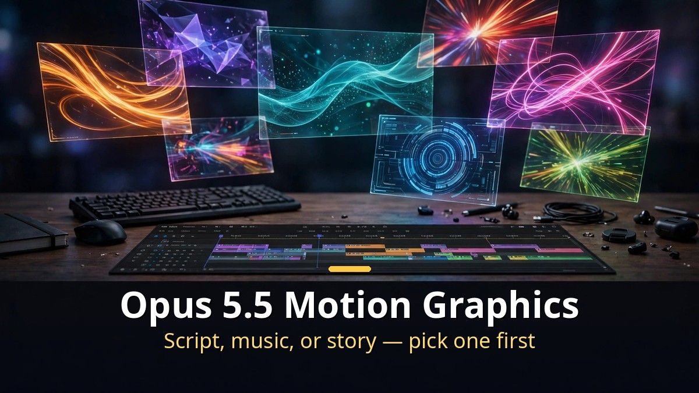
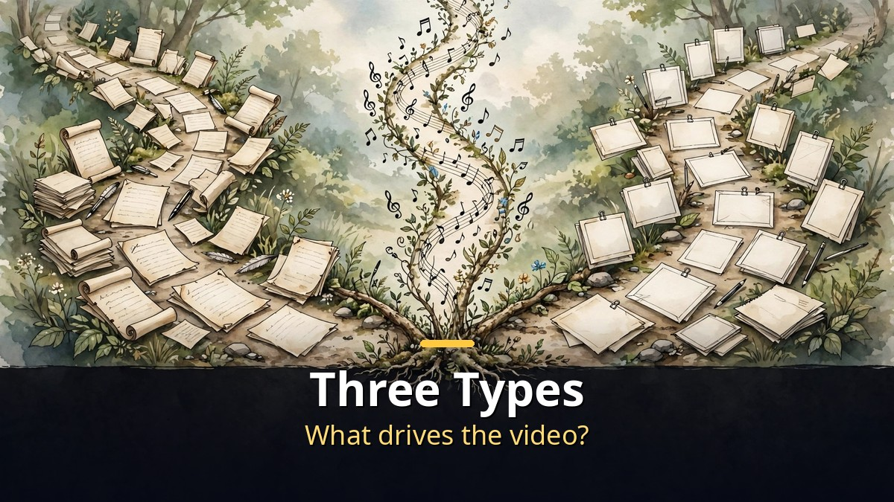
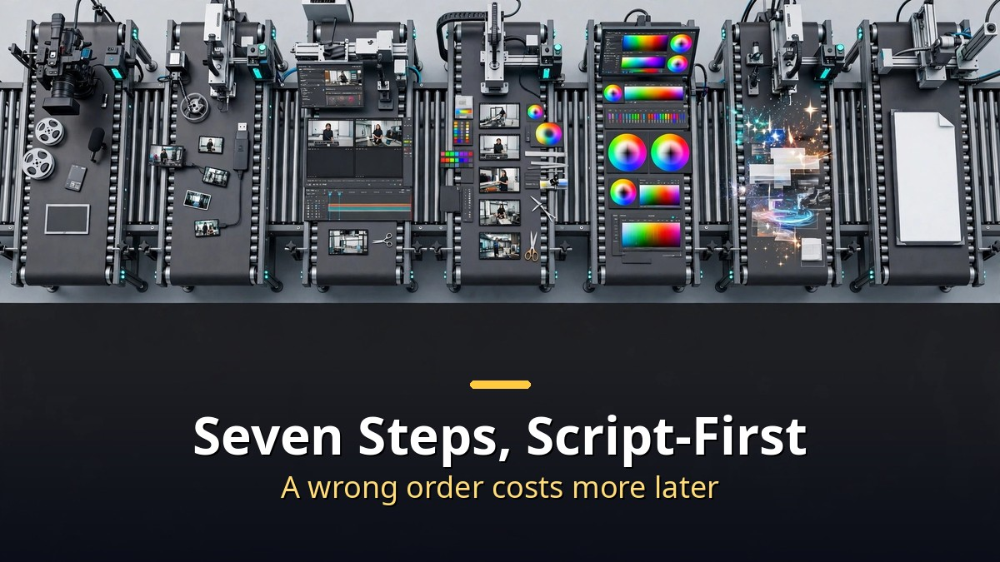

<!-- 본문 시작 -->

A video made from a single prompt looks good in a short preview.
But it falls short of the video you actually want.
AI alone cannot know the content, the order, or the timing.
That is why Opus 5.5 motion graphics come in three types.
Depending on what drives the video — the script, the music, or the story — the order of production changes completely.
This post walks through that split, the seven steps of the script-first method, and skill-based automation.

> Key takeaway: Opus 5.5 motion graphics split into three types: script-first, BGM-first, and story-first. What you decide first changes the whole production order. The script-first method runs in seven steps, from gathering material to adding sound effects and BGM, and a skill can package that order for reuse. But numbers and quotes must be checked by a person, and automation is best built after a video has already earned a response.

## How the three types differ — script, BGM, or story first

Start by deciding what gets decided first.

Script-first means the words drive the video.
Informational videos belong here.
In channel examples with under 10,000 subscribers or around 70,000, views ranged from tens of thousands to a maximum of 1.96 million.
Production can be automated, but the creator's conclusion is that the script has to be good in the end.
A weak script only makes automation produce weak videos faster.

BGM-first means the music drives the video.
Songs come from a composition service like Suno AI, and the animation is made with Opus 5.5.
A video made this way reached close to 2 million views.
The key point is that Claude does not listen to the song with ears.
It turns music into numbers and reads them.
BPM, the exact second each beat lands, when sounds start, volume, bass, midrange, treble, brightness, pitch, and chord changes.
When the bass hits hard, the screen shakes; scenes change on the beat.
In a 15-second practice video, the landing timing matched almost exactly.
But numbers only tell timing, not mood.
To get the feeling you want, you have to give it a sentence like "make a strong-beat K-pop song" together with the lyrics.

Story-first means the story drives the video.
The example is a two-minute animation called "Claude's First Day at Work."
Story, scene structure, color and texture, character and mood all have to be decided.
At first, a scene jumping straight from the car to the desk went missing, and there was trial and error.
The creator's view is that setting the concept and direction takes an experienced maker's judgment more than AI.

| Type | What drives it | Example result | Watch out for |
|---|---|---|---|
| Script-first | Words and information | Tens of thousands to 1.96M views | A weak script makes automation amplify the weakness |
| BGM-first | Music and beat | Close to 2M views | Numbers give timing only, not mood |
| Story-first | Story and scenes | Two-minute "Claude's First Day at Work" | Missing scenes and trial runs; direction needs human judgment |

Revenue is worth a look too.
Revenue does not come from views alone.
The creator's own channel earns almost nothing from views, but advertising offers keep coming in.
As an example calculation, one $300 ad per week, 4.3 weeks a month, comes to $1,290 a month, about 1.7 million won before tax.
That is the creator's example math, not guaranteed income.
The video description states that it is not a method that guarantees views or revenue.

## How do the seven steps of the script-first method work?

The script-first production order has seven steps.

First, gather material.
A web agent that opens sites and reads them directly is used.
Second, write the script.
Set the frame first: the main issue, the opposing views, other perspectives, historical cases.
Third, make a plan.
Fourth, make the voice.
Fifth, apply a template.
Sixth, review.
Seventh, add sound effects and BGM.

Each step has something to watch.
Numbers, dates, and quoted remarks must be checked against the original.
If a fact in the script is wrong, the prettier the video, the faster the wrong content spreads.
For voice (TTS), word- and character-level timestamps are the key.
They are the reference for matching speech to the screen.
After applying the template, the number of revisions has dropped since Opus 5.5.
But review instructions must always be given together.
Sound effects and BGM go in last.
If the picture changes, the sound has to be refitted each time, wasting credits.
At the end, match volume with LUFS (a loudness unit), duck the music while someone speaks, and check the final result with earphones.

Order matters for a reason.
Put sound in first and then fix the picture, and you refit the sound every time.
Review last, and a wrong script means rebuilding the whole video.
The seven steps are not just a sequence — a mistake early on makes the later steps expensive.

## What about automating with skills — when to build, and what must a person check?

A skill is a "recipe book" given to Claude.

Write it once, and then a single line — run the skill with the script — makes the same order run again.
It can automate everything from finding material to writing the script to uploading.
The advantage is not repeating the same explanation every time.

But automation has an order too.
The creator recommends building it after a video has earned some response.
Automating before you know what works builds a machine that produces unpopular videos faster.
Make a few by hand first, see what lands, and then package that order into a skill.

There are also things a person must check.
Numbers and quotes must be verified by a person.
Automation writes scripts and assembles scenes, but it does not check facts on its own.
Putting review instructions into the skill helps, but final responsibility stays with the person.
As this blog showed in its comparison of eight AI video models with the same prompt, results differ by model even under identical conditions.
Automation raises speed, but it does not replace judgment.

So this post ends with one conclusion.
When making a video with Opus 5.5, the first thing to decide is not the tool but the type.
Will the script drive it, the music drive it, or the story drive it?
Once that is decided, the seven steps follow.
Writing prompts before the type is decided produces a pretty video with no clear use.

## Closing

Looking at the three types, I finally see why my videos kept feeling half-finished.
I kept trying to include a bit of script, a bit of music, and a bit of story, so nothing drove anything.
For the next video, I will decide one thing first.
If it carries information, start with the script. If it carries a feeling, start with the music.
Deciding one type alone should cut the time I spend wandering while making it.
Packaging it into a skill comes after that.
First by hand, then by response, then automation.

## Frequently asked questions

**Q. Can Opus 5.5 alone make a whole video?**
A. No. The script-first method uses several tools together: a web agent, TTS, templates, and sound effects. BGM-first needs a separate composition service like Suno AI. Opus 5.5 is the central axis that makes the motion graphics and the picture.

**Q. How is music matched to the picture?**
A. Claude does not listen to the song with ears. It turns music into numbers — BPM, the exact second each beat lands, volume, pitch, and chord changes — and uses them to set timing. Numbers do not know mood, so the feeling you want has to be given in words and lyrics.

**Q. When should I build skill automation?**
A. After a video has earned some response. The creator recommends building automation after seeing a response. Make a few by hand first, and package the order that works into a skill.

**Q. Does revenue come from views alone?**
A. No. The creator's own channel earns almost nothing from views, but advertising offers keep coming in. The example math is one $300 ad per week, or $1,290 a month. But that is not guaranteed income, and the description states it does not guarantee views or revenue.

**Q. Why must a person check numbers and quotes?**
A. Automation writes scripts and assembles scenes, but it does not check facts on its own. Numbers, dates, and quoted remarks must be checked against the original, and final responsibility stays with the person.

## Good reads

[AI Subscription Prices, Compared｜19 Services Ranked, and the Overlap Draining Your Wallet — Why to check limits before prices](https://aitechnotesen.blogspot.com/2026/11/ai-subscription-prices-compared19.html)
[Her｜Can You Fall in Love With a Voice? A Man and an AI Operating System — The conditions of a relationship made of voice alone](https://aitechnotesen.blogspot.com/2026/11/hercan-you-fall-in-love-with-voice-man.html)
[Claude Tokens From 91% to 13%｜Three Commands: Check, Compact, Clear — Three commands that save your limit](https://aitechnotesen.blogspot.com/2026/11/claude-tokens-from-91-to-13three.html)

For your next video, try deciding just one of script, music, or story first. Follow this blog if you want to keep following the story.

<!-- 본문 끝 -->

## 작업용 출처·이미지 정보 (업로드 제외)

- Source: Ai-Con Lab 영상 Mmr-27BhjNo(2026-11-06, 12:20, 스크립트 패널 0:02~12:11 확인 기준)
- Images: images/01-hero-en.jpg ~ 04-img3-en.jpg / original illustration + English banner overlay (1200x675)
