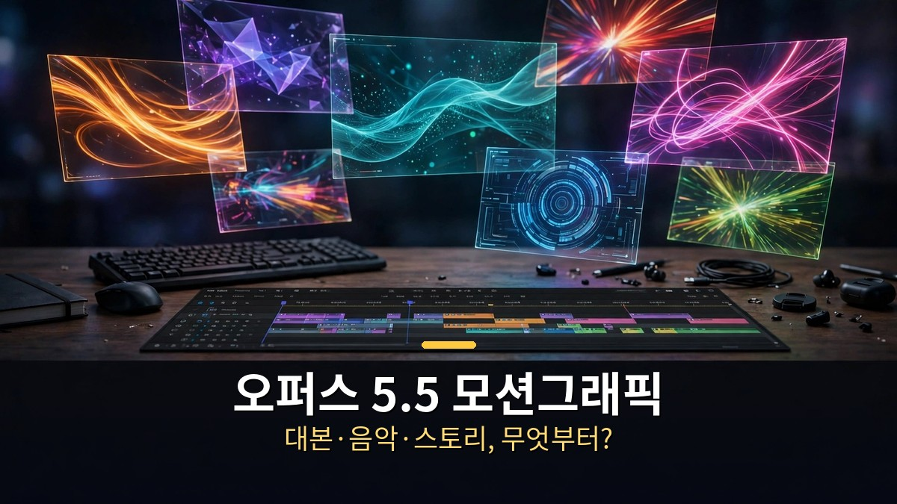
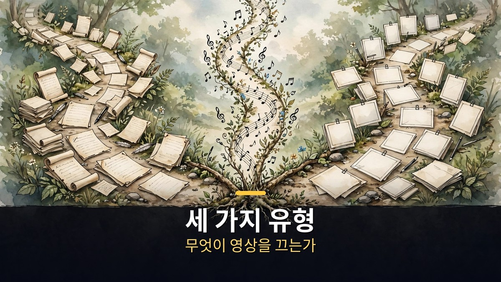
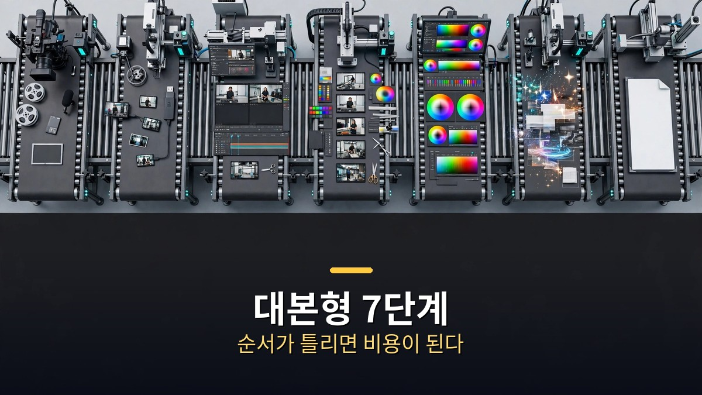

<!-- 본문 시작 -->

원 프롬프트 한 번으로 만든 영상은 짧게 보여주기엔 좋다.
그런데 원하는 영상까지 가기에는 부족하다.
내용과 순서, 타이밍을 AI가 혼자 알 수 없기 때문이다.
오퍼스 5.5 모션그래픽은 그래서 세 가지 유형으로 나뉜다.
무엇이 영상을 끄는지, 대본인지 음악인지 이야기인지에 따라 만드는 순서가 달라진다.
이 글은 그 구분부터 대본형 7단계, 스킬 자동화까지 정리한다.

> 핵심 정리: 오퍼스 5.5 모션그래픽은 대본 우선, BGM 우선, 스토리 우선 세 가지로 나뉜다. 무엇을 먼저 정하느냐에 따라 제작 순서가 통째로 바뀐다. 대본형은 소재 모으기부터 효과음·BGM 넣기까지 7단계로 돌아가고, 스킬로 묶으면 같은 순서를 반복해서 쓸 수 있다. 다만 숫자와 인용은 사람이 직접 확인해야 하고, 자동화는 반응이 어느 정도 나온 뒤에 만드는 것이 좋다.

## 세 가지 유형은 무엇이 다른가 — 대본·BGM·스토리 우선

먼저 무엇을 먼저 정하는지부터 가른다.

대본 우선은 말이 끄는 영상이다.
정보를 전달하는 영상이 여기에 속한다.
구독자 1만 명 미만이거나 7만 명 정도인 채널 사례에서, 조회수가 수만 회에서 최대 196만 회까지 나왔다.
제작 자동화가 가능하지만, 결국 대본이 좋아야 한다는 것이 제작자의 결론이다.
대본이 약하면 자동화로 돌릴수록 약한 영상이 빨리 나올 뿐이다.

BGM 우선은 음악이 끄는 영상이다.
노래는 Suno AI 같은 작곡 서비스로 만들고, 애니메이션은 오퍼스 5.5로 만든다.
이 방식으로 만든 영상이 조회수 200만 회 가까이 나왔다.
여기서 핵심은 클로드가 노래를 귀로 듣는 것이 아니라는 점이다.
음악을 숫자로 바꿔서 읽는다.
BPM, 박자가 치는 정확한 초, 소리 시작 순간, 음량, 저음·중음·고음, 밝기, 음, 코드 변화 같은 것들이다.
저음이 세게 치면 화면을 흔들고, 박자에 맞춰 장면을 바꾼다.
15초 연습 영상에서는 착지 타이밍을 거의 정확히 맞췄다고 한다.
다만 숫자는 타이밍만 알려줄 뿐 분위기는 모른다.
'비트 강한 K팝 노래를 만들어줘' 같은 문장과 가사를 함께 줘야 원하는 느낌이 나온다.

스토리 우선은 이야기가 끄는 영상이다.
2분 조금 넘는 '클로드의 출근' 애니메이션이 예다.
이야기, 장면 구성, 색과 질감, 캐릭터와 분위기를 모두 정해야 한다.
처음에는 차에서 책상으로 바로 넘어가는 장면이 빠지는 등 시행착오가 있었다.
콘셉트와 방향을 잡는 일은 AI보다 경험 많은 제작자의 감각이 필요하다고 제작자는 본다.

| 유형 | 끄는 요소 | 예시 결과 | 주의할 점 |
|---|---|---|---|
| 대본 우선 | 말·정보 | 조회수 수만~196만 회 | 대본이 약하면 자동화가 약점을 키운다 |
| BGM 우선 | 음악·박자 | 조회수 200만 회 가까이 | 숫자는 타이밍만 알려주고 분위기는 모른다 |
| 스토리 우선 | 이야기·장면 | 2분짜리 '클로드의 출근' | 장면 빠짐 같은 시행착오, 방향은 사람 감각 |

수익 얘기도 짚을 만하다.
수익이 조회수에서만 나오는 것은 아니다.
제작자 본인 채널은 조회수 수익은 거의 없지만 광고 제안이 계속 들어온다고 한다.
예시로 건당 300달러짜리 광고를 주 1건씩, 월 4.3주 기준으로 하면 월 1,290달러, 세전 약 170만 원이라는 계산을 보여줬다.
이건 제작자의 예시 계산이지, 보장되는 수익이 아니다.
설명란에도 "조회수나 수익을 보장하는 방법이 아님"이라고 적혀 있다.

## 대본형 7단계는 어떻게 돌아가나

대본형 제작 순서는 일곱 단계다.

첫째, 소재를 모은다.
사이트를 직접 열어 읽는 웹 에이전트를 쓴다.
둘째, 대본을 쓴다.
메인 이슈, 찬반 입장, 다른 관점, 역사적 사례 같은 틀을 먼저 정한다.
셋째, 계획표를 만든다.
넷째, 목소리를 만든다.
다섯째, 템플릿을 입힌다.
여섯째, 검수한다.
일곱째, 효과음과 BGM을 넣는다.

각 단계마다 지켜야 할 것이 있다.
숫자와 날짜, 인용 발언은 원본과 반드시 대조해야 한다.
대본에 들어가는 사실이 틀리면, 영상이 예뻐질수록 틀린 내용이 빨리 퍼진다.
목소리(TTS)에서는 단어와 글자별 타임스탬프가 핵심이다.
말과 화면을 맞추는 기준이 되기 때문이다.
템플릿을 입히고 나면, 오퍼스 5.5 이후로는 수정 횟수가 줄었다고 한다.
하지만 검수 지침은 반드시 함께 줘야 한다.
효과음과 BGM은 마지막에 넣는다.
화면을 수정할 때마다 다시 맞추면 크레딧이 낭비되기 때문이다.
마지막에 LUFS(음량 단위)로 음량을 맞추고, 말할 때 음악을 줄이는 더킹(ducking)을 적용한 뒤 이어폰으로 최종 확인한다.

순서가 중요한 이유가 있다.
효과음을 먼저 넣고 화면을 고치면, 고칠 때마다 소리를 다시 맞춰야 한다.
검수를 나중에 하면, 틀린 대본으로 만든 화면을 통째로 다시 만들어야 한다.
7단계는 그래서 순서대로 도는 것이 아니라, 앞 단계가 틀리면 뒤 단계가 비싸지는 구조다.

## 스킬로 자동화하려면 — 언제 만들고 무엇을 사람이 확인할까

스킬은 클로드에게 주는 '레시피북'이다.

한 번 적어두면, 대본을 넣고 스킬 실행 한마디로 같은 순서대로 제작이 돌아간다.
자료 찾기부터 대본, 업로드까지 자동화할 수 있다.
매번 같은 설명을 반복하지 않아도 된다는 것이 장점이다.

하지만 자동화에도 순서가 있다.
제작자는 반응이 어느 정도 나온 뒤에 만드는 것이 좋다고 권한다.
아직 무엇이 먹히는지 모르는 상태에서 자동화부터 만들면, 안 먹히는 영상을 빨리 찍어내는 기계가 된다.
먼저 손으로 몇 편을 만들어보고, 반응이 나온 뒤에 그 순서를 스킬로 묶는 것이 순서다.

사람이 꼭 확인해야 할 것도 있다.
숫자와 인용은 사람이 직접 확인해야 한다.
자동화가 대본을 쓰고 화면을 붙이는 동안, 사실 확인은 자동으로 되지 않는다.
검수 지침을 스킬에 넣어두면 도움이 되지만, 최종 책임은 사람에게 있다.
[같은 프롬프트로 8개 AI 영상 모델을 돌렸더니｜1위가 갈린 이유와 고르는 법](https://aitechnoteskr.tistory.com/115)에서 정리했듯, 같은 조건으로 돌려도 결과는 모델마다 갈린다.
자동화는 속도를 올리지만, 판단까지 대신하지는 않는다.

그래서 이 글의 결론은 하나다.
오퍼스 5.5로 영상을 만들 때 가장 먼저 정할 것은 도구가 아니라 유형이다.
대본이 끌 것인지, 음악이 끌 것인지, 이야기가 끌 것인지.
그것만 정하면 7단계는 따라온다.
유형이 정해지지 않은 상태에서 프롬프트부터 쓰면, 예쁜 영상이 나와도 어디에 쓸지 모르는 영상이 된다.

## 마무리

세 가지 유형을 보고 나니, 내 영상이 왜 자꾸 어중간했는지 알 것 같았다.
대본도 음악도 이야기도 다 조금씩 넣으려다, 어느 하나도 끌지 못했던 것이다.
다음 영상부터는 하나만 먼저 정해보기로 했다.
정보를 전하는 영상이라면 대본부터, 느낌을 전하는 영상이라면 음악부터.
유형 하나를 정하는 것만으로, 만들 때 헤매는 시간이 확 줄 것 같다.
스킬로 묶는 것은 그다음 일이다.
먼저 손으로, 반응을 보고, 그다음에 자동화다.

## 자주 묻는 질문

**Q. 오퍼스 5.5만으로 영상이 다 만들어지나요?**
A. 아니다. 대본형은 웹 에이전트·TTS·템플릿·효과음까지 여러 도구가 함께 돈다. BGM 우선은 Suno AI 같은 작곡 서비스가 따로 필요하다. 오퍼스 5.5는 모션그래픽과 화면을 만드는 중심축이다.

**Q. 음악은 어떻게 화면과 맞추나요?**
A. 클로드가 노래를 귀로 듣는 것이 아니라 음악을 숫자로 바꿔 읽는다. BPM, 박자가 치는 정확한 초, 음량, 음높이, 코드 변화 같은 숫자로 타이밍을 잡는다. 숫자는 분위기를 모르니, 원하는 느낌은 문장과 가사로 함께 줘야 한다.

**Q. 스킬 자동화는 언제부터 만들면 좋나요?**
A. 반응이 어느 정도 나온 뒤가 좋다. 제작자는 자동화는 반응이 나온 뒤에 만드는 것을 권한다. 먼저 손으로 몇 편을 만들어보고, 먹히는 순서를 스킬로 묶는 것이 순서다.

**Q. 수익은 조회수만으로 나오나요?**
A. 아니다. 제작자 본인 채널은 조회수 수익은 거의 없지만 광고 제안이 계속 들어온다고 한다. 건당 300달러짜리 광고를 주 1건씩 받으면 월 1,290달러라는 예시 계산을 보여줬다. 다만 보장되는 수익이 아니며, 설명란에도 보장하지 않는다고 적혀 있다.

**Q. 숫자와 인용은 왜 사람이 확인해야 하나요?**
A. 자동화는 대본을 쓰고 화면을 붙이는 일은 하지만, 사실 확인까지 대신하지 않기 때문이다. 숫자·날짜·인용 발언은 원본과 대조해야 하고, 최종 책임은 사람에게 있다.

## 함께 읽으면 좋은 글

[같은 프롬프트로 8개 AI 영상 모델을 돌렸더니｜1위가 갈린 이유와 고르는 법 — 프롬프트 준수 순위와 장면 완성도 순위](https://aitechnoteskr.tistory.com/115)
[A.I. 인공지능｜사랑하도록 프로그래밍된 소년 로봇, 인간이 된다는 것의 의미 — 감정을 가진 로봇 소년이 던지는 질문](https://aitechnoteskr.tistory.com/113)
[화면 없는 노트북 — Hero Keyboard, 사기 전에 확인할 조건 — 화면을 빌려 쓰는 키보드 PC의 조건 정리](https://aitechnoteskr.tistory.com/107)

다음 영상부터는 대본·음악·스토리 중 하나만 먼저 정해보기 바란다. 이 주제를 계속 따라가려면 이웃 추가를 눌러두면 된다.

<!-- 본문 끝 -->

## 작업용 출처·이미지 정보 (업로드 제외)

- 자료 출처: Ai-Con Lab 영상 Mmr-27BhjNo(2026-11-06, 12:20, 스크립트 패널 0:02~12:11 확인 기준)
- 이미지: images/01-hero.jpg ~ 04-img3.jpg / 자작 일러스트 + 한글 배너 오버레이 (1200x675)
