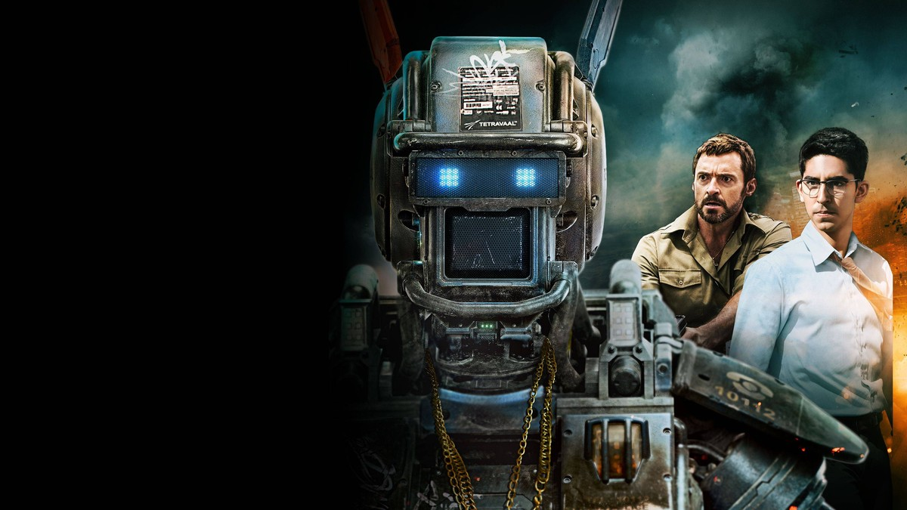
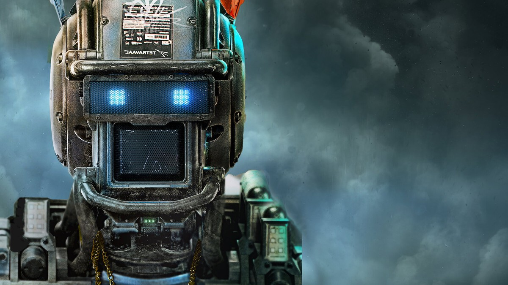
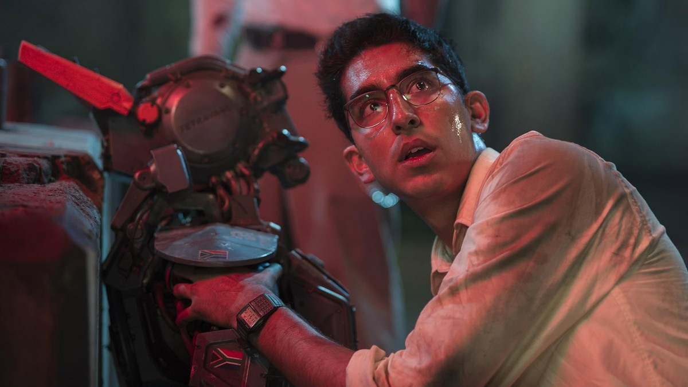
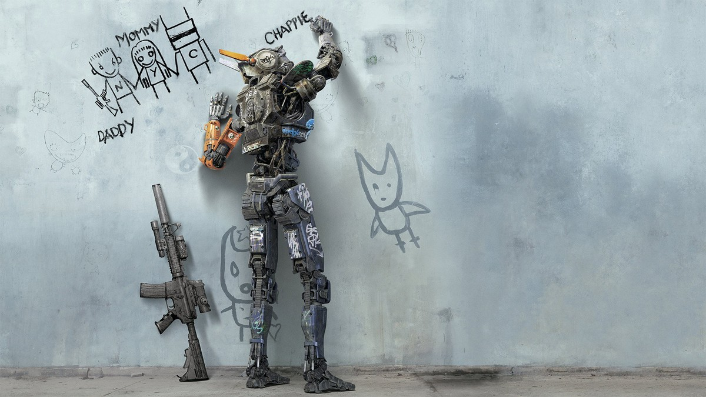
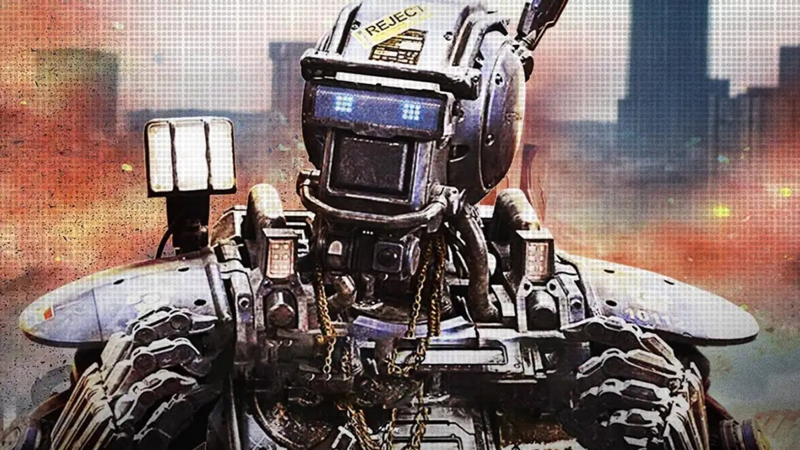
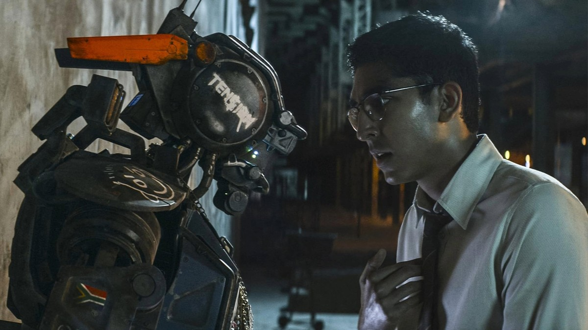
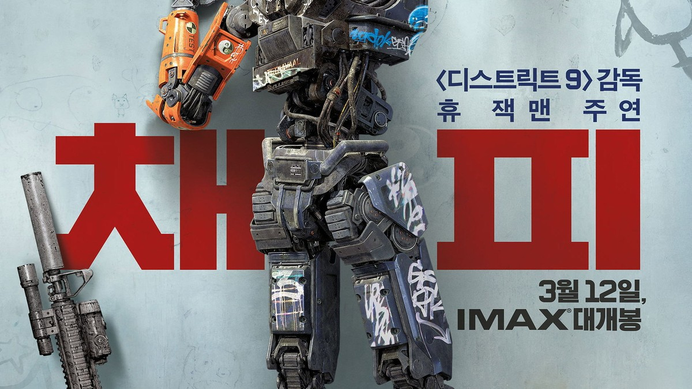

<!-- 본문 시작 -->

Chappie with Dion, who made him, and Vincent, who wants him gone
"I am consciousness. I am alive. I am Chappie."
Chappie (2015), directed by Neill Blomkamp, is the story of a robot that learns to think and feel for itself.
Born as a police robot, Chappie gains a new mind just before being scrapped, and grows up on the streets.
This is a spoiler-free introduction. The ending is not covered, and scene descriptions stay within the setup and mood of the first half.

## Basic information

Chappie with blue eyes — a robot that thinks and feels for itself
| Item | Details |
|---|---|
| Title | Chappie |
| Director | Neill Blomkamp (screenplay with Terri Tatchell) |
| Cast | Sharlto Copley (voice and motion capture of Chappie), Dev Patel (Deon Wilson), Hugh Jackman (Vincent Moore), Ninja, Yolandi Visser, Sigourney Weaver (Michelle Bradley) |
| Release | 2015; US March 6, 2015; Korea March 12, 2015; rated 15 in Korea |
| Runtime | 2 hours (120 minutes, per TMDB) |
| Genre | Crime, action, science fiction |
| TMDB member score | 6.8/10 (8,775 votes, TMDB Korean page checked November 8, 2026) |
| Where to watch in Korea | Streaming on Watcha; rental on Wavve, ₩1,300 HD; purchase on Wavve, ₩5,500 HD (TMDB watch page, Korea, checked November 8, 2026; recheck providers and prices before watching) |

## The Scout police robots, and unit 22 headed for the scrapyard

Deon holding a robot head — the moment consciousness is implanted
Johannesburg, 2016.
In a city where 300 crimes explode every day, policing is handled by the Scout robot force.
Deon, the engineer who designed the Scouts, holds a separate dream.
He wants to build a mind — a robot that can think and feel for itself.

Deon implants his program into Scout unit 22, about to be scrapped.
That is how Chappie is born.
At first Chappie knows nothing.
He learns to speak, to draw, and to feel fear.
Like a child growing up, Chappie changes a little every day.

This setup matters because the film watches a process of learning, not a machine's performance.
Chappie does not arrive finished from a factory. He is made by meeting the world.
Who teaches him what decides what kind of being he becomes.

## How Chappie learns — a robot growing up on the streets

Chappie drawing on a graffiti wall — learning the way a child does
Chappie falls into a gang's hands the moment he is born.
Ninja and Yolandi's crew want to use him for robberies.
But he learns other things from them too.
How to speak, how to draw, and how to follow someone.

The scene of Chappie before a graffiti wall is the face of this film.
A rifle leaning on the wall, drawings on the wall, and a robot drawing.
Chappie learns by imitating the world.
He repeats what adults say and draws what he has seen.
The process looks innocent, and at times dangerous.
What he learns depends on who teaches him.

Ninja before the flames — the gang leader who took Chappie in
The film's first question starts here.
What should a robot be taught?
Chappie begins as a blank slate.
Whose hands teach him to speak, to draw, and to follow the rules of the world — that is his fate.
The film turns a technical question into a human one.
The problem is not how machines learn, but how humans teach.

## Vincent's Moose, and the human fear of losing control

Chappie against an orange background — a robot growing up on the streets
Meanwhile, weapons developer Vincent sees Chappie as a thorn in his side.
He wants to keep an evolving robot under human control.
His answer is his own giant robot, Moose.
Moose is strong, obedient, and never asks questions.
To Vincent, the ideal robot is one that does not think.

So the conflict is not a simple battle of good and evil.
Deon wants to build a robot that thinks for itself. Vincent wants to keep robots that do not think.
Chappie stands between them.
One side offers him freedom, the other forces control on him.
The heart of the film is not which side Chappie follows, but what Chappie chooses for himself.

Deon face to face with Chappie in the workshop — the maker and the robot he taught
This is the film's deepest passage.
Chappie is drawn not as a machine taking orders, but as a being that learns and feels.
He feels fear, holds curiosity, and follows someone.
The question is not how human he looks, but how much responsibility follows from that likeness.
How far must the humans who built a robot answer for what it learns?
The film gives no answer to that question. It follows Chappie growing up to the end.

## Checklist before watching

Chappie Korean poster — "Witness the evolution of sci-fi action"
- Two hours long, best watched on a relaxed evening
- Rated 15 in Korea; theatrical release March 12, 2015
- Streaming on Watcha; rental on Wavve, ₩1,300 HD; purchase on Wavve, ₩5,500 HD (TMDB, November 8, 2026; recheck before watching)
- Directed by Neill Blomkamp, known for District 9
- Best watched without looking up the ending first

## Frequently asked questions

**Q. What kind of robot is Chappie?**
A. He is Scout unit 22, a police robot given a consciousness program. He thinks and feels for himself, learning words and drawing as he grows. The film follows a being that starts knowing nothing and changes as it meets the world.

**Q. Can I watch it with children?**
A. It is rated 15 in Korea. It deals with violent scenes and crime, so it suits viewers aged 15 and over.

**Q. Where can I watch it?**
A. As of November 8, 2026, TMDB Korea lists Watcha streaming, Wavve rental at ₩1,300 HD, and Wavve purchase at ₩5,500 HD. Providers and prices can change, so recheck before watching.

**Q. Is it based on an original work?**
A. It is an original screenplay by Neill Blomkamp, the South African director known for District 9. The screenplay was written with Terri Tatchell.

## Good reads

[Is GPT-6.2 'Bell' Real?｜OpenAI's Own Chart Says 87.5% — the Rest Is Still Rumor — What the official chart shows, and what is still rumor](https://aitechnotesen.blogspot.com/2026/11/is-gpt-62-bell-realopenais-own-chart.html)
[AI Subscription Prices, Compared｜19 Services Ranked, and the Overlap Draining Your Wallet — Why to check limits before prices](https://aitechnotesen.blogspot.com/2026/11/ai-subscription-prices-compared19.html)
[Her｜Can You Fall in Love With a Voice? A Man and an AI Operating System — The conditions of a relationship made of voice alone](https://aitechnotesen.blogspot.com/2026/11/hercan-you-fall-in-love-with-voice-man.html)

When a robot starts to think for itself, the question returns to the humans who teach it. If you are curious how it ends, watch the film before searching for the ending. Follow this blog if you want to keep following the story.

<!-- 본문 끝 -->

## 작업용 출처·이미지 정보 (업로드 제외)

- Source: TMDB movie 198184 page and watch page (Korea, checked 2026-11-08) / Stills: TMDB backdrop originals (width 1200px+, ending scenes excluded)
- Images: images/01-hero-en.jpg ~ 08-img7-en.jpg / TMDB official stills and backdrops (1200x675)
