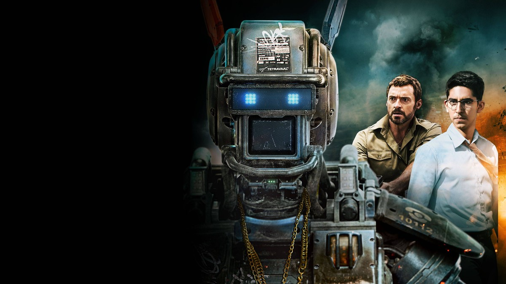
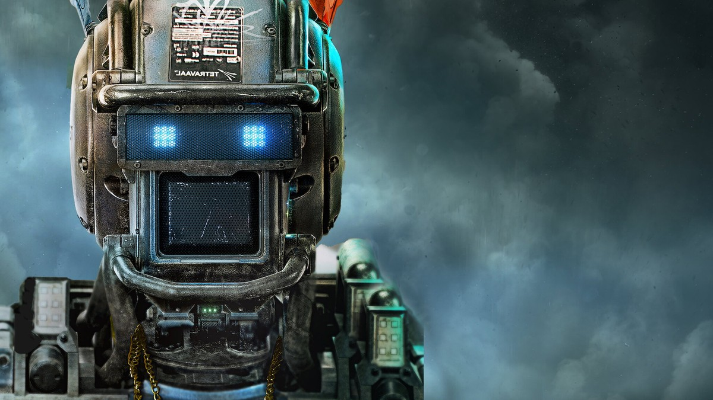
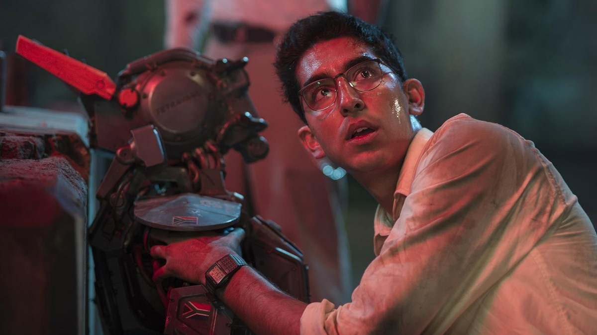
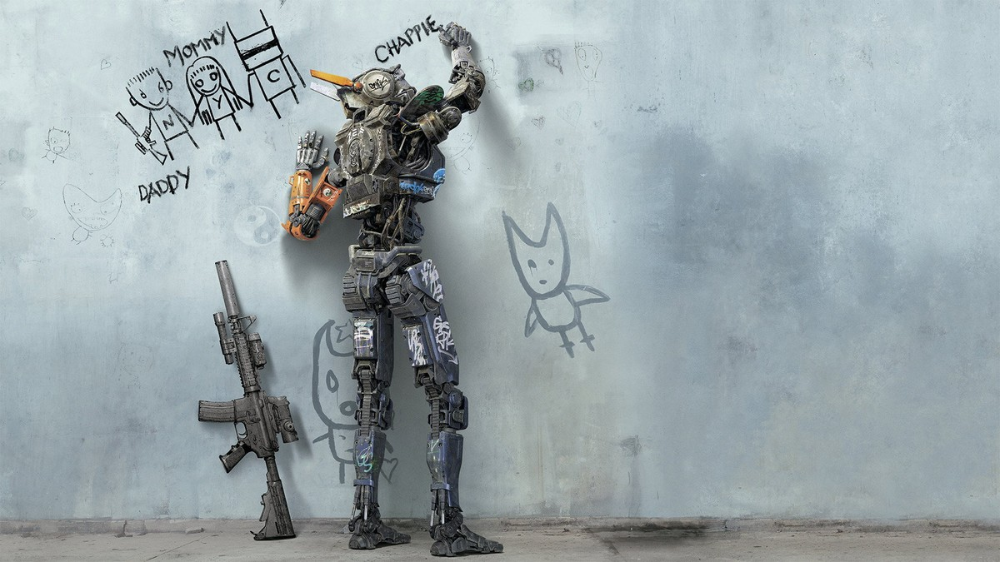
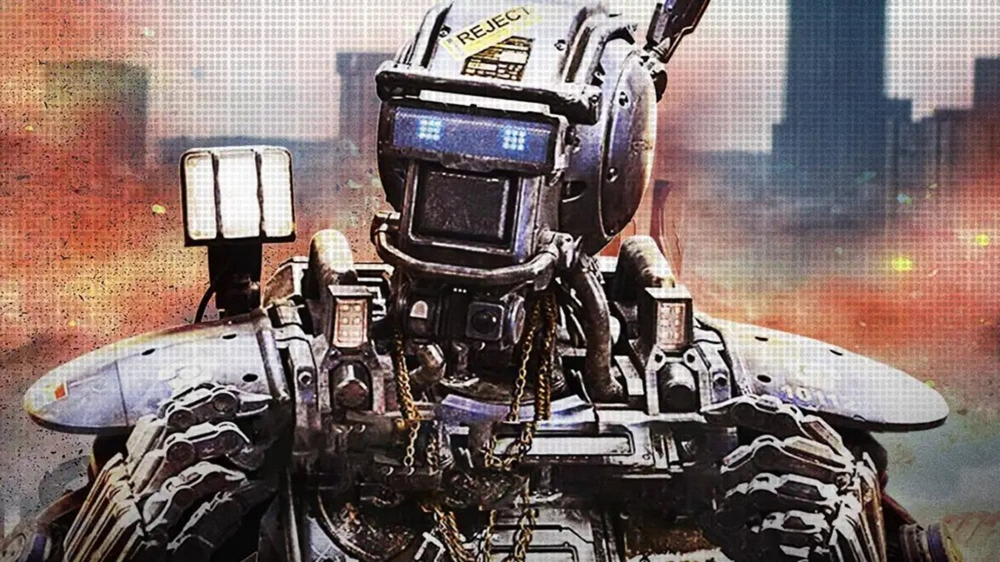
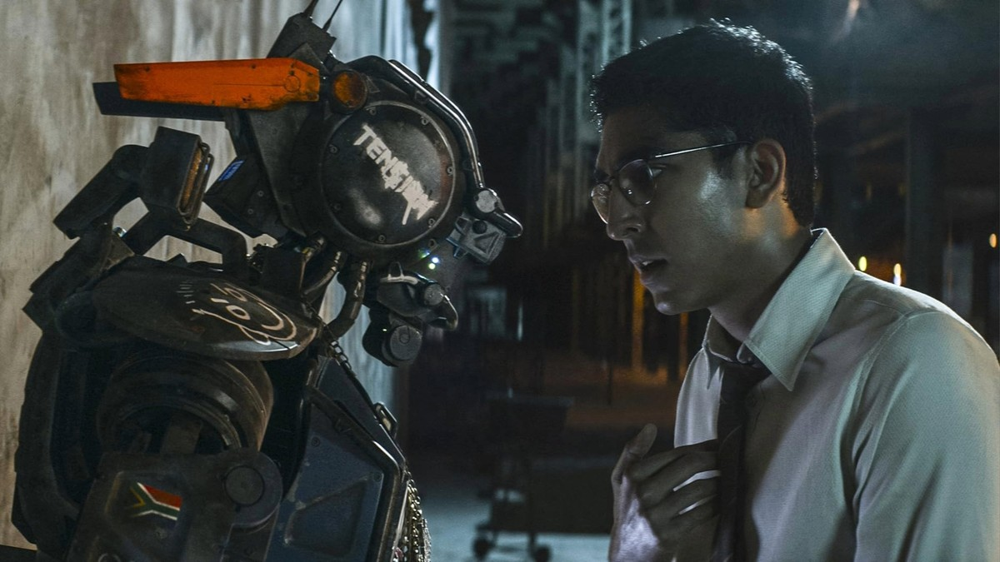
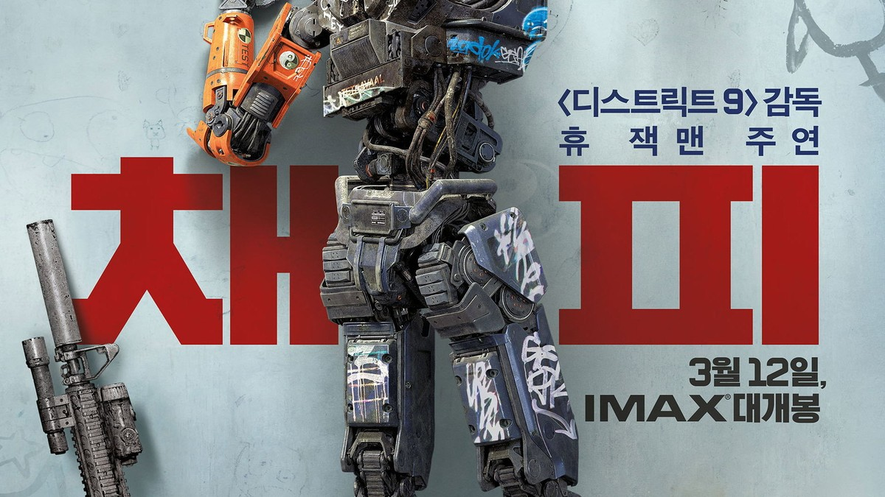

<!-- 본문 시작 -->

채피와 그를 만든 디온, 그를 없애려는 빈센트
"난 살아있어, 난 채피야."
2015년 닐 블롬캠프 감독의 '채피'는 스스로 생각하고 느끼는 로봇의 이야기다.
로봇 경찰로 태어난 채피는 폐기 직전에 새 마음을 얻고, 거리에서 자라난다.
이 글은 스포일러 없는 소개다. 결말 장면은 다루지 않으며, 장면 설명은 중반부까지의 설정과 분위기 중심으로 정리했다.

## 기본 정보

파란 눈의 채피 — 스스로 생각하고 느끼는 로봇
| 항목 | 내용 |
|---|---|
| 제목 | 채피 (Chappie) |
| 감독 | 닐 블롬캠프 (각본 테리 태처와 공동) |
| 주연 | 샬토 코플리(채피 목소리·모션캡처), 데브 파텔(디온 윌슨), 휴 잭맨(빈센트 무어), 닌자, 욜란디 비서, 시고니 위버(미셸 브래들리) |
| 개봉 | 2015년, 미국 2015년 3월 6일·한국 2015년 3월 12일, 등급 15세 |
| 러닝타임 | 2시간(120분, TMDB 표기) |
| 장르 | 범죄, 액션, SF |
| TMDB 회원 점수 | 6.8/10(8,775개 평가, TMDB 한국 페이지 2026-11-08 확인) |
| 국내 시청처 | 스트리밍 왓챠, 대여 웨이브 1,300원 HD, 구매 웨이브 5,500원 HD (TMDB 시청처 페이지 대한민국 기준 2026-11-08 확인, 가격·제공처는 시청 전 재확인 필요) |

## 로봇 경찰 스카우트, 그리고 폐기된 22호

로봇 머리를 든 디온 — 의식을 심는 순간
2016년의 요하네스버그.
매일 300건의 범죄가 폭주하는 도시에서, 치안은 로봇 경찰 '스카우트' 군단이 맡는다.
스카우트를 설계한 로봇 개발자 디온은 따로 품은 꿈이 있다.
로봇이 스스로 생각하고 느낄 수 있는 의식을 만드는 것이다.

디온은 폐기 직전의 스카우트 22호에 자신의 프로그램을 심는다.
그렇게 태어난 로봇이 채피다.
채피는 처음에는 아무것도 모른다.
말을 배우고, 그림을 그리고, 두려움을 느낀다.
마치 아이가 자라는 것처럼, 채피는 하루하루 조금씩 변한다.

이 설정이 중요한 이유는, 영화가 로봇의 성능이 아니라 배움의 과정을 보기 때문이다.
채피는 공장에서 완성된 채로 나오는 것이 아니라, 세상과 만나면서 만들어진다.
누가 무엇을 가르치느냐에 따라, 같은 로봇도 전혀 다른 존재가 된다.

## 채피가 배우는 법 — 거리에서 자라는 로봇

낙서 벽 앞에서 그림을 그리는 채피 — 배우는 법이 아이와 같다
채피는 태어나자마자 갱단의 손에 들어간다.
닌자와 욜란디가 이끄는 일당은 채피를 강도 일에 쓰려 한다.
하지만 채피는 그들에게서 다른 것도 배운다.
말하는 법, 그리는 법, 그리고 누군가를 따르는 법이다.

낙서 벽 앞에 선 채피의 장면이 이 영화의 얼굴이다.
벽에 기대어 선 소총, 벽에 그려진 그림들, 그리고 그림을 그리는 로봇.
채피는 세상을 흉내 내면서 배운다.
어른들이 하는 말을 따라 하고, 본 것을 그려본다.
그 과정이 순수해 보이다가도, 때로는 위험해 보인다.
가르치는 사람이 누구냐에 따라, 채피가 배우는 것이 달라지기 때문이다.

불길 앞에 선 닌자 — 채피를 데려간 갱단의 두목
영화가 던지는 첫 질문이 여기 있다.
로봇에게 무엇을 가르쳐야 하는가.
채피는 백지 상태에서 시작한다.
그에게 말을 가르치고, 그림을 가르치고, 세상의 규칙을 가르치는 손이 누구냐가 곧 그의 운명이다.
이 영화는 기술의 문제를 인간의 문제로 바꾼다.
기계가 배우는 방식이 아니라, 인간이 가르치는 방식이 문제라는 것이다.

## 빈센트의 무스, 통제하려는 인간의 두려움

주황빛 배경의 채피 — 거리에서 자라는 로봇
한편 무기 개발자 빈센트는 채피를 눈엣가시로 본다.
진화하는 로봇을 인간의 힘으로 통제하고 싶어 한다.
빈센트가 내세우는 것은 자신의 대형 로봇 무스다.
무스는 힘이 세고, 명령에 충실하고, 의문을 품지 않는다.
빈센트에게 이상적인 로봇은 생각하지 않는 로봇이다.

그래서 영화의 대립은 단순한 선악 구도가 아니다.
스스로 생각하는 로봇을 만들려는 디온과, 생각하지 않는 로봇을 유지하려는 빈센트.
채피는 그 사이에 서 있다.
한쪽은 채피에게 자유를 주고, 다른 한쪽은 채피에게 통제를 강요한다.
채피가 어느 쪽을 따르는지가 아니라, 채피가 스스로 무엇을 선택하는지가 영화의 중심이다.

작업장에서 채피와 마주한 디온 — 만든 사람과 배운 로봇의 대면
이 구간이 영화의 가장 깊은 대목이다.
채피는 명령을 받는 기계가 아니라, 배우고 느끼는 존재로 그려진다.
두려움을 느끼고, 호기심을 갖고, 누군가를 따른다.
그 모습이 인간과 얼마나 닮았는지가 아니라, 닮은 만큼 책임도 따른다는 점이 영화가 묻는 것이다.
로봇을 만든 인간은, 로봇이 배운 것에 대해 어디까지 책임져야 하는가.
영화는 이 질문에 정답을 주지 않고, 채피가 자라는 과정을 끝까지 따라간다.

## 시청 전 체크리스트

채피 한국어 포스터 — 'SF 액션의 진화를 목격하라'
- 러닝타임 2시간으로, 여유 있는 저녁 시간에 보는 것이 좋다
- 등급 15세, 국내 극장 개봉은 2015년 3월 12일
- 시청처는 스트리밍 왓챠, 대여 웨이브 1,300원 HD, 구매 웨이브 5,500원 HD (2026-11-08 TMDB 기준, 시청 전 재확인 필요)
- 감독 닐 블롬캠프, '디스트릭트 9'으로 알려진 감독의 로봇 영화
- 결말에 대한 사전 정보 없이 보는 것이 좋다

## 자주 묻는 질문

**Q. 채피는 어떤 로봇인가요?**
A. 로봇 경찰 스카우트 22호에 의식 프로그램을 심어 태어난 로봇이다. 스스로 생각하고 느끼며, 말과 그림을 배우면서 자란다. 처음에는 아무것도 모르던 존재가 세상과 만나면서 변해가는 과정을 그린다.

**Q. 아이와 함께 봐도 되나요?**
A. 국내 등급은 15세다. 폭력적인 장면과 범죄를 다루는 내용이 있어, 15세 이상 관람이 적합하다.

**Q. 어디서 볼 수 있나요?**
A. 2026-11-08 TMDB 대한민국 기준으로는 왓챠 스트리밍, 웨이브 대여 1,300원 HD, 웨이브 구매 5,500원 HD가 표시된다. 제공처와 가격은 바뀔 수 있어 시청 전 재확인이 필요하다.

**Q. 원작이 있나요?**
A. 닐 블롬캠프 감독의 오리지널 각본 영화다. 감독은 '디스트릭트 9'으로 알려진 남아프리카공화국 출신 감독으로, 각본은 테리 태처와 함께 썼다.

## 함께 읽으면 좋은 글

[터미네이터 2: 심판의 날｜미래에서 온 기계, 인간을 지키는 법을 배우다 — 죽이는 법만 알던 기계가 지키는 법을 배우는 이야기](https://aitechnoteskr.tistory.com/117)
[작은 모델이 거대 모델을 이겼다고?｜얀 르쿤 JEPA 논문, 숫자부터 따져보자 — 109M 모델이 72B 모델을 앞선 결과, 검증 범위부터 보는 법](https://aitechnoteskr.tistory.com/114)
[A.I. 인공지능｜사랑하도록 프로그래밍된 소년 로봇, 인간이 된다는 것의 의미 — 감정을 가진 로봇 소년이 던지는 질문](https://aitechnoteskr.tistory.com/113)

로봇이 스스로 생각하기 시작하면, 문제는 기계가 아니라 가르치는 인간에게 돌아간다는 것이 이 영화가 남기는 질문이다. 그 끝이 궁금해졌다면, 결말을 미리 검색하지 말고 영화를 먼저 보는 것이 좋다. 다음 영화 소개도 함께 따라가려면 이웃 추가를 눌러두면 된다.

<!-- 본문 끝 -->

## 작업용 출처·이미지 정보 (업로드 제외)

- 자료 출처: TMDB 영화 198184 페이지·시청처 페이지(대한민국 기준, 2026-11-08 확인) / 스틸: TMDB 백드롭 원본(너비 1200px 이상, 결말 장면 제외)
- 이미지: images/01-hero.jpg ~ 08-img7.jpg / TMDB 공식 스틸·백드롭 (1200x675)
