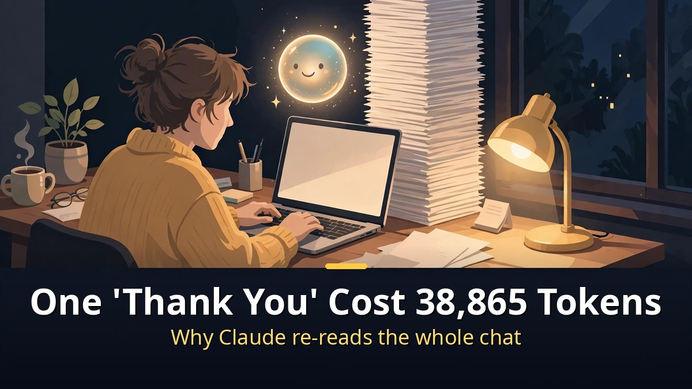
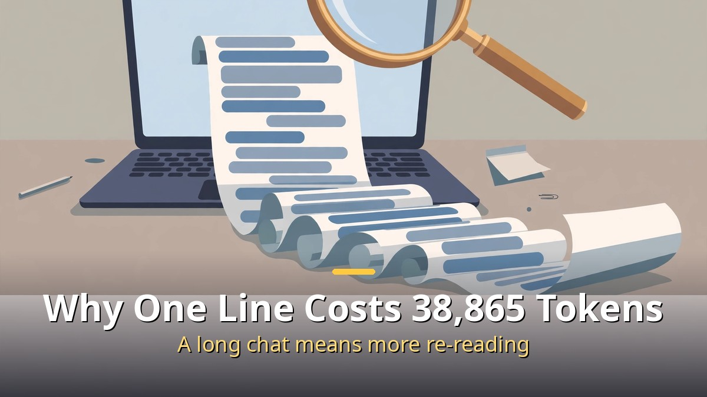
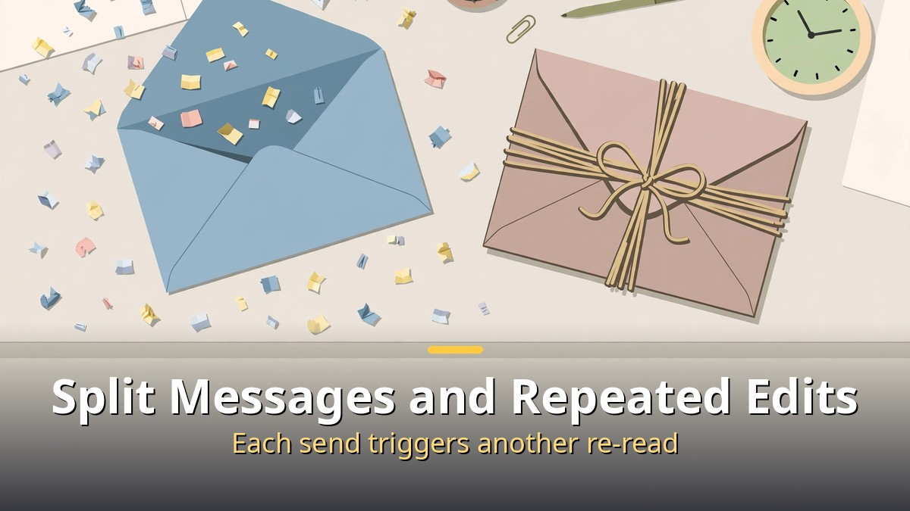
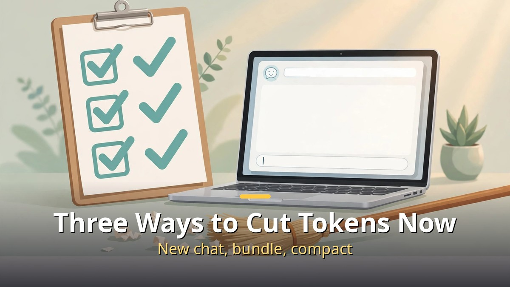

<!-- 본문 시작 -->

One "thank you" to Claude cost 38,865 tokens.
The same line in a new conversation cost 2,843 — about 14 times less.
This post is for everyday Claude users: why the gap exists, measured in real numbers, and how to cut it right away.
The longer the conversation, the more expensive a single line becomes.

> Key takeaway: In a measurement by the Mr. 5pm channel, one "thank you" cost 38,865 tokens in a long conversation and 2,843 in a new one. Sending the same content in two messages cost 77,784 tokens versus 38,882 in one message. Asking for three rounds of edits cost 117,829 tokens versus 38,954 when asked all at once. The reason is one thing: every time Claude replies, it re-reads the entire conversation.

## Why does one "thank you" cost 38,865 tokens?

It is not the "thank you" that is expensive.
It is the conversation stacked in front of it.

Every time Claude replies, it re-reads the whole conversation.
To answer a new question, it has to take in the full context that led to it.
So the same "thank you" costs more the longer the conversation runs.
One short greeting reaches 38,865 tokens not because the greeting is heavy, but because the conversation it carries is heavy.

The numbers make the structure visible.
The creator measured the same line under two conditions.
In a new conversation: 2,843 tokens. In a long, ongoing conversation: 38,865.
About 14 times more.
Same sentence — only the length of the conversation differed.

Here, a token is the unit AI reads, not a character count.
One Korean character is not one token; words, particles, and punctuation are split into small pieces.
So what gets billed is not the tokens of the three characters in "thank you," but the tokens of the whole conversation re-read to understand that one line.
This is not a special Claude pricing trick. It follows from how conversational AI works: the full context is sent as input every turn.

| Condition | Tokens for one "thank you" | Note |
|---|---|---|
| New conversation | 2,843 | Short context, light cost |
| Long conversation | 38,865 | Re-reads the whole history |
| Difference | About 14x | Same line, different conversation length |

These numbers come from the creator's own measurement on their own conversation.
Your real numbers will vary with conversation length, model, and settings.
The direction is clear, though.
The longer the conversation, the more a new line costs.

## Why do split messages and repeated edits cost more?

Saying in two or three messages what could be said in one costs double.
Same reason.
Every message triggers another full re-read, so the re-reading piles up with each send.

The creator measured this with two experiments.
First, the same content sent in two messages versus bundled into one.
Two messages: 77,784 tokens. One bundled message: 38,882.
Same content, about twice the cost, just from splitting it.

Second, asking for edits three times versus asking for everything at once.
Three rounds of edits: 117,829 tokens. Everything at once: 38,954.
About three times more.
Each edit round re-reads the earlier conversation and the earlier edits, so the number of rounds becomes the cost.

| How you send it | Measured tokens | If said all at once |
|---|---|---|
| Split into two messages | 77,784 | 38,882 |
| Three rounds of edits | 117,829 | 38,954 |

The lesson is not "say less."
It is "say it all at once."
If you have three fixes, do not say "fix this," then "oh, this too," then "and this too."
List all three in one message.
Each round makes the conversation longer and the re-reading heavier.

This also explains the token diet covered in the companion post.
As [How I Cut Claude Tokens From 91% to 13%｜Three Commands: Check, Compact, Clear](https://aitechnotesen.blogspot.com/2026/11/claude-tokens-from-91-to-13three.html) showed, when a conversation gets heavy, compress it, fold away unused context, and start a new conversation for a new topic. Same idea, same direction.

## Three ways to cut tokens right now

The fixes are not dramatic.
Change three small sending habits.

First, start a new conversation for a new topic.
If the new topic has nothing to do with the old one, continuing in the same thread makes every new question re-read the old topic.
Opening a new conversation is the surest saving.
One "new conversation" click can make a 14x difference.

Second, bundle what you send into one message.
If you have two things to say, do not send them twice. Write them once.
Same for edit requests.
Gather the fixes and ask for them together, and the re-reading shrinks.
A quick check before sending — "is this everything?" — saves tokens.

Third, tidy up when a conversation gets heavy.
When replies slow down or tokens feel heavy, use /compact to compress the conversation, or /clear to empty it and start fresh.
As the companion post explains, compacting keeps a summary, and clearing starts over.
Either beats dragging a long conversation along unchanged.

| Method | When | Effect |
|---|---|---|
| Start a new conversation | Topic changes | Old context is not re-read |
| Bundle into one message | Several things to say | Fewer re-reads piling up |
| Compact or clear | Conversation gets long | /compact shrinks it, /clear restarts it |

All three come down to one principle: keep the conversation short.
Claude is smart enough to follow a long conversation, but that smartness costs a full re-read every time.
Keeping conversations short is not using AI less. It is doing the same work for less.

## Closing

When I first saw that one "thank you" cost 38,865 tokens, my honest thought was "did I do something wrong?"
Once I understood the reason, I felt relieved instead.
It was not my words that were expensive. It was the conversation stacked behind them.
Now I open a new conversation without hesitation when a topic changes, and I gather my fixes into one message.
Saving tokens turned out to be about how you treat a conversation.
Short, bundled, and cleared when needed.
Try it once today, and you will feel it in next month's usage.

## FAQ

**Q. Did one "thank you" really cost 38,865 tokens?**
A. That is what the creator measured in their own conversation: 38,865 tokens in a long conversation, 2,843 in a new one. Your numbers will differ by conversation length, model, and settings, but a long conversation costs far more than a new one.

**Q. How are tokens counted?**
A. A token is the unit AI reads text in. It is not a character count: words, particles, and punctuation are split into small pieces. What matters is that the tokens billed are not for the three characters of "thank you," but for the whole conversation re-read to understand that line.

**Q. Why does splitting a message cost more?**
A. Because every send triggers another full re-read. Two messages cost 77,784 tokens versus 38,882 bundled into one. Three rounds of edits cost 117,829 versus 38,954 asked all at once.

**Q. Does compressing a conversation lose content?**
A. /compact summarizes the conversation to shrink it. Key points survive as a summary, but fine details may disappear. Keep important conclusions in a separate note before compressing. See the companion post for how /context, /compact, and /clear differ.

**Q. If I start a new conversation, does Claude forget the old one?**
A. Yes. Conversations are not shared. If you need an earlier conclusion, paste just the short conclusion into the first message of the new conversation. There is no need to copy the whole thread.

## Further Reading

[How to Make Claude Code Call You on the Phone｜An AI Agent That Rings When It Needs a Decision — an agent that calls when it needs you, and what it takes to build it](https://aitechnotesen.blogspot.com/2026/11/how-to-make-claude-code-call-you-on.html)
[How to Make Motion Graphics with Opus 5.5｜Script, Music, or Story — Pick One First — the seven script-first steps and skill automation](https://aitechnotesen.blogspot.com/2026/11/how-to-make-motion-graphics-with-opus.html)
[Chappie｜A Robot That Started to Think and Feel — What Humans Taught It — a robot with feelings, and what humans taught it](https://aitechnotesen.blogspot.com/2026/11/chappiea-robot-that-started-to-think.html)

One habit — keeping conversations short — can visibly change a month of Claude usage. If you want to keep following this topic, add this blog as a neighbor.

<!-- 본문 끝 -->

## 작업용 출처·이미지 정보 (업로드 제외)

- Source: 오후다섯씨 영상 om3rpjpT6r4(2026-11-08, 설명란 실측 수치 기준) + 2026-11-07-003 토큰 다이어트 편과 연결
- Images: images/01-hero-en.jpg ~ 04-img3-en.jpg / original illustration + English banner overlay (1200x675)
