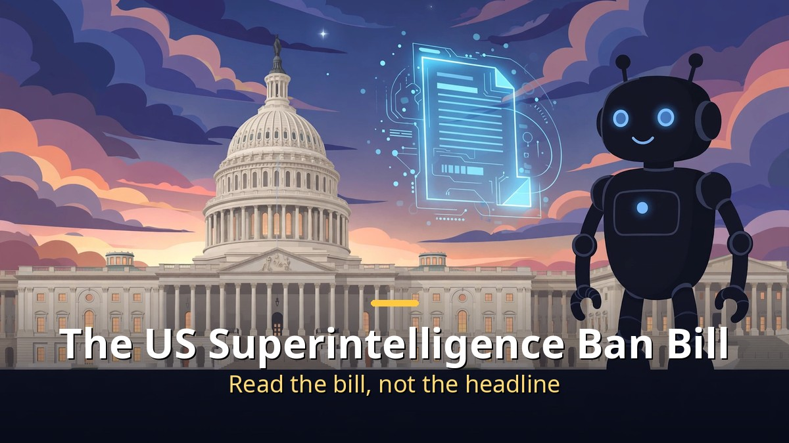
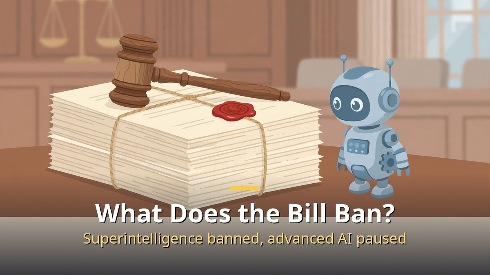
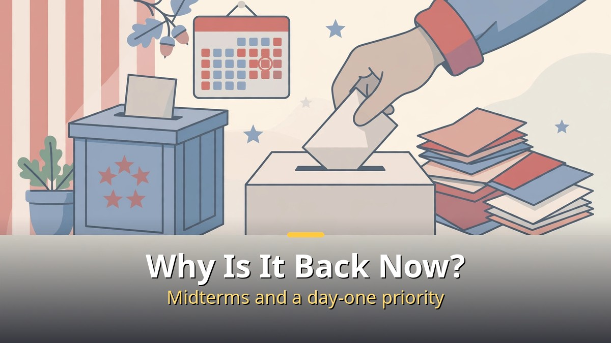

<!-- 본문 시작 -->

A bill to ban superintelligence is back in the US Congress.
Headlines say "the government is about to ban AGI," but the facts are a little different.
The bill was introduced in September, and it is now sitting in committee.
This post is for general readers following AI regulation: what the bill actually contains, why it is back in the news now, and what would change if it passed.

> Key takeaway: The Ban Artificial Superintelligence Act of 2026 was introduced as S.5493 in the Senate (Sanders, September 23) and H.R.10538 in the House (Casar, September 24). It would permanently ban developing, deploying, owning, or funding superintelligence; pause development of advanced AI trained with 10²⁵ operations or more until a new Department of Artificial Intelligence is staffed and safety rules are written; and create that cabinet-level department. Violations could mean forced dissolution for companies and up to 20 years in prison for individuals. But both bills are still stuck in committee — nothing has become law.

## What does the bill actually ban?

Start with the words.
What this bill would ban is not "AI" in general. It is "superintelligence."

The bill defines superintelligence in two ways: an AI that surpasses human cognitive abilities in most domains, or one that can take actions capable of disempowering humanity or overthrowing a government.
The bill would permanently ban developing, deploying, owning, or funding such systems.
That means ChatGPT or an image generator you use today is not the target.
This is about a different layer than the AI tools small businesses use.

There is also a "pause," separate from the ban.
The bill would temporarily halt development of advanced AI trained with at least 10²⁵ operations, until the new department is fully staffed and has established safety rules.
Once the department is running and the rules exist, the pause lifts.
It is a halt while the oversight system is built, not a permanent stop.

The new body would be a cabinet-level Department of Artificial Intelligence.
Its secretary would be appointed by the President, and an expert advisory board would supervise frontier models throughout their life cycle.
The bill also sets a foreign-policy goal of a global ban on superintelligence, using chip and compute export controls as the tool.
That is why reports about China rejecting calls to slow AI down appear in the same conversation.

| Part | Content | Status |
|---|---|---|
| Permanent ban | Developing, deploying, owning, or funding superintelligence | Bill text only |
| Temporary pause | Advanced AI at 10²⁵ operations or more, until the department and rules exist | In the same bill |
| New agency | Cabinet-level Department of Artificial Intelligence + expert advisory board | Not yet created |
| Penalties | Forced dissolution and asset seizure for companies, up to 20 years in prison for individuals | Bill text only |

The penalties are severe.
A company that violates the ban or tries to evade it could lose its operating license and be forcibly dissolved. Individual decision-makers could face up to 20 years in federal prison.
That is compared to major national-security crimes such as illegally developing nuclear weapons.
But all of this is text in a bill, not law in force.
To become law it must pass through Congress, and it has not reached that stage.

## Why is it back in the news now?

The bill itself was introduced on September 23 and 24.
It is back in November because of the midterm elections.

In the November 2026 midterms, Democrats regained control of both the Senate and the House.
On November 4, the day after the election, Representative Yassamin Ansari of Arizona posted on X that the first item on her party's agenda "from day one" should be a pause on advanced AI development, regulation of an "out-of-control" industry, and a ban on superintelligence.
Ansari is one of the bill's original co-sponsors.
The bill is unchanged, but with the majority changing hands, it is back in focus as an agenda item for the next Congress.

The election result itself is tied to AI issues, according to some analysis.
TIME wrote on November 4 that backlash against AI shaped the 2026 midterm elections, and CBS exit polls found that data centers were not winners in the elections.
Local opposition to data-center construction turned into votes.
In a climate where the pace of AI development has become a political issue, a bill introduced in September was pulled back into the spotlight.

A report saying AI is accelerating its own research landed just before this, which gave the "slow down" argument more weight — and the same discipline applies as with model rumors: as [Is GPT-6.2 'Bell' Real?｜OpenAI's Own Chart Says 87.5%, the Rest Is Still Rumor](https://aitechnotesen.blogspot.com/2026/11/is-gpt-62-bell-realopenais-own-chart.html) showed, official numbers and the claims around them must be kept apart.
The video also covers the "ban RSI" (recursive self-improvement) movement in the same current.
The Future of Life Institute's Statement on Superintelligence, an international signature campaign to stop superintelligence development, runs alongside it.

| When | What happened |
|---|---|
| September 23, 2026 | Senate bill S.5493 introduced (Sanders) |
| September 24, 2026 | House bill H.R.10538 introduced (Casar) |
| November 4, 2026 | Democrats win both houses in the midterms; Ansari calls it a "day one" priority |
| November 8, 2026 | Video and press coverage bring the bill back into focus |

There is also a separate proposal from Senators Bennet and Welch to create an independent Federal Digital Commission.
It would supervise frontier AI models and major digital platforms.
Even among those who want regulation, there is disagreement over whether to build a department or a commission.

## What changes if it passes — and what remains if it does not?

First, check what changes right now: nothing.
The bill is referred to the Senate Committee on Commerce, Science, and Transportation and the House Committee on Oversight and Government Reform.
Becoming law requires committee passage, floor votes, and the President's signature.
None of those steps has been taken.
"The government is banning AGI" describes a bill that has been introduced, not a law in force.

If it did pass, this is what would change.
Superintelligence research would be banned by law, and development of models at or above 10²⁵ operations would pause until the new department writes its rules.
Companies building frontier models would come under the department's supervision.
But "superintelligence" is broadly defined, and the 10²⁵ threshold would be adjusted annually by the secretary, so the real scope would only be clear once the rules appear.
The bill's text alone cannot tell you whether the AI you use would be blocked.

If it stays in committee, that does not mean nothing happened.
The bill signals the Democrats' priorities.
When the next Congress convenes in January, AI regulation bills are likely to sit near the front of the agenda.
According to a US Chamber of Commerce report from October 2026, 66% of surveyed small businesses use AI.
As the regulation debate grows, so will the counter-argument: "are you going to block small businesses from using AI?"
That is why it matters to distinguish this bill from a blanket ban.

| Scenario | Meaning | What to watch |
|---|---|---|
| Bill passes | Superintelligence banned, advanced AI paused, Department of AI created | Committee and floor vote schedule |
| Bill stays in committee | Remains a political signal only | Whether it enters the next session's agenda |
| Everyday users | No immediate change to the AI tools in use | How far the regulatory scope reaches |

China's response is another variable.
China has said it rejects calls to slow AI development.
The counter-argument — that slowing down in the US alone hands over the lead — is one axis of opposition to the bill.
The bill's foreign-policy goal of banning superintelligence everywhere is written with that objection in mind.
Whether one country's law can stop development around the world is also the bill's biggest weakness, according to its critics.

## Closing

A headline alone makes it look as if the world has changed, but following the legislative process shows this is still at the "proposal" stage.
That does not mean it can be ignored.
Through the midterms, slowing AI down has moved to the center of politics, and a bill introduced in September has become the vessel for that agenda.
Reading this bill reminded me that checking the stage matters more than memorizing numbers.
Introduced, in committee, voted, in force — once you know the stage, headlines stop shaking you.
Next time a headline carries the word "ban," I will look for the bill number first.

## FAQ

**Q. Has the US government banned AGI?**
A. No. The Ban Artificial Superintelligence Act is a bill introduced in September, now sitting in committee. Becoming law requires committee passage, floor votes, and the President's signature. None of those steps has been taken.

**Q. What is superintelligence in this bill?**
A. The bill defines it as AI that surpasses human cognitive abilities in most domains, or AI that can take actions capable of disempowering humanity or overthrowing a government. ChatGPT or image generators in everyday use do not fall under this definition.

**Q. If the bill passes, will I lose the AI I use?**
A. The bill's text alone cannot settle that. The ban targets superintelligence, and the pause targets development of advanced AI trained at 10²⁵ operations or more. There is no provision banning everyday users from using AI tools.

**Q. Why is this news again now?**
A. Democrats won both houses in the midterms, and co-sponsor Ansari said on November 4 that it should be a "day one" priority. The bill's content is the same as in September, but its political weight has changed.

**Q. How did China respond?**
A. China has said it rejects calls to slow AI development. The argument that slowing down in the US alone hands over the lead is one axis of opposition, and the bill answers it by setting a global ban on superintelligence as a foreign-policy goal.

## Further Reading

[How to Make Motion Graphics with Opus 5.5｜Script, Music, or Story — Pick One First — the seven script-first steps and skill automation](https://aitechnotesen.blogspot.com/2026/11/how-to-make-motion-graphics-with-opus.html)
[Chappie｜A Robot That Started to Think and Feel — What Humans Taught It — a robot with feelings, and what humans taught it](https://aitechnotesen.blogspot.com/2026/11/chappiea-robot-that-started-to-think.html)
[How to Make Claude Code Call You on the Phone｜An AI Agent That Rings When It Needs a Decision — an agent that calls when it needs you, and what it takes to build it](https://aitechnotesen.blogspot.com/2026/11/how-to-make-claude-code-call-you-on.html)

With AI regulation news, check the procedure before the headline: introduced, in committee, or passed. If you want to keep following this topic, add this blog as a neighbor.

<!-- 본문 끝 -->

## 작업용 출처·이미지 정보 (업로드 제외)

- Source: TheAIGRID 영상 PD03ve61CFY(2026-11-08, 설명란 출처 링크 기준) + 법안(S.5493·H.R.10538)·중간선거 보도 대조
- Images: images/01-hero-en.jpg ~ 04-img3-en.jpg / original illustration + English banner overlay (1200x675)
