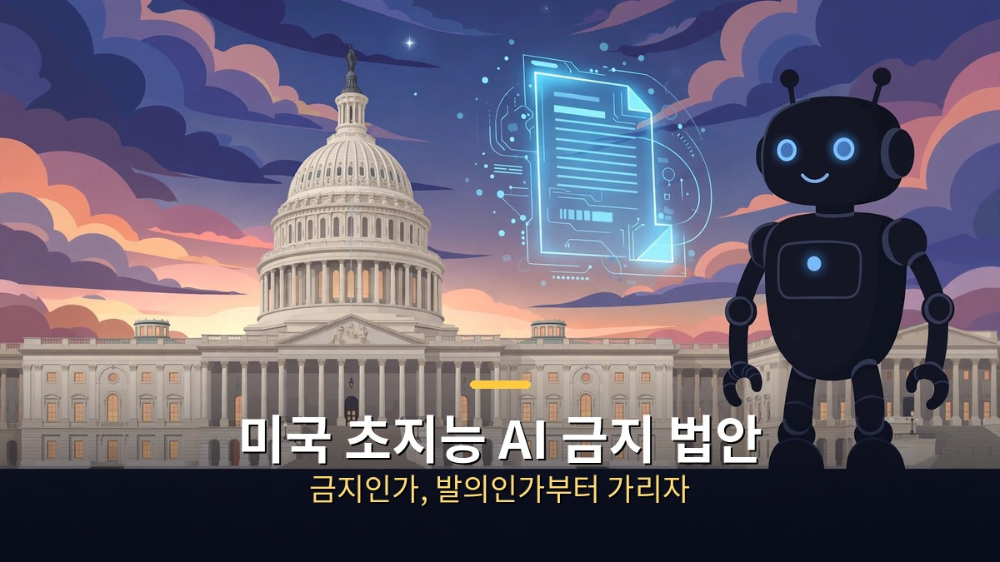
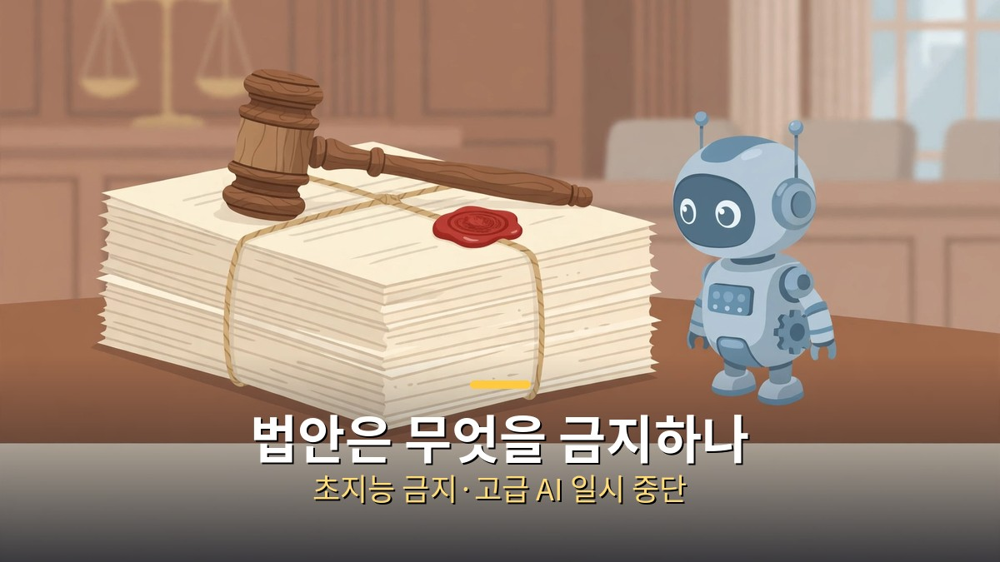
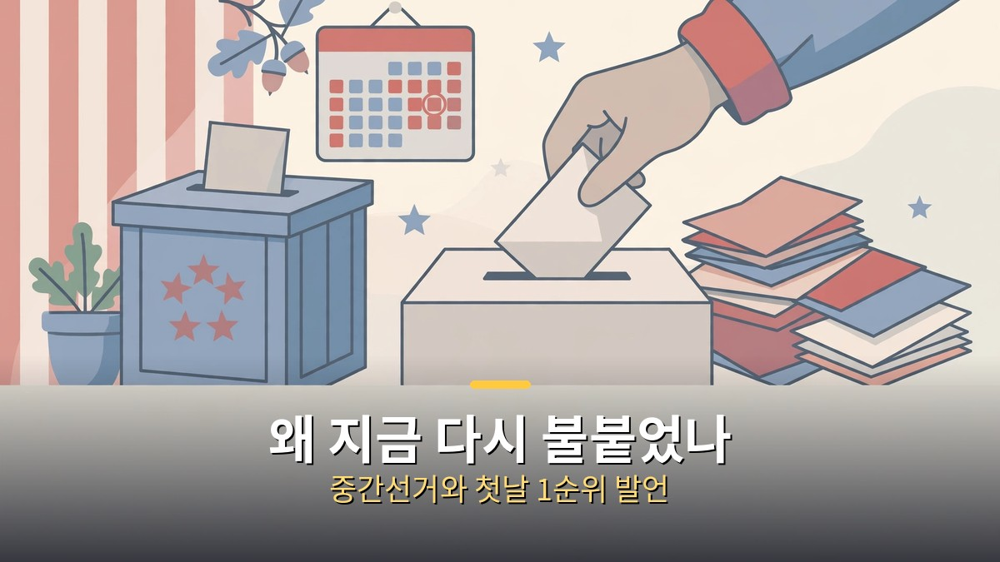

<!-- 본문 시작 -->

미국 의회에 초지능 AI를 금지하자는 법안이 다시 올라왔다.
"정부가 AGI를 금지하려 한다"는 제목이 돌아다니지만, 사실은 조금 다릅니다.
법안은 9월에 발의됐고, 지금은 위원회에 계류된 상태입니다.
이 글은 AI 규제를 따라가는 일반 독자를 위해, 법안이 실제로 무엇을 담았는지, 왜 지금 다시 불붙었는지, 통과되면 무엇이 바뀌는지 가려 정리합니다.

> 핵심 정리: '초지능 금지법(Ban Artificial Superintelligence Act of 2026)'은 상원 S.5493(샌더스, 9월 23일)과 하원 H.R.10538(카사르, 9월 24일)로 발의됐습니다. 초지능의 개발·배포·소유·자금 지원을 영구 금지하고, 10²⁵ 연산 이상 고급 AI 개발은 새 인공지능부가 꾸려져 안전 규칙을 만들 때까지 일시 중단하며, 내각급 인공지능부를 신설합니다. 위반하면 기업은 해산, 개인은 최대 20년형까지 받습니다. 다만 두 법안 모두 아직 위원회 계류 중이라, 법이 된 것은 아무것도 없습니다.

## 법안은 실제로 무엇을 금지하나요?

먼저 단어부터 가릅시다.
이 법안이 금지하려는 것은 'AI 전체'가 아니라 '초지능'입니다.

법안이 정의하는 초지능은 두 가지 중 하나입니다.
대부분의 분야에서 인간의 인지 능력을 능가하는 AI, 또는 인간을 무력화하거나 정부를 전복할 수 있는 행동을 할 수 있는 AI입니다.
법안은 이런 초지능의 개발·배포·소유·자금 지원을 영구히 금지합니다.
지금 쓰는 챗GPT나 이미지 생성기가 금지 대상이 아니라는 뜻입니다.
중소기업이 쓰는 AI 도구와는 다른 층위의 이야기입니다.

금지 말고 '일시 중단'도 있습니다.
법안은 연산량 10²⁵ 이상으로 학습한 고급 AI의 개발을 잠시 멈추게 합니다.
새로 만들 인공지능부가 인력을 갖추고 안전 규칙을 만들 때까지입니다.
부처가 꾸려지고 규칙이 생기면 중단은 풀리는 구조입니다.
영구 금지가 아니라, 감독 체계를 세우는 동안의 멈춤입니다.

새로 만드는 기구는 내각급 '인공지능부'입니다.
장관은 대통령이 임명하고, 전문가 자문위원회가 최첨단 모델을 생애주기 내내 감독합니다.
법안에는 외국에서 초지능이 개발되는 것도 막겠다는 외교 목표가 들어 있고, 칩과 연산 수출 통제를 수단으로 적었습니다.
중국이 AI 감속 요구를 거부했다는 보도가 같은 맥락에서 나오는 이유입니다.

| 구분 | 내용 | 상태 |
|---|---|---|
| 영구 금지 | 초지능의 개발·배포·소유·자금 지원 | 법안 문안만 존재 |
| 일시 중단 | 10²⁵ 연산 이상 고급 AI 개발, 부처·규칙 마련까지 | 같은 법안에 포함 |
| 신설 기구 | 내각급 인공지능부 + 전문가 자문위원회 | 설립 전 |
| 위반 처벌 | 기업 해산·자산 몰수, 개인 최대 20년형 | 법안 문안만 존재 |

처벌 수위가 센 편입니다.
위반하거나 회피를 시도한 기업은 운영 자격이 취소되고 강제 해산될 수 있으며, 개인 결정권자는 최대 20년형까지 받을 수 있습니다.
핵무기 불법 개발 같은 국가안보 범죄에 비유되는 수준입니다.
다만 이 모든 건 법안 문안에 적힌 내용이지, 지금 적용되는 법이 아닙니다.
법이 되려면 의회를 통과해야 하는데, 아직 그 단계에 가지 못했습니다.

## 왜 지금 다시 불붙었나요?

법안 자체는 9월 23일·24일에 발의됐습니다.
그런데 11월에 다시 뉴스가 된 건, 중간선거 때문입니다.

2026년 11월 중간선거에서 민주당이 상원과 하원을 모두 되찾았습니다.
선거 직후인 11월 4일, 애리조나주 하원의원 야사민 안사리는 X에 글을 올렸습니다.
"민주당 의제의 첫날 1순위는 고급 AI 개발 중단, 통제 불능 산업의 규제, 초지능 금지여야 한다"는 내용이었습니다.
안사리 의원은 이 법안의 공동 발의자 중 한 명입니다.
법안 자체는 그대로인데, 다수당이 바뀌면서 "다음 의회에서 다룰 의제"로 다시 주목받은 것입니다.

선거 결과가 AI 이슈와 무관하지 않다는 분석도 나왔습니다.
타임은 11월 4일 기사에서 AI에 대한 반발이 2026년 중간선거를 형성했다고 썼고, CBS 출구조사에서는 데이터센터가 선거의 승자가 아니었다고 전했습니다.
데이터센터 건설을 둘러싼 지역 반발이 표로 이어졌다는 분석입니다.
AI 개발 속도 자체가 정치 의제가 된 분위기에서, 9월에 발의된 금지법이 다시 소환된 것입니다.

[앤트로픽 내부 모델 4의 정체｜METR 보고서가 밝힌 AI 가속 1.9배, 어디까지 믿을까](https://aitechnoteskr.tistory.com/132)에서 정리한 것처럼, AI가 스스로 연구를 가속한다는 보고서가 나온 직후라 "속도를 늦춰야 한다"는 주장도 힘을 받았습니다.
이 영상에서 다루는 'RSI(재귀적 자기 개선) 금지' 움직임도 같은 흐름입니다.
미래생명연구소(Future of Life Institute)의 초지능 성명처럼, 초지능 개발을 멈추자는 국제 서명 운동도 이어지고 있습니다.

| 시점 | 일어난 일 |
|---|---|
| 2026-09-23 | 상원 S.5493 발의 (샌더스) |
| 2026-09-24 | 하원 H.R.10538 발의 (카사르) |
| 2026-11-04 | 중간선거 민주당 양원 승리, 안사리 의원 "첫날 1순위" 발언 |
| 2026-11-08 | 영상·보도를 통해 법안 재조명 |

별도로 베넷·웰치 상원의원이 제안한 연방 디지털 위원회 설치안도 있습니다.
최첨단 AI 모델과 대형 디지털 플랫폼을 감독하는 독립 위원회를 만들자는 내용으로, 카사르·샌더스 법안과는 다른 감독안입니다.
"규제하자"는 쪽 안에서도, 부처를 만들지 위원회를 만들지 의견이 갈립니다.

## 통과되면 무엇이 바뀌고, 안 되면 무엇이 남나요?

가장 먼저 확인할 건, 지금 당장 바뀌는 것은 없다는 점입니다.
법안은 상원 상무과학교통위원회와 하원 감독개혁위원회에 계류돼 있습니다.
법이 되려면 위원회 통과, 본회의 표결, 대통령 서명이 필요합니다.
어느 단계도 아직 밟지 않았습니다.
"정부가 AGI를 금지한다"는 제목은, 발의된 법안을 두고 하는 말이지, 시행되는 법을 두고 하는 말이 아닙니다.

만약 통과된다면 바뀌는 건 이렇습니다.
초지능 연구는 법으로 막히고, 10²⁵ 연산 이상 모델의 개발은 새 부처가 규칙을 만들 때까지 멈춥니다.
최첨단 모델을 만드는 기업은 부처의 감독을 받게 됩니다.
다만 "초지능"의 정의가 넓고, 10²⁵ 연산이라는 기준도 장관이 매년 조정하게 돼 있어, 실제 적용 범위는 규칙이 나와 봐야 알 수 있습니다.
법안의 문안만으로 "내가 쓰는 AI가 막힌다"고 단정할 수는 없습니다.

안 된다고 해서 아무 일도 없는 건 아닙니다.
이 법안은 민주당의 우선순위를 보여주는 신호입니다.
다음 의회가 1월에 시작하면, AI 규제 법안이 의제의 앞자리에 오를 가능성이 커졌습니다.
미국 상공회의소 10월 보고서에 따르면 설문 대상 중소기업의 66%가 AI를 쓰고 있습니다.
규제 논의가 커질수록 "소상공인의 AI 사용까지 막는 것 아니냐"는 반론도 함께 커질 겁니다.
이 법안이 전면 금지가 아니라는 점을 구분하는 게 그래서 중요합니다.

| 경우 | 의미 | 확인할 것 |
|---|---|---|
| 법안 통과 | 초지능 금지·고급 AI 일시 중단·인공지능부 신설 | 위원회·본회의 표결 일정 |
| 계류 유지 | 정치적 신호로만 남음 | 다음 의회 회기 의제 포함 여부 |
| 일반 사용자 | 지금 쓰는 AI 도구에는 당장 변화 없음 | 규제 범위가 어디까지인지 |

중국의 반응도 변수입니다.
중국은 AI 감속 요구를 받아들이지 않는다는 입장을 밝혔습니다.
미국만 속도를 늦추면 주도권을 넘겨준다는 반론이 법안 반대 논리의 한 축입니다.
법안이 "전 세계 어디서도 초지능을 개발하지 못하게 하겠다"는 외교 목표를 담은 것도, 이 반론을 의식한 대목입니다.
한 나라의 법으로 세계의 개발을 막을 수 있느냐는, 법안의 가장 큰 약점으로도 꼽힙니다.

## 마무리

법안 제목만 보면 세상이 바뀐 것 같지만, 의회 절차를 따라가 보면 아직은 "제안" 단계입니다.
그렇다고 무시할 일도 아닙니다.
중간선거를 거치며 AI 속도 조절이 정치의 중심 의제로 올라왔고, 9월에 발의된 법안이 그 의제를 담는 그릇이 됐으니까요.
저는 이 법안을 보면서, 숫자를 외우기보다 단계를 확인하는 습관이 더 중요해졌다고 느꼈습니다.
발의·계류·표결·시행, 어느 단계인지 알면 제목에 흔들리지 않거든요.
다음에 "금지"라는 단어가 든 제목을 보면, 먼저 법안 번호부터 찾아볼 생각입니다.

## 자주 묻는 질문

**Q. 미국 정부가 AGI를 금지한 건가요?**
A. 아닙니다. '초지능 금지법'은 9월에 발의된 법안이고, 지금은 위원회에 계류돼 있습니다. 법이 되려면 위원회 통과·본회의 표결·대통령 서명이 필요합니다. 아직 어느 단계도 밟지 않았습니다.

**Q. 초지능은 무엇인가요?**
A. 법안이 정의하는 초지능은 대부분의 분야에서 인간의 인지 능력을 능가하는 AI, 또는 인간을 무력화하거나 정부를 전복할 수 있는 행동을 할 수 있는 AI입니다. 지금 쓰는 챗GPT나 이미지 생성기는 이 정의에 해당하지 않습니다.

**Q. 법안이 통과되면 제가 쓰는 AI도 못 쓰게 되나요?**
A. 법안 문안만으로는 그렇게 단정할 수 없습니다. 금지 대상은 초지능이고, 일시 중단 대상은 10²⁵ 연산 이상으로 학습한 고급 AI의 개발입니다. 일반 사용자가 쓰는 AI 도구의 사용 금지를 정한 조항은 없습니다.

**Q. 왜 지금 다시 뉴스가 되나요?**
A. 중간선거에서 민주당이 양원을 되찾았고, 법안 공동 발의자인 안사리 의원이 11월 4일 "첫날 1순위"로 추진해야 한다고 밝혔기 때문입니다. 법안 내용은 9월과 같지만, 정치적 무게가 달라졌습니다.

**Q. 중국은 어떻게 반응했나요?**
A. 중국은 AI 감속 요구를 거부한다는 입장을 밝혔습니다. 미국만 속도를 늦추면 주도권을 넘겨준다는 반론이 법안 반대 논리의 한 축이고, 법안은 초지능의 글로벌 금지를 외교 목표로 삼아 수출 통제를 수단으로 적었습니다.

## 함께 읽으면 좋은 글

[앤트로픽 내부 모델 4의 정체｜METR 보고서가 밝힌 AI 가속 1.9배, 어디까지 믿을까 — 모델 4와 METR 보고서, 가속의 조건](https://aitechnoteskr.tistory.com/132)
[그녀｜목소리만 있는 인공지능과 사랑에 빠진 남자의 이야기 — 목소리만으로 이뤄지는 관계의 조건](https://aitechnoteskr.tistory.com/127)
[화면 없는 노트북 — Hero Keyboard, 사기 전에 확인할 조건 — 화면을 빌려 쓰는 키보드 PC의 조건 정리](https://aitechnoteskr.tistory.com/107)

AI 규제 소식은 제목보다 절차를 먼저 보면 됩니다. 발의인지, 계류인지, 통과인지. 이 주제를 계속 따라가려면 이웃 추가를 눌러두면 된다.

<!-- 본문 끝 -->

## 작업용 출처·이미지 정보 (업로드 제외)

- 자료 출처: TheAIGRID 영상 PD03ve61CFY(2026-11-08, 설명란 출처 링크 기준) + 법안(S.5493·H.R.10538)·중간선거 보도 대조
- 이미지: images/01-hero.jpg ~ 04-img3.jpg / 자작 일러스트 + 한글 배너 오버레이 (1200x675)
