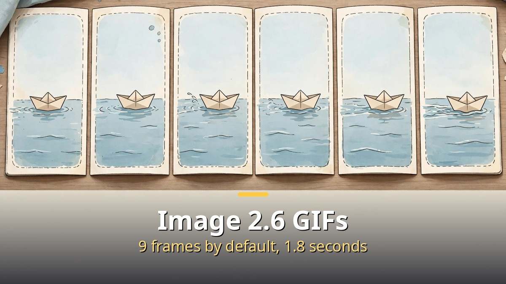
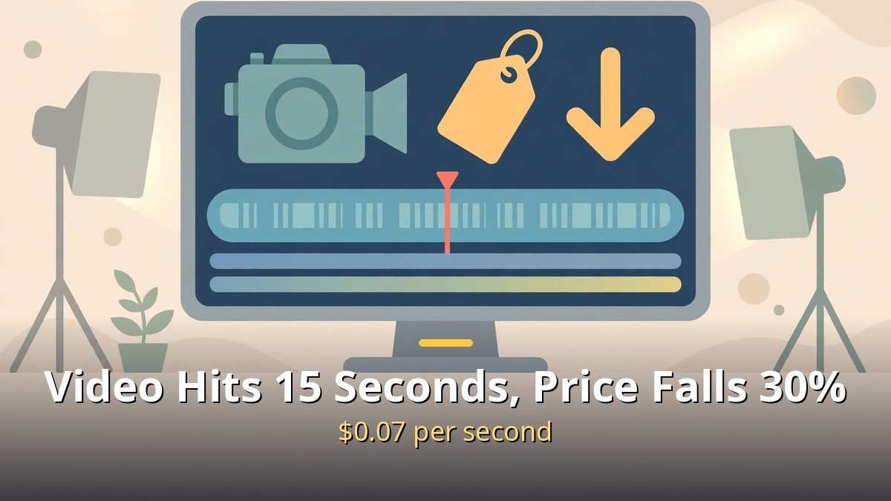
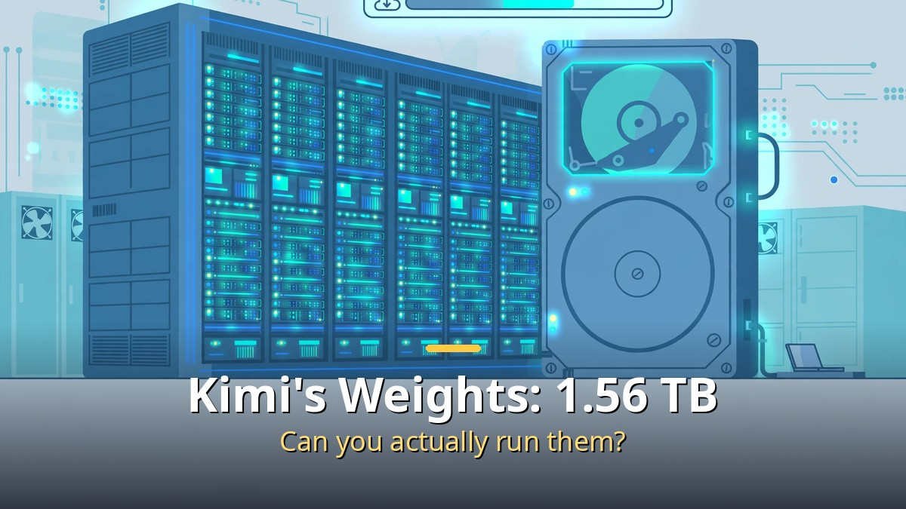

<!-- 본문 시작 -->

This week brought 14 AI news items.
You do not need to follow all of them.
Image 2.6's GIFs, Gemini Omni 1.2's 15-second video, Kimi's open weights, and AI that calls you by phone.
This post is for general readers who want the week's AI news in one pass: the four items worth using now, and the rest in one line each.
Anything unverified is labeled unverified.

> Key takeaway: Three items lead the week. On November 4, OpenAI released Image 2.6 with GIF generation. On November 5, Google made Gemini Omni 1.2 Flash generally available, stretching clips to 15 seconds and cutting the price by 30%. On November 4, Moonshot published Kimi K3.1 Pro's weights on Hugging Face. At 1.56 TB, using the API is the realistic choice for most people.

## How far do Image 2.6's GIFs go?

OpenAI released Image 2.6 on November 4.
The most visible change is GIF generation.
Give it a prompt or a photo, and it returns a short looping animation directly.

A GIF is 9 frames by default, 200 milliseconds per frame, 1.8 seconds in total.
Through the API you can set 2 to 64 frames and 20 to 2,000 milliseconds per frame.
You can change the playback speed, fix a single frame, and share the result.
Until now, getting an animation out of ChatGPT meant generating stills and joining them in another program. Now one request finishes the job.

Two developer models came with it.
Flare is for faster image work, Sunburst for more detailed and consistent edits.
Prices match version 2.5: $8 per million image input tokens and $30 per million image output tokens.
OpenAI says generation is 50% faster than before.
That figure describes particular settings, though, so it should not be read as a guarantee for every job.

| Item | Image 2.6 | Note |
|---|---|---|
| GIF generation | Default 9 frames, 1.8 seconds; API up to 64 frames | Generations endpoint only |
| Reference images | Save a person, pet, or character and reuse it | No need to re-upload each time |
| Developer models | Flare and Sunburst | API |
| Weekly output | Over 4 billion images | Up from about 3 billion in September |

Reference images arrived together with GIFs.
Save a person, pet, or character you use often, and call it up next time without uploading again.
For anyone animating a mascot or product photos repeatedly, this may matter more than the GIF itself.
One limit: API GIF output still sits behind a feature flag, so outside apps cannot rely on it yet.
Inside ChatGPT, OpenAI says it is available on every subscription tier.

## Video models: longer clips, lower prices

Google made Gemini Omni 1.2 Flash generally available on November 5.
The video generation and editing model now makes clips up to 15 seconds long, up from 10.
You can set the length from 3 to 15 seconds in one-second steps.

The price is $0.07 per second of 720p video, 30% less than version 1.1.
Google suggests drafting cheaply at 360p or 720p, then upscaling only the chosen clip to 1080p or 4K.
You can edit a clip across turns — swap a background, change lighting or angle — without regenerating the whole thing.
Every generated video carries an invisible SynthID watermark.

| Item | Omni 1.2 Flash | Omni 1.1 Flash |
|---|---|---|
| Longest clip | 15 seconds | 10 seconds |
| 720p price | $0.07 per second | 30% more |
| Available through | Gemini API and Google Cloud | — |
| Benchmarks | No published scores | — |

One caution: Google published no benchmark scores for this version.
Better quality is Google's claim, and there are no numbers to compare against.
Google itself says fast sports action and complex physics remain difficult.
From December 3, requests for version 1.1 will automatically route to 1.2 and be billed at 1.2 rates.
In the Gemini app, 15-second creation is rolling out to AI Ultra subscribers, and it is also available in Flow and Google Vids.

Open-weight video news appeared too.
Pruna's PH3 image model and Pika's H3 Flex open-weight video model were on this week's list.
Both point toward weights you can download and run yourself.
For this post, though, I could not verify specifics such as clip length or pricing.
They stay as unverified items.

## Kimi's weights are 1.56 TB — can you actually use them?

Moonshot published Kimi K3.1 Pro's weights on Hugging Face on November 4.
It kept the promise made when the model launched on October 23: weights by November 4.
The repository is moonshotai/Kimi-K3.1-Pro.

Start with the scale, because this is not a home-computer model.
Total parameters: 2.8 trillion. Active per token: 104 billion. A mixture of 896 experts, 16 selected per token.
Context window: 1 million tokens.
The download is 96 files totaling 1.56 TB.
Analyses say running it takes eight data-center GPUs.
Downloading is free, but running it takes serious hardware.

| Item | Kimi K3.1 Pro weights |
|---|---|
| Released | November 4, 2026, on Hugging Face |
| Scale | 2.8T total, 104B active |
| Download | 96 files, 1.56 TB |
| License | Custom license; a separate Moonshot agreement is needed once API revenue exceeds $20M a year |
| Terminal-Bench 4.0 | 65.7%, versus Opus 5.5 at 66.4% (Moonshot's own numbers) |

The license has conditions.
Commercial use is allowed, but if you sell the model as a service and annual revenue passes $20 million, you need a separate agreement with Moonshot.
"Open weights" is accurate. "Open source" is not.
Check the scope of use before using it.

The benchmark numbers are Moonshot's own.
Terminal-Bench 4.0: 65.7%, against 66.4% for Opus 5.5 — a gap of 0.7 points.
Ahead of GPT-6 Astra at 58.2%.
But these scores were measured Moonshot's way, and no independent evaluation of the published weights exists yet.
"Available to download" is a fact. "As good as Opus" is a claim. Keep them apart.

For most readers, the realistic choice is the API.
Moonshot's API charges $2 per million input tokens and $10 per million output tokens.
Microsoft Foundry also hosts the model.
Downloading the weights fits teams with large hardware or research purposes.
Before being tempted by "it's open" into fetching 1.56 TB, check first whether your hardware can run it.

## The rest of the news, in one line each
This week's backbone is the three items above. The rest goes like this.
It connects with the phone-agent trend covered in [How to Make Claude Code Call You on the Phone｜An AI Agent That Rings When It Needs a Decision](https://aitechnotesen.blogspot.com/2026/11/how-to-make-claude-code-call-you-on.html): Meta Muse voice calls and GroqBot's phone feature were both on this week's list.
AI that calls you by phone is appearing from several companies at once.

The other items on the list: GPT-6 Cyber, shared usage limits for ChatGPT and Codex, Claude's bank account integration, Steve Aoki's AI video editor, Netflix's AI Discover tab, a survey finding that almost nobody uses AI agents for delivery, and Google running AI in space.
These are summarized here only as items from the video; I could not verify firm figures or official announcement dates for them in this post.
They stay as unverified items.

There is no need to memorize all 14 items.
Three things are worth remembering this week.
GIFs arrived inside the image tool, video reached 15 seconds at $0.07 a second, and Kimi's weights are open with a 1.56 TB condition attached.
The rest can wait until you need it.

## Closing

When 14 items land in a week, chasing all of them is exhausting.
Looking at this week's list, I kept coming back to one rule: pick what I can use before what is merely new.
A GIF can be tried in ChatGPT right now, a 15-second clip starts with its price, and Kimi's weights start with the API price sheet.
Next week will bring another flood.
Then too, only a few items will be worth keeping, and letting the rest pass will be fine.

## FAQ

**Q. Are Image 2.6 GIFs free?**
A. OpenAI says they are available in ChatGPT on every subscription tier. The API charges image generation rates. GIF output runs on the generations endpoint only, and API GIF output still sits behind a feature flag.

**Q. Where can I use Gemini Omni 1.2?**
A. Through the Gemini API and Google Cloud, generally available. In the Gemini app, 15-second creation is rolling out to AI Ultra subscribers, and it is also in Flow and Google Vids. There is no free API tier for this model.

**Q. If Kimi's weights are open, can I use them for free?**
A. Downloading is free, but running them takes data-center-grade GPUs: 1.56 TB across 96 files. The license also has conditions — selling the model as a service past $20 million in annual revenue requires a separate agreement with Moonshot.

**Q. Can the 65.7% Terminal-Bench score be trusted?**
A. It is Moonshot's own evaluation. The 0.7-point gap to Opus 5.5's 66.4% was measured Moonshot's way, and no independent evaluation of the published weights exists yet.

**Q. What is worth trying right away this week?**
A. Image 2.6 GIFs and Omni 1.2's 15-second video are the closest: both are usable now in ChatGPT, the Gemini app, and their APIs. For Kimi's weights, check the hardware requirements first.

## Further Reading

[How to Make Motion Graphics with Opus 5.5｜Script, Music, or Story — Pick One First — the seven script-first steps and skill automation](https://aitechnotesen.blogspot.com/2026/11/how-to-make-motion-graphics-with-opus.html)
[Chappie｜A Robot That Started to Think and Feel — What Humans Taught It — a robot with feelings, and what humans taught it](https://aitechnotesen.blogspot.com/2026/11/chappiea-robot-that-started-to-think.html)
[How to Make Claude Code Call You on the Phone｜An AI Agent That Rings When It Needs a Decision — an agent that calls when it needs you, and what it takes to build it](https://aitechnotesen.blogspot.com/2026/11/how-to-make-claude-code-call-you-on.html)

AI news is not about catching everything. Pick what you can use first. If you want to keep following this topic, add this blog as a neighbor.

<!-- 본문 끝 -->

## 작업용 출처·이미지 정보 (업로드 제외)

- Source: Matt Wolfe 영상 IrAHINf0M6E(2026-11-06, 설명란 타임스탬프 목록 기준) + GPT-Image 2.6·Gemini Omni 1.2·Kimi 가중치 공개 보도 대조
- Images: images/01-hero-en.jpg ~ 04-img3-en.jpg / original illustration + English banner overlay (1200x675)
