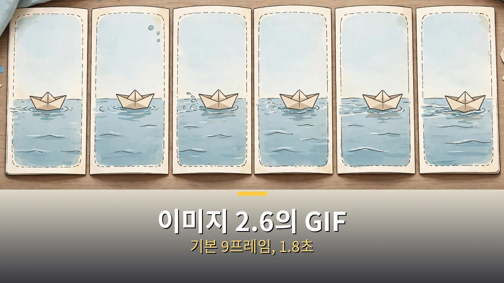
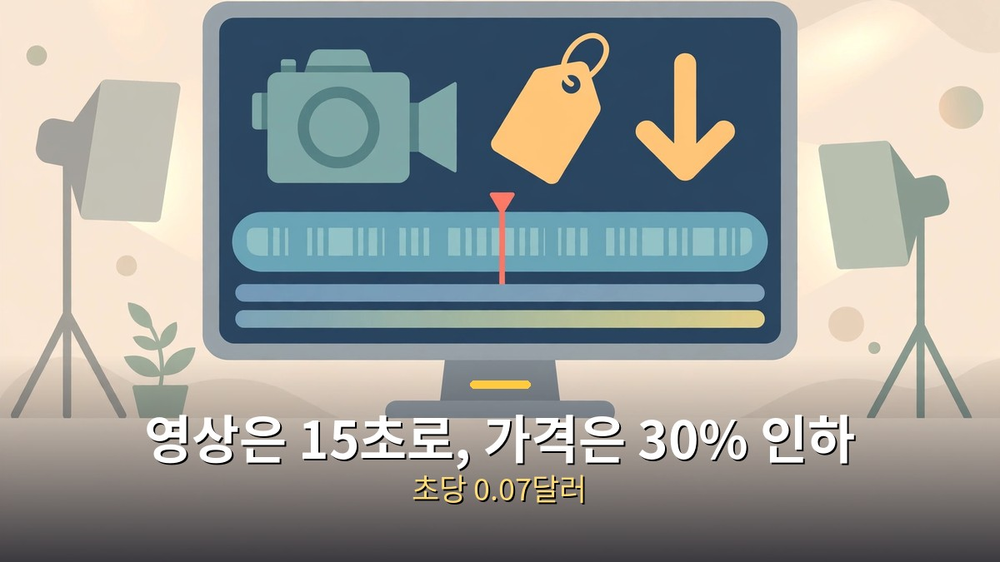
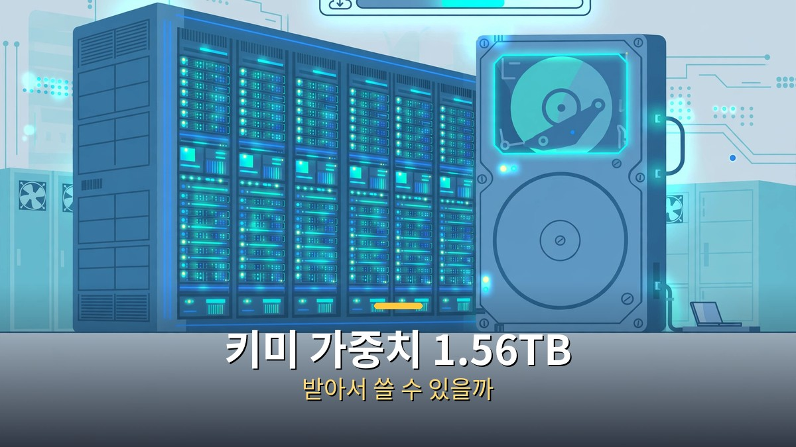

<!-- 본문 시작 -->

이번 주 AI 소식은 14건입니다.
다 챙길 필요는 없습니다.
이미지 2.6의 GIF, 제미나이 옴니 1.2의 15초 영상, 키미 가중치 공개, 그리고 전화로 부르는 AI.
이 글은 AI 뉴스를 따라가는 일반 독자를 위해, 14건 중 지금 써먹을 수 있는 4가지만 골라 정리합니다.
나머지는 한 줄로, 미확인 부분은 미확인이라고 밝힙니다.

> 핵심 정리: 이번 주 굵직한 소식은 세 가지입니다. 오픈AI가 11월 4일 이미지 2.6을 내놓으며 GIF 생성을 더했고, 구글은 11월 5일 제미나이 옴니 1.2 플래시를 정식 출시하며 영상 길이를 15초로 늘리고 가격을 30% 내렸습니다. 문샷은 11월 4일 키미 K3.1 프로의 가중치를 허깅페이스에 공개했습니다. 1.56TB라서, 받는 것보다 API로 쓰는 게 현실적인 선택입니다.

## 이미지 2.6의 GIF, 어디까지 되나요?

오픈AI가 11월 4일 이미지 2.6을 내놨습니다.
가장 눈에 띄는 건 GIF 생성입니다.
프롬프트나 사진을 주면, 움직이는 짧은 반복 영상을 바로 만들어 줍니다.

GIF는 기본 9프레임, 프레임당 200밀리초, 총 1.8초입니다.
API에서는 2~64프레임, 프레임당 20~2,000밀리초까지 조절할 수 있습니다.
재생 속도를 바꾸고, 프레임 하나만 따로 고치고, 공유할 수 있습니다.
예전에는 정지 이미지를 여러 장 만들고 다른 프로그램에서 이어 붙여야 했는데, 이제는 한 번의 요청으로 끝납니다.

개발자용 모델도 두 개가 나왔습니다.
플레어(Flare)는 빠른 이미지 작업용, 선버스트(Sunburst)는 더 세밀하고 일관된 편집용입니다.
가격은 2.5와 같은 수준입니다.
이미지 입력 토큰 100만 개당 8달러, 출력 토큰 100만 개당 30달러입니다.
속도는 이전보다 50% 빨라졌다고 오픈AI는 밝혔습니다.
다만 이 속도는 특정 설정에서의 수치라, 모든 작업에 그대로 적용된다고 보기는 어렵습니다.

| 항목 | 이미지 2.6 | 비고 |
|---|---|---|
| GIF 생성 | 기본 9프레임·1.8초, API 최대 64프레임 | 생성 엔드포인트에서만 지원 |
| 참조 이미지 | 인물·반려동물·캐릭터를 저장해 재사용 | 매번 다시 올릴 필요 없음 |
| 개발자 모델 | 플레어·선버스트 | API 제공 |
| 주간 생성량 | 40억 장 이상 | 9월 약 30억 장에서 증가 |

참조 이미지 기능도 함께 나왔습니다.
자주 쓰는 인물·반려동물·캐릭터를 저장해 두고, 다음에 만들 때 다시 올리지 않고 불러올 수 있습니다.
마스코트나 상품 사진을 반복해서 쓰는 사람에게는, GIF보다 이 기능이 더 실용적일 수 있습니다.
다만 GIF의 API 출력은 아직 기능 플래그 뒤에 있어, 외부 앱에서는 바로 쓰기 어렵습니다.
챗GPT 안에서는 모든 요금제에서 쓸 수 있다고 오픈AI는 밝혔습니다.

## 영상 모델은 15초로 길어지고 가격은 내렸습니다

구글은 11월 5일 제미나이 옴니 1.2 플래시를 정식 출시했습니다.
영상 생성·편집 모델로, 이제 클립을 최대 15초까지 만들 수 있습니다.
이전 버전은 10초였습니다.
3초부터 15초까지 1초 단위로 길이를 정할 수 있습니다.

가격은 720p 기준 초당 0.07달러로, 이전 버전보다 30% 내렸습니다.
360p나 720p로 초안을 빠르게 만들고, 고른 것만 1080p나 4K로 키우는 흐름을 구글이 권합니다.
대화하듯 여러 번에 걸쳐 배경·조명·각도를 바꾸는 편집도 됩니다.
만든 영상에는 보이지 않는 신스ID 워터마크가 들어갑니다.

| 항목 | 옴니 1.2 플래시 | 옴니 1.1 플래시 |
|---|---|---|
| 최대 클립 길이 | 15초 | 10초 |
| 720p 가격 | 초당 0.07달러 | 30% 더 비쌌다 |
| 제공 | 제미나이 API·구글 클라우드 | — |
| 벤치마크 | 공개된 수치 없음 | — |

주의할 점이 있습니다.
구글은 이번 버전에 대한 벤치마크 점수를 공개하지 않았습니다.
품질이 좋아졌다는 건 구글의 주장이고, 비교할 숫자는 없습니다.
빠른 스포츠 장면이나 복잡한 물리 표현은 아직 어렵다고 구글 스스로 밝혔습니다.
12월 3일부터는 1.1 버전 요청이 자동으로 1.2로 넘어가 1.2 요금이 적용됩니다.
제미나이 앱에서는 AI 울트라 구독자에게 15초 생성이 순차 제공되고, 플로우·구글 비드에서도 쓸 수 있습니다.

오픈 웨이트 쪽에서도 영상 소식이 있었습니다.
프루나의 PH3 이미지 모델과 피카 H3 플렉스 오픈 웨이트 영상 모델이 이번 주 목록에 올랐습니다.
두 모델 모두 가중치가 공개돼 직접 내려받아 돌릴 수 있는 방향입니다.
다만 이번 글에서는 영상 길이나 가격 같은 확정 수치까지는 확인하지 못했습니다.
미확인 항목으로 남깁니다.

## 키미 가중치 1.56TB, 받아서 쓸 수 있나요?

문샷은 11월 4일 키미 K3.1 프로의 가중치를 허깅페이스에 공개했습니다.
10월 23일 모델을 내놓으면서 "11월 4일까지 공개하겠다"고 약속했던 것을 지킨 것입니다.
저장소는 moonshotai/Kimi-K3.1-Pro입니다.

규모부터 보면, 이건 집 컴퓨터용이 아닙니다.
전체 파라미터 2.8조 개, 토큰마다 실제로 쓰는 건 1,040억 개, 896개 전문가 중 16개를 골라 쓰는 구조입니다.
컨텍스트는 100만 토큰입니다.
다운로드는 96개 파일, 총 1.56TB입니다.
돌리려면 8장의 데이터센터 GPU가 필요하다는 분석도 있습니다.
받는 것 자체는 무료지만, 돌리는 데 드는 장비가 만만치 않습니다.

| 항목 | 키미 K3.1 프로 가중치 |
|---|---|
| 공개일 | 2026년 11월 4일, 허깅페이스 |
| 규모 | 전체 2.8조 개, 활성 1,040억 개 |
| 다운로드 | 96개 파일, 1.56TB |
| 라이선스 | 자체 라이선스, API 매출 연 2,000만 달러 초과 시 별도 계약 필요 |
| 터미널벤치 4.0 | 65.7%, 오퍼스 5.5 66.4% (문샷 자체 수치) |

라이선스에도 조건이 있습니다.
무료로 쓸 수 있지만, 모델을 API 서비스로 팔아 연 매출 2,000만 달러를 넘기면 문샷과 별도 계약을 맺어야 합니다.
"오픈 웨이트"는 맞지만, "오픈소스"와는 다릅니다.
쓸 수 있는 범위를 확인하고 쓰는 게 안전합니다.

성능 수치는 문샷 자체 평가입니다.
터미널벤치 4.0에서 65.7%, 오퍼스 5.5의 66.4%와 0.7%포인트 차이입니다.
GPT-6 아스트라 58.2%보다는 앞섭니다.
다만 이 점수는 문샷이 정한 방식으로 잰 것이고, 공개된 가중치에 대한 독립 평가는 아직 없습니다.
"내려받아 쓸 수 있게 됐다"는 사실과 "오퍼스만큼 좋다"는 주장은 구분해서 봐야 합니다.

대부분의 독자에게 현실적인 선택은 API입니다.
문샷 API 가격은 입력 100만 토큰당 2달러, 출력 10달러입니다.
마이크로소프트 파운드리에서도 호스팅 형태로 쓸 수 있습니다.
가중치를 직접 받는 건, 큰 장비를 가진 팀이나 연구 목적에 가깝습니다.
"공개됐다"는 소식에 혹해서 1.56TB를 받기 전에, 내 장비에서 돌릴 수 있는지를 먼저 따져보는 게 순서입니다.

## 나머지 소식은 한 줄로
14건 중 위 세 가지가 이번 주의 뼈대라면, 나머지는 이렇게 정리됩니다.
[클로드 코드가 전화로 물어보게 만드는 법｜일하다 말고 전화받는 AI 에이전트](https://aitechnoteskr.tistory.com/133)에서 다룬 전화 에이전트 흐름과 이어지는 소식도 있습니다.
메타 뮤즈의 음성 통화, 그록봇의 전화 기능이 이번 주 목록에 올랐습니다.
전화로 AI를 부르는 방식이 여러 회사에서 동시에 나오고 있습니다.

그 밖에 목록에 오른 소식은 다음과 같습니다.
GPT-6 사이버, 챗GPT·코덱스 공유 사용 한도, 클로드 은행 계좌 연동, 스티브 아오키의 AI 영상 편집기, 넷플릭스 AI 탐색 탭, "배달에 AI 에이전트를 쓰는 사람은 거의 없다"는 조사, 구글의 우주 AI까지.
이 항목들은 영상에서 다룬 소식으로만 정리하고, 확정 수치나 공식 발표일까지는 이번 글에서 확인하지 못했습니다.
미확인 항목으로 남깁니다.

14건을 다 외울 필요는 없습니다.
이번 주에 기억할 건 세 가지면 됩니다.
GIF가 이미지 도구에 들어왔고, 영상은 15초에 초당 0.07달러가 됐고, 키미 가중치는 공개됐지만 1.56TB라는 조건이 붙었다는 것.
나머지는 필요할 때 찾아보면 됩니다.

## 마무리

일주일에 14건씩 쏟아지면, 다 따라가려다 지치기 쉽습니다.
저는 이번 주 목록을 보면서, "새로운 것"보다 "내가 쓸 수 있는 것"부터 고르는 게 맞다는 생각이 들었습니다.
GIF는 당장 챗GPT에서 만져볼 수 있고, 15초 영상은 가격부터 따져볼 수 있고, 키미 가중치는 일단 API 가격표부터 보는 게 순서니까요.
다음 주에도 소식은 또 쏟아질 겁니다.
그때도 챙길 건 몇 가지뿐일 테고, 나머지는 흘려보내도 괜찮습니다.

## 자주 묻는 질문

**Q. 이미지 2.6 GIF는 무료인가요?**
A. 챗GPT에서는 모든 요금제에서 쓸 수 있다고 오픈AI는 밝혔습니다. API에서는 이미지 생성 요금이 적용됩니다. GIF 출력은 생성 엔드포인트에서만 지원되고, API의 GIF 출력은 아직 기능 플래그 뒤에 있습니다.

**Q. 제미나이 옴니 1.2는 어디서 쓰나요?**
A. 제미나이 API와 구글 클라우드에서 정식 제공됩니다. 제미나이 앱에서는 AI 울트라 구독자에게 15초 생성이 순차 제공되고, 플로우·구글 비드에서도 쓸 수 있습니다. 무료 API 티어는 없습니다.

**Q. 키미 가중치를 받으면 무료로 쓸 수 있나요?**
A. 받는 건 무료지만, 돌리는 장비가 필요합니다. 1.56TB 다운로드에 데이터센터급 GPU가 필요합니다. 또 라이선스 조건이 있어, API 서비스로 팔아 연 매출 2,000만 달러를 넘기면 문샷과 별도 계약을 맺어야 합니다.

**Q. 터미널벤치 65.7%는 믿을 만한가요?**
A. 문샷 자체 평가입니다. 오퍼스 5.5의 66.4%와 0.7%포인트 차이인데, 이 점수는 문샷이 정한 방식으로 잰 것입니다. 공개된 가중치에 대한 독립 평가는 아직 없습니다.

**Q. 이번 주 소식 중 당장 써볼 만한 건 무엇인가요?**
A. 이미지 2.6의 GIF와 제미나이 옴니 1.2의 15초 영상이 가장 가깝습니다. 둘 다 챗GPT·제미나이 앱과 API에서 바로 쓸 수 있습니다. 키미 가중치는 장비 조건부터 확인하는 게 순서입니다.

## 함께 읽으면 좋은 글

[오퍼스 5.5로 모션그래픽 영상 만드는 법｜대본·음악·스토리, 무엇부터 잡을까 — 대본형 7단계와 스킬 자동화](https://aitechnoteskr.tistory.com/134)
[그녀｜목소리만 있는 인공지능과 사랑에 빠진 남자의 이야기 — 목소리만으로 이뤄지는 관계의 조건](https://aitechnoteskr.tistory.com/127)
[화면 없는 노트북 — Hero Keyboard, 사기 전에 확인할 조건 — 화면을 빌려 쓰는 키보드 PC의 조건 정리](https://aitechnoteskr.tistory.com/107)

AI 뉴스는 다 챙기는 게 아니라, 쓸 수 있는 것부터 고르는 게 먼저입니다. 이 주제를 계속 따라가려면 이웃 추가를 눌러두면 된다.

<!-- 본문 끝 -->

## 작업용 출처·이미지 정보 (업로드 제외)

- 자료 출처: Matt Wolfe 영상 IrAHINf0M6E(2026-11-06, 설명란 타임스탬프 목록 기준) + GPT-Image 2.6·Gemini Omni 1.2·Kimi 가중치 공개 보도 대조
- 이미지: images/01-hero.jpg ~ 04-img3.jpg / 자작 일러스트 + 한글 배너 오버레이 (1200x675)
