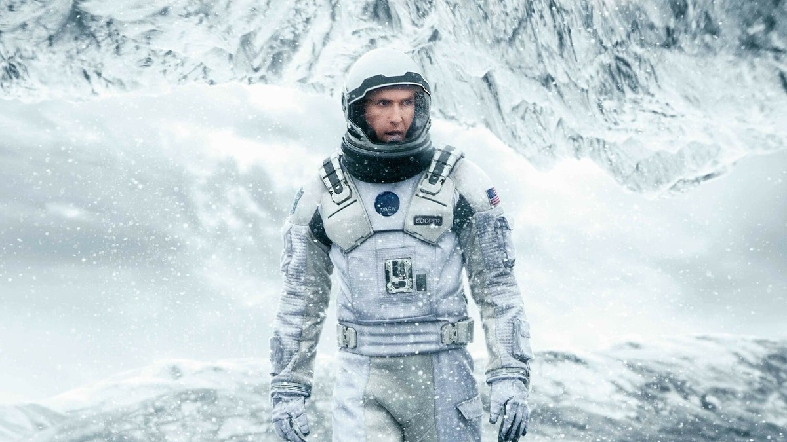
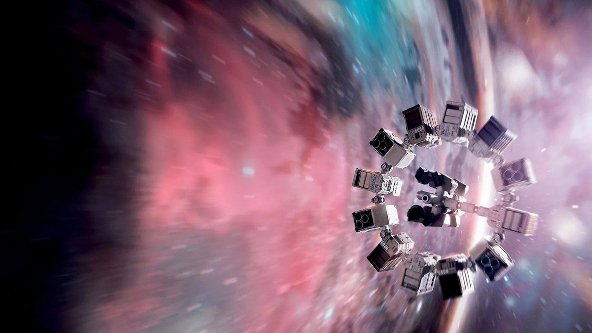
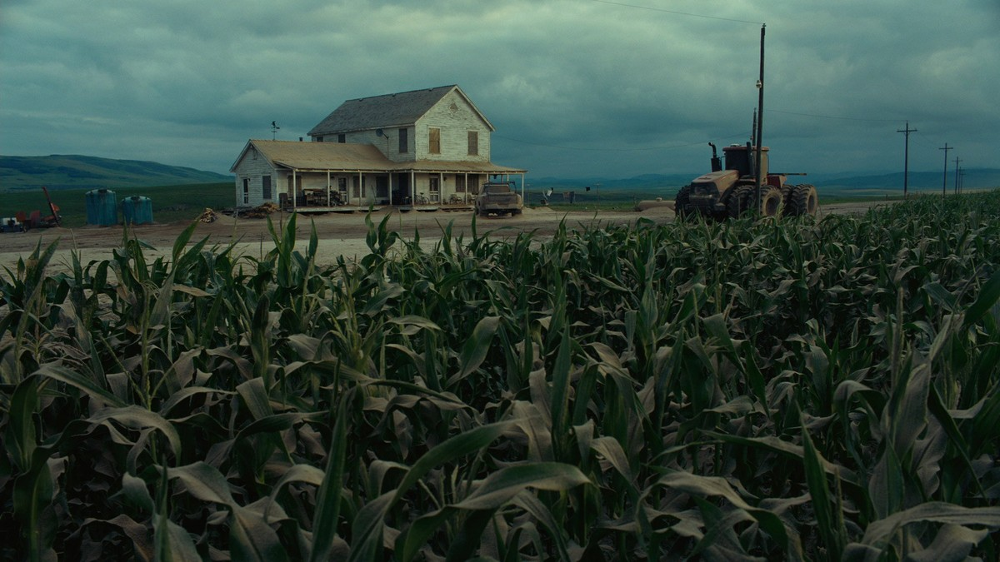
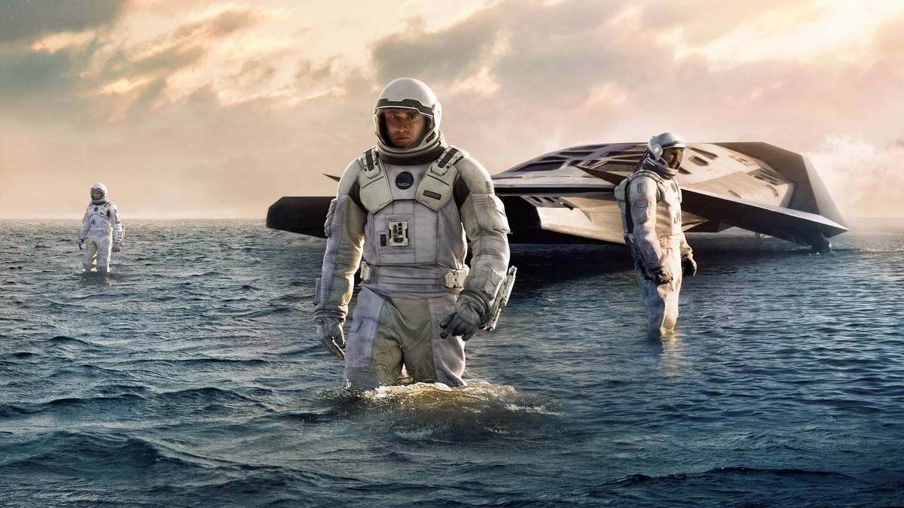
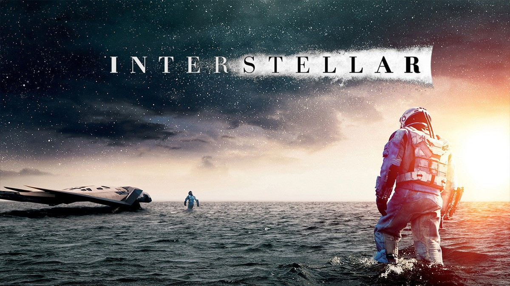
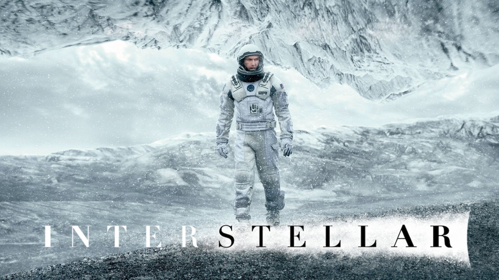
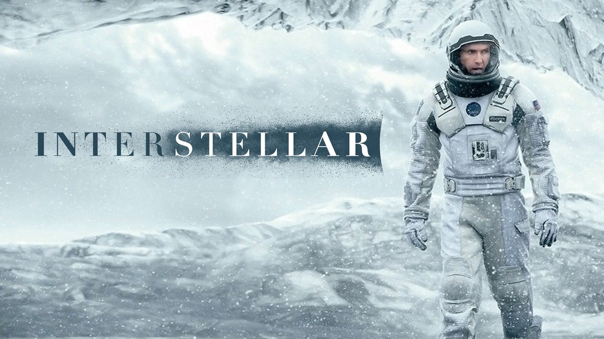
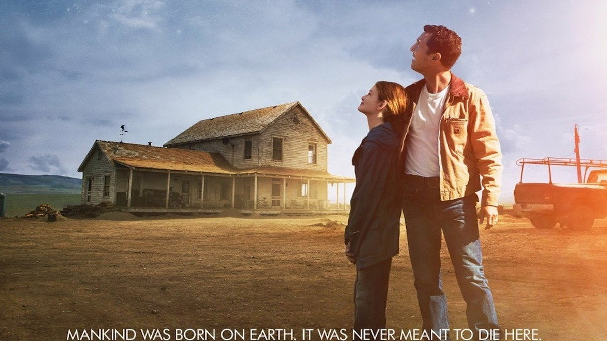

<!-- 본문 시작 -->

Cooper on the ice planet — the Korean poster for Interstellar
"We'll find a way. We always have."
Interstellar (2014), directed by Christopher Nolan, is the story of a search for a new home for humanity from an Earth running out of food.
Cooper, a former NASA pilot now farming corn, follows an unknown force with his daughter Murph to a secret NASA base, then travels aboard the spacecraft Endurance through a wormhole near Saturn to survey three candidate planets.
This is a spoiler-free introduction. The ending is not covered, and scene descriptions stay within the setup and mood of the first half.

## Basic information

The Endurance before the wormhole — the Interstellar 4K poster
| Item | Details |
|---|---|
| Title | Interstellar |
| Director | Christopher Nolan (screenplay with Jonathan Nolan) |
| Cast | Matthew McConaughey (Cooper), Anne Hathaway (Dr. Brand), Michael Caine (Professor Brand), Jessica Chastain (adult Murph), Mackenzie Foy (young Murph), Casey Affleck (Tom), Matt Damon (Mann), Bill Irwin (voice of TARS), Josh Stewart (voice of CASE) |
| Release | 2014; Korea November 6, 2014; rated 12 in Korea |
| Runtime | 2 hours 49 minutes (169 minutes, per TMDB) |
| Genre | Adventure, drama, science fiction |
| TMDB member score | 8.5/10 (41,820 votes, TMDB Korean page checked November 9, 2026) |
| Where to watch in Korea | Streaming on Netflix and Apple TV; rental and purchase on Google Play (TMDB watch page, Korea, checked November 9, 2026; recheck providers and prices before watching) |

## When Earth breaks down, where do people go?

The Cooper farmhouse before the cornfield — Earth in food crisis
The future after the governments and economies of the world have collapsed.
The mistakes of the last century have brought worldwide food shortages, and even NASA has been disbanded.
Cooper, once a NASA pilot, now grows corn to survive.
One day, as a fierce dust storm rolls in, an unknown force leads him and his daughter Murph to a secret NASA base searching for a planet where humanity can move.

This setup matters because the film sets its story in space but plants its starting point at Earth's dinner table.
Running out of food is not a distant fantasy. It is tomorrow's meal.
Cooper leaves not from a thirst for adventure, but because he judges there is no land left on Earth for his children to live on.
So the spaceship in this film is both a machine for going far away and a last resort for protecting home.

## A planet where one hour costs seven years — what does time charge?

Cooper and the crew wading across Miller's planet — the Ranger lander behind them
The first planet the crew lands on is Miller's planet, covered entirely in water.
The Ranger lander stands in a shallow sea that reaches the ankles, under a low sky.
This planet has one rule.
One hour here equals about seven years on Earth.
Time runs slowly this close to the black hole Gargantua.

The wide sea of Miller's planet — the calm before the wave
The film's first question starts here.
Every hour spent exploring costs seven years back on Earth.
Murph grows up, and news from her father arrives late.
The crew must survey the planet, yet the clock charges them while they look.
The film turns space travel from a question of distance and fuel into a question of time and family.
What matters is not how fast they go, but what they lose while going.

## The robot TARS and the ice planet — what question remains at the end?

Cooper on the ice planet — an expedition in a snowstorm
Traveling with the crew are the robots TARS and CASE, rectangular companions that move without wheels.
TARS can adjust its level of humor, and its level of honesty too.
The point is not that a machine imitates humans, but that humans decide what character to give a machine.
That idea follows the film throughout.
The question is not how human-like a robot should be, but what humans are willing to entrust to one.

Cooper walking the ice planet — snowstorm and frozen mountains
The second planet they survey is a frozen ice world.
Snowstorms rage, and the ground is covered in ice and snow.
A signal from an explorer who arrived earlier waits here.
The film asks in this passage how far a signal from a stranger on an alien planet can be trusted, and whether it is right to take a risk for the sake of hope.
No answer is given. The film only follows the choices Cooper and the crew make.

## Checklist before watching

Cooper and young Murph before the farmhouse — the Interstellar theatrical poster
- Two hours and 49 minutes long, best watched on a relaxed evening
- Rated 12 in Korea; theatrical release November 6, 2014
- Streaming on Netflix and Apple TV; rental and purchase on Google Play (TMDB, November 9, 2026; recheck before watching)
- Directed by Christopher Nolan, known for Inception and the Dark Knight trilogy
- The black hole Gargantua was drawn from the theories of Caltech physicist Kip Thorne
- Best watched without looking up the ending first

## Frequently asked questions

**Q. What kind of film is Interstellar?**
A. It follows Cooper, a pilot who leaves a starving Earth to find a new home for humanity. Passing through a wormhole near Saturn, he surveys three candidate planets and faces questions of time and family along the way.

**Q. What does "one hour is seven years" mean?**
A. Miller's planet sits close to the giant black hole Gargantua, where time runs slowly. One hour on the planet's surface equals about seven years of Earth time. The film explains this early on.

**Q. Can I watch it with children?**
A. It is rated 12 in Korea. With its long runtime and heavy themes, it suits viewers aged 12 and over.

**Q. Where can I watch it?**
A. As of November 9, 2026, TMDB Korea lists Netflix and Apple TV streaming, plus Google Play rental and purchase. Providers and prices can change, so recheck before watching.

**Q. Is real science in the film?**
A. Caltech physicist Kip Thorne advised the film, and the black hole Gargantua was built from his theories. In 2024 the film returned to IMAX screens for its 10th anniversary.

## Good reads

[Chappie｜A Robot That Started to Think and Feel — What Humans Taught It — a robot with feelings, and what humans taught it](https://aitechnotesen.blogspot.com/2026/11/chappiea-robot-that-started-to-think.html)
[How to Make Claude Code Call You on the Phone｜An AI Agent That Rings When It Needs a Decision — an agent that calls when it needs you, and what it takes to build it](https://aitechnotesen.blogspot.com/2026/11/how-to-make-claude-code-call-you-on.html)
[How to Make Motion Graphics with Opus 5.5｜Script, Music, or Story — Pick One First — the seven script-first steps and skill automation](https://aitechnotesen.blogspot.com/2026/11/how-to-make-motion-graphics-with-opus.html)

While one hour passes on a planet where time slows down, seven years pass on Earth. What Interstellar asks is not how to travel far, but what to protect in the place left behind. If you are curious how it ends, watch the film before searching for the ending. Follow this blog if you want to keep following the story.

<!-- 본문 끝 -->

## 작업용 출처·이미지 정보 (업로드 제외)

- Source: TMDB movie 157336 page and watch page (Korea, checked 2026-11-09) / Stills: TMDB backdrop and poster originals (width 1200px+, ending scenes excluded; s08 original is 1000px, upscaled 1.2x)
- Images: images/01-hero-en.jpg ~ 08-img7-en.jpg / TMDB official stills and backdrops (1200x675)
