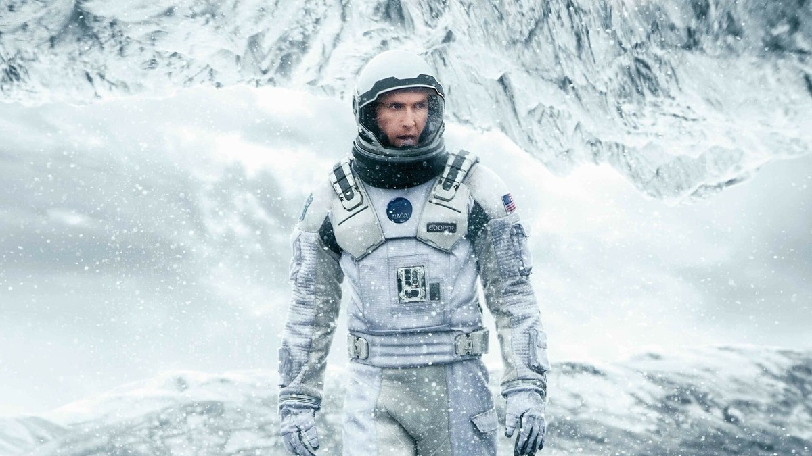
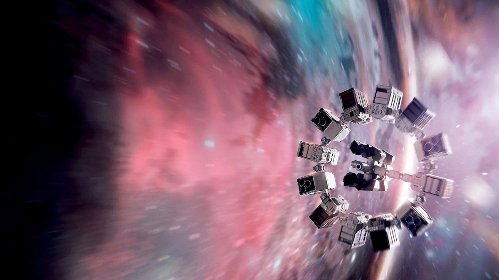
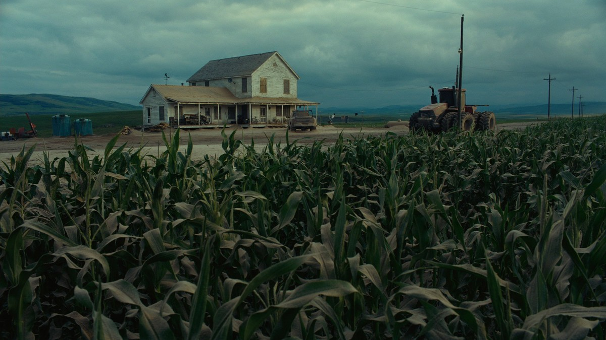
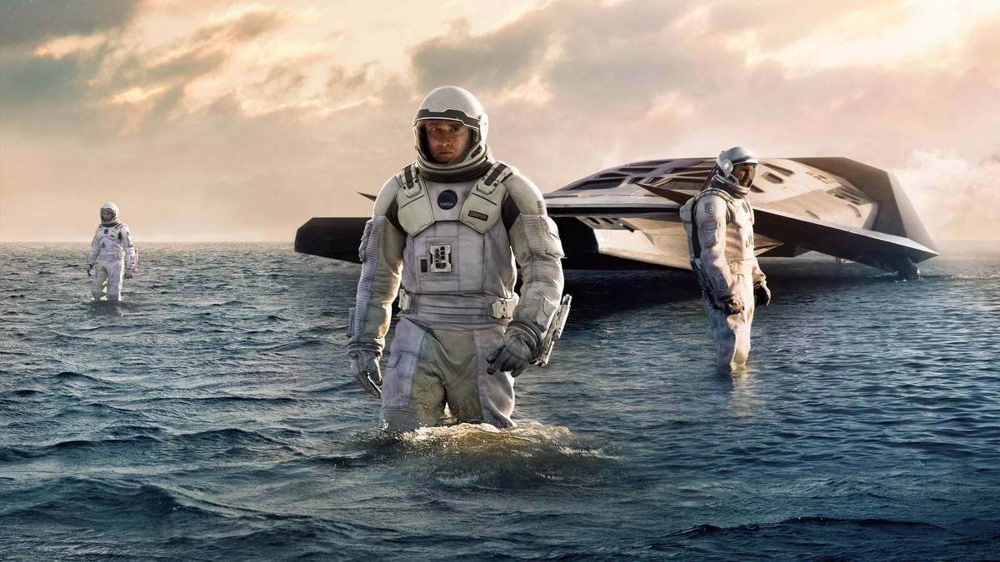
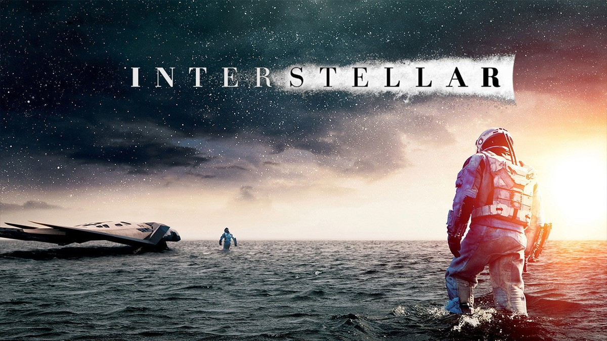
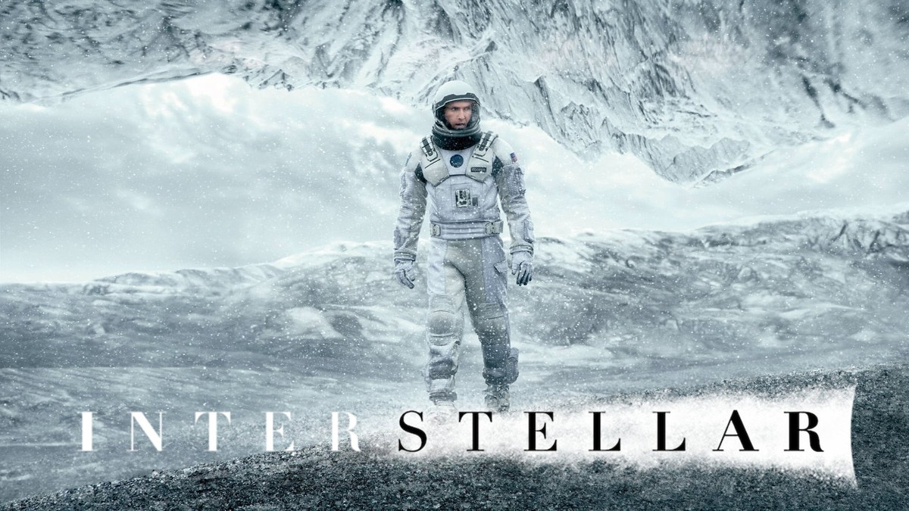
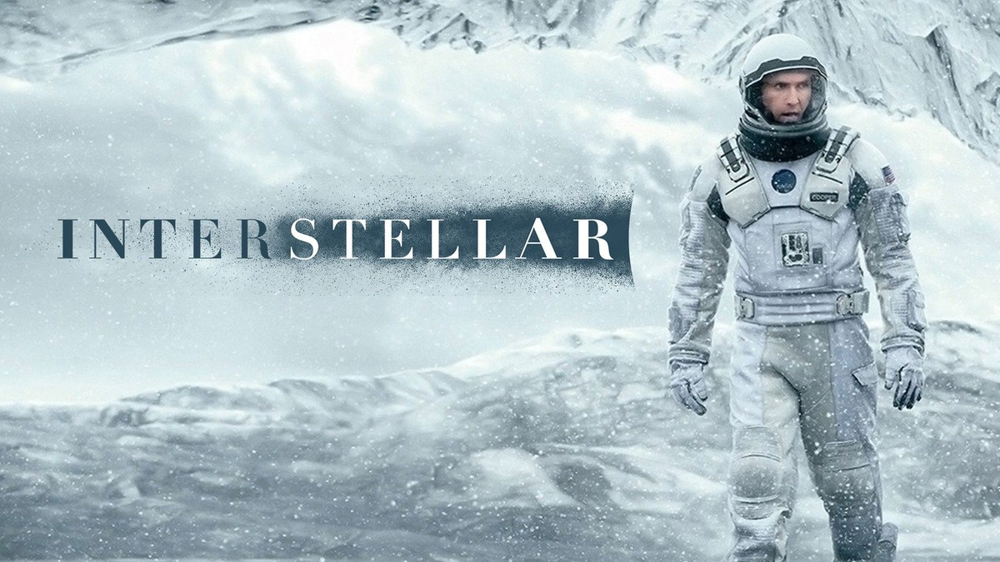
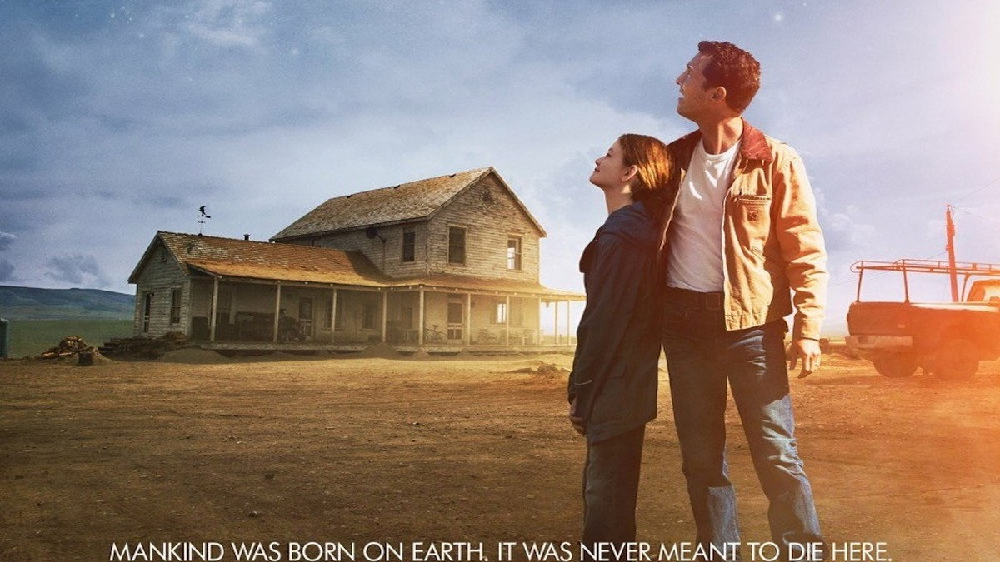

<!-- 본문 시작 -->

얼음 행성에 선 쿠퍼 — 인터스텔라 한국어 포스터
"우린 답을 찾을 것이다, 늘 그랬듯이."
2014년 크리스토퍼 놀란 감독의 '인터스텔라'는 식량이 떨어진 지구에서 인류의 새 집을 찾아 떠나는 이야기다.
전직 우주비행사 쿠퍼는 옥수수 농사를 짓다 딸 머프와 함께 나사의 비밀기지로 향하고, 우주선 엔듀런스호를 타고 토성 근처 웜홀을 지나 세 개의 후보 행성을 살핀다.
이 글은 스포일러 없는 소개다. 결말 장면은 다루지 않으며, 장면 설명은 중반부까지의 설정과 분위기 중심으로 정리했다.

## 기본 정보

웜홀 앞의 엔듀런스호 — 인터스텔라 4K 포스터
| 항목 | 내용 |
|---|---|
| 제목 | 인터스텔라 (Interstellar) |
| 감독 | 크리스토퍼 놀란 (각본 조나단 놀란과 공동) |
| 주연 | 매튜 매커너히(쿠퍼), 앤 해서웨이(브랜드 박사), 마이클 케인(브랜드 교수), 제시카 차스테인(성인 머프), 매켄지 포이(어린 머프), 케이시 애플렉(톰), 맷 데이먼(만), 빌 어윈(타스 목소리), 조쉬 스튜어트(케이스 목소리) |
| 개봉 | 2014년, 한국 2014년 11월 6일, 등급 12세 |
| 러닝타임 | 2시간 49분(169분, TMDB 표기) |
| 장르 | 모험, 드라마, SF |
| TMDB 회원 점수 | 8.5/10(41,820개 평가, TMDB 한국 페이지 2026-11-09 확인) |
| 국내 시청처 | 스트리밍 넷플릭스·애플 TV, 대여·구매 구글 플레이 (TMDB 시청처 페이지 대한민국 기준 2026-11-09 확인, 가격·제공처는 시청 전 재확인 필요) |

## 지구가 망가지면, 사람은 어디로 가야 할까

옥수수밭 앞의 쿠퍼네 농가 — 식량난의 지구
세계 각국의 정부와 경제가 무너진 뒤의 미래다.
지난 세기의 잘못이 전 세계적인 식량 부족을 불렀고, 나사마저 해체됐다.
나사 소속 우주비행사였던 쿠퍼는 이제 옥수수나 키우며 산다.
거센 황사가 몰아치는 어느 날, 알 수 없는 힘에 이끌려 딸 머프와 함께 도착한 곳은 인류가 이주할 행성을 찾는 나사의 비밀본부다.

이 설정이 중요한 이유는, 영화가 우주를 배경으로 삼으면서도 출발점을 지구의 밥상에 두기 때문이다.
식량이 떨어진다는 것은 먼 미래의 공상이 아니라, 당장 내일의 밥그릇 문제다.
쿠퍼가 떠나는 이유는 모험심이 아니라, 아이들이 살아갈 땅이 지구에 더는 없다는 판단 때문이다.
그래서 이 영화의 우주선은 멀리 가기 위한 기계인 동시에, 집을 지키기 위한 마지막 수단이다.

## 1시간이 7년이 되는 행성, 시간의 값을 어떻게 치를까

밀러 행성의 얕은 바다를 걷는 쿠퍼 일행 — 레인저 착륙선 뒤로
쿠퍼 일행이 처음 내리는 행성은 온통 물로 덮인 밀러 행성이다.
발목까지 차는 얕은 바다 위로 착륙선이 서 있고, 하늘은 낮게 깔린다.
이 행성의 규칙은 하나다.
이곳의 1시간이 지구에서는 약 7년에 해당한다.
블랙홀 가르강튀아 가까이에서 시간이 느리게 흐르기 때문이다.

밀러 행성의 넓은 바다 — 파도가 다가오기 전의 고요
영화가 던지는 첫 질문이 여기 있다.
탐험에 쓰는 1시간마다, 지구에서는 7년이 사라진다.
머프는 자라고, 아버지의 소식은 늦어진다.
탐험대는 행성을 살펴야 하지만, 살펴보는 동안에도 시간은 값을 매긴다.
이 영화는 우주여행을 거리와 연료의 문제가 아니라, 시간과 가족의 문제로 바꾼다.
얼마나 빨리 가느냐가 아니라, 무엇을 잃으면서 가느냐가 문제라는 것이다.

## 로봇 타스와 얼음 행성, 끝까지 남는 질문은 무엇일까

얼음 행성에 선 쿠퍼 — 눈보라 속의 탐험
일행과 함께하는 로봇 타스와 케이스는 네모난 몸에 바퀴 없이 움직이는 동료다.
타스는 농담의 수위를 조절할 수 있고, 솔직함의 정도도 정할 수 있다.
기계가 인간을 흉내 내는 것이 아니라, 인간이 기계에게 어떤 성격을 줄 것인지를 정하는 존재다.
이 설정은 영화 내내 따라다닌다.
로봇을 얼마나 인간답게 만들 것인가가 아니라, 인간이 로봇에게 무엇을 맡길 것인가가 문제이기 때문이다.

얼음 행성을 걷는 쿠퍼 — 눈보라와 얼어붙은 산
두 번째로 살피는 행성은 얼어붙은 얼음 행성이다.
눈보라가 몰아치고, 발밑은 얼음과 눈으로 덮여 있다.
이곳에서는 먼저 도착한 탐험가의 신호가 기다리고 있다.
영화는 이 구간에서 묻는다.
낯선 행성에서 만난 신호를 어디까지 믿을 수 있는가.
희망이라는 이유로 위험을 감수하는 것이 옳은가.
정답은 주어지지 않고, 쿠퍼 일행의 선택만 따라간다.

## 시청 전 체크리스트

농가 앞의 쿠퍼와 어린 머프 — 인터스텔라 극장 포스터
- 러닝타임 2시간 49분으로, 여유 있는 저녁 시간에 보는 것이 좋다
- 등급 12세, 국내 극장 개봉은 2014년 11월 6일
- 시청처는 스트리밍 넷플릭스·애플 TV, 대여·구매 구글 플레이 (2026-11-09 TMDB 기준, 시청 전 재확인 필요)
- 감독 크리스토퍼 놀란, '인셉션'과 '다크 나이트' 3부작으로 알려진 감독의 우주 영화
- 칼텍 물리학자 킵 손의 이론을 바탕으로 블랙홀 가르강튀아를 그렸다
- 결말에 대한 사전 정보 없이 보는 것이 좋다

## 자주 묻는 질문

**Q. 인터스텔라는 어떤 영화인가요?**
A. 식량난으로 망가진 지구에서 인류의 새 집을 찾으러 떠나는 우주비행사 쿠퍼의 이야기다. 토성 근처 웜홀을 지나 세 후보 행성을 살피고, 그 과정에서 시간과 가족의 문제를 마주한다.

**Q. 1시간이 7년이라는 말은 무슨 뜻인가요?**
A. 밀러 행성은 거대한 블랙홀 가르강튀아 가까이에 있어 시간이 느리게 흐른다는 설정이다. 행성 표면의 1시간이 지구 시간으로는 약 7년에 해당한다. 영화 초반에 설명되는 내용이다.

**Q. 아이와 함께 봐도 되나요?**
A. 국내 등급은 12세다. 긴 러닝타임과 무거운 주제가 있어 12세 이상 관람이 적합하다.

**Q. 어디서 볼 수 있나요?**
A. 2026-11-09 TMDB 대한민국 기준으로는 넷플릭스·애플 TV 스트리밍, 구글 플레이 대여·구매가 표시된다. 제공처와 가격은 바뀔 수 있어 시청 전 재확인이 필요하다.

**Q. 실제 과학이 들어간 영화인가요?**
A. 칼텍 물리학자 킵 손이 자문한 영화로, 블랙홀 가르강튀아의 모습은 그의 이론을 바탕으로 만들었다. 2024년에는 개봉 10주년을 맞아 IMAX 재개봉으로도 다시 화제가 됐다.

## 함께 읽으면 좋은 글

[채피｜스스로 생각하고 느끼기 시작한 로봇, 인간이 가르친 것들 — 감정을 가진 로봇, 인간이 가르친 것들](https://aitechnoteskr.tistory.com/135)
[앤트로픽 내부 모델 4의 정체｜METR 보고서가 밝힌 AI 가속 1.9배, 어디까지 믿을까 — 모델 4와 METR 보고서, 가속의 조건](https://aitechnoteskr.tistory.com/132)
[클로드 코드가 전화로 물어보게 만드는 법｜일하다 말고 전화받는 AI 에이전트 — 전화로 결정을 묻는 AI 에이전트, 직접 만드는 조건](https://aitechnoteskr.tistory.com/133)

시간이 느려지는 행성에서 1시간을 보내는 동안, 지구에서는 7년이 흐른다. 인터스텔라가 묻는 것은 멀리 가는 방법이 아니라, 떠난 자리에서 무엇을 지킬 것인가이다. 결말을 미리 검색하지 말고 영화를 먼저 보는 것이 좋다. 다음 영화 소개도 함께 따라가려면 이웃 추가를 눌러두면 된다.

<!-- 본문 끝 -->

## 작업용 출처·이미지 정보 (업로드 제외)

- 자료 출처: TMDB 영화 157336 페이지·시청처 페이지(대한민국 기준, 2026-11-09 확인) / 스틸: TMDB 백드롭·포스터 원본(너비 1200px 이상, 결말 장면 제외; s08 원본 1000px이라 1.2배 업스케일됨)
- 이미지: images/01-hero.jpg ~ 08-img7.jpg / TMDB 공식 스틸·백드롭 (1200x675)
