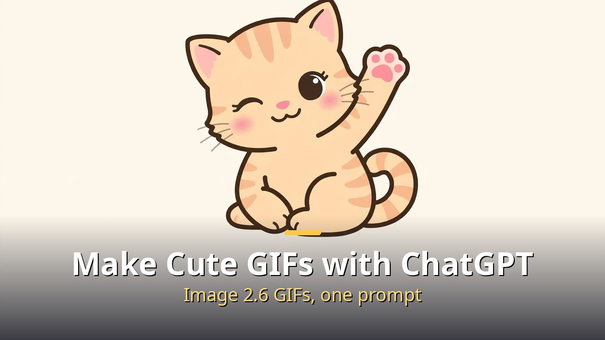
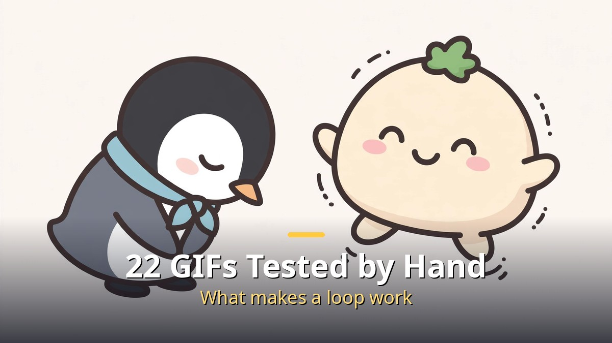
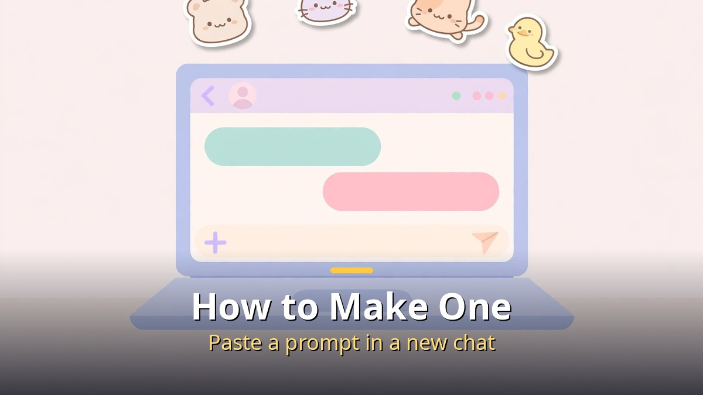
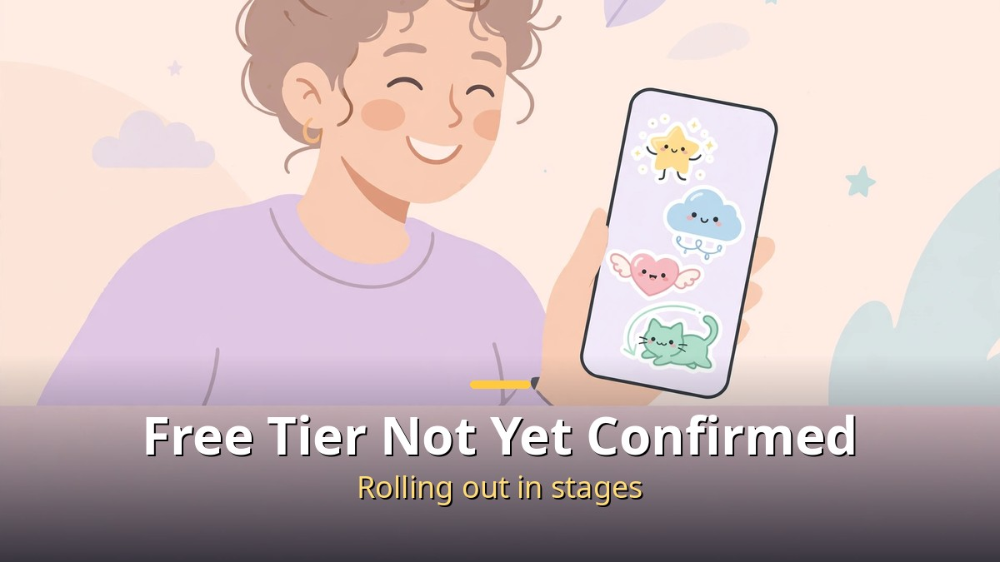

<!-- 본문 시작 -->

ChatGPT Image 2.6 can now make GIF animations.
For anyone who wants a custom reaction image for KakaoTalk or social media, one prompt is enough to get a cute looping animation.
This guide is based on a video the creator published on 2026-11-09, so it is a research-based write-up, not a hands-on test.
It carries over what the creator found after making 22 GIFs and sorting the good ones from the failures.

> **The whole trick comes down to one thing. Make the first frame and the last frame match exactly, keep the camera still, and leave text out. Follow those three rules and a single prompt can produce a seamless GIF.**

## How do you make a GIF with ChatGPT?

Open a new chat, paste a prompt, and ChatGPT makes the GIF.

The method itself is simple.
Open a new conversation in ChatGPT and paste a prompt describing the scene you want.
The creator tried this on a Plus plan and did not directly verify how it works on a free account.

It is faster than you might expect.
The quickest ones took about 25 seconds, and the slowest took a little over 2 minutes.
Image 2.6 was announced for all plans, including free, but it is rolling out gradually, so as of 11-08 it may not have reached every account yet.
If you do not see the feature, your account may simply not be in the rollout yet.

OpenAI announced ChatGPT Images 2.6 on 2026-11-04.
GIF animation generation is the new feature in this update.
The company says image generation is about 50% faster.

## Why do some GIFs turn out well while others fail?

Good GIFs and failed GIFs differ from the very first setup.

The creator made 22 GIFs and published the good ones separately from the failures.
Twelve prompts the creator actually tried are also public in the video description.
The examples give you the idea: a baby cat waving, a penguin bowing, a bouncing steamed bun, a squirrel munching, a duck wiggling its tail, clapping kimbap, a cloud breathing as it sleeps, a laptop typing, a letter envelope flapping its wings, and a twinkling light bulb.

What these examples share is a single motion.
Waving, bowing, bouncing, or eating — one action, repeated.
Asking for a complex scene change or several actions at once is how GIFs tend to fail.

| Category | GIFs that work | GIFs that fail |
| --- | --- | --- |
| First and last frame | The first and last frames match exactly | The first and last frames differ, so the loop jerks at the seam |
| Camera | A fixed camera on one scene | A moving camera that shakes the scene |
| Style | Bold outlines and simple flat colors | Lots of detail and complex shading |
| Text | No text or logos | Text or logos that come out broken |
| Background | A solid-color background | A busy background that swallows the subject |

**To keep the loop seamless, matching the first and last frames matters most.**
That one condition separated the good results from the failures.
The other four are stabilizers on top of it.

## Where can you use the GIFs you make?

Short looping animations fit reaction images and memes perfectly.

A GIF is a short loop of roughly 6 to 12 frames, closer to a flipbook than a video.
It is not a long scene that plays through.
One motion, repeated over and over, is the whole thing.

So the uses are clear: KakaoTalk and social media reaction images, memes, brand mascots, and animation storyboards.
A waving baby cat becomes a greeting you send instead of words.
Clapping kimbap becomes a meme for a congratulatory message.

This story started with [14 AI News Items This Week — Only 4 Are Worth Your Time](https://aitechnotesen.blogspot.com/2026/11/14-ai-news-items-this-week-only-4-are.html), the weekly roundup that first mentioned Image 2.6 GIFs in a single line.
This post is the hands-on follow-up that turns that line into a method.
If you read the roundup first, read this one as the next step: putting the news to use.

The same logic holds for repeat uses like a mascot or a storyboard.
One motion, kept simple, with no visible seam.
Follow those conditions and your odds of getting a usable result go up, just like the good ones among the 22.

---

One more note for anyone ready to try it right away.
**Do not start with a difficult scene. Start with one motion, like a wave.**
There is a reason every good example shows a single action.
Once one motion works, you can change it little by little.

The evidence for this post is the 22 GIFs the creator made and sorted.
It is a research-based summary, not something I tried myself, but the line between the good ones and the failures is worth borrowing as it is.
One reaction image for KakaoTalk, made some evening this week, is not a bad place to start.

## Frequently Asked Questions

**Can I make GIFs on the free plan?**
The announcement says all plans get it, but the rollout is gradual.
As of 11-08 it may not have reached every account, and the creator tried it on a Plus plan without directly verifying a free account.

**How long does it take to make one?**
By the creator's account, the fastest took about 25 seconds and the slowest a little over 2 minutes.
A more complex prompt can take longer.

**Why does my GIF jerk at the loop point?**
The first and last frames do not match.
Making the start and the end exactly the same is the most important step for a seamless loop.

**Can I add text or a logo?**
The guidance is to leave them out.
Text in a GIF can come out broken or look awkward.

**How is a GIF different from a video?**
A GIF is a short loop of roughly 6 to 12 frames, closer to a flipbook, and it does not play a long scene through like a video.
One motion, repeated, is all there is.

## Recommended Reading
[14 AI News Items This Week — Only 4 Are Worth Your Time — the weekly roundup that first covered Image 2.6 GIFs](https://aitechnotesen.blogspot.com/2026/11/14-ai-news-items-this-week-only-4-are.html)
[Interstellar — One Hour Is Seven Years on a Distant Planet — a 169-minute classic worth your evening on Netflix](https://aitechnotesen.blogspot.com/2026/11/interstellarone-hour-is-seven-years-on.html)
[The US Is Moving to Ban Superintelligence Again — how to tell a bill filing from a ban](https://aitechnotesen.blogspot.com/2026/11/the-us-is-moving-to-ban.html)

If you want to keep following this topic, follow this blog and the next update will reach you as soon as it is posted.

<!-- 본문 끝 -->

## 작업용 출처·이미지 정보 (업로드 제외)

- Source: Ai-Con Lab 영상 pLuq5CRFsWA(2026-11-09, 6분 55초, 자막 0:02~6:53 확인) + OpenAI Images 2.6 발표(2026-11-04) 대조
- Images: images/01-hero-en.jpg ~ 04-img3-en.jpg / original illustration + English banner overlay (1200x675)
