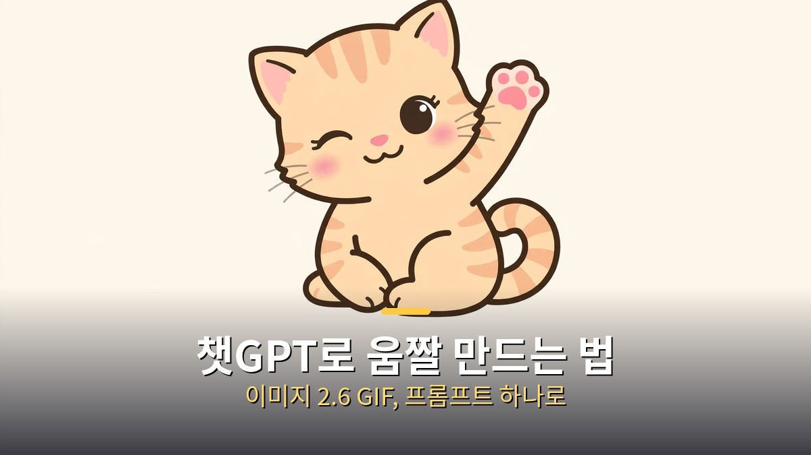
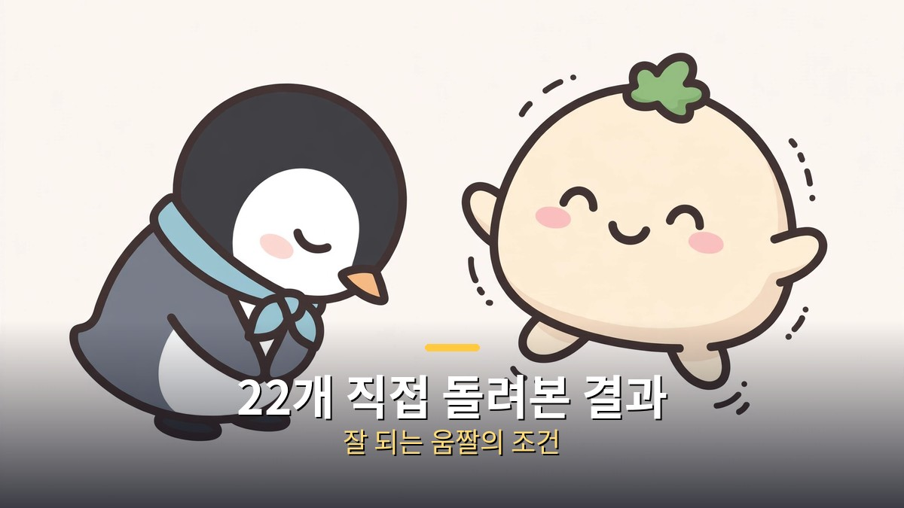
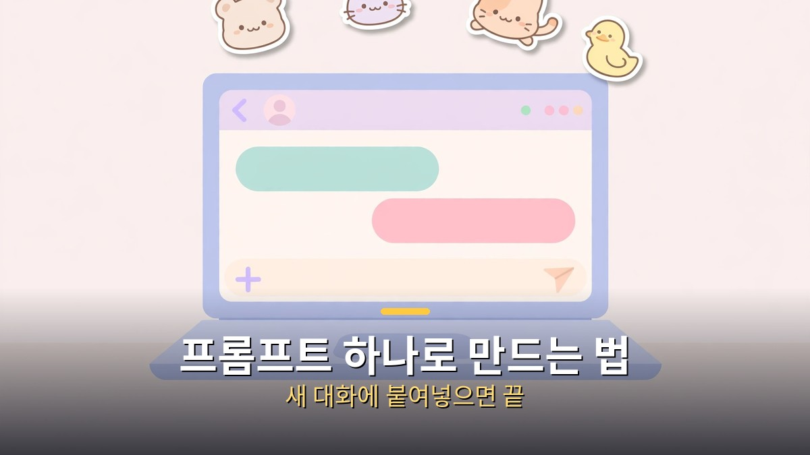
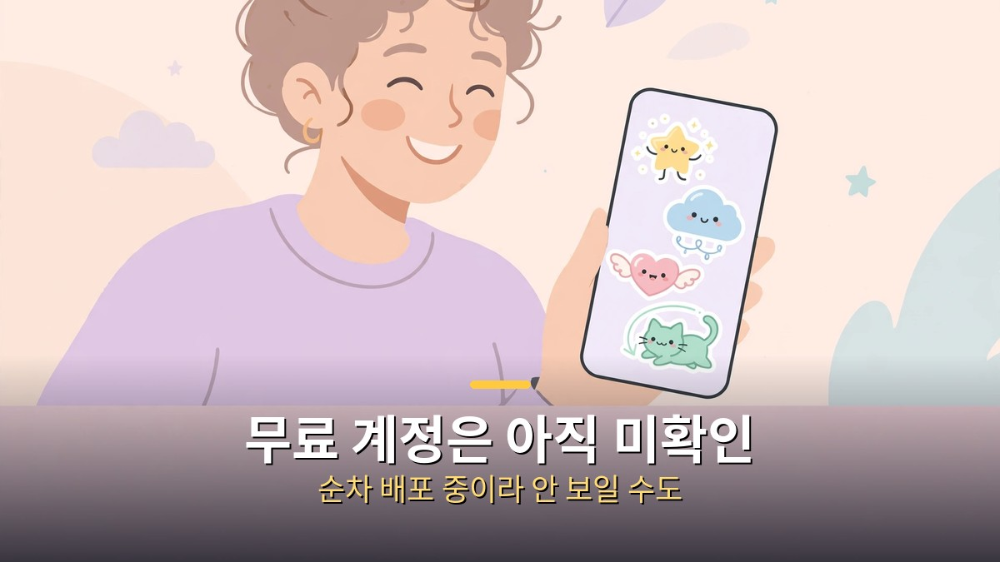

<!-- 본문 시작 -->

챗GPT 이미지 2.6으로 이제 GIF 움짤을 만들 수 있다.
카톡이나 SNS에 쓸 반응 이미지를 직접 만들고 싶은 사람에게, 프롬프트 하나로 귀여운 반복 애니메이션을 뽑는 방법이 생긴 셈이다.
이 글은 제작자가 2026-11-09에 공개한 영상을 바탕으로 정리한 자료 기반 안내다.
직접 만들어본 경험이 아니라, 제작자가 22개를 직접 돌려보고 가려낸 결과를 옮긴다.

> **핵심은 하나다. 첫 장면과 마지막 장면을 똑같이 맞추고, 카메라는 고정하고, 글자는 빼는 것. 이 세 가지만 지키면 프롬프트 하나로 끊김 없는 GIF가 나온다.**

## 챗GPT로 GIF 움짤을 만들려면 어떻게 해야 할까?

새 대화를 열고 프롬프트를 붙여넣으면 챗GPT가 GIF를 만들어준다.

방법 자체는 단순하다.
ChatGPT에서 새 대화를 열고, 만들고 싶은 장면을 담은 프롬프트를 붙여넣으면 된다.
제작자는 플러스 요금제로 해봤고, 무료 계정에서의 동작은 직접 확인하지 못했다.

속도는 생각보다 빠르다.
빠르면 25초, 길어도 2분 조금 넘게 걸렸다고 한다.
다만 이미지 2.6은 모든 요금제에 제공된다고 발표됐지만 순차 배포 중이라, 11-08 기준으로 계정마다 아직 안 보일 수 있다.
기능이 아직 안 보이면, 내 계정 차례가 아직 오지 않은 것일 수 있다.

OpenAI는 2026-11-04에 ChatGPT Images 2.6을 발표했다.
GIF 애니메이션 생성이 이번 업데이트의 신규 기능이다.
이미지 생성 속도는 약 50% 빨라졌다고 회사는 주장한다.

## 왜 어떤 움짤은 잘 나오고 어떤 건 망할까?

잘 나오는 움짤과 망하는 움짤은 시작 조건부터 갈린다.

제작자는 22개를 직접 만들어 잘 나온 것과 망한 것을 구분해 공개했다.
직접 돌려본 프롬프트 12개도 영상 설명란에 공개했다.
예시를 보면 감이 온다.
손 흔드는 아기 고양이, 꾸벅 인사하는 펭귄, 통통 튀는 찐빵, 오물오물 먹는 다람쥐, 엉덩이 흔드는 오리, 박수 치는 김밥, 숨 쉬며 자는 구름, 타자 치는 노트북, 날갯짓하는 편지 봉투, 반짝이는 전구.

이 예시들의 공통점은 움직임이 하나라는 점이다.
손 흔들기, 인사하기, 튀기, 먹기처럼 한 가지 동작만 반복한다.
복잡한 장면 전환이나 여러 동작을 한 번에 시키면 망하기 쉽다.

| 구분 | 잘 되는 움짤 | 망하는 움짤 |
| --- | --- | --- |
| 처음과 끝 | 첫 장면과 마지막 장면이 정확히 일치한다 | 처음과 끝이 달라 반복 지점에서 뚝 끊긴다 |
| 카메라 | 고정된 카메라로 한 장면을 찍는다 | 카메라가 움직여 장면이 흔들린다 |
| 그림체 | 굵은 외곽선과 단순한 면 색을 쓴다 | 디테일이 많고 음영이 복잡하다 |
| 글자 | 글자나 로고를 넣지 않는다 | 글자나 로고를 넣어 깨진다 |
| 배경 | 단색 배경을 쓴다 | 배경이 복잡해 주인공이 묻힌다 |

**반복이 끊기지 않게 하려면, 첫 장면과 마지막 장면을 일치시키는 것이 가장 먼저다.**
이 조건 하나가 잘 나온 것과 망한 것을 가르는 기준이 됐다.
나머지 네 가지는 그 위에 얹는 안정장치다.

## 만든 GIF는 어디에 쓰면 좋을까?

짧은 반복 애니메이션이라 카톡 반응 이미지와 밈에 잘 어울린다.

GIF는 6~12프레임 수준의 짧은 반복, 그러니까 플립북에 가깝다.
동영상과는 다르다.
길게 이어지는 장면이 아니라, 한 동작을 계속 되풀이하는 짧은 고리가 전부다.

그래서 활용처도 분명하다.
카톡이나 SNS 반응 이미지, 밈, 브랜드 마스코트, 애니메이션 스토리보드가 대표적이다.
손 흔드는 아기 고양이 하나면, 말 대신 보내는 인사말이 된다.
박수 치는 김밥 하나면, 축하 메시지에 쓸 밈이 된다.

이 소식의 출발점은 [이번 주 AI 뉴스 14건, 챙길 건 4가지뿐](https://aitechnoteskr.tistory.com/142)에서 이미지 2.6 GIF를 한 줄로 전한 주간 정리였다.
이 글은 그 한 줄을 방법형으로 풀어 쓴 심화 후속이다.
주간 정리에서 소식을 먼저 봤다면, 이 글은 그 소식을 직접 써먹는 순서로 읽으면 된다.

마스코트나 스토리보드처럼 반복 사용처가 있는 경우에도 같은 원리가 통한다.
한 동작만, 단순하게, 끊김 없이.
이 조건을 지키면 22개 중 잘 나온 것들처럼 쓸 만한 결과가 나올 확률이 올라간다.

---

이 글을 읽고 바로 해보고 싶은 사람에게, 한 가지만 덧붙인다.
**처음부터 어려운 장면을 시키지 말고, 손 흔들기 같은 한 동작부터 시작하는 것이 좋다.**
잘 나온 예시들이 전부 한 동작인 데는 이유가 있다.
한 동작이 되면, 그다음에 조금씩 바꾸면 된다.

제작자가 22개를 만들어 가려낸 결과가 이 글의 근거다.
직접 해본 게 아니라 자료로 정리한 글이지만, 잘 나온 것과 망한 것을 나눈 기준은 그대로 가져올 만하다.
카톡에 쓸 반응 이미지 하나, 오늘 저녁에 한 번 만들어보는 것도 나쁘지 않다.

## 자주 묻는 질문

**무료 요금제에서도 GIF를 만들 수 있나요?**
발표에 따르면 모든 요금제에 제공되지만 순차 배포 중이다.
11-08 기준으로 계정마다 아직 안 보일 수 있고, 제작자는 플러스 요금제로 해봤으며 무료 계정 동작은 직접 확인하지 못했다.

**만드는 데 얼마나 걸리나요?**
제작자 기준으로 빠르면 25초, 길어도 2분 조금 넘게 걸렸다.
프롬프트가 복잡해지면 시간이 더 걸릴 수 있다.

**내 움짤이 반복 지점에서 뚝뚝 끊기는 이유는 뭔가요?**
첫 장면과 마지막 장면이 일치하지 않아서다.
끊김 없는 반복을 만들려면 처음과 끝을 정확히 같게 맞추는 것이 가장 중요하다.

**글자나 로고를 넣으면 안 되나요?**
잘 나오는 요령은 글자나 로고를 넣지 않는 것이다.
글자가 들어가면 깨지거나 어색하게 나올 수 있다.

**동영상과 GIF는 뭐가 다른가요?**
GIF는 6~12프레임 수준의 짧은 반복이라 플립북에 가깝고, 동영상처럼 긴 장면이 이어지지 않는다.
한 동작을 계속 되풀이하는 짧은 고리가 전부다.

## 함께 읽으면 좋은 글
[이번 주 AI 뉴스 14건, 챙길 건 4가지뿐｜이미지 2.6 GIF부터 키미 가중치 공개까지 — 이미지 2.6 GIF 소식을 처음 전한 주간 정리](https://aitechnoteskr.tistory.com/142)
[인터스텔라｜1시간이 7년이 되는 행성, 아버지가 건너는 시간 — 169분짜리 명작, 넷플릭스에서 볼 가치](https://aitechnoteskr.tistory.com/143)
[미국, 초지능 AI 금지 법안 다시 불붙었다｜'금지'가 아니라 '발의'부터 가려야 하는 이유 — 법안 원문과 의회 단계로 가른 검증법](https://aitechnoteskr.tistory.com/141)

이 주제를 계속 따라가려면 이웃 추가를 해두면 다음 소식이 올라올 때 바로 볼 수 있다.

<!-- 본문 끝 -->

## 작업용 출처·이미지 정보 (업로드 제외)

- 자료 출처: Ai-Con Lab 영상 pLuq5CRFsWA(2026-11-09, 6분 55초, 자막 0:02~6:53 확인) + OpenAI Images 2.6 발표(2026-11-04) 대조
- 이미지: images/01-hero.jpg ~ 04-img3.jpg / 자작 일러스트 + 한글 배너 오버레이 (1200x675)
