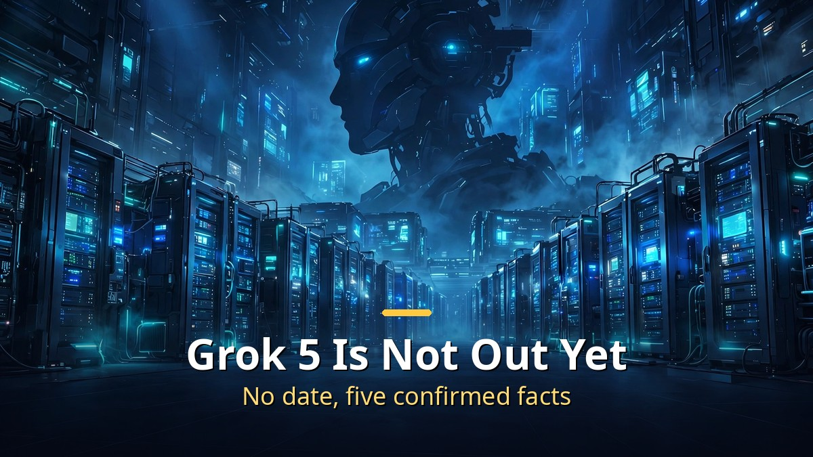
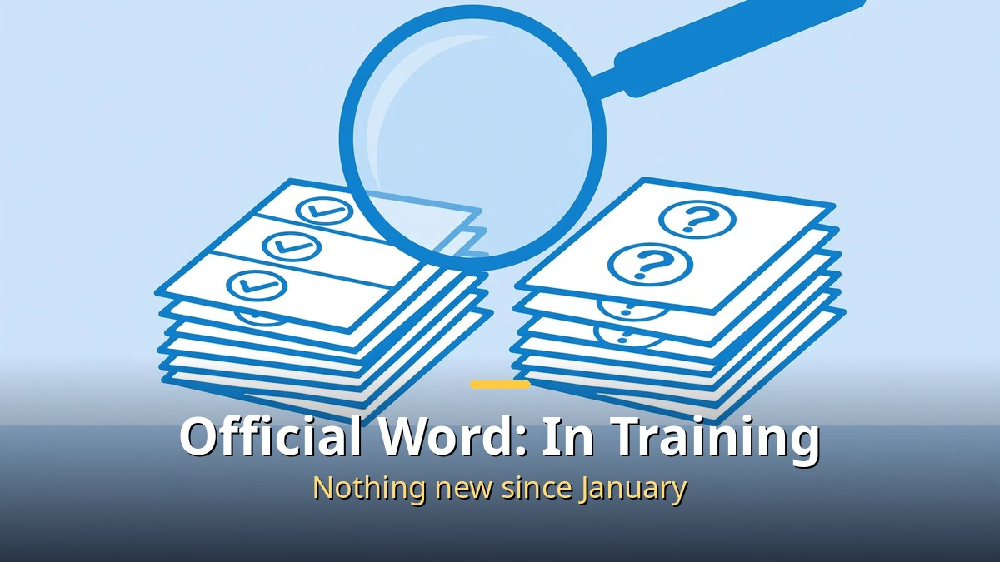
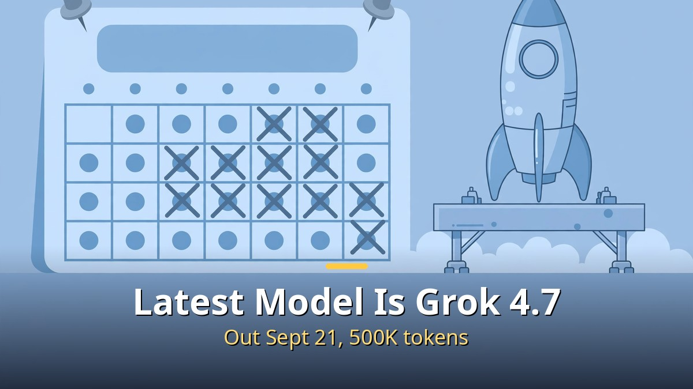

<!-- 본문 시작 -->

Grok 5 is not out yet.
If you are waiting for its release date, start with that one sentence.
The official position from xAI is that "Grok 5 is currently in training" — nothing more.
As of November 5, 2026, there is no release date.
This article is not written by someone who has used Grok 5.
It is based on documents and public records, separating confirmed facts from rumors.

> **The short version: Grok 5 is in training and has no release date. The latest public model is Grok 4.7, released on September 21, 2026. Release targets have already slipped three times, and Musk himself said Grok 4.8 and 4.9 will come first. So any claim that it is "coming soon" needs to be checked first.**

## Where does Grok 5 stand right now?

The last official statement from xAI is a single line: it is in training.

That wording comes from the Series E announcement on January 6, 2026.
Since then, there is no record of a Grok 5 launch in xAI's news list or its API release notes.
The absence of a launch record is itself the clearest evidence of where things stand.

So the latest model you can actually use is Grok 4.7.
Grok 4.7 was released on September 21, 2026, with a 500,000-token context window.
API pricing is $2 per million input tokens and $6 per million output tokens.

Before it came Grok 4.5 in July 2026 and Grok 4.6 on August 12, 2026.
Looking at that steady pace of version updates, Musk's statement that 4.8 and 4.9 will come first fits the pattern.
He said so on September 14, 2026.

The creator behind the video that prompted this article analyzed the situation along three axes: compute, SpaceX data, and agent tools.
This article does not copy that analysis.
It is built only from facts checked against the web.
Caption segments were not shown, so no detailed figures from the captions could be verified.

## Why has the release date kept slipping?

Release targets have already passed three times.

The first target was the end of 2025.
Then came the first quarter of 2026, and then the second quarter of 2026.
All three passed, and Grok 5 still has not arrived.

Musk's remarks at the Baron conference on November 17, 2025 also need to be read carefully.
He said Grok 5 would have around 6 trillion parameters and be natively multimodal, including real-time video.
He also put the chance of reaching human-level intelligence at about 10%.
This is his own assessment, with no numbers or benchmarks attached — not a confirmed specification.

The training infrastructure is Colossus 2 in Memphis and Southaven.
It is a gigawatt-class supercomputer that supports Grok 5 training.
A bigger cluster does not make a release faster.
Training has to finish before evaluation and launch preparation can follow.

Prediction markets are cautious as well.
On Polymarket, as of November 6, the chance of Grok 5 launching by the end of 2026 was about 10%.
A market reading is not the answer, but it is far from the "certain to launch this year" claims going around.

## What can you check right now while waiting for Grok 5?

The most practical thing to do while waiting is to build the habit of checking the source first.

First, look at xAI's official news list.
Check for yourself whether there is any Grok 5 launch record.
If there is no official announcement, it has not launched.

Second, check the API release notes.
When a new model becomes usable, the record shows up there first.
It is faster than any blog post.

Third, when a headline says "launch confirmed," ask for the date and the evidence.
If there is no date, or the only source is a single unnamed "insider," set it aside for now.
This way of sorting claims works for other AI news too.
[The US Is Moving to Ban Superintelligence Again — how to tell a bill filing from a ban](https://aitechnotesen.blogspot.com/2026/11/the-us-is-moving-to-ban.html)

Fourth, treat prediction market figures as a reference, not a verdict.
The roughly 10% figure on Polymarket is an aggregate of people's bets, not xAI's schedule.
A low number does not make a launch impossible, and a high number would not make it certain.

**To recap the five confirmed facts: the official position is that it is in training, there is no release date, the latest model is Grok 4.7, three targets have slipped, and Musk said 4.8 and 4.9 come first.**
Remembering just these five is enough to filter out half of what is written about Grok 5.

| Category | Content |
| --- | --- |
| Confirmed fact | xAI's official position, "Grok 5 is currently in training" (Series E announcement, 2026-01-06) |
| Confirmed fact | No release date as of 2026-11-05; no launch record in x.ai news or API release notes |
| Confirmed fact | Latest public model is Grok 4.7 (2026-09-21, 500K tokens, $2 input / $6 output per 1M tokens) |
| Confirmed fact | Three missed launch targets: end of 2025, Q1 2026, Q2 2026 |
| Confirmed fact | Musk's 2026-09-14 statement: Grok 4.8 and 4.9 will come before Grok 5 |
| Claim / rumor | "It will be the most powerful AI ever" — an analytical forecast, not a verified fact |
| Claim / rumor | Musk's 6 trillion parameters and roughly 10% human-level intelligence remarks — his own assessment, with no numbers or benchmarks |
| Reference figure | Polymarket chance of a launch by end of 2026: about 10% (as of 11-06) — a market judgment, not an official schedule |

The longer the wait, the more sensational the rumors get.
So the conclusion of this article is simple.
**You cannot use Grok 5 yet.**
Until an official announcement arrives, that one sentence is the most accurate information available.

---

## Frequently asked questions

**When will Grok 5 be released?**

There is no release date as of November 5, 2026.
xAI's official position is only that it is in training.

**What is the latest Grok I can use right now?**

Grok 4.7.
It was released on September 21, 2026, with a 500,000-token context window.

**Will Grok 4.8 and 4.9 really come before Grok 5?**

That is what Musk said on September 14, 2026.
He said Grok 4.8 and 4.9 will come before Grok 5.

**Are the 6 trillion parameters and 10% human-level intelligence figures confirmed specs?**

No.
They come from Musk's remarks at the Baron conference on November 17, 2025, with no numbers or benchmarks attached — his own assessment.

**What is the chance Grok 5 launches within 2026?**

About 10% on Polymarket as of November 6.
That is a prediction market reading, not xAI's official schedule.

## Further reading

[The US Is Moving to Ban Superintelligence Again — how to tell a bill filing from a ban](https://aitechnotesen.blogspot.com/2026/11/the-us-is-moving-to-ban.html)
[Interstellar — One Hour Is Seven Years on a Distant Planet — a 169-minute classic worth your evening on Netflix](https://aitechnotesen.blogspot.com/2026/11/interstellarone-hour-is-seven-years-on.html)
[Thank You Cost 38,865 Tokens — Why Claude Re-Reads Your Whole Conversation — and How to Cut It](https://aitechnotesen.blogspot.com/2026/11/thank-you-cost-38865-tokenswhy-claude.html)

If you want to keep following Grok 5 news, follow this blog and you will not miss the next update.
When the official announcement arrives, I will start with the confirmed facts.

<!-- 본문 끝 -->

## 작업용 출처·이미지 정보 (업로드 제외)

- Source: TheAIGRID 영상 KlG0VyhIzBU(2026-11-01, 25분, 자막 구간 미표시로 세부 미검증 — 웹 대조 사실로 구성) + xAI 공식 문구·그록 4.7·Polymarket 대조
- Images: images/01-hero-en.jpg ~ 04-img3-en.jpg / original illustration + English banner overlay (1200x675)
