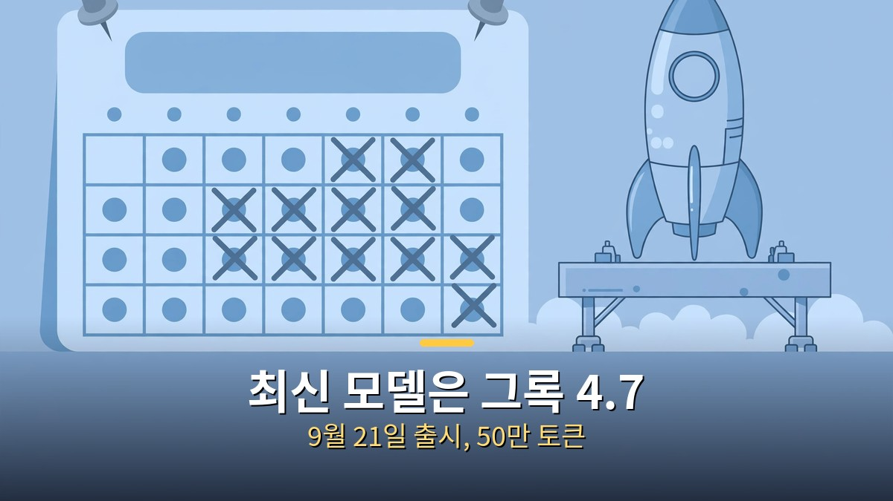

<!-- 본문 시작 -->

그록 5는 아직 나오지 않았다.
출시일을 기다리는 사람이라면, 이 한 문장부터 확인하고 시작하면 된다.
xAI의 공식 입장은 "Grok 5 is currently in training", 즉 지금 훈련 중이라는 말뿐이다.
2026년 11월 5일 기준으로 출시일은 정해지지 않았다.
이 글은 그록 5를 직접 써본 글이 아니다.
자료를 대조해 확인된 사실만 가려내고, 소문은 소문이라고 선을 긋는 글이다.

> **핵심 정리: 그록 5는 훈련 중이고 출시일은 없다. 최신 공개 모델은 2026년 9월 21일에 나온 그록 4.7이다. 출시 시점 목표는 세 차례나 지나갔고, 머스크 본인도 그록 4.8과 4.9가 먼저 나온다고 했다. 그러니 "곧 나온다"는 말은 일단 검증부터 해야 한다.**

## 그록 5는 지금 어디까지 왔나?

xAI가 마지막으로 공식적으로 밝힌 상태는 훈련 중이라는 한 줄이다.

이 문구는 2026년 1월 6일 Series E 발표에 들어 있다.
그 이후 xAI의 뉴스 목록과 API 릴리스 노트에는 그록 5 출시 기록이 없다.
출시 기록이 없다는 사실 자체가, 지금 상태를 보여주는 가장 확실한 근거다.

그래서 지금 쓸 수 있는 최신 모델은 그록 4.7이다.
그록 4.7은 2026년 9월 21일에 출시됐고, 문맥 길이는 50만 토큰이다.
API 가격은 입력 100만 토큰당 2달러, 출력 100만 토큰당 6달러다.

그 앞 순서는 그록 4.5(2026년 7월), 그록 4.6(2026년 8월 12일)이다.
버전이 하나씩 올라가는 속도를 보면, 그록 5가 아니라 4.8과 4.9가 먼저 나올 거라는 머스크의 말이 흐름과 맞는다.
머스크는 2026년 9월 14일에 그록 4.8과 4.9가 그록 5보다 먼저 나온다고 했다.

제작자는 이 상황을 세 가지 축으로 분석했다.
컴퓨트, SpaceX 데이터, 에이전트 도구다.
이 글은 그 분석을 그대로 옮기지 않고, 웹에서 대조한 사실만으로 구성했다.
자막 구간이 표시되지 않아 자막 기반 세부 수치는 검증하지 못했다.

## 출시일은 왜 자꾸 미뤄지나?

출시 시점 목표는 이미 세 번 지나갔다.

처음 목표는 2025년 말이었다.
다음은 2026년 1분기, 그다음은 2026년 2분기였다.
세 목표 모두 지나갔고, 그록 5는 아직 나오지 않았다.

머스크가 2025년 11월 17일 Baron 컨퍼런스에서 한 발언도 함께 봐야 한다.
그는 그록 5가 6조 파라미터 규모이며, 실시간 비디오를 포함한 네이티브 멀티모달이 될 거라고 했다.
인간 수준 지능에 도달할 확률은 약 10%라고도 했다.
다만 이건 수치나 벤치마크가 붙은 발표가 아니라, 본인의 평가라는 점을 분명히 해둔다.

학습 인프라는 멤피스와 사우스헤이븐에 있는 Colossus 2다.
기가와트급 슈퍼컴퓨터로, 그록 5 훈련을 떠받치는 기반이다.
규모가 크다고 출시가 빨라지는 건 아니다.
훈련이 끝나야 평가와 출시 준비가 이어지기 때문이다.

예측 시장도 조심스러운 쪽이다.
Polymarket 기준 2026년 11월 6일 시점에서, 2026년 말까지 그록 5가 출시될 확률은 약 10%다.
시장의 판단이 정답은 아니지만, "연내 출시 확실" 같은 말과는 거리가 멀다.

## 그록 5를 기다리는 사람이 지금 확인할 수 있는 방법은?

기다리는 동안 할 수 있는 가장 실용적인 일은, 소식을 출처부터 가리는 습관이다.

첫째, xAI 공식 뉴스 목록을 본다.
그록 5 출시 기록이 있는지 직접 확인한다.
공식 발표가 없으면 출시된 게 아니다.

둘째, API 릴리스 노트를 확인한다.
새 모델이 실제로 쓸 수 있게 되면, API 쪽 기록에 먼저 남는다.
블로그 글보다 이 기록이 빠르다.

셋째, "출시 확정"이라는 제목을 보면 날짜와 근거를 따진다.
날짜가 없거나, 출처가 "관계자" 한 줄이면 일단 보류한다.
이런 가려내기 방식은 다른 AI 소식에도 그대로 쓸 수 있다.
[미국, 초지능 AI 금지 법안 다시 불붙었다｜'금지'가 아니라 '발의'부터 가려야 하는 이유](https://aitechnoteskr.tistory.com/141)

넷째, 예측 시장 수치를 참고하되 맹신하지 않는다.
Polymarket의 약 10%는 사람들의 베팅이 모인 값이지, xAI의 일정이 아니다.
숫자가 낮다고 출시가 불가능한 것도 아니고, 높다고 확정된 것도 아니다.

**확인된 사실 5가지를 한 번 더 정리하면, 훈련 중이라는 공식 입장, 출시일 없음, 최신 모델은 그록 4.7, 세 차례 목표 불발, 그리고 4.8·4.9 우선 발언이다.**
이 다섯 가지만 기억해도, 그록 5 관련 글의 절반은 걸러낼 수 있다.

| 구분 | 내용 |
| --- | --- |
| 확인된 사실 | xAI 공식 입장 "Grok 5 is currently in training"(2026-01-06 Series E 발표) |
| 확인된 사실 | 2026-11-05 기준 출시일 없음, x.ai 뉴스·API 릴리스 노트에 출시 기록 없음 |
| 확인된 사실 | 최신 공개 모델은 그록 4.7(2026-09-21, 50만 토큰, 입력 2달러·출력 6달러/100만 토큰) |
| 확인된 사실 | 출시 목표 세 차례 불발: 2025년 말, 2026년 1분기, 2026년 2분기 |
| 확인된 사실 | 머스크 2026-09-14 발언: 그록 4.8·4.9가 그록 5보다 먼저 나온다 |
| 주장·소문 | "역대 가장 강력한 AI가 될 것"이라는 전망 — 검증된 사실이 아니라 분석·전망 성격의 주장이다 |
| 주장·소문 | 머스크의 6조 파라미터·약 10% 인간 수준 지능 발언 — 수치·벤치마크 없는 본인 평가다 |
| 참고 수치 | Polymarket 2026년 말까지 출시 확률 약 10%(11-06 기준) — 시장의 판단이지 공식 일정이 아니다 |

기다림이 길어질수록 소문은 더 자극적으로 바뀐다.
그래서 이 글의 결론은 단순하다.
**그록 5는 아직 못 쓴다.**
공식 발표가 나오기 전까지는, 그 한 문장이 가장 정확한 정보다.

---

## 자주 묻는 질문

**그록 5는 언제 출시되나요?**

2026년 11월 5일 기준으로 출시일은 없다.
xAI 공식 입장은 훈련 중이라는 말뿐이다.

**지금 쓸 수 있는 가장 최신 그록은 무엇인가요?**

그록 4.7이다.
2026년 9월 21일에 출시됐고, 문맥 길이는 50만 토큰이다.

**그록 4.8과 4.9는 그록 5보다 먼저 나오나요?**

머스크는 2026년 9월 14일에 그렇게 말했다.
그록 4.8과 4.9가 그록 5보다 먼저 나온다는 발언이다.

**6조 파라미터, 인간 수준 지능 10%라는 말은 확정된 스펙인가요?**

아니다.
2025년 11월 17일 Baron 컨퍼런스에서 머스크가 한 말로, 수치나 벤치마크가 붙지 않은 본인 평가다.

**2026년 안에 그록 5가 나올 가능성은 얼마나 되나요?**

Polymarket 기준 2026년 11월 6일 시점에서 약 10%다.
예측 시장의 판단일 뿐, xAI의 공식 일정은 아니다.

## 함께 읽으면 좋은 글

[미국, 초지능 AI 금지 법안 다시 불붙었다｜'금지'가 아니라 '발의'부터 가려야 하는 이유 — 법안 원문과 의회 단계로 가른 검증법](https://aitechnoteskr.tistory.com/141)
[인터스텔라｜1시간이 7년이 되는 행성, 아버지가 건너는 시간 — 169분짜리 명작, 넷플릭스에서 볼 가치](https://aitechnoteskr.tistory.com/143)
[「고마워」 한 줄에 토큰 3만 9천 개｜클로드가 대화를 통째로 다시 읽는 이유와 줄이는 법 — 긴 대화에서 한 줄이 비싸지는 원리](https://aitechnoteskr.tistory.com/140)

그록 5 소식을 계속 따라가려면 이웃 추가를 눌러두면 된다.
공식 발표가 나오는 대로, 확인된 사실부터 정리해 전하겠다.

<!-- 본문 끝 -->

## 작업용 출처·이미지 정보 (업로드 제외)

- 자료 출처: TheAIGRID 영상 KlG0VyhIzBU(2026-11-01, 25분, 자막 구간 미표시로 세부 미검증 — 웹 대조 사실로 구성) + xAI 공식 문구·그록 4.7·Polymarket 대조
- 이미지: images/01-hero.jpg ~ 04-img3.jpg / 자작 일러스트 + 한글 배너 오버레이 (1200x675)
