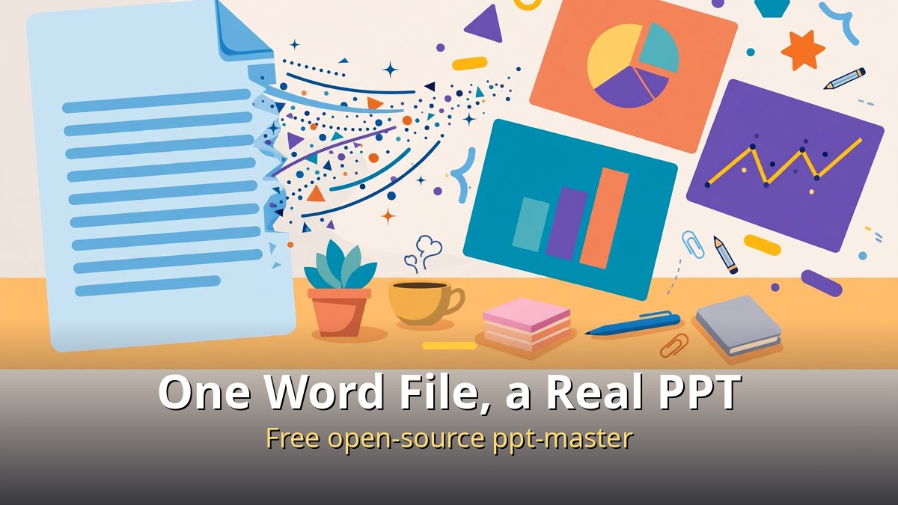
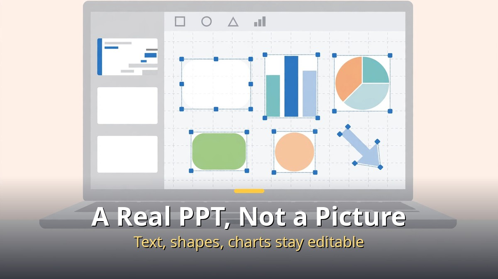
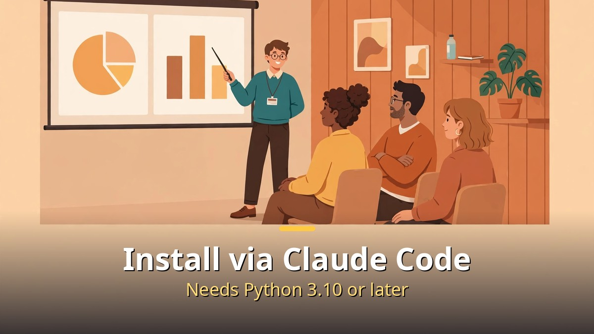
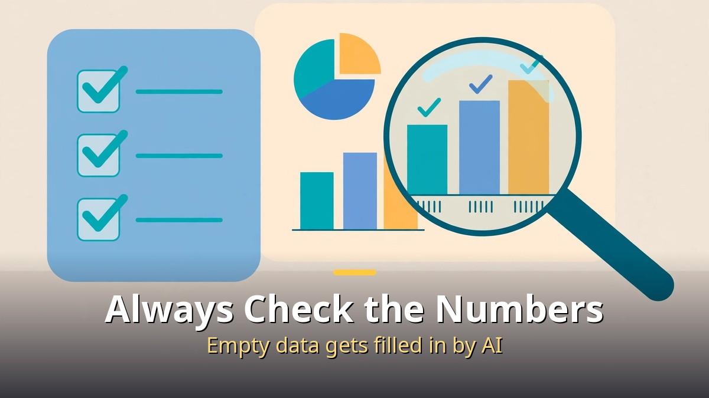

<!-- 본문 시작 -->

One Word file is all it takes to get a PPT skeleton.
If you have ever stared at a blank screen before a presentation, this is worth a look.
Free open-source ppt-master turns a Word file, a PDF, or a web page into a real PPT you can edit right in PowerPoint.
The short version: it comes out as objects, not pictures, so you can keep fixing it after it is made.

> **Key takeaway**
>
> ppt-master is a free open-source tool that turns a Word file into a real PPT (.pptx) where text, shapes, tables, and charts each come out as objects you can click and edit.
> On GitHub it had 72,074 stars as of November 1, 2026, and roughly 74,000 to 75,000 by November 7–8, with the latest release v6.9.0.
> But an agent may fill in gaps in your source material on its own, so always check the numbers and content yourself.

---

## What makes a real PPT different from a picture PPT?

A slide that comes out as a picture looks nice but cannot be fixed; a slide made of objects can be touched up.

Plenty of AI tools already make PPTs.
But most of them hand you one big picture.
You cannot fix a single word, because there is nothing to click.

ppt-master is different right there.
Feed it a Word file, a PDF, or a web page, and you get a real PPT (.pptx) where **text, shapes, tables, and charts each come out as objects you can click and edit**.
Open it in PowerPoint and you can change the text, fix a table number, or move a shape, just like any normal file.

| | Picture PPT | ppt-master's real PPT |
|---|---|---|
| Text | An image, cannot be edited | Click and edit right away |
| Shapes, tables, charts | One merged picture | Separate objects, one by one |
| Fixing it later | Start over from scratch | Edit directly in PowerPoint |
| File format | Image-based | A real .pptx file |

Picture the night before a presentation, when you spot one typo.
With a picture PPT you have to regenerate it or start over.
With a real PPT you just click the word and fix it.
**A presentation file is valuable because you can fix it, not just because it looks good.**

---

## How do you install it and make your first PPT?

Install it as a skill in Claude Code, drop a Word file into the project folder, and ask for a PPT.

Installation happens as a skill in Claude Code.
Give it the GitHub address (github.com/hugohe3/ppt-master) and ask it to install.
You need **Python 3.10 or higher**.
The steps, as laid out in the pinned comment, are: install Python 3.10–3.14, get the repository, install the requirements, and open that folder in Claude Code.

The hands-on demo used a marketing team workshop plan for the second half of 2026.
The plan's Word file goes into the project folder, and then you ask for a PPT.
A server screen appears, where you set the **core message, audience, slides, template, design, and page count**.

On the preview screen you can fix text, backgrounds, buttons, and numbers right there.
Change what you do not like on the spot, and download the PPT file when it is ready.
If your plan is already written up as a Word file, building the skeleton takes far less time.

The cost is **only the AI model usage fee**.
ppt-master itself is free open source under the MIT license.
Image and video generation credits are separate, so keep that in mind.
For how AI costs creep up in long conversations, see [Thank You Cost 38,865 Tokens — Why Claude Re-Reads Your Whole Conversation — and How to Cut It](https://aitechnotesen.blogspot.com/2026/11/thank-you-cost-38865-tokenswhy-claude.html).

---

## How far can you go with images and video too?

You can add slide images and a 30-second video clip, but the PPT itself stays at the center.

In the second half of the demo, Hixfield MCP is connected to Claude.
That lets you insert slide images and even a **Kling 4.0 video B-roll (up to 30 seconds)**.
Video makes a deck feel much more alive.

But Kling 4.0 is only a supporting element.
The PPT is the center, and the video is there to set the mood.
If you chase the video and neglect the deck itself, you have it backwards.

And there is one warning the creator gives directly.
**Content missing from your source material may be filled in by the agent on its own.**
So check the numbers and content in your PPT yourself.
ppt-master is not a tool that does your whole PPT from start to finish.
It builds the skeleton fast; it does not take responsibility for whether the content is accurate.

This post is a source-based introduction put together from the creator's hands-on video published on October 31, 2026 (9 minutes 35 seconds, 11 chapters).
It is based on the published demo material, not on first-hand use.
So the install steps and the demo flow cover only what the video confirms, and nothing untested is stated as fact.

---

## Frequently asked questions

**Q. Is it really free?**

A. Yes, it is free open source under the MIT license. The only cost is the AI model usage fee, and image and video generation credits are separate.

**Q. Can I use a PDF or a web page instead of a Word file?**

A. Yes, Word files, PDFs, and web pages all turn into a real PPT (.pptx).

**Q. Can I edit the finished PPT directly in PowerPoint?**

A. Yes, text, shapes, tables, and charts each come out as objects you can click and edit. Fix a typo or change a number right in PowerPoint.

**Q. Is installation hard?**

A. You need Python 3.10 or higher, then get the repository, install the requirements, and open that folder in Claude Code. Give Claude Code the GitHub address and ask it to install it as a skill.

**Q. Can the numbers come out wrong?**

A. Yes, they can. Content missing from your source material may be filled in by the agent, so check the numbers and content as soon as you get the file.

---

## Further reading

[Thank You Cost 38,865 Tokens — Why Claude Re-Reads Your Whole Conversation — and How to Cut It](https://aitechnotesen.blogspot.com/2026/11/thank-you-cost-38865-tokenswhy-claude.html)
[14 AI News Items This Week — Only 4 Are Worth Your Time — the weekly roundup in one read](https://aitechnotesen.blogspot.com/2026/11/14-ai-news-items-this-week-only-4-are.html)
[Interstellar — One Hour Is Seven Years on a Distant Planet — a 169-minute classic worth your evening on Netflix](https://aitechnotesen.blogspot.com/2026/11/interstellarone-hour-is-seven-years-on.html)

If you have been losing time to a blank screen before a presentation, pull out one Word file this week and build the skeleton with ppt-master.
Follow the blog if you want to keep up with topics like this — the next one will find you.

<!-- 본문 끝 -->

## 작업용 출처·이미지 정보 (업로드 제외)

- Source: 성공지식백과 영상 FIH_ZAxtQtU(2026-10-31, 9분 35초, 자막 0:00~9:34 확인) + ppt-master 깃허브(hugohe3/ppt-master, 11-01 기준 72,074 스타) 대조
- Images: images/01-hero-en.jpg ~ 04-img3-en.jpg / original illustration + English banner overlay (1200x675)
