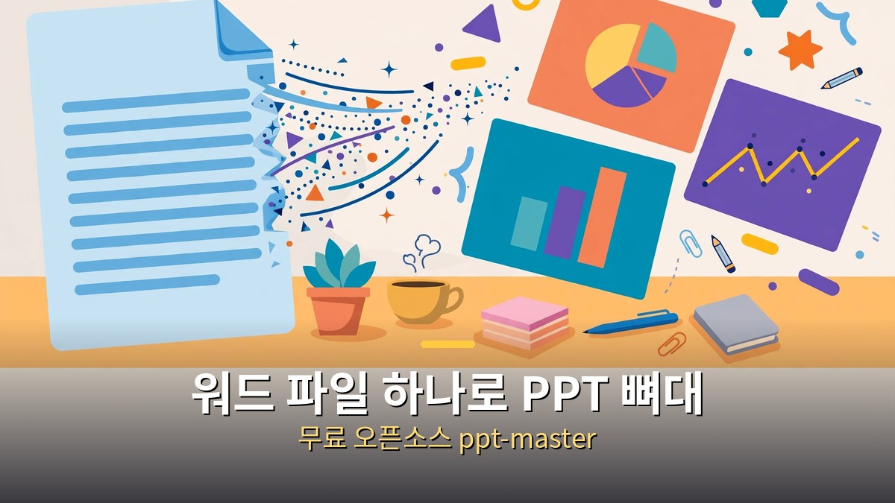
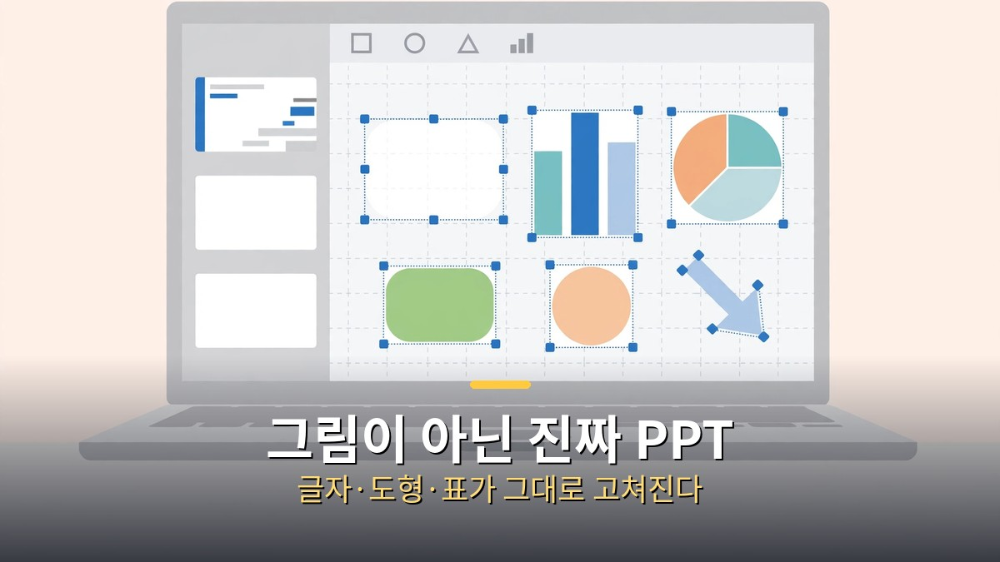
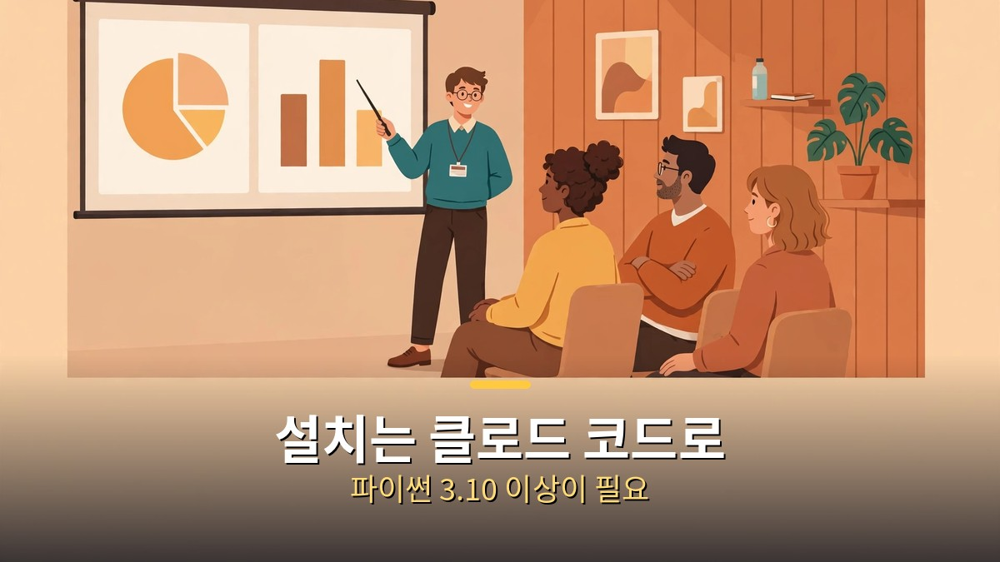
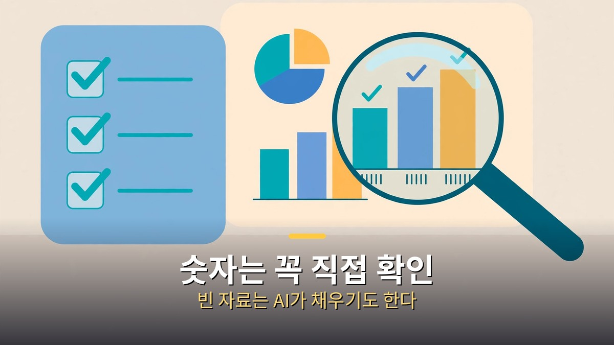

<!-- 본문 시작 -->

워드 파일 하나만 있으면 PPT 뼈대가 나옵니다.
발표 자료를 만들 때 빈 화면 앞에서 막막했던 직장인이라면 주목할 만한 소식입니다.
무료 오픈소스 ppt-master는 워드·PDF·웹페이지를 파워포인트에서 바로 고칠 수 있는 진짜 PPT로 바꿔줍니다.
결론부터 말하면, 그림이 아니라 개체로 나오는 PPT라 완성한 뒤에도 손질이 가능합니다.

> **핵심 정리**
>
> ppt-master는 워드 파일을 넣으면 글자·도형·표·차트가 하나씩 눌러서 고칠 수 있는 진짜 PPT(.pptx)를 만들어주는 무료 오픈소스입니다.
> 깃허브 스타는 2026년 11월 1일 기준 72,074개, 11월 7~8일 기준 약 7만 4천~7만 5천 개로 빠르게 늘고 있습니다.
> 다만 자료에 없는 내용은 에이전트가 알아서 채울 수 있으니, 숫자와 내용은 꼭 직접 확인해야 합니다.

---

## 그림 PPT 말고, 진짜 PPT가 뭐가 다른가요?

그림으로 나온 슬라이드는 예쁘지만 고칠 수가 없고, 개체로 나온 슬라이드는 손질이 가능합니다.

AI로 PPT를 만들어주는 도구는 이미 많습니다.
그런데 결과물을 받아보면 대부분이 통째로 된 그림입니다.
글자 하나를 고치려고 해도 이미지라서 누를 수가 없습니다.

ppt-master가 다른 지점은 바로 여기입니다.
워드·PDF·웹페이지를 넣으면 **글자·도형·표·차트가 하나씩 눌러서 고칠 수 있는 개체**로 된 진짜 PPT(.pptx)가 나옵니다.
파워포인트를 열어 글자를 고치고, 표 숫자를 바꾸고, 도형 위치를 옮기는 평범한 작업이 그대로 됩니다.

| 구분 | 그림으로 나오는 PPT | ppt-master의 진짜 PPT |
|---|---|---|
| 글자 | 이미지라 수정 불가 | 눌러서 바로 고칠 수 있음 |
| 도형·표·차트 | 통째로 하나의 그림 | 하나씩 분리된 개체 |
| 완성 후 손질 | 처음부터 다시 만들어야 함 | 파워포인트에서 직접 수정 |
| 파일 형식 | 이미지 중심 | 진짜 .pptx 파일 |

발표 전날 오타 하나를 발견했을 때를 떠올려보세요.
그림 PPT라면 다시 생성하거나 처음부터 손대야 하지만, 진짜 PPT라면 글자만 눌러 고치면 됩니다.
**발표 자료의 가치는 예쁨이 아니라 고칠 수 있음에서 나옵니다.**

---

## 설치부터 첫 PPT까지, 어떻게 하나요?

클로드 코드에 스킬로 설치하고, 워드 파일을 프로젝트 폴더에 넣은 뒤 PPT 생성을 요청하면 됩니다.

설치는 클로드 코드에 스킬로 합니다.
깃허브 주소(github.com/hugohe3/ppt-master)를 주고 설치를 요청하면 됩니다.
준비물은 **Python 3.10 이상**입니다.
고정 댓글에 정리된 순서는 이렇습니다. Python 3.10~3.14를 깔고 저장소를 받은 뒤 requirements를 설치하고, 그 폴더를 클로드 코드로 열어 줍니다.

실습은 2026년 하반기 마케팅 팀 워크숍 기획안으로 진행됐습니다.
기획안 워드 파일을 프로젝트 폴더에 넣고 PPT 생성을 요청합니다.
그러면 서버 화면이 뜨고, **핵심 메시지·대상·화면·템플릿·디자인·장수**를 정합니다.

미리보기 화면에서는 글자·배경·버튼·숫자를 바로 고칠 수 있습니다.
마음에 들지 않는 부분을 그 자리에서 수정하고, 확정되면 PPT 파일로 받습니다.
기획안이 이미 워드 파일로 정리돼 있다면, 뼈대를 만드는 시간은 크게 줄어듭니다.

비용은 **AI 모델 사용료만** 듭니다.
ppt-master 자체는 MIT 라이선스의 무료 오픈소스입니다.
다만 이미지·영상 생성 크레딧은 별도이니, 그 부분은 따로 챙겨야 합니다.
AI를 쓸 때 비용이 어디서 불어나는지는 [「고마워」 한 줄에 토큰 3만 9천 개｜클로드가 대화를 통째로 다시 읽는 이유와 줄이는 법](https://aitechnoteskr.tistory.com/140)에서 다룬 적이 있습니다.

---

## 그림·영상까지 넣으면 어디까지 되나요?

슬라이드용 그림과 30초짜리 영상까지 넣을 수 있지만, 중심은 어디까지나 PPT 자체입니다.

후반부에서는 힉스필드 MCP를 클로드에 연결합니다.
그러면 슬라이드용 그림을 넣고, **클링 4.0 영상 B롤(최대 30초)**까지 삽입할 수 있습니다.
영상이 들어가면 발표 자료가 훨씬 살아납니다.

다만 클링 4.0은 어디까지나 부수 요소입니다.
중심은 PPT이고, 영상은 분위기를 더하는 역할에 가깝습니다.
영상에 욕심을 내다 PPT 본연의 정리를 놓치면 본말이 전도됩니다.

그리고 제작자가 직접 경고한 한 가지가 있습니다.
**자료에 비어 있는 내용은 에이전트가 알아서 채우기도 합니다.**
그래서 PPT의 숫자와 내용은 꼭 직접 확인해야 합니다.
ppt-master는 PPT를 처음부터 끝까지 다 해 주는 도구가 아닙니다.
뼈대를 빠르게 만들어주는 도구이지, 내용의 정확성까지 책임져주지는 않습니다.

이 글은 2026년 10월 31일 공개된 제작자의 실습 영상(9분 35초, 11개 챕터)을 바탕으로 정리한 자료 기반 소개입니다.
직접 사용해 본 경험이 아니라 공개된 실습 자료를 근거로 썼습니다.
그래서 설치 순서와 실습 과정은 영상에서 확인된 내용만 담았고, 써보지 않은 부분은 단정하지 않았습니다.

---

## 자주 묻는 질문

**Q. 정말 무료인가요?**

A. 네, MIT 라이선스의 무료 오픈소스입니다. 비용은 AI 모델 사용료만 들고, 이미지·영상 생성 크레딧은 별도로 듭니다.

**Q. 워드 말고 PDF나 웹페이지도 넣을 수 있나요?**

A. 네, 워드·PDF·웹페이지를 넣으면 진짜 PPT(.pptx)가 나옵니다.

**Q. 만든 PPT를 파워포인트에서 직접 고칠 수 있나요?**

A. 네, 글자·도형·표·차트가 하나씩 눌러서 고칠 수 있는 개체로 나옵니다. 오타 수정이나 숫자 변경은 파워포인트에서 바로 하면 됩니다.

**Q. 설치가 어렵지 않나요?**

A. Python 3.10 이상이 필요하고, 저장소를 받은 뒤 requirements를 설치하고 그 폴더를 클로드 코드로 여는 순서입니다. 클로드 코드에 깃허브 주소를 주고 스킬로 설치를 요청하는 방식입니다.

**Q. 숫자가 틀리게 나올 수도 있나요?**

A. 네, 그럴 수 있습니다. 자료에 비어 있는 내용은 에이전트가 알아서 채우기도 하니, PPT의 숫자와 내용은 받자마자 직접 확인하는 게 안전합니다.

---

## 함께 읽으면 좋은 글

[「고마워」 한 줄에 토큰 3만 9천 개｜클로드가 대화를 통째로 다시 읽는 이유와 줄이는 법 — 긴 대화에서 한 줄이 비싸지는 원리](https://aitechnoteskr.tistory.com/140)
[이번 주 AI 뉴스 14건, 챙길 건 4가지뿐｜이미지 2.6 GIF부터 키미 가중치 공개까지 — 한 주 소식을 한 번에 훑는 정리](https://aitechnoteskr.tistory.com/142)
[인터스텔라｜1시간이 7년이 되는 행성, 아버지가 건너는 시간 — 169분짜리 명작, 넷플릭스에서 볼 가치](https://aitechnoteskr.tistory.com/143)

발표 자료 때문에 빈 화면 앞에서 시간을 보내고 있다면, 이번 주에 워드 파일 하나를 꺼내 ppt-master로 뼈대부터 만들어보세요.
이 주제를 계속 따라가려면 이웃 추가를 눌러두시면 다음 소식도 받아보실 수 있습니다.

<!-- 본문 끝 -->

## 작업용 출처·이미지 정보 (업로드 제외)

- 자료 출처: 성공지식백과 영상 FIH_ZAxtQtU(2026-10-31, 9분 35초, 자막 0:00~9:34 확인) + ppt-master 깃허브(hugohe3/ppt-master, 11-01 기준 72,074 스타) 대조
- 이미지: images/01-hero.jpg ~ 04-img3.jpg / 자작 일러스트 + 한글 배너 오버레이 (1200x675)
