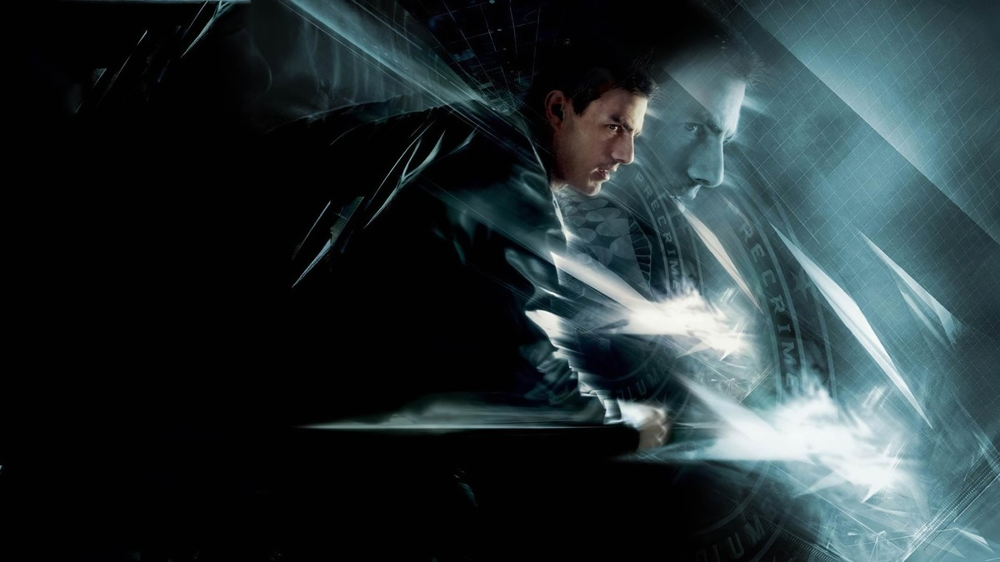
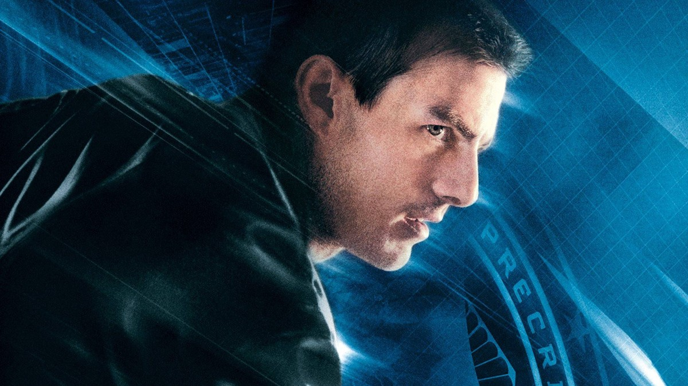
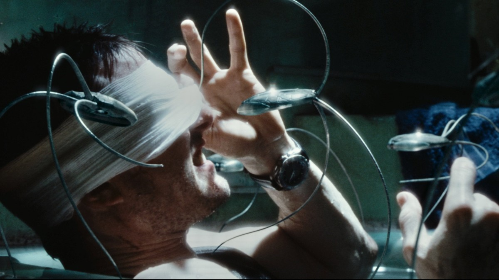
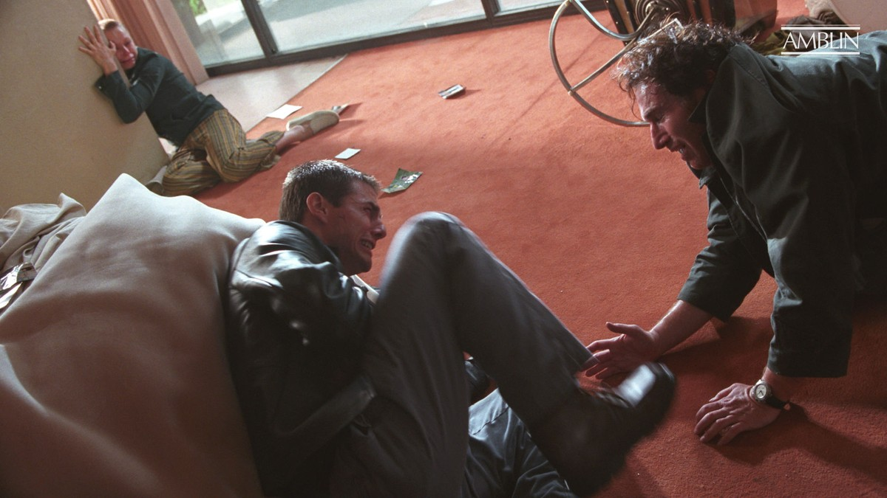
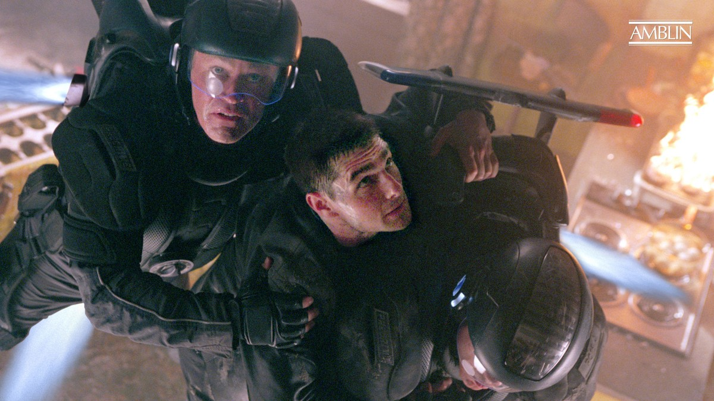
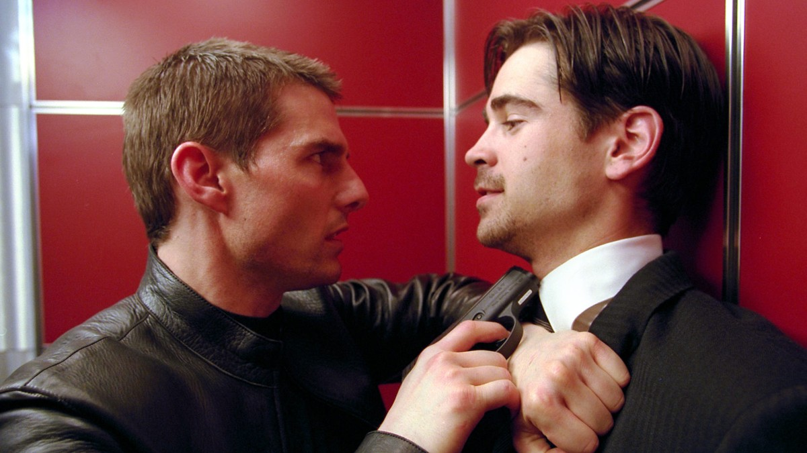

<!-- 본문 시작 -->

John Anderton under the PRECRIME sign — Minority Report key art
*Everybody runs.*
In Washington in 2054, a system called Precrime analyzes the visions of precogs and arrests murderers before they kill.
Precrime chief John Anderton becomes the subject of a prediction himself one day: the system says he will commit a murder, and the hunter turns into the hunted.
This is a spoiler-free introduction. The ending is not covered here, and the scenes described stay within the setup and mood of the first half.

## Basic Information

Anderton, the man in the prediction — Tom Cruise
| Item | Details |
|---|---|
| Title | Minority Report |
| Director | Steven Spielberg (screenplay by Scott Frank and Jon Cohen, based on the Philip K. Dick short story The Minority Report, 1956) |
| Cast | Tom Cruise (John Anderton), Colin Farrell (Danny Witwer), Samantha Morton (Agatha), Max von Sydow (Director Lamar Burgess) |
| Release | 2002, United States 2002-06-21, South Korea 2002-07-26, 3.36 million admissions in South Korea |
| Runtime | 2 hours 25 minutes (145 minutes) |
| Rating | 15 and over in South Korea, PG-13 in the United States |
| Scores | TMDB 7.4/10 (10,104 ratings), Rotten Tomatoes 89%, Metacritic 80 (TMDB Korea page, checked 2026-11-09) |
| Where to watch in Korea | Listed on Wavve; rental and purchase prices require sign-in to view (checked 2026-11-10, not on Watcha; providers and prices should be rechecked before watching) |

## How Do You Arrest a Crime That Has Not Happened Yet

Anderton under blue light — chief of Precrime
In the Washington of 2054, there is a system that catches killers before a murder takes place.
Fragments of the future seen by precogs are pieced together into a scene of a murder, and the Precrime team arrests the killer in advance.
The idea of stopping a crime before it happens turns into a question about where prevention ends and punishment begins.

Anderton is the face of this system.
As chief, he analyzes the visions to identify killers, and he has never doubted that the system can be wrong.
Then one day he becomes the main character of a prediction.
The vision says he will kill a man.
The moment the man who arrests becomes the man to be arrested, the film's question turns upside down.

After an eye transplant, Anderton hides from the spider robots
As a fugitive, Anderton has to change his own eyes.
In the city of 2054, people are identified by eye scans.
After the eye transplant scene comes a search by spider robots.
The small robots crawl through a building, checking the eyes in every room, while Anderton has to stay out of their sight.
This sequence shows the film's vision of technology most directly.
The more convenient surveillance becomes, the harder it is to run away.

## The Man the Prediction Points To — Is He Really a Murderer

Anderton faces Leo Crow — the place the prediction pointed to
Anderton follows the predicted scene and tracks down a man.
The man is Leo Crow.
According to the prediction, Anderton will kill him.
But Anderton does not know him, and does not know any reason to kill him.
The film does not stop there; it asks the next question.
If a prediction is correct, can the person who knows it still change what they do?

A jetpack chase — Anderton on the run
Precrime chases Anderton as he tries to escape the prediction.
The jetpack chase through the sky is the film's signature action sequence.
Even after hunter and hunted have switched places, the system does not stop.
Once a prediction is issued, it is believed as it stands, and a believed prediction moves as if proving itself.
Here is the film's central question.
If a prediction can be wrong, is it right to arrest people because of one?

## The Man Who Doubts the Prediction — What Did Witwer See

Anderton confronts Witwer in an elevator
Danny Witwer arrives to investigate Precrime.
He does not take the claim that the system is perfect at face value.
The confrontation between Anderton and Witwer is a clash of two viewpoints.
One side trusts the system that stops crimes before they happen; the other suspects that a prediction can be wrong.
This is where the film connects crime prediction to the problems of AI.
However accurate a prediction looks, a prediction is a probability, not a judgment.
What it costs to lock people up on a probability is the question the film keeps asking the audience.

## Before You Watch Checklist

Korean theatrical poster — Minority Report
- Runtime is 2 hours 25 minutes (145 minutes), so an unhurried evening suits it best
- Rated 15 and over in South Korea; released in Korean theaters on 2002-07-26
- Where to watch: listed on Wavve; rental and purchase prices require sign-in to view (checked 2026-11-10, not on Watcha; providers and prices should be rechecked before watching)
- Directed by Steven Spielberg, based on Philip K. Dick's 1956 short story The Minority Report
- 3.36 million admissions in South Korea, TMDB 7.4/10 (10,104 ratings, TMDB Korea page checked 2026-11-09)
- Best watched without looking up the ending in advance

## Frequently Asked Questions

**Q. What kind of film is Minority Report?**
A. Set in Washington in 2054, it is the story of Precrime, a system that analyzes the visions of precogs and arrests murderers before they kill. When chief John Anderton is predicted to commit a murder himself, he becomes the hunted and starts digging into whether a prediction can be wrong.

**Q. How does Precrime predict crimes?**
A. In the film's setup, fragments of the future seen by precogs are assembled into a scene of a murder, and the killer is arrested before the crime happens. The system is explained early in the film.

**Q. What does it mean that a prediction can be wrong?**
A. It is the question of whether the future in a prediction must happen, or whether a person who knows the prediction can still act differently. The film keeps following this possibility to the end.

**Q. Is it suitable for children?**
A. It is rated 15 and over in South Korea. Violent scenes and heavy themes make it suitable for viewers aged 15 and over.

**Q. Where can I watch it?**
A. As of 2026-11-10, in Korea the title is listed on Wavve, but rental and purchase prices require sign-in to view. It is not on Watcha. Providers and prices can change, so recheck before watching.

**Q. Is it based on a novel?**
A. The original is the short story The Minority Report, published by Philip K. Dick in 1956. The film was directed by Steven Spielberg, with a screenplay by Scott Frank and Jon Cohen.

## Further Reading

[Interstellar — One Hour Is Seven Years on a Distant Planet — a 169-minute classic worth your evening on Netflix](https://aitechnotesen.blogspot.com/2026/11/interstellarone-hour-is-seven-years-on.html)
[14 AI News Items This Week — Only 4 Are Worth Your Time — the weekly roundup in one read](https://aitechnotesen.blogspot.com/2026/11/14-ai-news-items-this-week-only-4-are.html)
[Thank You Cost 38,865 Tokens — Why Claude Re-Reads Your Whole Conversation — and How to Cut It](https://aitechnotesen.blogspot.com/2026/11/thank-you-cost-38865-tokenswhy-claude.html)

In a nation that arrests crimes before they happen, a prediction, once issued, is believed as it stands. What Minority Report asks is not how accurate the technology is, but how people should be treated when a prediction can be wrong. Watch the film before searching for the ending. To follow the next movie introduction as well, tap follow and stay with the series.

<!-- 본문 끝 -->

## 작업용 출처·이미지 정보 (업로드 제외)

- Source: TMDB movie 180 page and watch check (Korea, checked 2026-11-09~10) / Viewing correction: listed on Wavve, rental/purchase prices not shown pre-login, subscription inclusion unconfirmed; not on Watcha (checked 2026-11-10) / Stills: TMDB key art and backdrops + Amblin official stills (width 1200px+, ending scenes excluded; s08 poster original is 860px)
- Images: images/01-hero-en.jpg ~ 08-img7-en.jpg / TMDB and Amblin official stills (1200x675)
