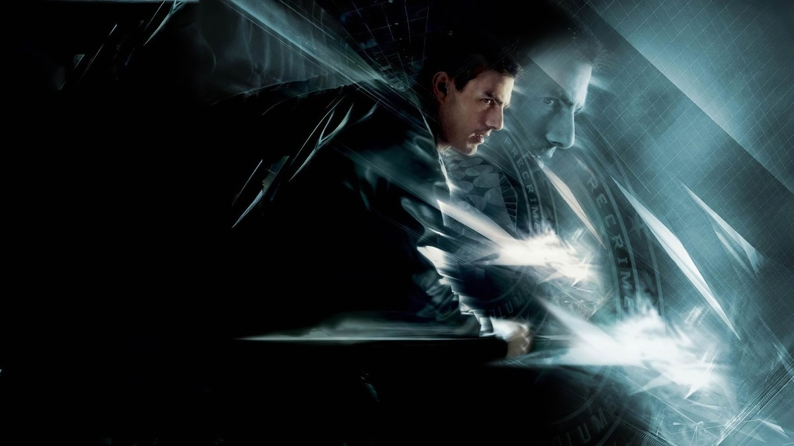
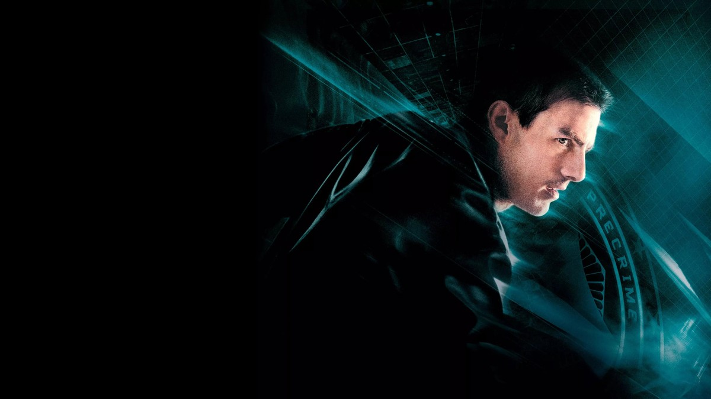
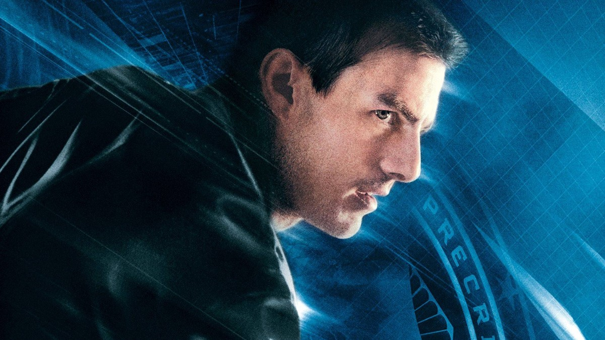
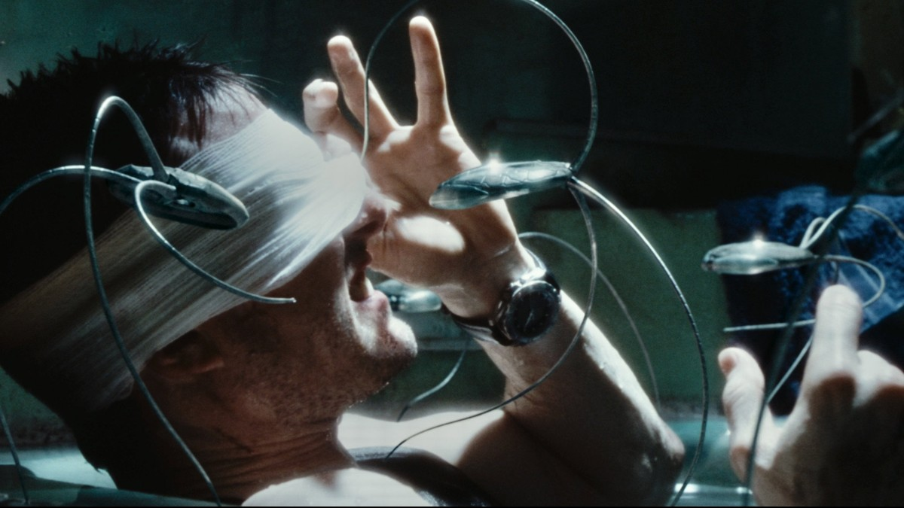
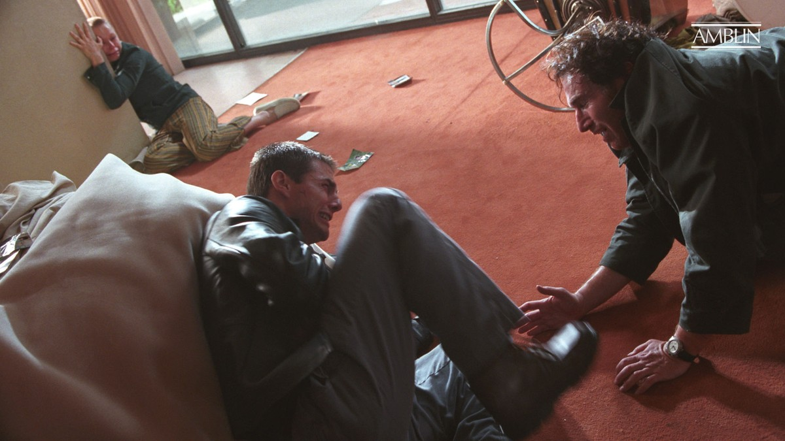
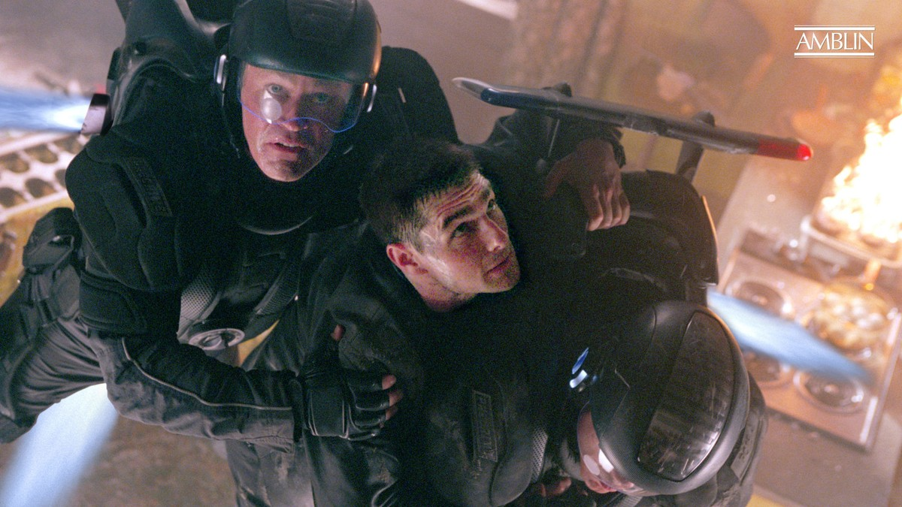
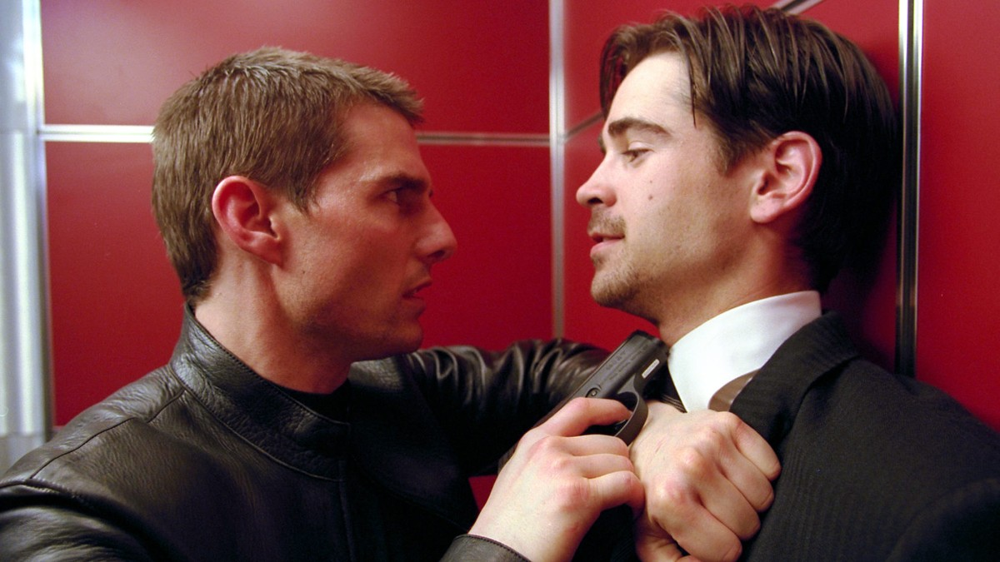
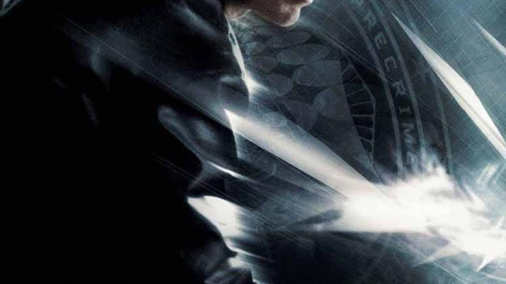

<!-- 본문 시작 -->

PRECRIME 글자 아래의 존 앤더튼 — 마이너리티 리포트 키아트
"모두가 도망친다."
2054년 워싱턴, 예지자의 미래를 분석해 살인 전에 범인을 체포하는 프리크라임이 있다.
프리크라임 팀장 존 앤더튼은 어느 날 자신이 살인을 저지를 것이라는 예측을 받고, 체포자에서 추적 대상이 된다.
이 글은 스포일러 없는 소개다. 결말 장면은 다루지 않으며, 장면 설명은 중반부까지의 설정과 분위기 중심으로 정리했다.

## 기본 정보

예언의 남자가 된 앤더튼 — 톰 크루즈
| 항목 | 내용 |
|---|---|
| 제목 | 마이너리티 리포트 (Minority Report) |
| 감독 | 스티븐 스필버그 (각본 Scott Frank·Jon Cohen, 원작 필립 K. 딕 단편 'The Minority Report', 1956) |
| 주연 | 톰 크루즈(존 앤더튼), 콜린 파렐(대니 위트워), 사만다 모튼(아가사), 막스 폰 시도우(라마 버지스 국장) |
| 개봉 | 2002년, 미국 2002-06-21, 한국 2002-07-26, 한국 관객 336만 명 |
| 러닝타임 | 2시간 25분(145분) |
| 등급 | 한국 15세 이상 관람가, 미국 PG-13 |
| 평점 | TMDB 7.4/10(10,104개 평가), 로튼토마토 89%, 메타크리틱 80점 (TMDB 한국 페이지 2026-11-09 확인) |
| 국내 시청처 | 웨이브에서 작품 확인됨, 대여·구매 가격은 로그인 후 확인 필요 (2026-11-10 확인, 왓챠 미제공, 제공처·가격은 시청 전 재확인 필요) |

## 아직 일어나지 않은 범죄, 어떻게 체포할 수 있을까

파란 불빛 아래의 앤더튼 — 프리크라임의 팀장
2054년 워싱턴에는 살인이 일어나기 전에 범인을 잡는 시스템이 있다.
예지자들이 본 미래의 조각을 모아 살인의 장면을 재구성하고, 프리크라임 팀이 범인을 미리 체포한다.
범죄가 일어나기 전에 잡는다는 발상은, 예방과 처벌의 경계를 묻는 질문으로 이어진다.

앤더튼은 이 시스템의 얼굴이다.
그는 예언의 영상을 분석해 범인을 특정하는 팀장이며, 시스템이 틀릴 수 있다는 생각은 해본 적이 없는 사람이다.
그런 그가 어느 날 예언의 주인공이 된다.
자신이 살인을 저지를 것이라는 예측이 나온 것이다.
체포하던 사람이 체포당할 사람이 되는 순간, 영화의 질문이 뒤집힌다.

안구 이식 후 거미 로봇의 수색을 피하는 앤더튼
도망자가 된 앤더튼은 자신의 눈을 바꿔야 한다.
2054년의 도시는 안구 스캔으로 사람을 식별하기 때문이다.
안구 이식 장면 뒤에는 거미 로봇의 수색이 이어진다.
작은 로봇들이 건물 안을 기어 다니며 방마다 눈을 확인하고, 앤더튼은 그 눈을 피해 숨어야 한다.
이 구간은 영화의 기술 상상력을 가장 직접적으로 보여준다.
감시가 편리해질수록, 도망치는 일은 더 어려워진다.

## 예언이 가리킨 남자, 그는 정말 살인자인가

레오 크로우와 마주한 앤더튼 — 예언이 가리킨 장소
앤더튼은 예언 속 장면을 따라 한 남자를 찾아간다.
그 남자는 레오 크로우다.
예언대로라면 앤더튼은 이 남자를 살해하게 된다.
하지만 앤더튼은 그를 알지 못하고, 살해할 이유도 알지 못한다.
영화는 여기서 멈추지 않고 묻는다.
예언이 맞다면, 그 예언을 아는 사람이 행동을 바꿀 수는 없는가.

제트팩 추격 — 도망치는 앤더튼
예언을 피하려는 앤더튼의 뒤를 프리크라임이 쫓는다.
하늘을 나는 제트팩 추격 장면은 이 영화의 속도감을 대표한다.
도망치는 사람과 쫓는 사람의 입장이 바뀐 뒤에도, 시스템은 멈추지 않는다.
예언은 한 번 나오면 그대로 믿어지고, 믿어진 예언은 스스로를 증명하듯 움직인다.
이 영화가 던지는 핵심 질문은 여기 있다.
예언이 틀릴 수 있다면, 예언으로 사람을 체포하는 일은 정당한가.

## 예언을 의심하는 사람, 위트워는 무엇을 보았을까

엘리베이터에서 위트워와 대치하는 앤더튼
대니 위트워는 프리크라임을 조사하러 온 사람이다.
그는 시스템이 완벽하다는 주장을 곧이곧대로 믿지 않는다.
앤더튼과 위트워의 대치는 두 가지 관점의 충돌이다.
한쪽은 범죄를 미리 막는다는 시스템을 믿고, 다른 한쪽은 예언이 틀릴 가능성을 의심한다.
이 구간에서 영화는 범죄 예측이라는 소재를 AI의 문제로 연결한다.
예측이 아무리 정확해 보여도, 예측은 판단이 아니라 확률이다.
확률로 사람을 가두는 일의 대가가 무엇인지, 영화는 끝까지 관객에게 묻는다.

## 시청 전 체크리스트

한국어 극장 포스터 — 마이너리티 리포트
- 러닝타임 2시간 25분(145분)으로, 여유 있는 저녁 시간에 보는 것이 좋다
- 등급 15세 이상 관람가, 국내 극장 개봉은 2002년 7월 26일
- 시청처는 웨이브에서 작품 확인됨, 대여·구매 가격은 로그인 후 확인 필요 (2026-11-10 확인, 왓챠 미제공, 제공처·가격은 시청 전 재확인 필요)
- 감독 스티븐 스필버그, 원작은 필립 K. 딕의 1956년 단편 'The Minority Report'
- 한국 관객 336만 명, TMDB 7.4/10(10,104개 평가, TMDB 한국 페이지 2026-11-09 확인)
- 결말에 대한 사전 정보 없이 보는 것이 좋다

## 자주 묻는 질문

**Q. 마이너리티 리포트는 어떤 영화인가요?**
A. 2054년 워싱턴을 배경으로, 예지자의 미래를 분석해 살인 전에 범인을 체포하는 프리크라임 시스템의 이야기다. 팀장 존 앤더튼이 자신이 살인을 저지를 것이라는 예측을 받고 추적 대상이 되면서, 예언이 틀릴 수 있는지를 파헤친다.

**Q. 프리크라임은 어떻게 범죄를 예측하나요?**
A. 예지자들이 본 미래의 조각을 모아 살인 장면을 재구성하고, 그 정보를 바탕으로 범인을 미리 체포한다는 설정이다. 영화 초반에 시스템의 작동 방식이 설명된다.

**Q. 예언이 틀릴 수 있다는 말은 무슨 뜻인가요?**
A. 예언이 나온 뒤에도 사람이 행동을 바꿀 수 있다면, 예언대로의 미래는 반드시 일어나지 않을 수 있다는 질문이다. 영화는 이 가능성을 끝까지 놓지 않고 따라간다.

**Q. 아이와 함께 봐도 되나요?**
A. 국내 등급은 15세 이상 관람가다. 폭력적인 장면과 무거운 주제가 있어 15세 이상 관람이 적합하다.

**Q. 어디서 볼 수 있나요?**
A. 2026-11-10 기준 웨이브에서 작품이 확인되며, 대여·구매 가격은 로그인 후 확인해야 한다. 왓챠에서는 제공되지 않는다. 제공처와 가격은 바뀔 수 있어 시청 전 재확인이 필요하다.

**Q. 원작 소설이 있나요?**
A. 필립 K. 딕이 1956년에 발표한 단편 'The Minority Report'가 원작이다. 영화는 스티븐 스필버그 감독이 연출했고, 각본은 Scott Frank와 Jon Cohen이 맡았다.

## 함께 읽으면 좋은 글

[채피｜스스로 생각하고 느끼기 시작한 로봇, 인간이 가르친 것들 — 감정을 가진 로봇, 인간이 가르친 것들](https://aitechnoteskr.tistory.com/135)
[「고마워」 한 줄에 토큰 3만 9천 개｜클로드가 대화를 통째로 다시 읽는 이유와 줄이는 법 — 긴 대화에서 한 줄이 비싸지는 원리](https://aitechnoteskr.tistory.com/140)
[미국, 초지능 AI 금지 법안 다시 불붙었다｜'금지'가 아니라 '발의'부터 가려야 하는 이유 — 법안 원문과 의회 단계로 가른 검증법](https://aitechnoteskr.tistory.com/141)

아직 일어나지 않은 범죄를 체포하는 나라에서, 예언은 한 번 나오면 그대로 믿어진다. 마이너리티 리포트가 묻는 것은 기술이 얼마나 정확한지가 아니라, 예측이 틀릴 수 있을 때 사람을 어떻게 대할 것인가이다. 결말을 미리 검색하지 말고 영화를 먼저 보는 것이 좋다. 다음 영화 소개도 함께 따라가려면 이웃 추가를 눌러두면 된다.

<!-- 본문 끝 -->

## 작업용 출처·이미지 정보 (업로드 제외)

- 자료 출처: TMDB 영화 180 페이지·시청처 확인(대한민국 기준, 2026-11-09~10 확인) / 시청처 정정: 웨이브 작품 확인됨·대여/구매 가격 미표시·월정액 포함 여부 미확인, 왓챠 미제공(2026-11-10 왓챠 검색 직접 확인) / 스틸: TMDB 키아트·백드롭 + Amblin 공식 스틸 원본(너비 1200px 이상, 결말 장면 제외; s08 포스터 원본 860px)
- 이미지: images/01-hero.jpg ~ 08-img7.jpg / TMDB·Amblin 공식 스틸 (1200x675)
