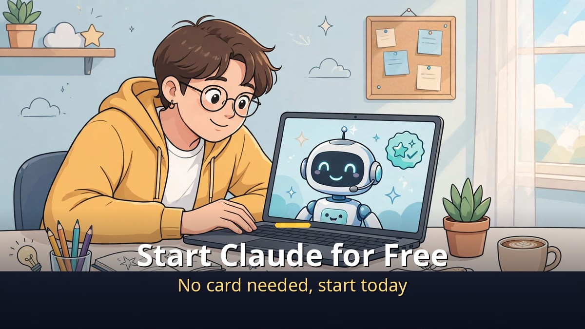
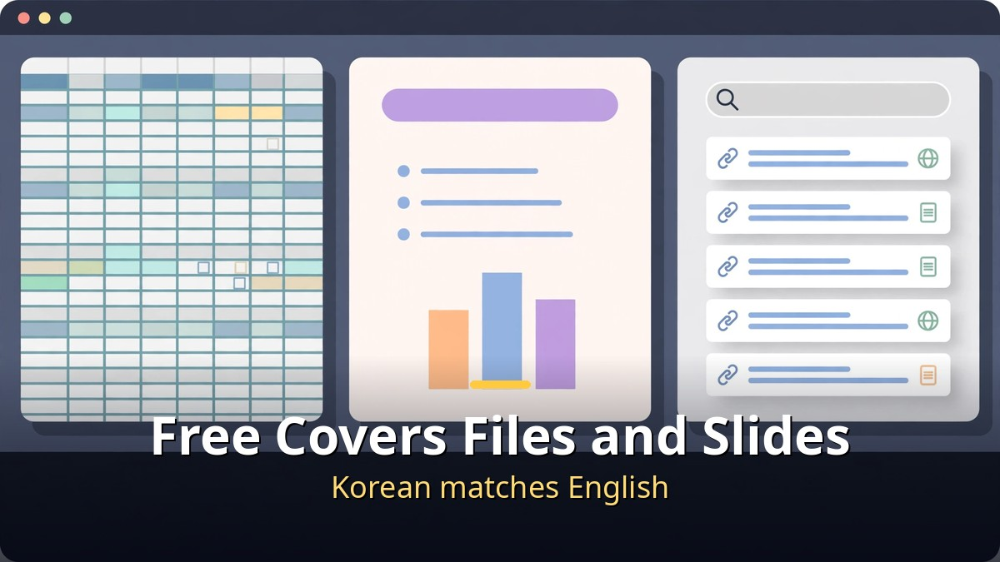
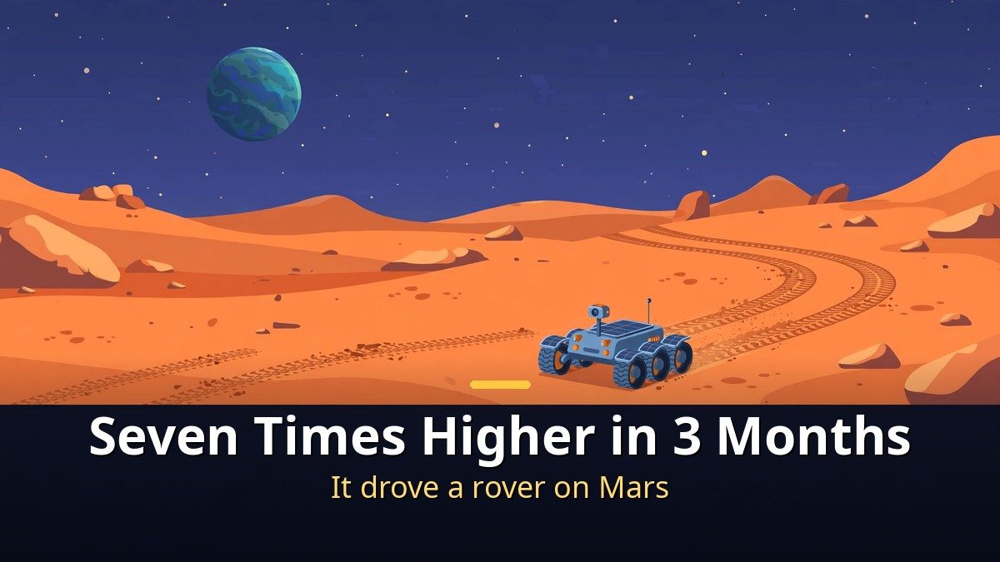
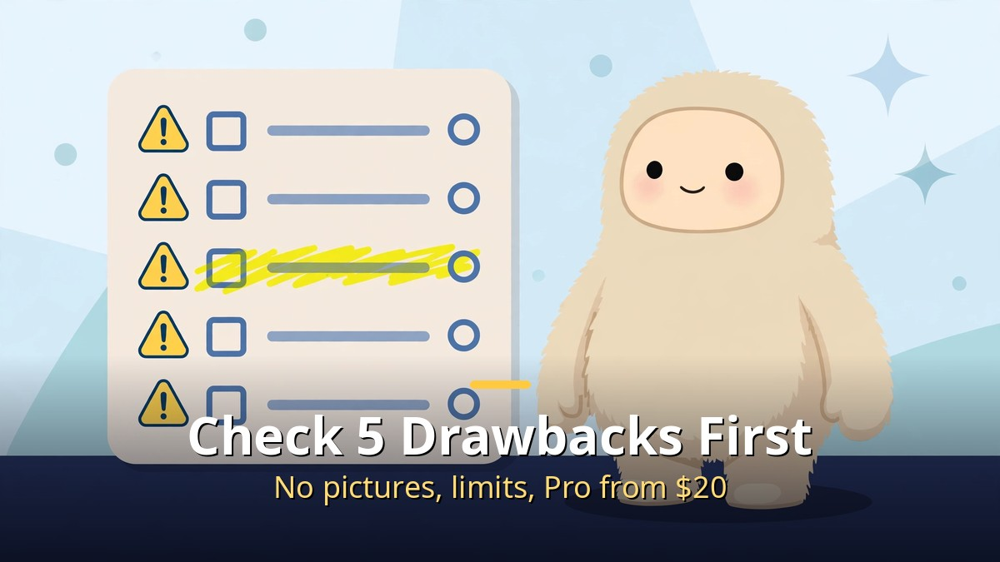

<!-- 본문 시작 -->

Before paying for Claude, check how far the free plan goes.
Web search, Excel and PowerPoint files, memory of past chats, and connections to other apps are all in the free plan.
You can start today with no card.
This post is a source-based guide built on a video published on 2026-11-10.
Every number in it comes from Anthropic's own announcements, according to the video.

> **The point is simple. The free plan already covers file creation and slide decks, but the Opus model and Claude Code start at Pro, $20 a month. Check the five drawbacks first, and turn off the "model improvement" setting before anything else.**

## How far does free go?

The free plan covers more than expected, and Korean works as well as English.

Start with what free includes.
Web search, Excel and PowerPoint files, memory of past conversations, and app connections are all in the free plan.
That means you can start today with no card.
Slide decks are free too.
Record your thoughts into your phone while walking, paste the transcript into Claude, and type "/slides, make a presentation from this."
You get the finished deck as a PPT or PDF.

Korean is not a worry.
Anthropic's data puts Opus 5.5's Korean score at 99.1% of its English score.
Ask in Korean or in English and you get nearly the same ability.
Koreans actually use Claude 3.5 times more than expected for the population, and Anthropic opened a Seoul office in June this year.

Privacy takes one check before you start.
Claude lets you choose whether your conversations are used to train the AI.
Turn off "model improvement" in Settings, under Privacy, and your conversations are not used for training.
Leave it on and they can be kept for up to five years.
A secret chat is never used for training, whatever the setting.
Once you start pasting company files or customer data, this matters — so check it today.

## Why do the numbers look so different?

A score up seven times in three months, a rover driven on Mars, and non-developers getting work done.

There is a test for whether an AI can actually finish a job inside a computer.
It is called terminal-bench.
Sonnet from June scored 10.3% on it.
Three months later, Sonnet 5.5 scored 70.6% — nearly seven times higher in a single update.
That is even higher than Opus 5.5's 66.4%.
The smallest model, Haiku, is more dramatic still.
Haiku 4.5 scored 0% on this test. Haiku 5.5 scored 39.2%.
And its developer price fell to about a tenth, according to the video.
Usually a better model costs more. Here it is the opposite.

On the test where the model operates a computer directly — looking at the screen, clicking a mouse, typing — Opus 5.5 scored 81.8%.
That is how far the ability to use a computer like a person has come.
Of course, a test score is not everything.
Anthropic itself notes in its announcements that score gaps may feel different in real use.

Look outside the test room.
Last December, NASA drove a Mars rover along a route Claude had planned.
It covered 210 meters, then 246 meters, over two days.
Claude planned the route a person used to plan by hand, and the person only checked it.

| Test or case | Number | What it means |
| --- | --- | --- |
| Terminal-bench, Sonnet | 10.3% → 70.6% | Seven times higher in three months |
| Terminal-bench, Haiku | 0% → 39.2% | The smallest model's turnaround |
| Direct computer use | Opus 5.5, 81.8% | Screen, mouse, and keyboard |
| NASA Mars rover | 210 m and 246 m in two days | Claude planned the route |

"Isn't that just for developers?" is now only half true.
Claude Code used to mean a black terminal window and typed commands.
Now the same engine runs in a desktop app with buttons.
You do not need to know the terminal.

In June this year, Anthropic analyzed 400,000 Claude Code sessions.
Developers succeeded about 30% of the time, non-developers about 26% — a gap of around 5 points.
The group with the highest success rate was not developers but managers.
The report tells of an accountant who had never used Python.
If you can state the month-end rules exactly and catch the exceptions, you are the expert on that job, it says.
What matters is no longer coding skill, but how well you know your own work.

The cases back it up.
At Rakuten in Japan, one engineer handed Claude Code a big job and it worked alone for seven hours.
The engineer wrote no code meanwhile, only gave direction now and then.
In Korea, thousands of Naver engineers use Claude Code, and LG CNS moved a 20-year-old company system in seven months.
Most of its 2,913 features were moved, at about half the cost of the old way.
The person in charge put it this way: "It is not only faster. We can now start work we never dared to attempt."

There is also a small demo with nothing to do with coding.
Paste a month of sales into a small table and write one line: "Split this by weekday and make an Excel file with totals as formulas."
Wait a moment and the Excel file appears.
The total cells hold real formulas, not plain numbers.
Change one sale and the totals change with it.
One paste, one sentence. That is all.

## What are the 5 drawbacks to check before starting?

It does not draw pictures, it has usage limits, and the free plan leaves things out.

Good news alone is only half the story.
Here are the drawbacks, honestly.

First, Claude does not draw photos or illustrations.
It can make charts, tables, and simple screens, but if drawing is your main job, use another tool for that.

Second, there are usage limits.
There is an amount you can use every five hours, and a separate weekly limit.
Work that operates Chrome for you burns through the limit much faster than ordinary chat.
Check the usage menu in Settings for what is left and when it refills — check often at first.
If you run out, a paid plan can buy extra credits to keep going.

Third, the free plan leaves things out.
The Opus model, Claude Code, Excel integration, and Chrome features start at Pro, $20 a month.

Fourth, Korean voice chat is still in beta.
If talking back and forth matters to you, it may still feel a little unfinished.

Fifth, some features are still US-only.
Duet, which picks up tasks for you, and the bank-account link that helps manage money are not available in Korea yet.

If you can live with those five, starting free today is not too late.
To sum up: free already covers file creation and slide decks, Korean matches English, and even non-developers can hand their work to Claude Code.
Today, check the model improvement setting first, then give it one free job.
That is the order.

If you want to weigh the token cost too, the token-measurement post is a useful companion.
[Thank You Cost 38,865 Tokens — Why Claude Re-Reads Your Whole Conversation — and How to Cut It](https://aitechnotesen.blogspot.com/2026/11/thank-you-cost-38865-tokenswhy-claude.html)
It shows why one line costs more in a long conversation, and three ways to cut it.

---

Many people start because "free" sounds good, then stop at the limit.
So start in this order: turn off model improvement, give it one free job, check the limit.
Those three steps tell you today whether Claude fits your work.
There are more than a million public skills made by others, so borrowing someone else's instructions is part of the fun.
Just remember the one line: if you need a picture, open another tool.

## Frequently asked questions

**Can the free plan really make files?**

A. Yes. Web search, Excel and PowerPoint files, memory, and app connections are in the free plan. You can start today with no card, and slide decks work free with /slides.

**How does Korean compare with English?**

A. Anthropic's data puts Opus 5.5's Korean score at 99.1% of its English score. Asking in Korean or in English gives nearly the same ability.

**Are my conversations used to train the AI?**

A. You choose in Settings. Turn off "model improvement" under Privacy and your conversations are not used for training. Left on, they can be kept for up to five years. Secret chats are never used for training.

**Do non-developers need Claude Code?**

A. You do not need the terminal — the desktop app works with buttons. In an analysis of 400,000 sessions, non-developers succeeded 26% of the time versus 30% for developers, a gap of about 5 points, and managers had the highest success rate.

**How much is the Pro plan?**

A. $20 a month. The Opus model, Claude Code, Excel integration, and Chrome features start at Pro.

## Good reads
[Grok 5 Is Not Out Yet — Why There Is No Release Date and 5 Confirmed Facts — how to separate rumor from fact, and which model you can actually use now](https://aitechnotesen.blogspot.com/2026/11/grok-5-is-not-out-yet-why-there-is-no.html)
[Make Cute GIFs with ChatGPT — Image 2.6 GIFs, One Prompt for a Looping Animation — how to make a GIF from one prompt, and five conditions that make a loop work](https://aitechnotesen.blogspot.com/2026/11/make-cute-gifs-with-chatgpt-image-26.html)
[Interstellar — One Hour Is Seven Years on a Distant Planet — a 169-minute classic worth your evening on Netflix](https://aitechnotesen.blogspot.com/2026/11/interstellarone-hour-is-seven-years-on.html)

If you want to keep following this topic, follow the blog and the next update will find you.

<!-- 본문 끝 -->

## 작업용 출처·이미지 정보 (업로드 제외)

- Source: honjobs 영상 aup0LpevX_0(2026-11-10, 8분 23초, 자막 0:00~8:15 확인) + Anthropic 공식 발표 수치 대조
- Images: images/01-hero-en.jpg ~ 04-img3-en.jpg / original illustration + English banner overlay (1200x675)
