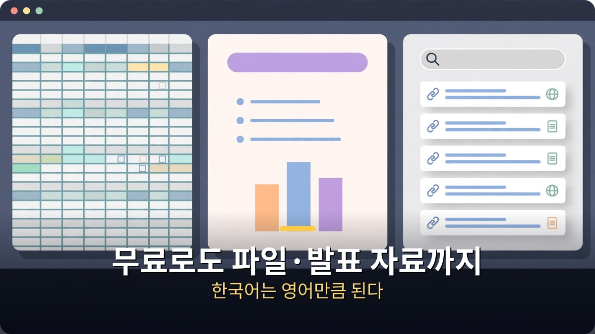

<!-- 본문 시작 -->

클로드, 돈 내기 전에 무료로 어디까지 되는지부터 보면 된다.
웹 검색, 엑셀·PPT 파일 만들기, 지난 대화 기억하기, 다른 앱 연결까지 무료 플랜에 들어 있다.
카드 등록 없이 오늘 바로 써볼 수 있다.
이 글은 2026-11-10에 공개된 영상을 바탕으로 정리한 자료 기반 안내다.
영상에서 든 숫자는 전부 앤트로픽 공식 발표에서 확인한 것만 골랐다고 한다.

> **핵심은 하나다. 무료로도 파일 만들기와 발표 자료까지 되지만, 오퍼스 모델과 클로드 코드는 프로(월 20달러)부터다. 시작하기 전에 단점 5가지를 먼저 확인하고, 설정에서 '모델 개선' 항목부터 끄는 게 순서다.**

## 무료로 어디까지 될까?

무료 플랜은 생각보다 넓고, 한국어는 영어만큼 된다.

먼저 무료로 되는 것부터 보자.
웹 검색, 엑셀·PPT 파일 만들기, 지난 대화를 기억하는 메모리, 다른 앱 연결이 전부 무료 플랜에 들어 있다.
카드 등록 없이 오늘 바로 시작할 수 있다는 뜻이다.
발표 자료도 무료로 된다.
산책하면서 휴대폰 녹음기에 떠든 말을 받아써서 클로드에 붙여넣고 "/슬라이드, 이걸로 발표 자료 만들어 줘"라고 하면 된다.
다 만든 건 PPT나 PDF로 받을 수 있다.

한국어도 걱정할 필요가 없다.
앤트로픽 자료를 보면 오퍼스 5.5의 한국어 점수는 같은 모델 영어 점수의 99.1%다.
한국어로 물어보나 영어로 물어보나 거의 같은 실력이라는 뜻이다.
실제로 한국 사람들은 인구에 비해 예상보다 3.5배 넘게 클로드를 쓰고 있고, 올해 6월에는 서울 사무소까지 생겼다.

개인정보는 시작 전에 한 번만 확인하면 된다.
클로드는 내 대화를 AI 학습에 쓸지 말지를 내가 고른다.
설정에서 개인정보 안에 있는 '모델 개선' 항목을 끄면 내 대화는 학습에 쓰이지 않는다.
켜두면 최대 5년까지 보관될 수 있다.
남기기 싫은 대화는 시크릿 대화로 하면 설정과 상관없이 학습에 들어가지 않는다.
회사 자료나 고객 정보를 넣기 시작하면 얘기가 달라지니, 오늘 한 번 확인해두는 게 좋다.

## 숫자로 보면 왜 다를까?

석 달 만에 일곱 배 뛴 점수, 화성 탐사차를 몰고 간 길, 비개발자도 맡기는 일이 근거다.

AI가 컴퓨터 안에서 실제로 일을 끝까지 해내는지 보는 시험이 있다.
터미널 벤치라고 부른다.
6월에 나온 소넷은 이 시험에서 10.3%였다.
그런데 석 달 뒤에 나온 소넷 5.5는 70.6%가 나왔다.
한 번 업데이트에 일곱 배 가까이 뛴 셈이다.
재미있는 건 이게 위등급인 오퍼스 5.5의 66.4%보다도 높다는 점이다.
제일 작은 모델 하이쿠는 더 극적이다.
하이쿠 4.5는 이 시험에서 0%였는데, 하이쿠 5.5는 39.2%가 나왔다.
그러면서 개발자용 가격은 10분의 1 수준으로 내렸다고 영상은 전한다.
보통 성능이 오르면 값도 오르는데, 여기서는 반대다.

화면을 보고 마우스를 누르고 타자를 치면서 컴퓨터를 직접 쓰는 시험에서는 오퍼스 5.5가 81.8%를 받았다.
사람처럼 컴퓨터를 만지는 실력이 벌써 여기까지 왔다.
물론 시험 점수가 전부는 아니다.
앤트로픽도 발표에서 점수 차이가 실제 체감과 다를 수 있다고 직접 적어놨다.

시험장 밖에서는 어떤지 보자.
작년 12월, 나사는 클로드가 짠 길로 화성 탐사차를 실제로 몰았다.
이틀에 걸쳐 210m, 그리고 246m를 달렸다.
사람이 매번 손으로 짜던 길을 클로드가 짜고, 사람은 확인만 했다.

| 시험·사례 | 수치 | 의미 |
| --- | --- | --- |
| 터미널 벤치 소넷 | 10.3% → 70.6% | 석 달 만에 일곱 배 |
| 터미널 벤치 하이쿠 | 0% → 39.2% | 가장 작은 모델의 반전 |
| 컴퓨터 직접 조작 | 오퍼스 5.5, 81.8% | 화면 보고 마우스·타자까지 |
| 나사 화성 탐사차 | 이틀에 210m·246m | 사람이 짜던 길을 클로드가 짬 |

"그거 개발자들이 코딩할 때 쓰는 거 아니냐"는 말도 이제는 절반만 맞는다.
예전에는 클로드 코드가 까만 터미널 창에 명령어를 쳐야 했다.
지금은 데스크톱 앱에서 똑같은 엔진을 버튼으로 쓴다.
터미널을 몰라도 된다.

올해 6월, 앤트로픽이 클로드 코드 작업 40만 건을 분석해서 결과를 냈다.
개발자가 맡긴 일의 성공률은 30% 정도, 개발자가 아닌 사람들은 26% 정도였다.
차이가 5%포인트 정도다.
성공률이 제일 높은 직군은 개발자가 아니라 관리자였다.
보고서에는 파이썬을 한 번도 안 써 본 회계사 얘기가 나온다.
코딩은 몰라도 월말 정산 규칙을 정확히 말하고 예외를 잡아낼 줄 알면 그 사람이 그 일의 전문가라는 것이다.
결국 코딩 실력보다 내 일을 얼마나 잘 아느냐가 더 중요해졌다는 얘기다.

사례도 있다.
일본 라쿠텐에서는 한 엔지니어가 클로드 코드에 큰 일을 맡겼더니 7시간 동안 혼자 일을 끝냈다.
그 엔지니어는 그동안 코드를 한 줄도 안 쓰고 가끔 방향만 알려줬다.
한국에서도 네이버 엔지니어 수천 명이 클로드 코드를 쓰고 있고, LG CNS는 20년 된 회사 시스템을 7개월 만에 새로 옮겼다.
기능 2,913개 가운데 대부분을 옮겼고, 비용은 원래 방식의 절반 정도였다.
그곳 책임자의 말이 이렇다.
"빨라진 게 다가 아니라, 엄두도 못 내던 일을 시작할 수 있게 됐다."

코딩과 상관없는 일로 직접 해보는 예도 하나 있다.
작은 표에 한 달 매출 내역을 그대로 붙여 놓고 딱 한 줄만 쓴다.
"요일별로 나눠서 합계는 수식으로 넣은 엑셀로 만들어 줘."
잠깐 기다리면 엑셀 파일이 나온다.
합계칸에 그냥 숫자가 아니라 진짜 수식이 들어가 있다.
그래서 매출 하나를 고치면 합계도 같이 바뀐다.
붙여넣기 한 번, 문장 한 줄이 전부다.

## 시작 전에 확인할 5가지 단점은?

그림은 안 그리고, 사용량 한도가 있고, 무료에는 빠진 게 있다.

좋은 얘기만 하면 반쪽짜리 설명이다.
단점도 솔직하게 보자.

첫째, 클로드는 사진이나 일러스트를 그려 주지 않는다.
차트나 도표, 간단한 화면은 만들어 주지만, 그림 그리는 게 주 업무라면 그 도구는 따로 써야 한다.

둘째, 사용량 한도가 있다.
다섯 시간마다 쓸 수 있는 양이 정해져 있고, 일주일 한도도 따로 있다.
특히 크롬을 대신 조작시키는 일은 일반 대화보다 한도를 훨씬 빨리 쓴다.
설정의 사용량 메뉴에서 남은 양과 다시 차는 시간을 볼 수 있으니, 처음엔 자주 확인하는 게 좋다.
한도를 다 쓰면 유료 플랜은 추가 크레딧을 사서 이어서 쓸 수도 있다.

셋째, 무료에는 빠진 게 있다.
오퍼스 모델, 클로드 코드, 엑셀 연동, 크롬 기능은 한 달 20달러인 프로부터 된다.

넷째, 한국어 음성 대화는 아직 베타다.
말로 주고받는 게 중요하다면 아직은 조금 아쉬울 수 있다.

다섯째, 세 기능 중에 아직 미국에서만 되는 게 있다.
클로드가 먼저 할 일을 챙겨 주는 듀엣, 은행 계좌를 연결해서 돈 관리를 돕는 기능은 지금 한국에서는 못 쓴다.

이 다섯 가지를 감수할 수 있다면, 오늘 무료로 먼저 시작해봐도 늦지 않다.
정리하면 이렇다.
무료로도 파일 만들기와 발표 자료가 되고, 한국어는 영어만큼 하고, 개발자가 아니어도 클로드 코드로 내 일을 맡길 수 있다.
오늘은 설정에서 모델 개선 항목부터 확인해보고, 무료로 일 하나만 시켜보는 게 순서다.

토큰이 얼마나 드는지까지 따져보고 싶다면, 클로드 토큰을 줄이는 방법을 정리한 글이 도움이 된다.
[클로드 필수 신기능! 토큰 다이어트 91% → 13% 직접 해 봤습니다](https://aitechnoteskr.tistory.com/126)
설정을 바꾸는 것만으로 토큰 사용량을 크게 줄이는 방법이 그 글에 있다.

---

무료라는 말에 혹해서 시작했다가, 한도 때문에 멈추는 사람이 많다.
그래서 시작 순서는 이렇다.
설정에서 모델 개선 항목 끄기, 무료로 일 하나 시켜보기, 한도 확인하기.
이 세 가지만 하면 클로드가 내 일에 맞는지 오늘 안에 알 수 있다.
남이 잘 만들어 둔 스킬이 100만 개가 넘는다니, 남의 설명서를 빌려 쓰는 재미도 있다.
다만 그림 한 장이 필요하면 다른 도구를 열어야 한다는 것, 그 한 줄만 잊지 않으면 된다.

## 자주 묻는 질문

**무료 플랜으로 정말 파일까지 만들 수 있나요?**

A. 된다. 웹 검색, 엑셀·PPT 파일 만들기, 메모리, 다른 앱 연결이 무료 플랜에 들어 있다. 카드 등록 없이 오늘 바로 시작할 수 있다. 발표 자료도 /슬라이드로 무료로 만들 수 있다.

**한국어 실력은 영어와 얼마나 차이 나나요?**

A. 앤트로픽 자료 기준 오퍼스 5.5의 한국어 점수는 영어 점수의 99.1%다. 한국어로 물어보나 영어로 물어보나 거의 같은 실력이다.

**내 대화가 AI 학습에 쓰이나요?**

A. 설정에서 고를 수 있다. 개인정보 안의 '모델 개선' 항목을 끄면 내 대화는 학습에 쓰이지 않는다. 켜두면 최대 5년까지 보관될 수 있고, 시크릿 대화는 설정과 상관없이 학습에 들어가지 않는다.

**개발자가 아닌데 클로드 코드가 필요할까요?**

A. 터미널을 몰라도 데스크톱 앱에서 버튼으로 쓸 수 있다. 40만 건 분석에서 비개발자 성공률은 26%로 개발자(30%)와 5%포인트 차이였고, 성공률이 가장 높은 직군은 관리자였다.

**프로 요금제는 얼마인가요?**

A. 한 달 20달러다. 오퍼스 모델, 클로드 코드, 엑셀 연동, 크롬 기능이 프로부터 된다.

## 함께 읽으면 좋은 글
[그록 5, 아직 안 나왔다｜출시일 없는 이유와 확인된 사실 5가지 — 소문과 사실을 가르고 지금 쓸 수 있는 모델을 정리한 검증법](https://aitechnoteskr.tistory.com/148)
[챗GPT로 움짤 만드는 법｜이미지 2.6 GIF, 프롬프트 하나로 귀여운 반복 애니메이션 — 프롬프트 하나로 GIF를 만드는 방법과 잘 되는 조건 5가지](https://aitechnoteskr.tistory.com/147)
[인터스텔라｜1시간이 7년이 되는 행성, 아버지가 건너는 시간 — 169분짜리 명작을 넷플릭스에서 볼 가치와 시청 전 체크리스트](https://aitechnoteskr.tistory.com/143)

이 주제를 계속 따라가려면 이웃 추가를 해두면 다음 소식이 올라올 때 바로 볼 수 있다.

<!-- 본문 끝 -->

## 작업용 출처·이미지 정보 (업로드 제외)

- 자료 출처: honjobs 영상 aup0LpevX_0(2026-11-10, 8분 23초, 자막 0:00~8:15 확인) + Anthropic 공식 발표 수치 대조
- 이미지: images/01-hero.jpg ~ 04-img3.jpg / 자작 일러스트 + 한글 배너 오버레이 (1200x675)
