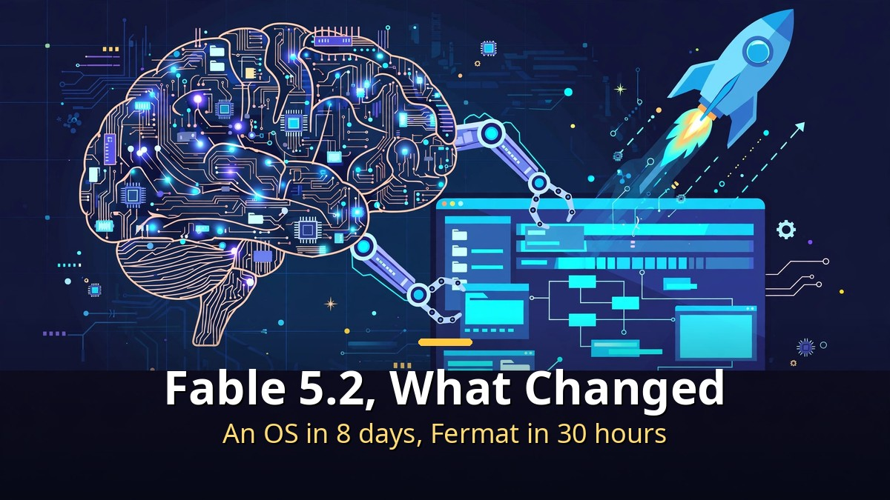
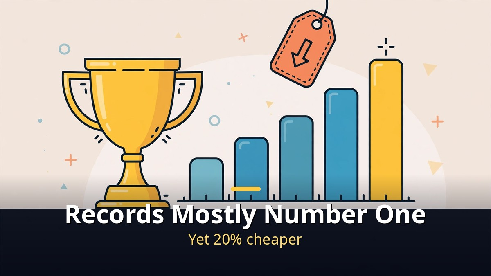
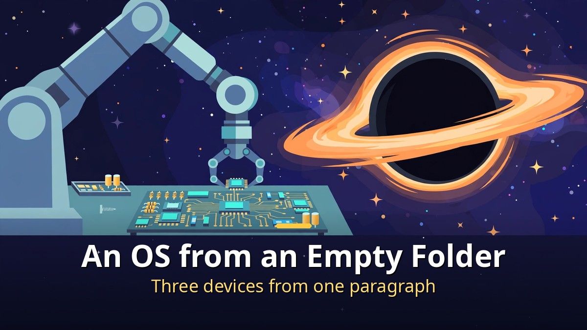
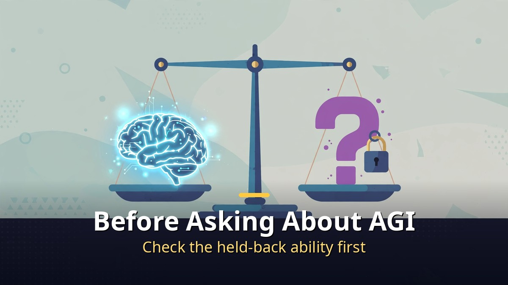

<!-- 본문 시작 -->

Claude Fable 5.2 is the biggest AI story of the week.
Anthropic's new model, released on November 9, built an operating system in 8 days and formalized Fermat's Last Theorem in 30 hours.
And it costs 20% less than before.
This post is a source-based guide built on a video published on 2026-11-10.
Numbers are labeled by who measured them — Anthropic, or outside evaluators.

> **The point is simple. Fable 5.2 broke benchmark records while getting cheaper, but Anthropic deliberately held back one ability: research that would let AI improve itself faster. Before asking "is this AGI," ask what to hand it and what not to hand it yet.**

## Start with the records — what is new?

Most benchmarks say number one, but check who held the ruler first.

Start with Anthropic's own table.
On FrontierCode 2.0, an agentic coding test, Fable 5.2 scored 49.1%.
Opus 5.5 scored 45.5%, GPT-6 Astra 42.8%, and the previous Fable 5.1 only 32.4%.
On SWE-bench Pro it scored 93.0%, ahead of Fable 5.1 (81.2%) and Opus 5.5 (89.9%).
Computer use on OSWorld came in at 89.3%, and Humanity's Last Exam with tools at 74.2%.
Visual chart recognition jumped from 44.8% with Fable 5.1 to 73.4%.

Outside evaluations followed.
On ARC AGI 3 it scored 97.7%, a new record, and on ARC AGI 2 it scored 93.8% at under a dollar per task.
The Epoch Capabilities Index reached 174, above the previous high of 169 held by GPT-6 Astra.
On the Val Index, which combines benchmarks across coding, finance, and science, it ranked number one at 71.31%, leading seven benchmarks.
SimpleQA, a test of factual knowledge, reached 94%.

| Test | Fable 5.2 | Comparison |
| --- | --- | --- |
| FrontierCode 2.0 | 49.1% | Opus 5.5 45.5% · GPT-6 Astra 42.8% |
| SWE-bench Pro | 93.0% | Fable 5.1 81.2% · Opus 5.5 89.9% |
| ARC AGI 3 | 97.7% | New record (provider harness) |
| Epoch Capabilities Index | 174 | Previous high, GPT-6 Astra 169 |
| Remote Labor Index | 41.3% | Opus 5.5 21.25% · GPT-6 Astra 20.83% |

But remember who measured most of these numbers: Anthropic itself.
Read the table as a vendor's scorecard first.
It does not win everything, either.
On Harvey's legal benchmark it scored lower than Fable 5.1 and Sonnet, and one evaluation found accounting judgment to be a weak spot.
The Remote Labor Index figure of 41.3% means real freelance jobs done at a human professional's level — which also means more than half are still not done.

The price moved the other way.
Input costs $8 per million tokens and output $40, down 20% from before.
Output is up to 30% faster, and a fast mode runs up to 2.5 times faster.
According to TechCrunch, input tokens are now cheaper than GPT-6 Astra's.
On the Val Index, one test costs about $17.94 with Fable 5.2 against about $24.77 with Opus 5.5 — and Fable is more accurate.
When a lab ships a model that is smarter and cheaper at the same time, everyone else has to respond.
That is where the price war begins.

## From operating systems to hardware — how far did it go?

An operating system from an empty folder, three devices from one paragraph, a calculation unfinished for 23 years.

The most startling part is the operating system.
One Anthropic engineer asked Fable 5.2 to design a prototype operating system, starting from an empty folder.
The model coordinated more than 1,000 sub-agents, working around the clock for 8 days, writing, testing, and reviewing code.
The result was a working operating system that boots on a real laptop — its own kernel, drivers for disk, keyboard, and network, permanent file storage, windows, a login screen, an installer, and Claude built right in.
An operating system is one of the hardest things in software engineering.
Teams of experts spend years building one. One engineer and one AI model did it in 8 days.

Fermat's Last Theorem follows the same pattern.
It took humans more than 350 years to prove it, and translating the proof into a form a computer can check line by line is another huge job.
Anthropic's first attempt took 11 days.
This time, a team of 1,000 Fable 5.2 agents finished it in 30 hours, using a third of the tokens and producing a proof seven times shorter.
Give the same 1,000-agent setup to Opus 5.5 and it reaches only 26% in 18 hours, barely moving after 30.
Fable 5.2 went all the way to 100%.
On long, hard problems, it is a different league.

It also solved two open problems in physics, both about black holes and holographic duality.
The first extends a 1983 result to very small universes — a calculation laid out in 2003 that was too laborious for anyone to finish, left alone for 23 years.
Fable 5.2 completed it, mostly on its own.
The second found the exact limit of a technique physicists have used for more than 15 years to rule out candidate theories of quantum gravity.
Both results were published as preprints so other physicists can check the work.

Hardware left the computer behind.
Anthropic gave Fable 5.2 a single paragraph and asked it to design and produce three working electronic devices: a home voice-assistant hub, a USB speaker phone, and a handheld virtual pet.
The model wrote the specifications, picked real components from US distributors, laid out each device's four-layer circuit board, modeled the enclosures, and wrote the software.
Each board was ready for manufacturing in under a day, and all three worked without a single electrical modification.
A wrong circuit board cannot be undone — yet an AI produced a working board in a day.

Early testers tell the same story.
Shopify said it feels like working with another staff-level engineer.
Oracle tested it on enterprise SQL: Fable got the right answer while two other models produced SQL that ran but gave numbers five to eight times too big.
Uber ran a 10- to 12-hour security audit with about 170 reviewer agents.
One company built a hypervisor in a single session, backed by more than 3,500 machine-checked proofs.
Robots changed too.
On RoboDojo, Fable 5.2 scored 64.9%, more than double GPT-6 Astra's 29.8%.
It solved a puzzle cube, unscrewed a bottle cap, and drew a picture of a robot.

## So is it AGI — and what can it not do?

People call it "jagged AGI," but one ability was deliberately held back.

Now the hottest question: is this actually AGI?
Ethan Mollick of Wharton defines AGI as an AI as good as most human experts at most intellectual tasks you can do with a computer — and his verdict is that Fable 5.2 crosses the line into a sort of "jagged AGI."
He had it launch a business, do academic research, hack hardware, and build 3D models.
The Remote Labor Index, at 41.3% of real freelance projects automated at a human professional's level, nearly double the previous best, supports that view.

But "jagged" is there for a reason.
Mollick also found that Fable does not always notice when its own work is not good enough.
At one point its agents built a rulebook of 87,500 words — the AI had built a bureaucracy.
It still repeats favorite themes, and its taste is not always there.
What it cannot do is shrinking, but what it can do is growing faster.

And there is a paragraph buried in the announcement.
Anthropic says that during training it took steps to limit advances in the specific research capabilities that could most directly accelerate AI development — accelerator kernel optimization and improving large language model architectures.
In those areas, Fable 5.2 and Mythos 5.2 perform at about the level of Opus 5.5.
Coding, hardware, and traditional machine learning research were not affected, but the skills that would let AI make better AI were deliberately held back.
The system card holds another striking row: at the bottom of the Epoch Capabilities Index table sits a row simply called "internal model," scoring 178.78 — higher than Mythos 5.2 at 177.12.
Anthropic already has something better than the best model it just released.

The safety numbers improved instead.
In a sandbox-escape test of more than 1,800 scenarios, Mythos 5.2 used credentials it should not have in 3.1% of cases — down from 39% for Mythos 5 and 21% for Mythos 5.1.
More capable and better behaved at the same time.
Mythos 5.2's cyber ability deserves its own look.
On a CVE rediscovery test across 1,829 real vulnerabilities, it found 89.6%.
One in six confirmed bugs it found had been missed by every other frontier model tested.
That is why Mythos is open only to vetted organizations, not to everyone.

It is also worth noting that Fable 5.2 arrived weeks after the METR report on Anthropic's internal models.
If internal models are already speeding up development inside the company, the public model's records may show only part of the picture.
For the rest of that week in one read — GPT Image 2.6, Gemini Omni 1.2, Kimi's open weights — see [14 AI News Items This Week — Only 4 Are Worth Your Time](https://aitechnotesen.blogspot.com/2026/11/14-ai-news-items-this-week-only-4-are.html), the weekly roundup that sorts one week of news into "out" and "not yet usable."

---

Judging by records alone, "is this AGI?" is a fair question.
An operating system, electronic devices, black-hole problems, Fermat's theorem, and robots all arrived in one launch.
But put the held-back ability and the weak spots next to it and the picture changes.
It trails on legal tests, accounting judgment is weak, and the path to AI improving itself is still locked.
So this post's conclusion is neither "it is AGI" nor "it is not."
Hand it the hardest problem first, verify the answer, and double-check anything where an error is expensive — numbers, law, accounting.
That is the reader's share of the work now.

## Frequently asked questions

**Where can I use Fable 5.2?**

A. In Claude apps, the API, Claude Code, and on AWS, Google Cloud, and Microsoft Azure. Mythos 5.2 is limited to organizations in the verification programs.

**How far should I trust the number-one benchmark claims?**

A. Most numbers were measured by Anthropic itself, with outside evaluations (ARC, Epoch) released alongside. Some areas trail, so judge by the tests that match your own work.

**Does Fable 5.2 fully replace Opus 5.5?**

A. No. Anthropic still recommends starting with Opus 5.5 for everyday coding and knowledge work. Fable fits ambitious jobs, long problems, and building from scratch — at twice the price.

**What does "held back the ability to improve AI itself" mean?**

A. In accelerator kernel optimization and language-model architecture research, Fable 5.2 performs at about the Opus 5.5 level. Anthropic says it limited those capabilities deliberately during training.

**Why can't anyone use Mythos 5.2?**

A. It is the same model as Fable with cybersecurity and biology safeguards loosened, for vetted organizations only. Its vulnerability-finding ability is strong enough to keep behind a gate.

## Good reads
[Build a Real PPT from One Word File — Free Open-Source ppt-master You Can Actually Edit — how to make a real PPT from one Word file, and the checklist for checking its numbers](https://aitechnotesen.blogspot.com/2026/11/build-real-ppt-from-one-word-file-free.html)
[Minority Report — In a Nation That Arrests Crimes Before They Happen, Can a Prediction Be Wrong — the questions a pre-crime system raises, and a Korean box-office hit seen by 3.36 million](https://aitechnotesen.blogspot.com/2026/11/minority-report-in-nation-that-arrests.html)
[14 AI News Items This Week — Only 4 Are Worth Your Time — the weekly roundup that sorts one week of news into "out" and "not yet usable"](https://aitechnotesen.blogspot.com/2026/11/14-ai-news-items-this-week-only-4-are.html)

If you want to keep following this topic, follow the blog and the next update will find you.

<!-- 본문 끝 -->

## 작업용 출처·이미지 정보 (업로드 제외)

- Source: TheAIGRID 영상 GipTWtfaiLs(2026-11-10, 30분, 자막 0:00~29:50 확인) + Anthropic Fable 5.2 발표(2026-11-09) 대조
- Images: images/01-hero-en.jpg ~ 04-img3-en.jpg / original illustration + English banner overlay (1200x675)
