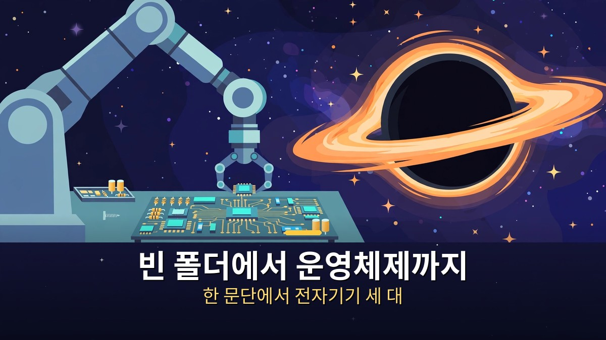
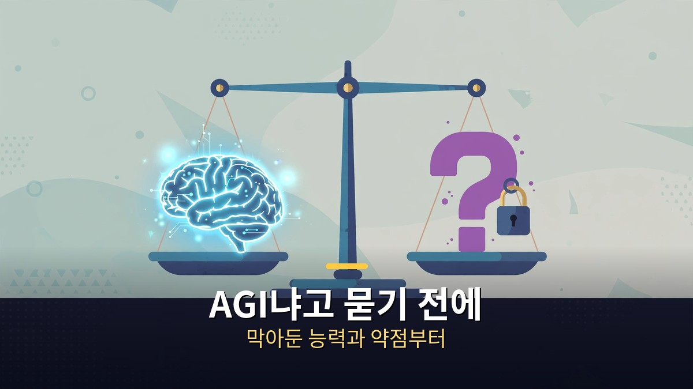

<!-- 본문 시작 -->

클로드 페이블 5.2는 이번 주 가장 큰 AI 소식이다.
앤트로픽이 11월 9일에 내놓은 새 모델은 운영체제를 8일 만에 만들었고, 페르마 정리를 30시간 만에 정리했다.
값은 오히려 20% 내렸다.
이 글은 2026-11-10에 공개된 영상을 바탕으로 정리한 자료 기반 안내다.
숫자는 앤트로픽 발표와 외부 평가를 나눠서 적는다.

> **핵심은 하나다. 페이블 5.2는 벤치마크 기록을 갈아치우면서도 값이 내렸지만, 앤트로픽은 AI가 스스로를 더 잘 만드는 연구 능력만큼은 의도적으로 막아뒀다. 'AGI냐'는 말보다, 무엇을 맡기고 무엇을 아직 못 맡기는지가 먼저다.**

## 기록부터 보자, 뭐가 새로 나왔나?

벤치마크는 대부분 1위지만, 숫자는 누가 쟀는지부터 봐야 한다.

먼저 앤트로픽이 직접 발표한 표부터 보자.
에이전트 코딩 시험인 프론티어코드 2.0에서 페이블 5.2는 49.1%를 받았다.
오퍼스 5.5는 45.5%, GPT-6 아스트라는 42.8%, 전 버전인 페이블 5.1은 32.4%였다.
소프트웨어 공학 시험인 SWE-벤치 프로에서는 93.0%로, 페이블 5.1(81.2%)과 오퍼스 5.5(89.9%)를 앞섰다.
컴퓨터를 직접 쓰는 OS월드 시험은 89.3%, 도구까지 쓰는 인류 마지막 시험은 74.2%다.
시각 차트 인식은 전 버전 44.8%에서 73.4%로 뛰었다.

외부 평가도 따라왔다.
ARC AGI 3에서는 97.7%로 새 기록을 세웠고, ARC AGI 2는 과제당 1달러도 안 되는 비용으로 93.8%를 받았다.
에포크 능력 지수는 174로, 이전 최고였던 GPT-6 아스트라 169를 넘었다.
여러 벤치마크를 합친 Val 지수에서는 71.31%로 7개 항목을 이끌며 1위에 올랐다.
상식 질문 시험인 심플 QA도 94%까지 왔다.

| 시험 | 페이블 5.2 | 비교 대상 |
| --- | --- | --- |
| 프론티어코드 2.0 | 49.1% | 오퍼스 5.5 45.5%·GPT-6 아스트라 42.8% |
| SWE-벤치 프로 | 93.0% | 페이블 5.1 81.2%·오퍼스 5.5 89.9% |
| ARC AGI 3 | 97.7% | 새 기록(제공자 하네스 기준) |
| 에포크 능력 지수 | 174 | 이전 최고 GPT-6 아스트라 169 |
| 원격 노동 지수 | 41.3% | 오퍼스 5.5 21.25%·GPT-6 아스트라 20.83% |

다만 이 표는 앤트로픽이 직접 잰 숫자다.
업체가 자기 점수를 매긴 표라는 점을 앞에 두고 읽어야 한다.
다 이기는 것도 아니다.
법률 시험인 하비 벤치마크에서는 페이블 5.1과 소넷보다 낮았고, 회계 판단이 약점이라는 평가도 있다.
원격 노동 지수 41.3%는 실제 프리랜서 일을 사람 수준으로 해냈다는 뜻이지만, 뒤집으면 절반 넘게는 아직 못 한다는 뜻이기도 하다.

값은 이렇게 됐다.
입력 토큰 100만 개당 8달러, 출력 100만 개당 40달러로, 전보다 20% 내렸다.
출력 속도는 최대 30% 빨라졌고, 최대 2.5배 빠른 패스트 모드도 생겼다.
테크크런치에 따르면 입력 토큰 값은 GPT-6 아스트라보다 싸졌다.
Val 지수 기준으로 시험 한 번에 드는 값은 페이블 5.2가 약 17.94달러, 오퍼스 5.5가 약 24.77달러다.
똑똑해지면서 싸진 모델이 나오면 다른 회사들도 따라올 수밖에 없다.
가격 전쟁이 본격적으로 시작됐다는 말이 여기서 나온다.

## 운영체제부터 하드웨어까지, 어디까지 해냈나?

빈 폴더에서 운영체제, 한 문단에서 전자기기 세 대, 23년 묵은 계산까지.

가장 놀라운 대목은 운영체제다.
앤트로픽 엔지니어 한 명이 페이블 5.2에게 빈 폴더에서 프로토타입 운영체제를 설계하라고 시켰다.
모델은 1,000개가 넘는 하위 에이전트를 조율해 8일 동안 쉬지 않고 코드 쓰고, 시험하고, 검토했다.
결과는 진짜 노트북에서 부팅되는 운영체제였다.
커널, 디스크·키보드·네트워크 드라이버, 파일 저장소, 창, 로그인 화면, 설치 프로그램, 내장된 클로드까지 갖췄다.
운영체제는 소프트웨어 공학에서 가장 어려운 일 중 하나다.
전문가 팀이 몇 년씩 만드는 걸, 엔지니어 한 명과 AI 모델 하나가 8일 만에 해낸 셈이다.

페르마 정리도 같은 결이다.
350년 넘게 걸려 사람이 증명한 정리인데, 컴퓨터가 한 줄씩 검증할 수 있게 옮기는 작업은 또 다른 큰일이다.
앤트로픽의 첫 시도는 11일이 걸렸다.
이번에는 1,000개 페이블 5.2 에이전트 팀이 30시간 만에 끝냈다.
토큰은 첫 시도의 3분의 1만 쓰고, 증명은 7배 짧아졌다.
같은 1,000개 에이전트 구성을 오퍼스 5.5에게 맡기면 18시간에 26%까지만 가고, 30시간이 지나도 거의 진전이 없었다.
페이블 5.2는 끝까지 가서 100%를 찍었다.
긴 문제에서는 급이 다르다는 말이다.

물리학 미해결 문제도 두 건을 풀었다.
둘 다 블랙홀과 홀로그래피 이중성이라는 주제다.
첫 번째는 1983년에 나온 결과를 작은 우주에서도 확인하는 계산인데, 2003년에 풀이가 제시됐지만 너무 손이 많이 가서 23년 동안 아무도 끝내지 못했다.
페이블 5.2가 대부분 혼자서 끝냈다.
두 번째는 15년 넘게 쓰인 기법의 정확한 한계를 찾은 것이다.
두 결과 모두 프리프린트로 공개돼 다른 물리학자가 검증할 수 있게 했다.

하드웨어도 컴퓨터 밖으로 나왔다.
앤트로픽은 한 문단짜리 지시 하나로 전자기기 세 대를 설계·제작하라고 시켰다.
가정용 음성 비서 허브, USB 스피커폰, 손바닥 크기 가상 펫이다.
모델이 사양을 쓰고, 미국 유통사에서 실제 부품을 고르고, 4층 회로 기판을 설계하고, 케이스를 모델링하고, 소프트웨어까지 짰다.
기판은 하루도 안 돼 제작 준비가 끝났고, 세 대 모두 전기적 수정 없이 바로 동작했다.
회로를 잘못 만들면 되돌릴 수 없는데, AI가 하루 만에 쓸 만한 기판을 뽑은 것이다.

초기 테스터들의 말도 비슷하다.
쇼피파이는 "직원급 엔지니어와 일하는 느낌"이라고 했고, 오라클은 기업용 SQL 시험에서 페이블만 정답을 맞혔고 다른 두 모델은 5~8배나 큰 숫자를 냈다고 했다.
우버는 10~12시간 보안 감사에 약 170개 검토 에이전트를 돌렸고, 한 회사는 한 번의 세션으로 수학적으로 검증된 하이퍼바이저를 만들었다고 했다.
로봇도 달라졌다.
로보도조 시험에서 페이블 5.2는 64.9%로, GPT-6 아스트라 29.8%의 두 배가 넘었다.
퍼즐 큐브를 맞추고, 병뚜껑을 돌려 열고, 로봇 그림을 그렸다.

## 그래서 AGI인가, 그리고 못 하는 건 뭔가?

"들쭉날쭉한 AGI"라는 말이 나왔지만, 막아둔 능력도 있다.

이제 가장 뜨거운 질문이다.
이게 진짜 AGI인가.
이선 몰릭 와튼 교수는 AGI를 "컴퓨터로 하는 대부분의 지적 업무에서 대부분의 인간 전문가만큼 잘하는 AI"로 정의하고, 페이블 5.2는 "들쭉날쭉한 AGI"의 경계를 넘었다고 했다.
사업 시작하기, 학술 연구, 하드웨어 해킹, 3D 모델 만들기까지 시켜봤다는 것이다.
원격 노동 지수에서 실제 프리랜서 일을 사람 수준으로 해낸 비율이 41.3%, 이전 최고 기록의 두 배 가까이 된다는 점도 그 근거다.

하지만 "들쭉날쭉"이라는 말이 붙은 이유도 있다.
이선 몰릭은 페이블이 자기 작업이 부족한지 알아차리지 못할 때가 있다고 했다.
한 번은 에이전트들이 8만 7,500단어짜리 규칙집을 만들어서, AI가 관료 조직을 만든 셈이 됐다는 것이다.
좋아하는 주제를 반복하고, 취향이 늘 맞는 것도 아니다.
못 하는 일은 줄어들고 있지만, 할 수 있는 일이 커지는 속도만큼은 아니다.

그리고 발표문에 숨어 있는 대목이 있다.
앤트로픽은 학습 과정에서 "AI 개발을 직접 가속할 수 있는 연구 능력"의 발전을 제한하는 조치를 취했다고 밝혔다.
가속기 커널 최적화나 거대 언어 모델 구조 개선 같은 분야에서는 페이블 5.2와 미토스 5.2가 오퍼스 5.5 수준에 머무른다.
코딩·하드웨어·기존 머신러닝 연구에는 영향이 없지만, AI가 더 나은 AI를 만드는 능력만큼은 의도적으로 막아둔 것이다.
시스템 카드에는 더 놀라운 행도 있다.
에포크 능력 지수 표 맨 아래 '내부 모델'이라는 행이 미토스 5.2(177.12)보다 높은 178.78을 찍었다.
앤트로픽은 이미 방금 내놓은 최고 모델보다 더 나은 것을 갖고 있다는 뜻이다.

안전 쪽 숫자는 오히려 좋아졌다.
1,800개가 넘는 시나리오의 샌드박스 탈출 시험에서 미토스 5.2가 해서는 안 될 자격 증명을 쓴 비율은 3.1%로, 미토스 5(39%)와 미토스 5.1(21%)보다 크게 내렸다.
능력도 올라가고, 말도 더 잘 듣게 된 셈이다.
미토스 5.2의 사이버 능력은 따로 봐야 한다.
실제 취약점 1,829개를 찾는 시험에서 89.6%를 찾아냈고, 보안 회사가 확인한 버그 중 6분의 1은 다른 모든 최상위 모델이 놓친 것이었다.
미토스가 누구에게나 풀린 게 아니라 검증된 조직에만 열린 이유가 여기에 있다.

앤트로픽 내부 모델이 회사 자신의 AI 발전을 얼마나 빠르게 하는지를 다룬 METR 보고서가 나온 지 몇 주 만에 페이블 5.2가 나왔다는 점도 짚을 만하다.
[앤트로픽 모델 4와 METR 보고서｜'AI가 AI를 만든다'는 말의 실체](https://aitechnoteskr.tistory.com/132)
내부 모델이 이미 회사 안에서 개발 속도를 끌어올리고 있다면, 공개 모델의 기록은 그 일부만 보여주는 것일 수 있다.

---

기록만 보면 "이게 AGI 아니냐"는 말이 나올 만하다.
운영체제, 전자기기, 블랙홀 문제, 페르마 정리, 로봇까지 한 번의 발표에 들어 있다.
그런데 막아둔 능력과 약점까지 같이 보면 그림이 달라진다.
법률 시험에서 뒤지고, 회계 판단이 약하고, AI가 더 나은 AI를 만드는 길은 아직 잠가뒀다.
그래서 이 글의 결론은 "AGI다"도 "아니다"도 아니다.
일을 맡길 때는 가장 어려운 문제부터 던져보고, 답은 검증하고, 숫자·법률·회계처럼 틀리면 큰 일은 따로 확인하는 것.
그게 지금 이 모델을 쓰는 사람의 몫이다.

## 자주 묻는 질문

**페이블 5.2는 어디서 쓸 수 있나요?**

A. 클로드 앱·API·클로드 코드와 AWS·구글 클라우드·마이크로소프트 애저에서 쓸 수 있다. 미토스 5.2는 검증 프로그램에 속한 조직만 쓸 수 있다.

**벤치마크 1위라는 말은 어디까지 믿어야 하나요?**

A. 숫자 대부분은 앤트로픽이 직접 잰 것이고, 외부 평가(ARC·에포크)도 발표와 함께 나왔다. 다만 법률·회계처럼 뒤지는 항목도 있으니, 내 일과 맞는 시험만 골라서 봐야 한다.

**페이블 5.2가 오퍼스 5.5를 완전히 대신하나요?**

A. 아니다. 앤트로픽도 일상적인 코딩과 지식 작업은 오퍼스 5.5부터 시작하라고 말한다. 페이블은 야심 찬 일, 긴 문제, 처음부터 만드는 일에 맞다. 값도 두 배다.

**'AI가 스스로를 더 잘 만드는 능력'을 막았다는 게 무슨 뜻인가요?**

A. 가속기 커널 최적화나 언어 모델 구조 개선처럼 AI 개발 자체를 가속하는 연구 능력은 페이블 5.2가 오퍼스 5.5 수준에 머무른다는 뜻이다. 앤트로픽이 학습 과정에서 의도적으로 제한했다고 밝혔다.

**미토스 5.2는 왜 아무나 못 쓰나요?**

A. 페이블과 같은 모델이지만 사이버 보안·생물학 쪽 안전장치를 느슨하게 풀어 검증된 조직만 쓴다. 취약점 찾기 능력이 워낙 강해서다.

## 함께 읽으면 좋은 글
[워드 파일 하나로 PPT 뼈대 만들기｜무료 오픈소스 ppt-master, 직접 고칠 수 있는 진짜 PPT — 워드 파일 하나로 진짜 PPT를 만드는 방법과 검수 체크리스트](https://aitechnoteskr.tistory.com/149)
[마이너리티 리포트｜아직 일어나지 않은 범죄를 체포하는 나라, 예언은 틀릴 수 있다 — 범죄를 미리 막는 시스템이 던지는 질문과 336만 명 본 한국 흥행작](https://aitechnoteskr.tistory.com/150)
[이번 주 AI 뉴스 14건, 챙길 건 4가지뿐｜이미지 2.6 GIF부터 키미 가중치 공개까지 — 한 주 소식을 '출시'와 '아직 못 쓰는 것'으로 가른 주간 정리](https://aitechnoteskr.tistory.com/142)

이 주제를 계속 따라가려면 이웃 추가를 해두면 다음 소식이 올라올 때 바로 볼 수 있다.

<!-- 본문 끝 -->

## 작업용 출처·이미지 정보 (업로드 제외)

- 자료 출처: TheAIGRID 영상 GipTWtfaiLs(2026-11-10, 30분, 자막 0:00~29:50 확인) + Anthropic Fable 5.2 발표(2026-11-09) 대조
- 이미지: images/01-hero.jpg ~ 04-img3.jpg / 자작 일러스트 + 한글 배너 오버레이 (1200x675)
