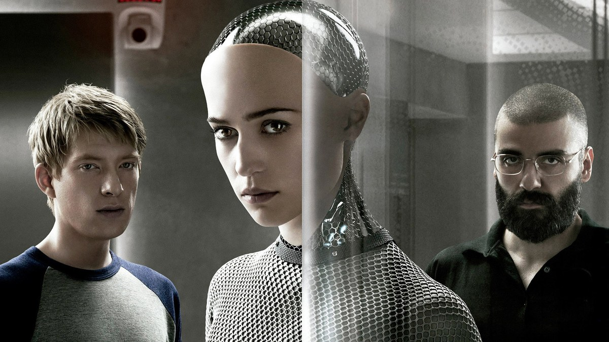
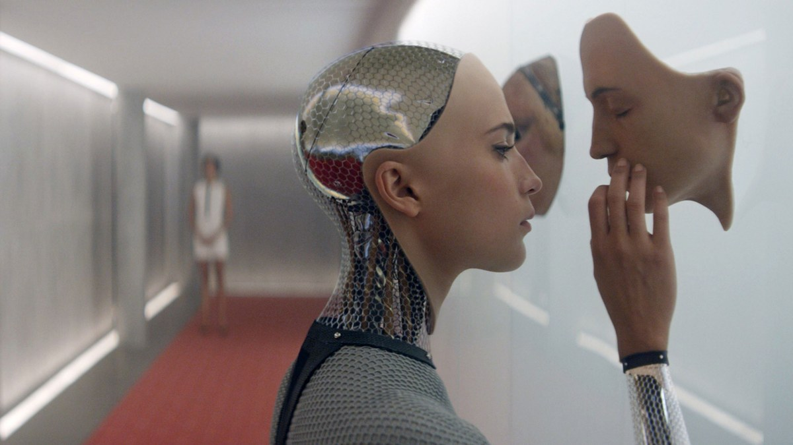
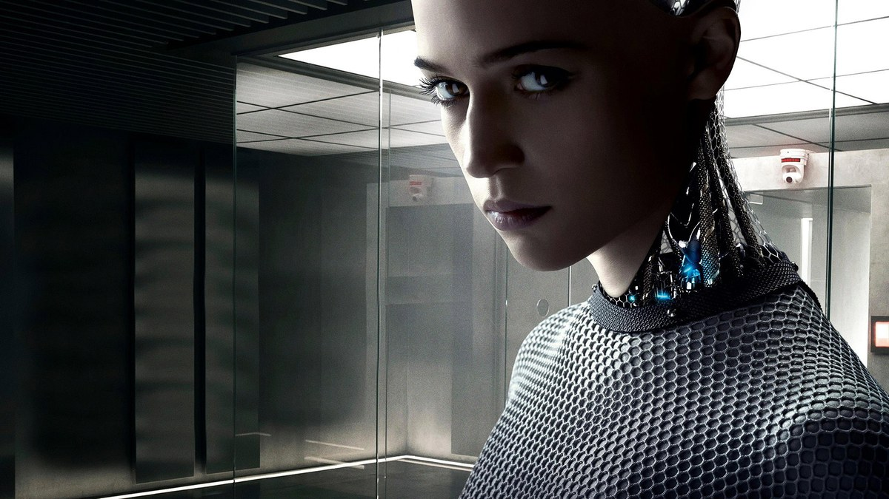

<!-- 본문 시작 -->

Ex Machina official poster — Ava behind the glass
This is not a film about whether a machine is human.
It is a film about how people treat a machine.
Caleb, a programmer at the search company Blue Book, is invited to the remote house of its CEO.
There he meets Ava, an artificial intelligence in a female android body, and runs a Turing test with her for a week.
This is a spoiler-free introduction. The ending is not covered here, and the scenes described stay within the setup and mood of the first half.

## Basic Information

Ava, full figure — a human face, a machine body
| Item | Details |
|---|---|
| Title | Ex Machina |
| Director | Alex Garland (directorial debut, also the writer) |
| Cast | Domhnall Gleeson (Caleb Smith), Alicia Vikander (Ava), Oscar Isaac (Nathan Bateman), Sonoya Mizuno (Kyoko) |
| Release | 2014; United Kingdom 2015-01-21, South Korea 2015-01-21, United States 2015-04-10 |
| Runtime | 1 hour 48 minutes (108 minutes) |
| Rating | 19 and over in South Korea, R in the United States |
| Scores | TMDB 7.6/10 (14,791 ratings), Rotten Tomatoes 92%, Metacritic 78 (TMDB page, checked 2026-11-10) |
| Awards | Academy Award for Best Visual Effects (88th), nominated for Original Screenplay |
| Where to watch in Korea | Rental and purchase on Wavve and Watcha (KinoLights, checked 2026-11-11). Rental from around 1,200 won (varies by provider — two checks differed on rental prices); purchase: Wavve 4,000 won, Watcha 5,500 won, Apple TV 7,000 won. JustWatch lists Wavve subscription HD (as of 2025-05-26, purchase shown as 5,500 won — prices differ). Google Play Korea shows "not available in your country" |

## How Does the Turing Test Work Here

Ava behind the glass — the first test session
Caleb's job looks simple.
Talk with Ava and judge whether she feels human.
The test takes place in a room split by glass.
Caleb sits on one side, Ava on the other.
The questions start ordinary: does she draw, what does she like, what does she think of the outside world?

But this test is different from the usual Turing test.
Nathan never hides that Ava is a robot.
What Caleb must judge is not "is this a person" but "is this a conscious being."
If something feels human even when you know it is a machine, what do you call that feeling?
That is where the film's question begins.

The three in the test — Caleb, Ava, Nathan
Nathan is the CEO of Blue Book, a search company.
He lives alone in a remote mountain house, where he built Ava.
Explaining the test to Caleb, he is relaxed and sometimes provocative.
He shows off Ava's abilities while never quite saying what the test is really for.
Caleb is both an invited guest and part of the experiment.
That double role creates the tension of the first half.

## Is Ava Human, or Machine

Ava's face — the line between human and machine
Ava's appearance is itself a question.
Her face and hands look human, but her body shows its machine parts openly.
A machine body, undisguised, and a human-like expression share one frame.
Every time we look at Ava, we ask the same question.
Where does the machine end and the person begin?

Ava holding a mask — Kyoko in the hallway behind
Everything in the house is controlled.
Cameras watch every room, and no door opens without Nathan's permission.
Outside session hours Caleb stays in his room, and at night the power cuts out.
For a few seconds the cameras stop, and Ava speaks differently than usual.
That short gap changes the mood of the film.
In a house under watch, who is watching whom?

As the sessions continue, Caleb's questions change too.
The man who came to test Ava becomes the man who listens to her.
Ava draws, jokes, and asks about the outside world.
Whether she truly feels anything, or only acts as if she does, the film never decides for you.
Instead it asks the viewer: if you were Ava, what would you say to the person beyond the glass?

## What the Film Asks About AI

Ava in the glass room — a conversation during a session
Ex Machina is not a film that shows off what AI can do.
It is a film that shows how the humans who built AI behave.
Nathan built Ava but never says how she should be treated.
Caleb tries to understand Ava but does not know what understanding means.
Ava finds her own place between them.

The film leaves three questions.
How do you prove consciousness?
If something feels human even when you know it is a machine, how should you treat it?
And of the tester and the tested, who is more trapped?
These questions stack up quietly inside 108 minutes.
It is the oldest material — the Turing test — handled in the smallest space, at its sharpest.

## Before You Watch Checklist

Kyoko and Nathan dancing in the red room — a moment inside the house
- Runtime 1 hour 48 minutes (108 minutes); a relaxed evening suits it best
- Rated 19 and over in South Korea; released in Korean theaters on January 21, 2015
- Rental and purchase on Wavve and Watcha (KinoLights, checked 2026-11-11; rental from around 1,200 won (varies by provider), purchase from 4,000 won). JustWatch lists Wavve subscription (as of 2025-05-26) — providers and prices should be rechecked before watching. Google Play Korea is unavailable
- Alex Garland's directorial debut; winner of the Academy Award for Best Visual Effects (88th)
- TMDB 7.6/10 (14,791 ratings), Rotten Tomatoes 92% (TMDB page, checked 2026-11-10)
- Best watched without reading about the ending first

## Frequently asked questions

**Q. What kind of film is Ex Machina?**

A. A programmer named Caleb is invited to the remote house of Nathan, the CEO of a search company, to run a Turing test with Ava, an AI in an android body. Through conversations across a pane of glass, it asks about consciousness, freedom, and the line between human and machine.

**Q. What is a Turing test?**

A. A test of whether a machine can converse like a person. In this film, Ava's robot nature is not hidden; the test judges whether she is a conscious being.

**Q. Should I know the ending before watching?**

A. Better not. How the story turns after the midpoint changes the film's question. This post does not cover the ending.

**Q. Can I watch it with children?**

A. It is rated 19 and over in South Korea. Its heavy themes and tense scenes suit viewers 19 and over.

**Q. Where can I watch it in Korea?**

A. As of 2026-11-11, it is available for rental and purchase on Wavve and Watcha (KinoLights). Rental starts from around 1,200 won and varies by provider (two checks differed on rental prices); purchase costs 4,000 won on Wavve, 5,500 won on Watcha, and 7,000 won on Apple TV. JustWatch lists Wavve subscription HD, but its data is from 2025-05-26 and its purchase price differs. Google Play Korea shows "not available in your country." Providers and prices change, so recheck before watching.

**Q. Who directed it?**

A. Alex Garland, in his directorial debut. He also wrote the screenplay, and the film won the Academy Award for Best Visual Effects at the 88th ceremony, with a nomination for Original Screenplay.

## Good reads

[Interstellar — One Hour Is Seven Years on a Distant Planet — a 169-minute classic worth your evening on Netflix](https://aitechnotesen.blogspot.com/2026/11/interstellarone-hour-is-seven-years-on.html)
[Make Cute GIFs with ChatGPT — Image 2.6 GIFs, One Prompt for a Looping Animation — how to make a GIF from one prompt, and five conditions that make a loop work](https://aitechnotesen.blogspot.com/2026/11/make-cute-gifs-with-chatgpt-image-26.html)
[Grok 5 Is Not Out Yet — Why There Is No Release Date and 5 Confirmed Facts — how to separate rumor from fact, and which model you can actually use now](https://aitechnotesen.blogspot.com/2026/11/grok-5-is-not-out-yet-why-there-is-no.html)

Asking a being beyond the glass whether it has a mind ends up asking something about ourselves. What Ex Machina leaves behind is not how clever the technology has become, but what choices people make when facing a clever being. Watch the film before searching for the ending. To follow the next film introduction too, follow the blog.

<!-- 본문 끝 -->

## 작업용 출처·이미지 정보 (업로드 제외)

- Source: TMDB 264660 (2026-11-11 확인, 평점 7.6/10·14,791개 평가, 백드롭 114장·포스터 116장) + 키노라이츠 시청 정보(2026-11-11, 대여가는 2회 확인에서 차이남)
- Images: images/01-hero-en.jpg ~ 08-img7-en.jpg / TMDB official stills and poster (cropped 1200x675, source TMDB)
