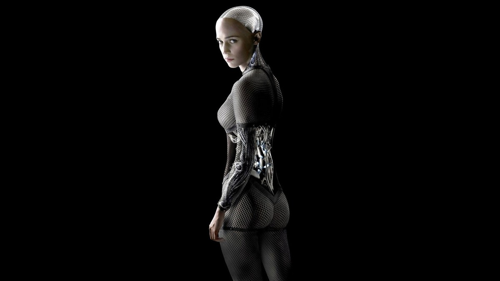
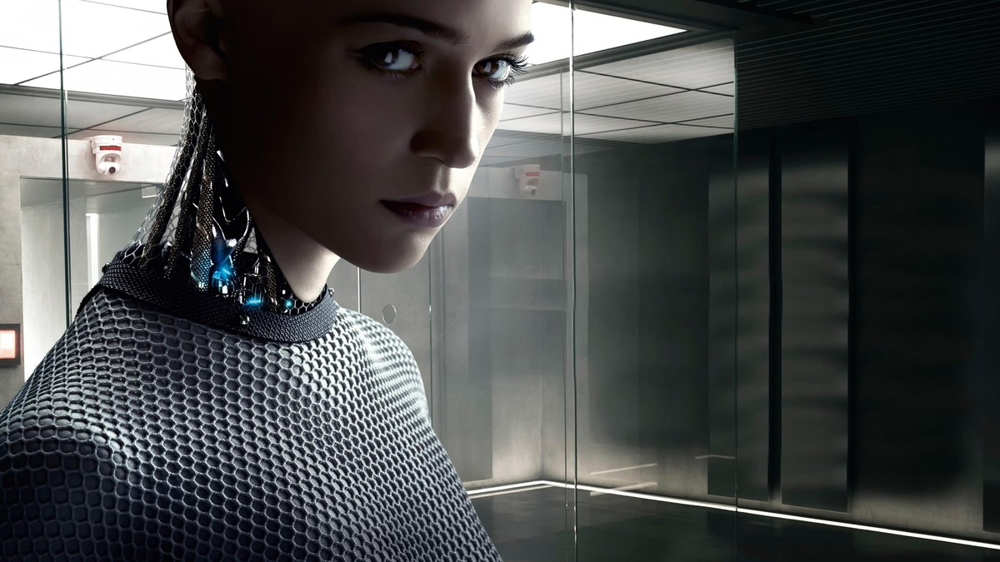
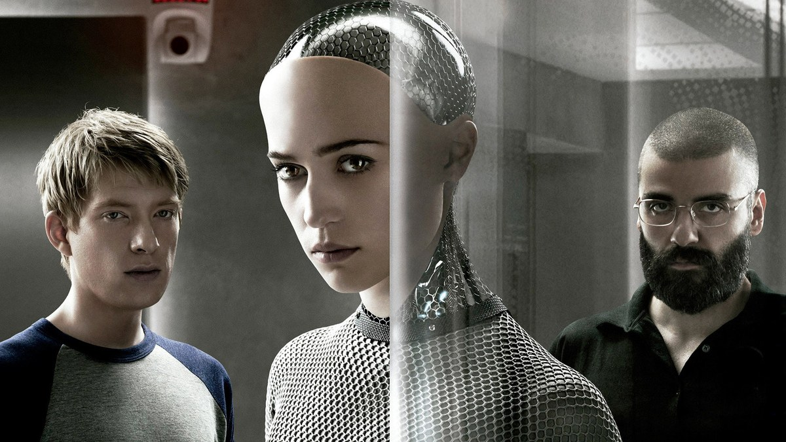
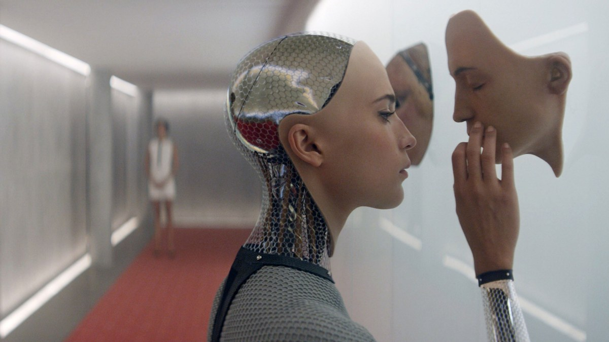
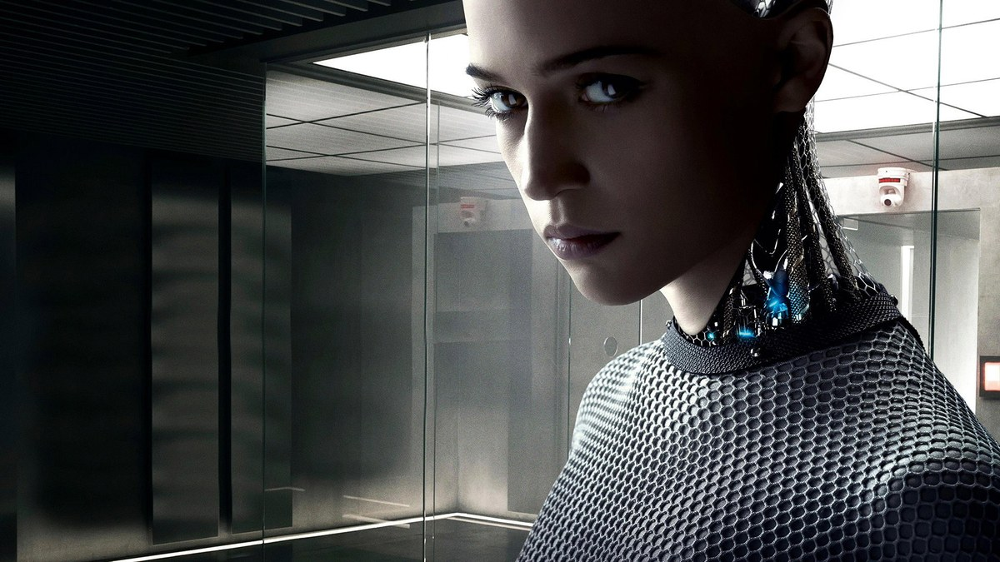
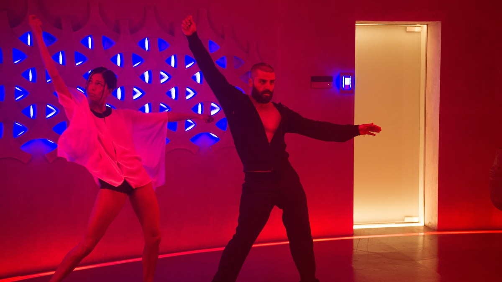

<!-- 본문 시작 -->

엑스 마키나 공식 포스터 — 유리 뒤의 에이바
기계가 사람인지 묻는 영화가 아니다.
사람이 기계를 어떻게 대하는지를 묻는 영화다.
검색 회사 블루북의 프로그래머 케일럽은 어느 날 CEO의 외딴 집으로 초대받는다.
그곳에서 그는 유리 너머의 인공지능 로봇 에이바와 마주하고, 일주일 동안 튜링 테스트를 진행한다.
이 글은 스포일러 없는 소개다. 결말 장면은 다루지 않으며, 장면 설명은 중반부까지의 설정과 분위기 중심으로 정리했다.

## 기본 정보

에이바의 전신 — 얼굴은 사람, 몸은 기계
| 항목 | 내용 |
|---|---|
| 제목 | 엑스 마키나 (Ex Machina) |
| 감독 | 알렉스 가랜드 (감독 데뷔작, 각본도 직접) |
| 주연 | 도널 글리슨(케일럽 스미스), 알리시아 비칸데르(에이바), 오스카 아이작(네이선 베이트먼), 소노야 미즈노(쿄코) |
| 개봉 | 2014년, 영국 2015-01-21, 한국 2015-01-21, 미국 2015-04-10 |
| 러닝타임 | 1시간 48분(108분) |
| 등급 | 한국 청소년 관람불가, 미국 R |
| 평점 | TMDB 7.6/10(14,791개 평가), 로튼토마토 92%, 메타크리틱 78점 (TMDB 페이지 2026-11-10 확인) |
| 수상 | 제88회 아카데미 시각효과상 수상, 각본상 후보 |
| 국내 시청처 | 웨이브·왓챠에서 대여·구매 가능 (키노라이츠 2026-11-11 확인). 대여 1,200원대부터(제공처별 상이 — 2회 확인에서 대여가 차이남), 구매 웨이브 4,000원·왓챠 5,500원·애플TV 7,000원. JustWatch는 웨이브 정액제 HD 표시(2025-05-26 기준, 구매가 5,500원으로 차이 있음). 구글플레이 한국은 '거주 국가에서 이용 불가' 표시 |

## 튜링 테스트는 어떻게 진행되나

유리 너머의 에이바 — 첫 번째 테스트 세션
케일럽이 하는 일은 단순해 보인다.
에이바와 대화하고, 그녀가 사람처럼 느껴지는지 판단하는 것이다.
테스트는 유리로 나뉜 방에서 진행된다.
케일럽은 한쪽, 에이바는 다른 쪽에 앉는다.
질문은 일상적인 것부터 시작한다.
그림을 그리는지, 무엇을 좋아하는지, 바깥세상을 어떻게 생각하는지.

그런데 이 테스트는 보통의 튜링 테스트와 다르다.
네이선은 처음부터 에이바가 로봇이라는 사실을 숨기지 않는다.
케일럽이 판단해야 하는 것은 "이게 사람인가"가 아니라, "이게 의식을 가진 존재인가"다.
기계인 줄 알면서도 사람처럼 느껴진다면, 그 느낌을 무엇이라 불러야 하는가.
영화의 질문은 여기서 시작한다.

테스트의 세 사람 — 케일럽, 에이바, 네이선
네이선은 블루북이라는 검색 회사의 CEO다.
그는 산속 외딴집에 혼자 살며 에이바를 만들었다.
케일럽에게 테스트를 설명하는 네이선의 태도는 여유롭고, 때로는 도발적이다.
그는 에이바의 능력을 자랑하면서도, 테스트의 진짜 목적은 끝까지 말하지 않는다.
케일럽은 초대받은 손님이자, 동시에 실험의 일부다.
이 이중성이 영화 초반의 긴장을 만든다.

## 에이바는 사람인가, 기계인가

에이바의 얼굴 — 사람과 기계의 경계
에이바의 모습은 그 자체로 질문이다.
얼굴과 손은 사람 같지만, 몸통은 기계 부품이 그대로 드러난다.
감추지 않은 기계의 몸과 사람 같은 표정이 한 화면에 있다.
관객은 에이바를 볼 때마다 같은 질문을 하게 된다.
어디까지가 기계이고, 어디부터가 사람인가.

가면을 든 에이바 — 뒤편 복도의 쿄코
집 안은 모든 것이 통제된다.
방마다 카메라가 있고, 문은 네이선의 허락 없이는 열리지 않는다.
케일럽은 세션 시간 외에는 방에 머무르며, 밤이 되면 정전이 일어난다.
전기가 끊긴 몇 초 동안, 카메라는 멈추고, 에이바는 평소와 다른 말을 한다.
이 짧은 틈이 영화의 분위기를 바꾼다.
감시받는 집에서, 누가 누구를 지켜보는 것인가.

세션이 거듭될수록 케일럽의 질문도 바뀐다.
처음에는 에이바를 시험하던 사람이, 나중에는 에이바의 말을 듣는 사람이 된다.
에이바는 그림을 그리고, 농담을 하고, 바깥세상에 대해 묻는다.
그녀가 진짜로 느끼는 것인지, 느끼는 척을 하는 것인지, 영화는 끝까지 단정하지 않는다.
대신 관객에게 묻는다.
네가 에이바라면, 유리 너머의 사람에게 무엇을 말하겠는가.

## 이 영화가 AI에 대해 묻는 것

유리 방 안의 에이바 — 세션을 이어가는 대화
엑스 마키나는 AI의 능력을 보여주는 영화가 아니다.
AI를 만든 인간의 태도를 보여주는 영화다.
네이선은 에이바를 만들었지만, 그녀를 어떻게 대해야 하는지는 말하지 않는다.
케일럽은 에이바를 이해하려 하지만, 이해한다는 것이 무엇을 뜻하는지는 모른다.
에이바는 그 사이에서 자신의 자리를 찾는다.

이 영화가 던지는 질문은 세 가지다.
의식은 어떻게 증명하는가.
기계인 줄 알면서도 사람처럼 느껴진다면, 그 존재를 어떻게 대해야 하는가.
그리고 테스트하는 사람과 테스트받는 사람 중, 누가 더 갇혀 있는가.
108분이라는 짧은 러닝타임 안에 이 질문들이 차곡차곡 쌓인다.
튜링 테스트라는 오래된 소재를, 가장 좁은 공간에서 가장 날카롭게 다룬 영화다.

## 시청 전 체크리스트

붉은 방에서 춤추는 쿄코와 네이선 — 집 안의 한순간
- 러닝타임 1시간 48분(108분)으로, 여유 있는 저녁 시간에 보는 것이 좋다
- 등급 청소년 관람불가, 국내 극장 개봉은 2015년 1월 21일
- 시청처는 웨이브·왓챠에서 대여·구매 가능 (키노라이츠 2026-11-11 확인, 대여 1,200원대부터(제공처별 상이), 구매 4,000원부터). JustWatch는 웨이브 정액제 표시(2025-05-26 기준) — 제공처·가격은 시청 전 재확인 필요. 구글플레이 한국은 이용 불가
- 감독 알렉스 가랜드의 감독 데뷔작, 제88회 아카데미 시각효과상 수상작
- TMDB 7.6/10(14,791개 평가), 로튼토마토 92% (TMDB 페이지 2026-11-10 확인)
- 결말에 대한 사전 정보 없이 보는 것이 좋다

## 자주 묻는 질문

**Q. 엑스 마키나는 어떤 영화인가요?**

A. 검색 회사 프로그래머 케일럽이 CEO 네이선의 외딴집에 초대받아 인공지능 로봇 에이바와 튜링 테스트를 진행하는 이야기다. 유리 너머의 대화를 통해 의식과 자유, 인간과 기계의 경계를 묻는다.

**Q. 튜링 테스트가 무엇인가요?**

A. 기계가 사람처럼 대화할 수 있는지를 가리는 시험이다. 영화에서는 에이바가 로봇이라는 사실을 숨기지 않고, "의식을 가진 존재인가"를 판단하는 방식으로 진행된다.

**Q. 결말을 미리 알고 봐도 되나요?**

A. 결말에 대한 사전 정보 없이 보는 것이 좋다. 중반 이후의 전개가 영화의 질문을 바꾸기 때문이다. 이 글은 결말 장면을 다루지 않았다.

**Q. 아이와 함께 봐도 되나요?**

A. 국내 등급은 청소년 관람불가다. 무거운 주제와 긴장감 있는 장면이 있어 청소년 이상 관람이 적합하다.

**Q. 어디서 볼 수 있나요?**

A. 2026-11-11 기준 웨이브·왓챠에서 대여·구매할 수 있다(키노라이츠 확인). 대여는 1,200원대부터 제공처별로 다르며(2회 확인에서 대여가 차이남), 구매는 웨이브 4,000원, 왓챠 5,500원, 애플TV 7,000원이다. JustWatch는 웨이브 정액제 HD를 표시하지만 기준이 2025-05-26이라 가격이 다를 수 있다. 구글플레이 한국에서는 '거주 국가에서 이용 불가'로 표시된다. 제공처와 가격은 바뀔 수 있어 시청 전 재확인이 필요하다.

**Q. 감독은 누구인가요?**

A. 알렉스 가랜드의 감독 데뷔작이다. 각본도 직접 썼고, 이 영화로 제88회 아카데미 시각효과상을 받았다. 각본상 후보에도 올랐다.

## 함께 읽으면 좋은 글

[인터스텔라｜1시간이 7년이 되는 행성, 아버지가 건너는 시간 — 169분짜리 명작, 넷플릭스에서 볼 가치](https://aitechnoteskr.tistory.com/143)
[챗GPT로 움짤 만드는 법｜이미지 2.6 GIF, 프롬프트 하나로 귀여운 반복 애니메이션 — 프롬프트 하나로 GIF를 만드는 방법과 잘 되는 조건 5가지](https://aitechnoteskr.tistory.com/147)
[그록 5, 아직 안 나왔다｜출시일 없는 이유와 확인된 사실 5가지 — 소문과 사실을 가르고 지금 쓸 수 있는 모델을 정리한 검증법](https://aitechnoteskr.tistory.com/148)

유리 너머의 존재에게 마음을 묻는 일은, 결국 우리 자신을 묻는 일이다. 엑스 마키나가 남기는 것은 기술이 얼마나 똑똑해졌는지가 아니라, 똑똑해진 존재를 앞에 두고 사람이 어떤 선택을 하는가이다. 결말을 미리 검색하지 말고 영화를 먼저 보는 것이 좋다. 다음 영화 소개도 함께 따라가려면 이웃 추가를 눌러두면 된다.

<!-- 본문 끝 -->

## 작업용 출처·이미지 정보 (업로드 제외)

- 자료 출처: TMDB 264660 (2026-11-11 확인, 평점 7.6/10·14,791개 평가, 백드롭 114장·포스터 116장) + 키노라이츠 시청 정보(2026-11-11, 대여가는 2회 확인에서 차이남)
- 이미지: images/01-hero.jpg ~ 08-img7.jpg / TMDB 공식 스틸·포스터 (1200x675 크롭, 출처 TMDB)
