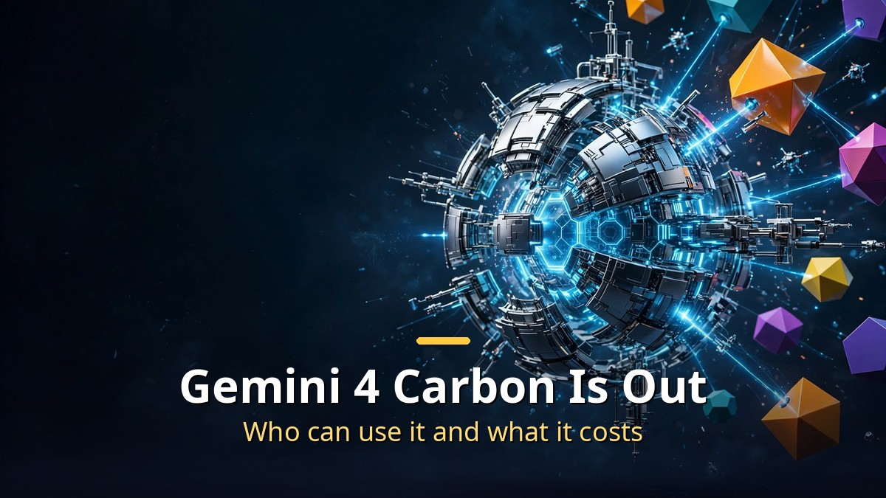
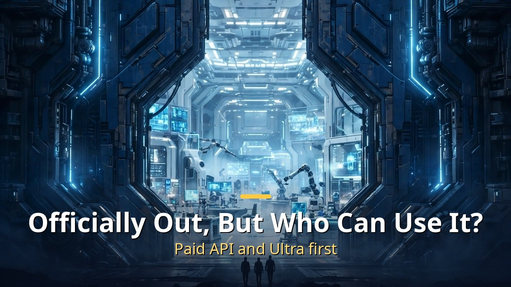
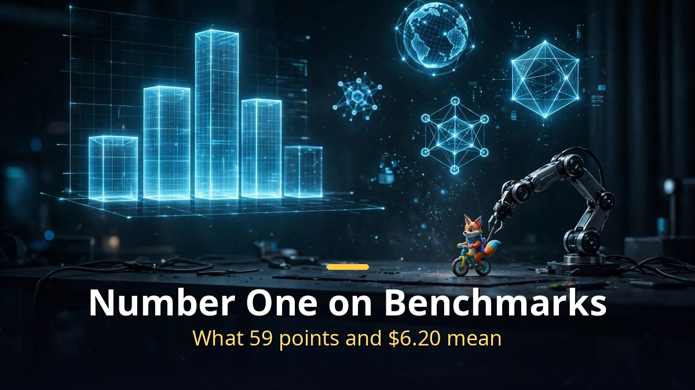
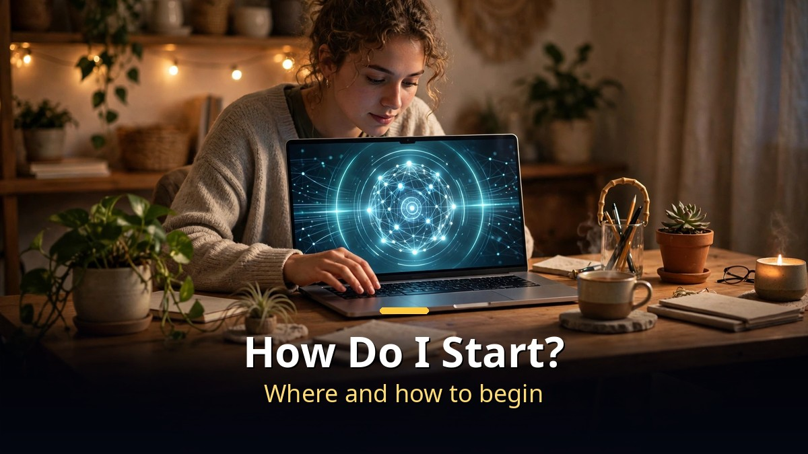

<!-- 본문 시작 -->

Gemini 4 Carbon is officially out.
But "officially out" does not mean everyone can use it.
This post is a source-based guide built on a video published on 2026-11-11, covering who can use Carbon now, what it costs, and when it makes sense next to Argon and Fable 5.2.

> **The point is simple. Carbon opened on November 10 to paid API users and AI Ultra subscribers, at $2 per million input tokens and $10 per million output tokens until November 30. Free users cannot use it yet, and its specialized security features stay limited to vetted institutions. So do not open the app expecting to find it.**

## Officially launched — but who can use it?

Carbon was first announced on October 28.
At that point only a specific security group could use it, and there was no public access.
Two weeks later, on November 10, Google widened access.

Three groups can use it now.
Developers can call Carbon through the paid Gemini API, AI Studio, and Android Studio.
Businesses can use it through Gemini for Business.
Among individuals, Google AI Ultra subscribers can pick Carbon in the Gemini app, AI Mode in Search, and Antigravity.

Free Gemini users still cannot use it.
That condition has to travel with the words "officially launched."
Being released and being available to everyone are two different things.

Security access is narrower still.
Carbon's specialized cybersecurity features open only to vetted institutions through Google's Fairwind Program.
A public release does not mean the security features are public too.

It helps to place Carbon in the lineup.
Carbon is the successor to Argon.
Argon was announced on September 30 and reached the app and the paid API on October 13; Carbon was announced 15 days later.
Google describes Carbon as its strongest model for cybersecurity and long-horizon agent work.

## Number one on benchmarks — but the demos say more

The numbers first.
On the Artificial Analysis Intelligence Index v5, Carbon scores 59 and Argon 50.
Carbon ranks first, one point ahead of Claude Opus 5.5.
But Fable 5.2 is missing from that index, so "number one" needs the qualifier "on this index."

On Terminal-Bench 4.0, Carbon scored 65.2%.
According to the video, that is higher than Opus 5.5.
By benchmarks alone, Carbon is one of the strongest models available now.

The video spends more time on demos than on benchmarks, though.
There is a reason.
Gemini has long heard the complaint that its benchmarks are good but its results are not.
These demos answer that complaint directly.

The most striking one is Swarm, a new feature in Antigravity.
It calls several agents at once and gives each one a job.
Given historical photos and blueprints, the agents predicted how the Eiffel Tower's short pillars would stack up and completed the full shape.
Given seven city-planning PDFs, they built detailed buildings.

There are also 3D assets made in Blender.
They took six to seven hours to build, but the results simulated machines that actually work, down to the structure.
A scene of lanterns floating on a river kept the moonlit shadow play intact.

A cost comparison appears too.
For one pixel-art animation shown in the video, the Fable 5.2 version cost $18 and the Carbon version cost $6.20.
At a glance the two results look close, but the price is about a third.
In a shark-image comparison, Carbon cost half as much as Opus.
This comparison is the video's own example, not an official head-to-head under identical conditions.

| Model | Intelligence Index | Terminal-Bench 4.0 | Input per 1M tokens | Output per 1M tokens |
| --- | --- | --- | --- | --- |
| Gemini 4 Carbon | 59 (1st) | 65.2% | $2 | $10 |
| Gemini 4 Argon | 50 | — | $2 | $10 |
| Claude Opus 5.5 | 58 | Lower than Carbon | $4 | $20 |

Carbon costs half as much as Opus 5.5.
But Carbon's price is an introductory rate until November 30.
From December 1 it rises to $4 input and $20 output.
Cached input is discounted 95% off the input price.

## How do I start, if I can use it?

If you are eligible, starting is simple.
Developers pick Carbon in AI Studio.
Ultra subscribers find Carbon under Argon in the Gemini app's model picker.
It is also available in Antigravity.

There are three thinking levels: low, medium, and high.
The video recommends "high" for benchmark-like results and the best quality.
The deeper it thinks, the better the result.

The creator also ran his own benchmarks.
He made a 3D asset of a quokka riding a unicycle, then added juggling so it rides while tossing three balls.
A simple prompt, yet the motion stayed natural.
He also built a quokka website that switches between Korean and English, pulls in outside information like habitat details, and lets you drag the result around inside Canvas.

What this benchmark shows is one thing.
Carbon is strong at long-horizon work that takes many steps: building a 3D asset from a few photos, raising buildings from several PDFs, filling in a website.
For a single short question, there is little reason to reach for Carbon.
Argon or a lighter model is enough for that kind of job.

So the rule for choosing is simple.
Use Carbon when you need long agent work or heavy building like 3D and simulation.
But use it in November to get the introductory price.
If you are a free user, trying the same job on Argon first is the realistic move.
[This comparison of Fable 5.2 and Opus 5.5 across four experiments](https://aitechnotesen.blogspot.com/2026/11/fable-52-vs-opus-55-4-experiments-that.html) also helps clarify when an expensive model is worth picking.

A checklist before you start:
Check first whether your account is a paid API user or an Ultra subscriber.
If the job needs security features, check whether you are a Fairwind candidate.
Remember the price doubles after November 30.
And start with the thinking level set to "high."

## Closing thoughts
Following the Carbon news, one thought kept coming back: the model name matters less than who can use it.
The word "launch" is only ever half true.
It opens for some people and stays closed for others.
Carbon was the same.
The condition — paid API and Ultra subscribers first — mattered more than the number-one benchmark score.
Still, reaching the public in two weeks is a pace worth watching.
When the next model comes, I will be checking whether it can pass Fable 5.2 too, and at the same speed.

## Frequently asked questions
**Can I use Gemini 4 Carbon for free?**
Not now.
Paid API users, AI Ultra subscribers, and business customers can use it first.
Free users cannot use it yet.

**What does it cost?**
Until November 30, 2026, it is $2 per million input tokens and $10 per million output tokens.
From December 1, it rises to $4 input and $20 output.

**How is it different from Argon?**
Carbon is Argon's successor, ranking first on the Intelligence Index with 59 points against Argon's 50.
Google presents Carbon as its strongest model for long-horizon agent work and cybersecurity.

**What is Antigravity Swarm?**
A feature that calls multiple AI agents at once and assigns each one a job.
It splits long jobs — making a 3D asset from photos and blueprints, or building from several PDFs — across agents.

**Is it better than Fable 5.2?**
Fable 5.2 is missing from the Intelligence Index, so there is no direct comparison.
In the video's pixel-art example, Carbon cost $6.20 and Fable 5.2 cost $18.
That is the video's own example, not an official comparison under identical conditions.

## Good reads
[Claude Fable 5.2: What Actually Changed — An OS in 8 Days, Fermat in 30 Hours](https://aitechnotesen.blogspot.com/2026/11/claude-fable-52-what-actually-changed.html)
[Ex Machina — 108 Minutes Asking a Robot If It Has a Mind](https://aitechnotesen.blogspot.com/2026/11/ex-machina-108-minutes-asking-robot-if.html)
[Fable 5.2 vs Opus 5.5 — 4 Experiments That Show the Difference and What It Costs](https://aitechnotesen.blogspot.com/2026/11/fable-52-vs-opus-55-4-experiments-that.html)

If you have tried Gemini 4 Carbon, tell me in the comments what you used it for.
To keep following this topic, subscribe and stay tuned — I will cover the next model news the same way.

<!-- 본문 끝 -->

## 작업용 출처·이미지 정보 (업로드 제외)

- Source: 성공지식백과 영상 v65FQ_za4fM(2026-11-11, 9분 06초, 자막 0:00~8:58 확인) + 구글 카본 발표(2026-10-28) 및 11-10 확대 출시 대조
- Images: images/01-hero-en.jpg ~ 04-img3-en.jpg / original illustration + English banner overlay (1200x675)
