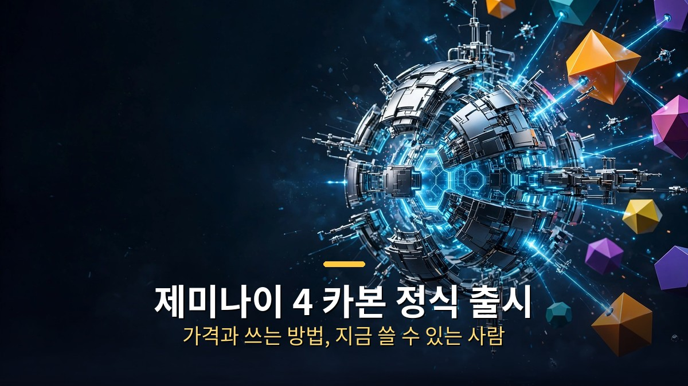
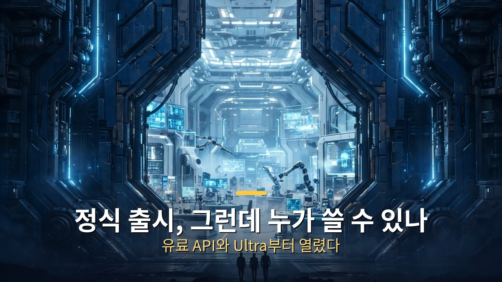
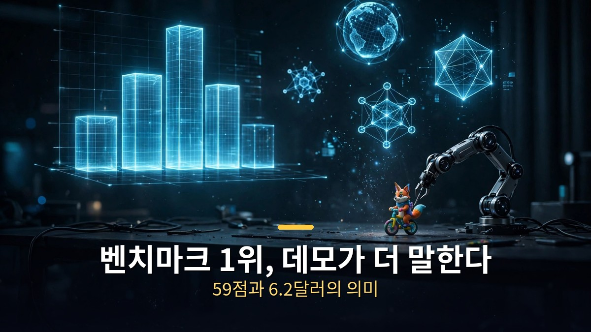

<!-- 본문 시작 -->

제미나이 4 카본이 정식으로 나왔다.
그런데 '정식 출시'라고 해서 누구나 쓸 수 있는 건 아니다.
이 글은 2026년 11월 11일에 공개된 영상을 바탕으로, 카본을 지금 쓸 수 있는 사람과 가격, 그리고 아르곤·페이블 5.2와 비교했을 때 어떤 일에 써야 하는지를 정리한 자료 기반 안내다.

> **핵심은 하나다. 카본은 11월 10일부터 유료 API와 AI Ultra 구독자에게 열렸고, 가격은 11월 30일까지 입력 100만 토큰당 2달러·출력 10달러다. 무료 사용자는 아직 쓸 수 없고, 특수 보안 기능은 검증된 기관에만 열려 있다. 그러니 '출시됐다'는 말만 보고 앱을 켜면 안 된다.**

## 정식 출시, 그런데 누가 쓸 수 있나?

카본은 10월 28일에 처음 발표됐다.
그때는 특정 보안 그룹만 쓸 수 있었고, 일반 공개는 안 된 상태였다.
발표 2주 만인 11월 10일, 구글이 접근을 넓혔다.

지금 쓸 수 있는 사람은 세 갈래다.
개발자는 유료 제미나이 API와 AI Studio, 안드로이드 스튜디오에서 카본을 부를 수 있다.
기업은 제미나이 for business로 쓴다.
개인 중에서는 구글 AI Ultra 구독자가 제미나이 앱과 검색 AI 모드, 안티그래비티에서 카본을 고를 수 있다.

무료 제미나이 사용자는 아직 선택지에 카본이 없다.
이 점이 '정식 출시'라는 말과 함께 꼭 붙어야 하는 조건이다.
공개가 됐다는 것과 모두가 쓸 수 있다는 것은 다른 말이다.

보안 쪽은 문이 더 좁다.
카본의 전문 사이버 보안 기능은 구글의 페어윈드 프로그램을 통과한 검증 기관에만 열린다.
일반 공개가 보안 기능까지 푼다는 뜻은 아니다.

카본이 어디에 서 있는지도 짚고 넘어가자.
카본은 아르곤의 다음 모델이다.
아르곤은 9월 30일에 발표돼 10월 13일부터 앱과 유료 API에 들어왔고, 카본은 그로부터 15일 뒤에 발표됐다.
구글은 카본을 "사이버 보안과 긴 호흡의 에이전트 작업에서 가장 강한 모델"이라고 소개한다.

## 벤치마크 1위, 그런데 데모가 더 말한다

숫자부터 보자.
종합지능 지수(Artificial Analysis Intelligence Index v5)에서 카본은 59점, 아르곤은 50점이다.
카본이 1위이고, 오퍼스 5.5보다 1점 앞선다.
다만 이 지수에는 페이블 5.2가 빠져 있다.
그래서 '1위'라는 말 뒤에는 '이 지수 기준'이라는 단서가 붙는다.

터미널벤치 4.0에서는 카본이 65.2%를 기록했다.
영상에 따르면 오퍼스 5.5보다 높은 점수다.
벤치마크만 보면 카본은 지금 가장 센 모델 중 하나다.

그런데 영상은 벤치마크보다 데모에 시간을 더 쓴다.
이유가 있다.
제미나이는 그동안 '벤치마크만 좋고 결과물은 아쉽다'는 말을 들어왔기 때문이다.
이번 데모들은 그 말을 겨냥한다.

가장 눈에 띄는 건 안티그래비티의 새 기능 '스웜'이다.
여러 에이전트를 한꺼번에 불러 각자 일을 맡기는 기능이다.
역사적 사진과 설계도면을 주고 에펠탑을 만들게 하자, 에이전트들이 사진 속 짧은 기둥을 예측해 쌓아 올리며 전체 형상을 완성했다.
도시계획 PDF 7개를 주고 건물을 만들게 한 결과도 디테일이 살아 있었다.

블렌더로 만든 3D 에셋도 있다.
만드는 데 6~7시간이 걸렸지만, 기계가 제대로 돌아가는 구조까지 시뮬레이션한 결과물이었다.
강가에 띄운 연등 장면에서는 달빛에 비친 그림자 표현까지 살아 있었다.

비용 비교도 나왔다.
영상에 나온 픽셀아트 애니메이션 한 장면 기준으로, 페이블 5.2가 만든 결과물은 18달러, 카본이 만든 결과물은 6.2달러가 들었다고 한다.
얼핏 보면 큰 차이가 느껴지지 않는 결과물인데 값은 3분의 1 수준이라는 얘기다.
상어 이미지 비교에서는 오퍼스와 카본의 값 차이가 2배, 카본이 반값이라고 했다.
이 비교는 영상에 나온 사례를 그대로 옮긴 것이고, 같은 프롬프트·같은 조건의 공식 대조는 아니다.

| 모델 | 종합지능 지수 | 터미널벤치 4.0 | 입력 100만 토큰 | 출력 100만 토큰 |
| --- | --- | --- | --- | --- |
| 제미나이 4 카본 | 59점 (1위) | 65.2% | 2달러 | 10달러 |
| 제미나이 4 아르곤 | 50점 | — | 2달러 | 10달러 |
| 클로드 오퍼스 5.5 | 58점 | 카본보다 낮음 | 4달러 | 20달러 |

가격은 카본이 오퍼스 5.5의 반값이다.
다만 카본의 가격은 11월 30일까지의 도입가다.
12월 1일부터는 입력 4달러·출력 20달러로 오른다.
캐시된 입력은 입력 가격의 95%를 할인받는다.

## 나도 써보려면, 어디서 어떻게 시작하나?

쓸 수 있는 사람이라면 시작은 간단하다.
개발자는 AI Studio에서 카본을 고르면 된다.
Ultra 구독자는 제미나이 앱의 모델 선택지에서 아르곤 아래에 생긴 카본을 고르면 된다.
안티그래비티에서도 쓸 수 있다.

사고 수준은 세 가지다.
낮음·보통·높음 중 고를 수 있는데, 영상에서는 벤치마크에 가까운 결과물과 좋은 품질을 원하는 사람에게 '높음'을 권한다.
생각을 더 깊게 할수록 결과물이 좋아지는 구조다.

제작자는 자기만의 벤치마크도 만들어 봤다.
쿼카가 외발자전거를 타는 3D 에셋을 만들고, 저글링을 추가하면 세 개의 공을 던지며 타는 모습까지 이어지게 했다.
단순한 프롬프트였는데도 동작이 자연스럽게 이어졌다고 한다.
쿼카 웹사이트도 만들었는데, 한국어와 영어로 바꾸면 설명이 바뀌고, 서식지 같은 외부 정보를 긁어와 내용을 채웠다.
캔버스 기능 안에서는 결과물을 드래그해 확인할 수 있었다.

이 벤치마크가 말해주는 건 하나다.
카본은 긴 호흡의 작업, 여러 단계를 거쳐야 하는 일에 강하다.
사진 몇 장으로 3D 에셋을 만들고, PDF 여러 개로 건물을 짓고, 웹사이트를 채우는 식이다.
짧은 질문 하나에 답하는 용도라면 굳이 카본을 쓸 이유가 적다.
아르곤이나 더 가벼운 모델로도 충분한 일이 많다.

그래서 고르는 기준은 이렇게 정리된다.
긴 에이전트 작업과 3D·시뮬레이션 같은 무거운 만들기가 필요하면 카본을 쓴다.
단, 11월 안에 써야 도입가를 적용받는다.
지금 무료 사용자라면 카본을 기다리기보다 아르곤으로 같은 일을 먼저 해보는 게 현실적이다.
[페이블 5.2와 오퍼스 5.5를 실험 4번으로 비교한 글](https://aitechnoteskr.tistory.com/153)도 함께 보면, 비싼 모델을 언제 골라야 하는지 기준이 더 분명해진다.

시작 전 체크리스트도 있다.
내 계정이 유료 API 사용자나 Ultra 구독자인지 먼저 확인한다.
보안 기능이 필요한 일이라면 페어윈드 대상인지 확인한다.
11월 30일 이후 가격이 두 배가 된다는 점을 염두에 둔다.
그리고 사고 수준은 '높음'부터 써본다.

## 마무리
카본 소식을 따라가면서 든 생각은, 모델 이름보다 '누가 쓸 수 있나'가 먼저라는 것이다.
출시라는 말은 늘 반쯤만 맞다.
누군가에게는 열리고, 누군가에게는 아직 닫혀 있기 때문이다.
카본도 그랬다.
벤치마크 1위라는 숫자보다, 유료 API와 Ultra 구독자부터 열렸다는 조건이 더 중요했다.
그래도 2주 만에 공개까지 온 속도는 눈여겨볼 만하다.
다음 모델이 나올 때 페이블 5.2까지 앞지를 수 있을지, 그때도 같은 속도로 따라가 보려고 한다.

## 자주 묻는 질문
**제미나이 4 카본은 무료로 쓸 수 있나요?**
지금은 아니다.
유료 API 사용자와 AI Ultra 구독자, 기업 고객부터 쓸 수 있다.
무료 사용자는 아직 쓸 수 없다.

**가격은 얼마인가요?**
2026년 11월 30일까지 입력 100만 토큰당 2달러, 출력 10달러다.
12월 1일부터는 입력 4달러, 출력 20달러로 오른다.

**아르곤과 뭐가 다른가요?**
카본은 아르곤의 다음 모델로, 종합지능 지수 59점으로 1위다.
아르곤은 50점이다.
구글은 카본을 긴 호흡의 에이전트 작업과 사이버 보안에 가장 강한 모델로 소개한다.

**안티그래비티 스웜은 무엇인가요?**
여러 AI 에이전트를 한꺼번에 불러 각자 일을 맡기는 기능이다.
사진과 설계도면으로 3D 에셋을 만들거나, PDF 여러 개로 건물을 짓는 식의 긴 작업을 나눠 처리한다.

**페이블 5.2보다 좋은가요?**
종합지능 지수에는 페이블 5.2가 빠져 있어 직접 비교가 안 된다.
영상에 나온 픽셀아트 사례에서는 카본이 6.2달러, 페이블 5.2가 18달러로 비용 차이가 났다.
다만 같은 조건의 공식 대조는 아니다.

## 함께 읽으면 좋은 글
[클로드 페이블 5.2, 뭐가 달라졌나 — 8일 만에 운영체제, 30시간 만에 페르마 정리](https://aitechnoteskr.tistory.com/155)
[엑스 마키나｜로봇에게 마음을 묻는 108분, 튜링 테스트의 진짜 질문](https://aitechnoteskr.tistory.com/156)
[마이너리티 리포트｜아직 일어나지 않은 범죄를 체포하는 나라, 예언은 틀릴 수 있다](https://aitechnoteskr.tistory.com/150)

제미나이 4 카본을 써보셨다면, 어떤 일에 썼는지 댓글로 알려주세요.
이 주제를 계속 따라가려면 이웃 추가를 눌러두세요.
다음 모델 소식이 나올 때 또 정리해서 가져오겠습니다.

<!-- 본문 끝 -->

## 작업용 출처·이미지 정보 (업로드 제외)

- 자료 출처: 성공지식백과 영상 v65FQ_za4fM(2026-11-11, 9분 06초, 자막 0:00~8:58 확인) + 구글 카본 발표(2026-10-28) 및 11-10 확대 출시 대조
- 이미지: images/01-hero.jpg ~ 04-img3.jpg / 자작 일러스트 + 한글 배너 오버레이 (1200x675)
