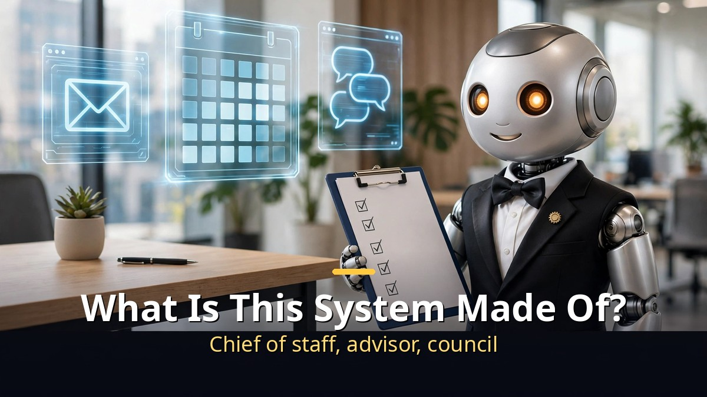
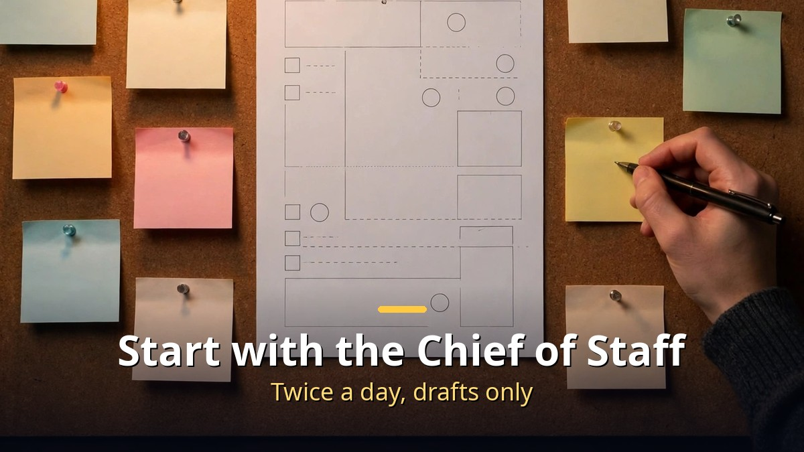
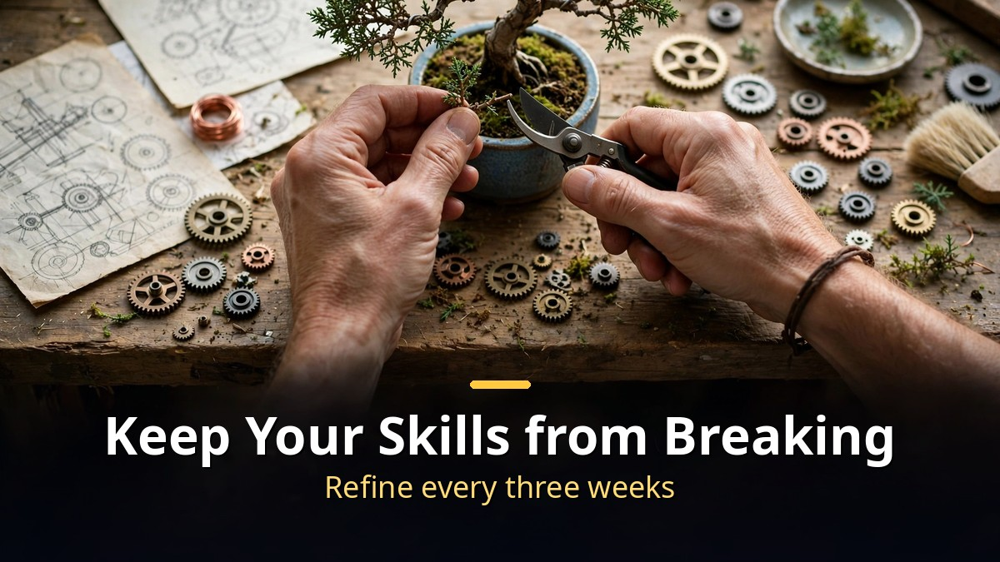

<!-- 본문 시작 -->

One person runs an entire business with a single AI system.
Email, calendar, podcast prep, video editing, even weekend plans with the kids — the AI sorts it first.
This post is a source-based guide built on a video published on 2026-11-11, taking apart Peter Yang's AI system and showing where to start if you want to build your own.

> **The point is simple. The system is not one giant AI, but a bundle of small jobs: a chief of staff, an advisor, content work, and scheduled tasks. Get a briefing twice a day, write a one-page yearly plan by hand, and refine your skills every three weeks. So do not try to build it all. Start with the one job that would actually save you time.**

## What is this system made of?

The person is Peter Yang.
He spent more than ten years as a product manager in the Bay Area, most recently at Roblox.
In June 2026 he quit to become a full-time creator.
The reason was simple: keeping up with AI and building with it had itself become a full-time job.

His system has three layers.
At the top are three things that run his life and his business.
A chief of staff, an advisor, and a council.

The chief of staff moves twice a day, at 7 a.m. and 4 p.m.
It reads his email, calendar, and Slack and tells him what needs attention.
The advisor checks decisions against his goals for the year.
The council gathers several AI perspectives before a big decision.

Below that sits the content system.
Researching podcast guests, building an interview guide he can actually send, titles and thumbnails, video editing, and turning one recording into a newsletter and social posts.
Below that are scheduled tasks.
Business numbers, a fitness check-in, even ideas for things to do with his kids on the weekend — all arriving by email.
Last is the skill editor.
Its whole job is keeping his other skills clean.

He uses three tools: ChatGPT, Claude Code, and Grokbot.
All three share the same skills.
A skill is a saved set of instructions for one job, so he does not have to explain himself from scratch every time.
When the model changes, the skills carry over.

As Peter puts it, the harness matters more than the model.
Models change every week, but skills and automations tuned to your own work stay.
That is why he tells people not to chase new models, but to build a personal AI system that saves their time and money.

Models are split by job.
Opus 5.5 is strong at video editing and motion graphics.
ChatGPT's computer use is best for filling out forms in the browser.
Scheduled tasks go to Grokbot.
Grokbot runs on a virtual machine, so it works when his own computer is off, and its X integration helps with research.
Writing goes to Claude, which matches his voice best.

## Start with the chief of staff

You do not need to copy the whole system.
Start with the chief of staff alone.
Its job is simple.
Look at the last 24 hours of email, today's and tomorrow's calendar, and Slack, then return a numbered list, most important first.
Each item gets one line, a link, and a suggested next step.

The prompt looks like this:
"You are my chief of staff. Look at my email from the last 24 hours, my calendar for today and tomorrow, and my Slack. Give me a numbered list of what needs my attention, most important first. For each item, one line on what it is, a link, and your suggested next step. Skip newsletters, promos, and anything that does not need me. When I reply with numbers, do what I say for each one. Draft emails, but never send them without me."

Add two more devices to it.
First, schedule it to run on weekday mornings at 8:30 a.m., in the cloud, so it runs when your computer is off.
Second, add one line at the end of the morning briefing:
"Review my chats, my connected sources, and your memory, and tell me something special or unique you notice about me that I have not realized about myself yet. Be honest — you do not have to be positive."
That line comes straight from Peter's own suggestion.

The safety rule is clear.
The AI drafts emails only; the person reviews and sends.
Peter says he almost never lets it send one by itself — he always reviews first.
Editing a draft is far faster than writing from scratch.
The same applies inside Claude Code or ChatGPT: you can write, edit, and send email from there, but the person presses send.

The advisor works differently — once a month, not every day.
Checking direction does not need to happen often.
Its reference is a one-page yearly plan: this year's goals, what he is not doing this year, what gives him energy, what drains him, and the family things that are non-negotiable.
The person writes this document, not the AI.
The AI may suggest changes but never make them.
Peter calls it his "slop free zone."
An advisor only works when the standard it measures against is written by a human hand.

The council is for big decisions only.
Ask several AI perspectives the same question and compare the answers.
It is a device for decisions too heavy to make alone.

## How to keep your skills from breaking

The smartest part of the system is the skill editor.
Skills invite constant tinkering.
Every time the AI gets something wrong, you want to add "do it like this next time."
Do that after every conversation and the skill fills up with one-off rules.
So Peter does not fix skills on the spot.

Instead, he looks at three weeks of conversations at once.
He gathers his podcast threads and asks: "Look at all the feedback I gave these skills over the past three weeks, and pick out what I keep repeating."
Then the AI finds patterns.
For his short-form video skill, nine edits and thirteen rounds produced four recurring notes: B-roll that does not show what is being said, white text that repeats the subtitles or covers the B-roll, sound effects and number animations out of sync.
Only those go into the skill.
What becomes a rule is what keeps repeating, not a single mistake.

Video editing follows the same pattern.
Peter built a tool that works like frame.io: watch the video, leave a note at a timestamp — "change this at five minutes" — and the agent fixes it.
Shorts of about a minute to a minute and a half can now be made almost in one shot.
Long-form video still goes to a human editor, and so does the podcast.

The podcast prep skill is worth a look too.
Give it four things: who the guest is, what you are talking about, who the audience is, and the format of the interview.
The AI researches the guest, pulls out top insights, suggests thumbnail angles from screenshots of what is working, and builds an interview guide.
The guide is a set of questions that build on each other like a conversation, not a questionnaire.
Titling is the one thing Peter does not hand to AI.
He says AI is still bad at titles.

Scheduled tasks run on the same principle.
A weekly business review email summarizes sales and newsletter flow.
A weekend email searches local mom blogs for things to do with the kids.
A fitness app takes lifting stats through MCP and sends a summary.
All of it follows one rule: one bot per job.
For every bot, define its purpose, what it needs to do the job, and what good looks like.
If it recurs, add when it runs and where it sends the results.
A bass coach bot, for example, reads a practice-log spreadsheet and sends a check-in every Sunday at 6:30 p.m.

The line Peter stressed most comes last.
A human reviews everything the AI changes.
Newsletter or skill, he asks for the exact before-and-after copy as a numbered list and reads each one.
What makes sense stays; what does not gets dropped.
Anything customer-facing gets human eyes first.
That one line is the safety device for the whole system.

[How to start Claude for free, and the 5 drawbacks to check first](https://aitechnotesen.blogspot.com/2026/11/start-claude-for-free-what-you-get-what.html) is a useful companion read — it shows which plan you can start a chief of staff on.

## Closing thoughts
What stayed with me from this video was not the size of the system, but the way to start it.
Do not build everything. Start with the one job that saves time.
That line kept coming back.
One chief of staff, one skill, one scheduled task.
A small start, refined every three weeks, looks more likely to last than a grand automation.
I pictured the morning scene — today's work already listed before opening the inbox — and it felt closer to real than I expected.
That is why my hands moved a little faster while writing this up.

## Frequently asked questions
**What do I need to build an AI chief of staff?**
Connections to email, calendar, and Slack, plus a schedule that sends a briefing twice a day.
One tool — Claude Code, ChatGPT, or Grokbot — is enough to start.

**Which model should I use?**
It depends on the job.
The video presents Opus 5.5 for video editing, ChatGPT for browser work, and Grokbot for scheduled tasks.
Peter's point is that the harness matters more than the model.

**Is automatic email sending safe?**
The video does not use it.
The AI drafts only, and the person reviews before sending.
That rule is the system's safety device.

**How do I maintain my skills?**
Do not fix them after every mistake.
Gather three weeks of conversations, pick out the feedback that repeats, and add only that to the skill.
One mistake turned into a rule fills a skill with one-off rules.

**Does this work if I am not working alone?**
Yes.
The chief of staff, advisor, and scheduled-task structure works with a team too.
This video simply shows a one-person business as the example.

## Good reads
[Start Claude for Free: What You Get, What You Don't, and 5 Drawbacks to Check First](https://aitechnotesen.blogspot.com/2026/11/start-claude-for-free-what-you-get-what.html)
[Ex Machina — 108 Minutes Asking a Robot If It Has a Mind](https://aitechnotesen.blogspot.com/2026/11/ex-machina-108-minutes-asking-robot-if.html)
[Fable 5.2 vs Opus 5.5 — 4 Experiments That Show the Difference and What It Costs](https://aitechnotesen.blogspot.com/2026/11/fable-52-vs-opus-55-4-experiments-that.html)

To keep following this topic, subscribe and stay tuned — the next post covers another hands-on AI workflow.

<!-- 본문 끝 -->

## 작업용 출처·이미지 정보 (업로드 제외)

- Source: Matt Wolfe 영상 pvl3z_GyU2Y(2026-11-11, 27분 43초, 자막 0:00~27:37 확인)
- Images: images/01-hero-en.jpg ~ 04-img3-en.jpg / original illustration + English banner overlay (1200x675)
