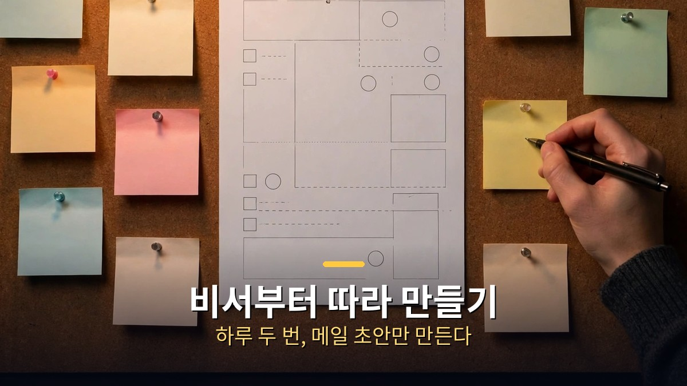
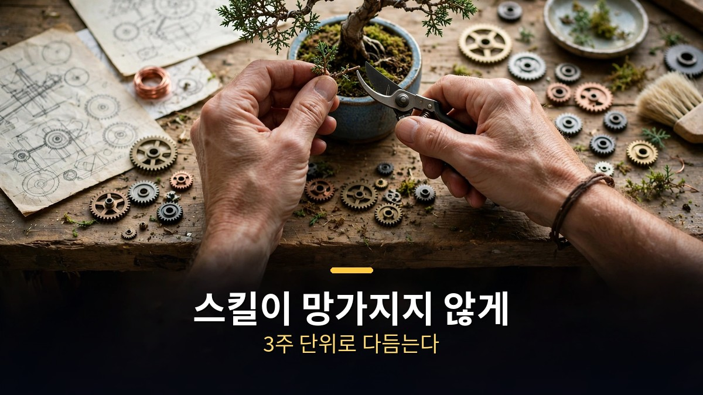

<!-- 본문 시작 -->

혼자 일하는 사업가 한 명이 AI 시스템 하나로 사업을 돌린다.
메일·일정·팟캐스트 준비·영상 편집·주말 가족 계획까지, AI가 먼저 정리해 준다.
이 글은 2026년 11월 11일에 공개된 영상을 바탕으로, 피터 양의 AI 시스템을 뜯어보고 나도 따라 만들려면 어디서부터 시작해야 하는지를 정리한 자료 기반 안내다.

> **핵심은 하나다. 시스템은 거창한 AI 하나가 아니라, 비서·고문·콘텐츠·예약 작업이라는 작은 일들의 묶음이다. 하루 두 번 보고를 받고, 한 페이지짜리 연간 계획을 손으로 쓰고, 스킬은 3주 단위로 다듬는다. 그러니 전부 만들려 하지 말고, 시간을 아껴주는 일 하나부터 시작하면 된다.**

## 이 시스템은 무엇으로 짜여 있나?

주인공은 피터 양이다.
베이 에어리어에서 10년 넘게 프로덕트 매니저로 일했고, 마지막 직장은 로블록스였다.
2026년 6월에 회사를 그만두고 크리에이터로 전업했다.
이유는 간단했다.
AI를 따라가며 직접 만져보는 일 자체가 전업이 될 만큼 커졌기 때문이다.

그가 만든 시스템은 세 층으로 나뉜다.
맨 위에는 일과 삶을 운영하는 세 가지가 있다.
비서, 고문, 그리고 자문단이다.

비서는 하루 두 번, 오전 7시와 오후 4시에 움직인다.
메일과 캘린더, 슬랙을 읽고 오늘 처리해야 할 일을 알려준다.
고문은 1년 목표와 비교해 결정을 점검한다.
자문단은 여러 AI 관점을 모아 큰 결정을 앞두고 의견을 묻는 자리다.

그 아래에는 콘텐츠 시스템이 있다.
팟캐스트 게스트 조사, 보낼 수 있는 인터뷰 가이드 만들기, 제목과 썸네일, 영상 편집, 녹음 한 번으로 뉴스레터와 소셜 글까지 만드는 일이다.
그 아래에는 예약 작업이 있다.
사업 수치 정리, 운동 체크인, 주말에 아이들과 할 일 아이디어까지 메일로 도착한다.
맨 마지막에는 스킬 에디터가 있다.
다른 스킬들을 깨끗하게 유지하는 게 이 스킬의 일이다.

도구는 세 가지다.
챗GPT, 클로드 코드, 그록봇이다.
세 도구가 같은 스킬을 함께 쓴다.
스킬이란 한 가지 일을 위한 저장된 지시 모음이다.
매번 처음부터 설명하지 않아도 되게 해준다.
모델이 바뀌어도 스킬은 그대로 가져갈 수 있다.

피터의 말대로, 도구가 모델보다 중요하다.
모델은 매주 바뀌지만, 내 일에 맞춘 스킬과 자동화는 남는다.
그래서 그는 남들에게도 이렇게 권한다.
새 모델을 쫓아다니지 말고, 내 시간을 아껴주는 나만의 AI 시스템을 만들라고.

모델은 일마다 나눠 쓴다.
영상 편집과 모션그래픽에는 오퍼스 5.5가 강하다.
브라우저에서 양식을 채우는 일에는 챗GPT의 컴퓨터 사용 기능이 좋다.
예약 작업은 그록봇에 맡긴다.
그록봇은 가상머신에서 돌아가 내 컴퓨터가 꺼져 있어도 되고, X 연동으로 조사도 한다.
글쓰기는 클로드가 맡는다.
자기 목소리에 가장 가깝다고 한다.

## 비서부터 따라 만들기

전체를 따라 만들 필요는 없다.
비서 하나부터 시작하면 된다.
비서가 하는 일은 단순하다.
지난 24시간 메일과 오늘·내일 캘린더, 슬랙을 보고 가장 중요한 순서대로 번호를 매긴 목록을 준다.
각 항목마다 한 줄 설명과 링크, 다음 단계를 붙인다.

프롬프트는 이렇게 짠다.
"너는 내 비서다. 지난 24시간 메일, 오늘과 내일 캘린더, 슬랙을 보고 가장 신경 써야 할 일을 순서대로 번호 목록으로 줘. 각 항목은 한 줄 설명과 링크, 권하는 다음 단계를 붙여줘. 뉴스레터와 광고는 빼줘. 내가 번호로 답하면 그 지시를 따라줘. 메일은 초안만 만들고, 내가 확인하기 전에는 절대 보내지 마."

여기에 두 가지 장치를 더한다.
하나는 매주 평일 오전 8시 30분에 자동으로 돌게 예약하는 것이다.
클라우드에서 돌게 설정하면 컴퓨터가 꺼져 있어도 된다.
다른 하나는 아침 보고 끝에 한 줄을 추가하는 것이다.
"내 채팅과 연결된 자료, 기억을 보고 내가 아직 깨닫지 못한 나에 대한 특별한 점을 솔직하게 알려줘. 긍정적으로 말할 필요 없어."
피터가 직접 권하는 문장이다.

안전 규칙은 분명하다.
메일은 초안만 만들고, 보내는 건 사람이 직접 확인한 뒤에 한다.
피터는 메일을 거의 절대 자동으로 보내지 않고, 항상 직접 확인한다고 말한다.
초안을 고치는 게 처음부터 쓰는 것보다 훨씬 빠르기 때문이다.
브라우저가 하는 일도 마찬가지다.
클로드 코드나 챗GPT 안에서 메일을 쓰고 고치고 보내는 것까지 되지만, 보내는 버튼은 사람이 누른다.

고문은 비서와 다르게 한 달에 한 번만 쓴다.
방향을 점검하는 일은 자주 할 필요가 없다.
고문의 기준이 되는 건 한 페이지짜리 연간 계획이다.
올해 목표와 올해 하지 않을 일, 에너지를 주는 것과 빼앗는 것, 가족에게 양보할 수 없는 일을 적는다.
이 문서는 사람이 직접 쓴다.
AI는 제안을 할 수 있어도 고치지 못한다.
피터는 이걸 '슬롭 프리 존'이라고 부른다.
AI가 만든 문장이 아니라, 내 손으로 쓴 기준이어야 고문이 제대로 작동하기 때문이다.

자문단은 큰 결정에만 쓴다.
여러 AI 관점에 같은 질문을 던지고, 돌아온 답을 비교한다.
혼자 결정하기 버거운 일에 쓰는 장치다.

## 스킬이 망가지지 않게 관리하는 법

시스템에서 가장 똑똑한 부분은 스킬 에디터다.
스킬은 쓰다 보면 자꾸 고치게 된다.
AI가 틀릴 때마다 "다음부터는 이렇게 해"라고 덧붙이다 보면, 스킬은 일회성 규칙으로 가득 찬다.
그래서 피터는 그때그때 고치지 않는다.

대신 3주치 대화를 한꺼번에 본다.
팟캐스트 스레드들을 모아 "지난 3주간 내가 스킬에 준 피드백을 보고, 반복되는 것만 골라줘"라고 묻는다.
그러면 AI는 패턴을 찾는다.
예를 들어 숏폼 영상 스킬에서는 9번 편집에 13번 왕복한 끝에 반복되는 피드백 네 가지가 나왔다.
B롤이 말과 맞지 않거나, 자막과 겹치는 흰 글자, 박자와 어긋난 효과음 같은 것들이다.
그것만 스킬에 넣는다.
한 번의 실수가 아니라, 계속 반복되는 것만 규칙이 된다.

영상 편집도 같은 방식이다.
피터는 타임스탬프마다 피드백을 남기는 도구를 직접 만들었다.
영상을 보며 "5분 지점, 이것만 바꿔줘"라고 적으면 에이전트가 고친다.
숏폼은 1분~1분 30초짜리라 이제 거의 한 번에 만들 수 있게 됐다.
긴 영상은 아직 사람이 편집한다.
팟캐스트도 사람이 편집한다.

팟캐스트 준비 스킬도 들여다볼 만하다.
게스트가 누구인지, 무슨 얘기를 할지, 어떤 청중을 노리는지, 인터뷰 형식은 무엇인지 네 가지만 주면 된다.
AI는 게스트를 조사해 핵심 통찰을 뽑고, 썸네일 각도를 제안하고, 인터뷰 가이드를 만든다.
가이드는 질문 목록이 아니라 대화처럼 이어지는 질문들로 짠다.
제목은 AI에게 맡기지 않는다.
피터는 제목 짓기는 AI가 아직 못 한다고 말한다.

예약 작업도 같은 원리다.
사업 주간 리뷰 메일은 매출과 뉴스레터 흐름을 정리해 보내준다.
주말 메일은 지역 엄마 블로그를 뒤져 아이들과 할 일을 찾아준다.
운동 앱은 들어올린 무게 기록을 MCP로 받아 요약해 준다.
이 모두가 '일마다 봇 하나'라는 규칙으로 돌아간다.
봇 하나에는 목적과 필요한 것, 잘됐다는 기준을 정한다.
반복되는 일이면 언제 돌고 어디로 결과를 보낼지도 정한다.
예를 들어 베이스 연습 코치 봇은 연습 기록 스프레드시트를 보고 매주 일요일 저녁 6시 30분에 체크인을 보낸다.

마지막으로 피터가 가장 강조한 말이 있다.
AI가 바꾼 것은 사람이 직접 눈으로 확인한다는 것이다.
뉴스레터든 스킬이든, 바꾸기 전과 바꾼 뒤를 번호 목록으로 받아 하나씩 본다.
맞는 것만 살리고, 아닌 건 버린다.
고객에게 보이는 것은 무조건 사람의 눈을 거친다.
이 한 줄이 시스템 전체의 안전장치다.

[클로드 무료로 시작하는 법, 시작 전 꼭 확인할 5가지 단점](https://aitechnoteskr.tistory.com/154)을 함께 보면, 비서를 만들 때 어떤 플랜에서 시작할 수 있는지도 가늠할 수 있다.

## 마무리
이 영상을 보면서 가장 오래 남은 건, 시스템의 크기가 아니라 시작하는 방식이었다.
전부를 만들려 하지 말고, 시간을 아껴주는 일 하나부터.
그 말이 자꾸 맴돌았다.
비서 하나, 스킬 하나, 예약 하나.
작게 시작해 3주마다 다듬는 방식은 거창한 자동화보다 오래 갈 것 같았다.
나도 아침에 메일함을 열기 전에 오늘 할 일을 먼저 받는 장면을 상상해 봤다.
그 장면이 생각보다 금방 현실이 될 것 같아서, 이 글을 정리하는 손이 조금 바빠졌다.

## 자주 묻는 질문
**AI 비서 시스템을 만들려면 무엇이 필요한가요?**
메일·캘린더·슬랙 같은 연결과, 하루 두 번 보고를 받는 예약 설정이 필요하다.
클로드 코드나 챗GPT, 그록봇 같은 도구 중 하나면 시작할 수 있다.

**모델은 무엇을 써야 하나요?**
일마다 다르다.
영상 편집은 오퍼스 5.5, 브라우저 작업은 챗GPT, 예약 작업은 그록봇이 강하다고 영상에서 소개한다.
피터는 모델보다 도구가 중요하다고 말한다.

**메일 자동 발송은 안전한가요?**
영상에서는 자동 발송을 하지 않는다.
AI는 초안만 만들고, 사람이 확인한 뒤에 직접 보낸다.
이 규칙이 시스템의 안전장치다.

**스킬은 어떻게 관리하나요?**
틀릴 때마다 바로 고치지 말고, 3주치 대화를 모아 반복되는 피드백만 골라 스킬에 넣는다.
한 번의 실수를 규칙으로 만들면 스킬이 일회성 규칙으로 가득 찬다.

**혼자 일하지 않아도 쓸 수 있나요?**
쓸 수 있다.
비서·고문·예약 작업의 뼈대는 팀이 있어도 그대로 통한다.
다만 이 영상은 1인 사업가의 사례를 보여준다.

## 함께 읽으면 좋은 글
[클로드 무료로 시작하는 법｜8분 정리, 시작 전 꼭 확인할 5가지 단점](https://aitechnoteskr.tistory.com/154)
[엑스 마키나｜로봇에게 마음을 묻는 108분, 튜링 테스트의 진짜 질문](https://aitechnoteskr.tistory.com/156)
[마이너리티 리포트｜아직 일어나지 않은 범죄를 체포하는 나라, 예언은 틀릴 수 있다](https://aitechnoteskr.tistory.com/150)

이 주제를 계속 따라가려면 이웃 추가를 눌러두세요.
다음 편에서는 또 다른 AI 활용법을 정리해서 가져오겠습니다.

<!-- 본문 끝 -->

## 작업용 출처·이미지 정보 (업로드 제외)

- 자료 출처: Matt Wolfe 영상 pvl3z_GyU2Y(2026-11-11, 27분 43초, 자막 0:00~27:37 확인)
- 이미지: images/01-hero.jpg ~ 04-img3.jpg / 자작 일러스트 + 한글 배너 오버레이 (1200x675)
