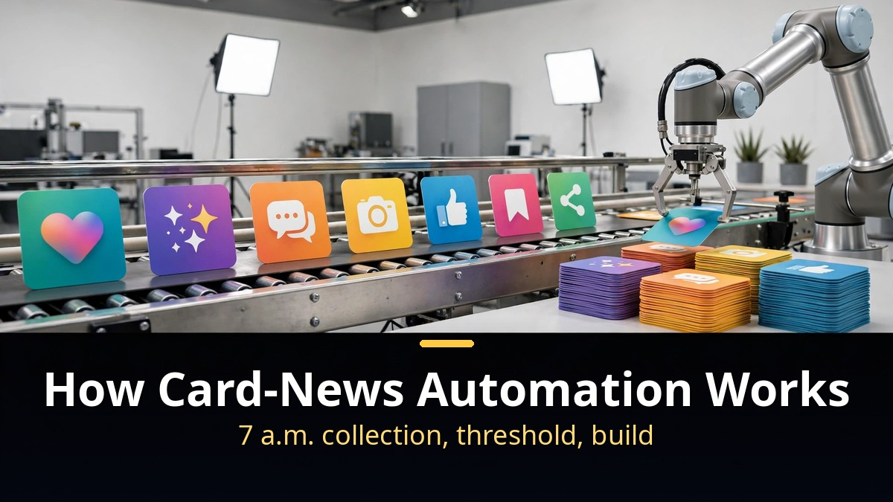
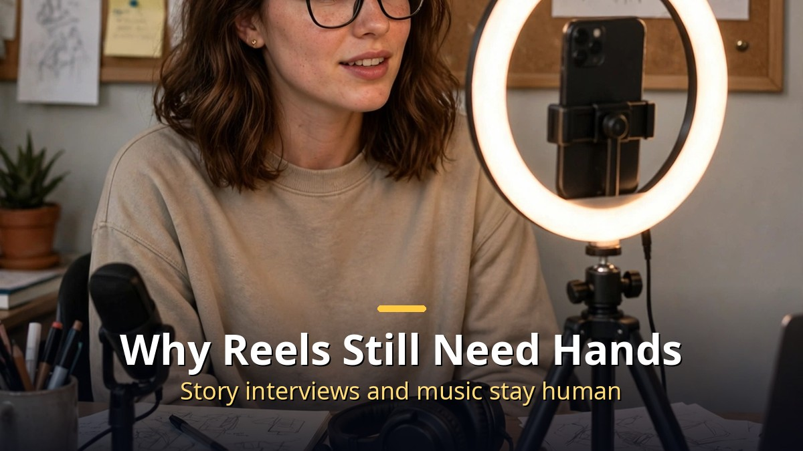

<!-- 본문 시작 -->

Instagram card news, finished by the time you wake up.
Two AI creators showed the Claude Code screens they use every day.
This post is a source-based guide built on a video published on 2026-11-10, laying out the automation flow from reference collection to finished card news.

> **The point is simple. Card news can be automated because collection, filtering, production, and storage run in one line. References are gathered at 7 a.m., only the ones that pass a views threshold become card news, and everything lands in Notion. Reels and uploading still need a human hand. So automation is not magic — it is a sequence that cuts down work you repeat every day.**

## How does card-news automation work?

The main person is Subin, an AI creator with 140,000 Instagram followers.
His card news runs on full automation.
In the video he describes it as "100% AI, no editing, done by the time I wake up."

The flow has four steps.
First, gather references.
Material is pulled every day from YouTube, X, Reddit, and Instagram.
Collection tools do the gathering.
Instagram goes through a tool called Epiphy, the rest through one called Aside, with accounts set up in advance.

Second, a scheduled collection runs at 7 a.m.
It brings likes, views, and comment counts along with the posts.
That data becomes the pool to choose from.

Third, only what passes the bar becomes card news.
A threshold is set — this many views, this many comments.
References that clear it go into automatic card-news production.
Finished card news is saved to a hard drive and queued.

Fourth, everything connects to Notion.
Open a finished card and you can jump to the planning page, the shared-materials page, and the original reference.
When you look something up later, you can see at once where it came from.

The dashboard is the heart of this flow.
It shows the reference collection, social-media status, and a ranking of posted content at a glance.
It was built because its owner is bad at organizing and wanted AI to do the organizing instead.
Scattered data, gathered in one place, useful when you need to find it.

## Why do Reels still need a human hand?

Unlike card news, Reels are not fully automated yet.
Two skills make them: an Instagram Reels content skill and a Reels editing skill.

The Reels skill has a special device.
Claude interviews the creator first.
The rule is that the creator's own story must be in there.
It asks whether the creator has had that experience, and the answer goes into the script.
That fixes the weakness of copying references alone — a video with no personal story in it.

Of course, adding a personal story is not always better.
Combining already-viral content performs at least decently, while mixing in a personal story can do very well or flop.
The video says this honestly.
Still, for a beginner, following references is closest to the right answer.

Uploading is not automated either.
The reason is music.
Trending music has to be picked inside the app.
So card news finishes while you sleep, but Reels and uploads still end with human hands.

Shin Young-sun's method runs on the same skeleton.
Two features: a creator studio and a Reels pipeline.
It pulls content from overseas creators she designates, translates the original scripts, and tests them with Claude.
She checks what images go on each screen.
The gathered source material becomes her own standard.
Once the standard exists, the method stays the same no matter how big the account grows.
She puts the ratio at "80% reference method, 20% my own creation."

Paste in a reference link and it gets taken apart.
The script is broken down second by second, with hook points, script structure (hook, body, call to action), and scene analysis.
It looks at why something went viral and why people reacted.
Using the dissected original as a structure, she is testing a way to pull out five script versions.
The words "infinite replication" come up, but it is still a test.
Only what passes review gets posted, and only within what she actually knows.

## What to check before copying this

Copying the system needs preparation.
First, Claude Code.
You no longer need to open a terminal.
The Claude desktop app works with clicks alone.
The screen was overhauled on October 15, and session status, remote control, and connector connections now sit on one screen.
You can even open a browser inside a chat session and point at things.

Next is the eye for references.
The principle the video stresses most is this one:
"At the start, follow references. That is definitely the answer."
Find verified overseas references, change only the keywords, and digest them into your own.
Copying outright is wrong, but borrowing a structure that works is the standard way for a beginner.
Add your own color once the account has grown.
An acquaintance's case works the same way: find three viral pieces of content and mix them.
A bigger market runs faster on the same method.

The revenue talk needs care.
The video introduces Instagram view revenue of about 500,000 to 2,000,000 won a month per account.
At an average of 1,000,000 won, twenty accounts would mean 20,000,000 won a month.
But those numbers come from a marketing agency representative speaking in the video, and they are not independently verified facts.
Do not read them as a promise that running many accounts brings that income.

Finally, automation has a precondition.
It is also the closing line of the video.
To reach extreme efficiency, you first have to endure a period of inefficiency.
There is a time of making content diligently every day and thinking about how to automate hard work.
Interest in AI is what carries you through that time.
So the checklist before you start looks like this:
Is Claude Code set up? Do you have a list of references to check daily? Have you set card-news thresholds for views and comments? Is there a review step before posting?
[How to start Claude for free, and the 5 drawbacks to check first](https://aitechnotesen.blogspot.com/2026/11/start-claude-for-free-what-you-get-what.html) helps you see which plan you can start on.
The video notes that a free lecture on November 18 at 8 p.m. will cover the rest.

## Closing thoughts
Watching this video, one thought stayed with me: the word "automation" is more modest than it sounds.
It is not one grand AI doing everything, but a sequence — gather references at 7 a.m. every morning, make only what passes the bar.
And behind that sequence, oddly enough, human diligence came first.
Behind the system that makes cards by itself were hours of taking references apart, testing them by hand, and reviewing the results.
So before dreaming about automation, writing down the one thing I repeat every day seems like the right first step.
That one line is where the system starts.

## Frequently asked questions
**Can Claude Code fully automate Instagram card news?**
In the case shown in the video, card-news production is automated.
Uploading is not, because music has to be picked in the app.
Reels are not fully automated yet either.

**Where do the references come from?**
YouTube, X, Reddit, and Instagram.
Collection tools gather them on a 7 a.m. schedule, and only what passes the views and comments thresholds goes into production.

**How should a beginner start?**
Start by following verified overseas references.
Change only the keywords to make them your own, and add your color once the account grows.
That is the principle the video stresses most.

**Do I need a terminal to use Claude Code?**
No longer.
The Claude desktop app works with clicks alone, and since the October 15 screen overhaul, sessions, remote control, and connectors appear on one screen.

**How much Instagram view revenue is there?**
The video cites 500,000 to 2,000,000 won a month per account, averaging 1,000,000 won.
That comes from an agency representative speaking in the video and is not an independently verified fact.

## Good reads
[Start Claude for Free: What You Get, What You Don't, and 5 Drawbacks to Check First](https://aitechnotesen.blogspot.com/2026/11/start-claude-for-free-what-you-get-what.html)
[Ex Machina — 108 Minutes Asking a Robot If It Has a Mind](https://aitechnotesen.blogspot.com/2026/11/ex-machina-108-minutes-asking-robot-if.html)
[Fable 5.2 vs Opus 5.5 — 4 Experiments That Show the Difference and What It Costs](https://aitechnotesen.blogspot.com/2026/11/fable-52-vs-opus-55-4-experiments-that.html)

To keep following this topic, subscribe and stay tuned — the next post covers another hands-on AI workflow.

<!-- 본문 끝 -->

## 작업용 출처·이미지 정보 (업로드 제외)

- Source: 신영선의 AI탐구 영상 7MGY09neWho(2026-11-10, 37분, 자막 0:00~36:56 확인)
- Images: images/01-hero-en.jpg ~ 04-img3-en.jpg / original illustration + English banner overlay (1200x675)
