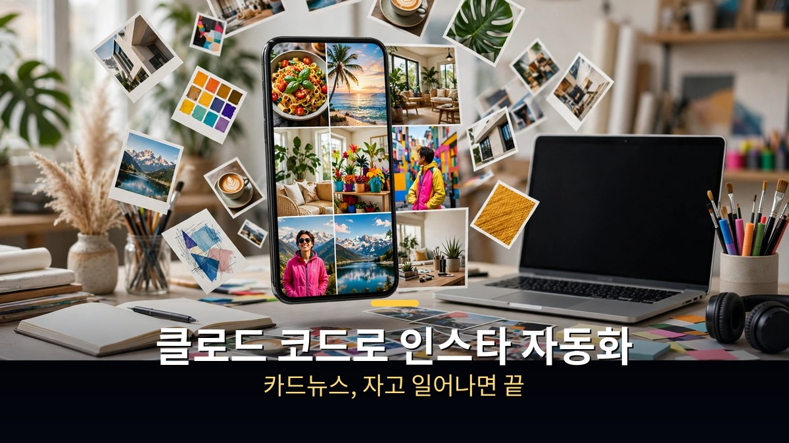
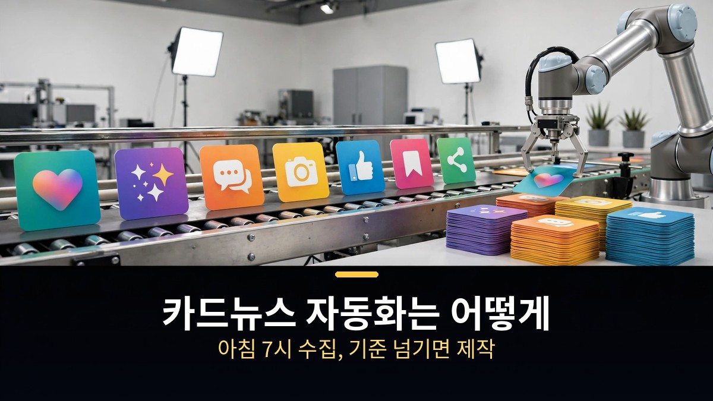
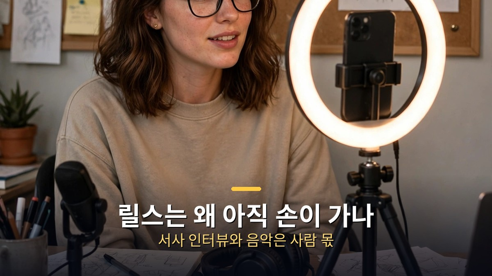
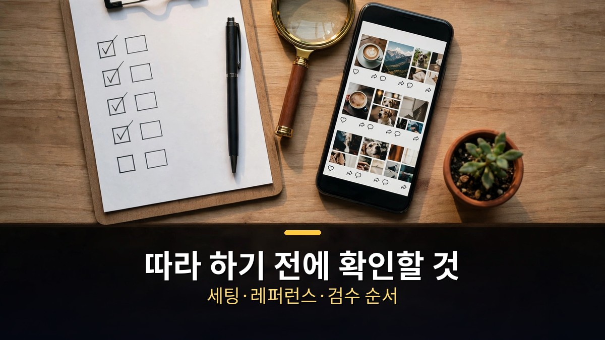

<!-- 본문 시작 -->

인스타 카드뉴스가 자고 일어나면 만들어져 있다.
두 명의 AI 크리에이터가 매일 쓰는 클로드 코드 작업 화면을 공개했다.
이 글은 2026년 11월 10일에 공개된 영상을 바탕으로, 레퍼런스 수집부터 카드뉴스 제작까지의 자동화 과정을 정리한 자료 기반 안내다.

> **핵심은 하나다. 카드뉴스는 수집·기준·제작·저장이 한 줄로 이어진 시스템이라 자동화가 된다. 아침 7시에 레퍼런스를 모으고, 조회수 기준을 넘긴 것만 카드뉴스로 만들고, 노션에 쌓는다. 릴스와 업로드는 아직 사람의 손이 간다. 그러니 자동화는 마법이 아니라, 매일 반복되는 일을 줄이는 순서다.**

## 카드뉴스 자동화는 어떻게 돌아가나?

주인공은 수빈이다.
인스타그램 팔로워 14만 명의 AI 크리에이터다.
그의 카드뉴스는 완전 자동화로 돌아간다.
"100% AI, 편집도 안 하고 자고 일어나면 끝"이라는 게 영상에서의 설명이다.

과정은 네 단계다.
첫째, 레퍼런스를 모은다.
유튜브·X·레딧·인스타그램에서 매일 소재를 긁어온다.
수집은 도구가 맡는다.
인스타그램은 에피파이, 나머지는 어사이드라는 수집 도구로 계정을 설정해 둔다.

둘째, 아침 7시에 정기 수집이 돈다.
좋아요 수와 조회수, 댓글 수 같은 수치를 함께 가져온다.
그걸 바탕으로 게시물을 모은다.

셋째, 기준을 넘긴 것만 카드뉴스로 만든다.
조회수 몇 이상, 댓글 몇 이상이라는 할당량을 정해둔다.
그 선을 넘긴 레퍼런스만 자동으로 카드뉴스 제작에 들어간다.
만들어진 카드뉴스는 하드드라이브에 저장해 대기해 둔다.

넷째, 노션에 연결한다.
완성된 카드뉴스를 열면 기획 페이지와 자료 공유 페이지, 원본 레퍼런스로 바로 갈 수 있다.
나중에 찾아볼 때 원본이 어디서 왔는지 바로 확인되는 구조다.

이 흐름의 핵심은 대시보드다.
레퍼런스 모음과 SNS 현황, 올린 콘텐츠의 순위를 한눈에 본다.
정리를 잘 못해서 AI에게 정리를 맡겼다는 게 만든 이유다.
흩어진 데이터를 모아두고, 찾을 때 유용하게 쓰는 용도다.

## 릴스는 왜 아직 손이 가나?

카드뉴스와 달리 릴스는 아직 완전 자동화가 안 됐다.
릴스는 스킬 두 개로 만든다.
인스타그램 릴스 콘텐츠 제작 스킬과 릴스 편집 스킬이다.

릴스 스킬에는 특별한 장치가 있다.
클로드가 먼저 인터뷰를 한다.
"내 서사가 꼭 들어가야 한다"는 조건 때문이다.
내 경험이 있었는지 물어보고, 그 답을 대본에 넣는다.
레퍼런스만 따라하면 내 이야기가 빠진다는 단점을 보완하는 방법이다.

물론 서사를 넣는 게 항상 좋은 건 아니다.
이미 터진 콘텐츠를 조합하면 어느 정도 이상은 잘 되는 반면, 내 서사를 섞어 새로 만들면 잘 될 수도 있고 안 될 수도 있다.
영상에서는 이걸 솔직하게 말한다.
그래도 처음에는 레퍼런스를 따라 하는 게 정답에 가깝다고 한다.

업로드도 자동화가 안 된다.
음악 때문이다.
인기 상승 음악은 앱에서 직접 골라야 한다.
그래서 카드뉴스는 자고 일어나면 끝나지만, 릴스와 업로드는 사람이 마무리한다.

신영선의 방식도 같은 뼈대다.
크리에이터 스튜디오와 릴스 파이프라인, 두 가지 기능으로 돌아간다.
지정한 해외 크리에이터들의 콘텐츠를 긁어오고, 원문 스크립트를 번역해 본다.
클로드로 직접 테스트해 보고, 화면별로 무슨 이미지가 들어가는지 확인한다.
이렇게 모은 원천 소스가 자기 방식의 기준이 된다.
그 기준대로 만들면, 계정이 커져도 방식은 그대로 간다.
영상에서는 이 비중을 "80%는 레퍼런스 방식, 20%는 내 창작"이라고 말한다.

레퍼런스 링크 하나를 넣으면 분석도 해준다.
대본을 초반 몇 초 단위로 뜯고, 후킹 포인트와 대본 구조(후킹·본문·행동 유도), 화면 분석까지 나눈다.
왜 터졌는지, 사람들이 왜 반응했는지까지 본다.
이렇게 뜯은 원문을 구조로 삼아 대본 다섯 개를 뽑는 테스트도 하고 있다.
"무한 복제"라는 말까지 나오지만, 아직 테스트 단계다.
올리는 건 검수를 거친 것만, 자기가 아는 지식 선에서만 올린다고 한다.

## 따라 하기 전에 확인할 것

이 시스템을 따라 만들려면 준비물이 있다.
먼저 클로드 코드다.
이제는 터미널을 열지 않아도 된다.
클로드 데스크톱 앱에서 클릭만으로 쓸 수 있다.
10월 15일에 화면이 거의 통째로 바뀌었고, 세션 표시와 원격 제어, 커넥터 연결 상태가 한 화면에 보인다.
채팅 안에서 브라우저를 띄워 지정해 줄 수도 있다.

다음은 레퍼런스를 고르는 눈이다.
영상에서 가장 강조한 원칙은 이것이다.
"처음에는 레퍼런스 따라서 해라. 그건 무조건 정답이다."
검증된 해외 레퍼런스를 찾아 키워드만 바꿔 내 것으로 소화한다.
그대로 베끼는 건 안 되지만, 잘된 구조를 빌려오는 건 시작하는 사람의 정석이라는 얘기다.
계정이 어느 정도 크면 그때 내 색깔을 넣는다.
지인의 사례도 같다.
터진 콘텐츠 세 개를 찾아 믹스하는 방식이다.
시장이 큰 쪽은 같은 방식으로도 더 빨리 뛴다고 한다.

수익 얘기는 조심해서 들어야 한다.
영상에서는 인스타그램 조회수 수익이 계정당 한 달에 적으면 50만 원, 많으면 200만 원 정도 나온다고 소개한다.
평균 100만 원으로 잡고 20개를 운영하면 한 달에 2,000만 원이라는 계산도 나온다.
하지만 이 수치는 영상 속 대행사 대표의 설명을 옮긴 것이고, 직접 확인된 사실이 아니다.
계정을 여러 개 운영하면 수익이 따라온다는 식으로 읽으면 안 된다.

마지막으로, 자동화에도 전제 조건이 있다.
영상 말미의 말이기도 하다.
극강의 효율을 얻으려면, 그 전에 비효율의 시기를 견뎌야 한다.
성실하게 매일 콘텐츠를 만들고, 자동화를 고민하는 시간이 먼저 있다.
AI에 대한 관심이 그 시간을 버티는 동력이 된다고 한다.
그러니 시작 전 체크리스트는 이렇게 정리된다.
클로드 코드를 세팅했는지, 매일 볼 레퍼런스 목록이 있는지, 카드뉴스 기준(조회수·댓글)을 정했는지, 올리기 전 검수 단계를 넣었는지.
[클로드 무료로 시작하는 법, 시작 전 꼭 확인할 5가지 단점](https://aitechnoteskr.tistory.com/154)을 함께 보면, 어떤 플랜에서 시작할 수 있는지도 가늠할 수 있다.
영상에서는 11월 18일 저녁 8시 무료 강의에서 나머지 내용을 풀 예정이라고 밝힌다.

## 마무리
이 영상을 보면서 든 생각은, 자동화라는 말이 생각보다 소박하다는 것이다.
거창한 AI 하나가 모든 걸 해주는 게 아니라, 매일 아침 7시에 레퍼런스를 모으고 기준을 넘긴 것만 만드는 순서였다.
그 순서를 만드는 데는 오히려 사람의 성실함이 먼저였다.
카드를 자동으로 만드는 시스템 뒤에는, 레퍼런스를 뜯어보고 직접 써보고 검수하는 시간이 있었다.
그래서 자동화를 꿈꾸기 전에, 내가 매일 반복하는 일 하나를 적어보는 게 먼저인 것 같다.
그 한 줄이 시스템의 시작이니까.

## 자주 묻는 질문
**클로드 코드로 인스타 카드뉴스를 완전히 자동화할 수 있나요?**
영상 속 사례에서는 카드뉴스 제작까지는 자동화됐다.
다만 업로드는 음악 선택 때문에 자동화가 안 된다.
릴스도 아직 완전 자동화는 아니다.

**레퍼런스는 어디서 모으나요?**
유튜브·X·레딧·인스타그램에서 모은다.
수집 도구로 계정을 설정해 두고 아침 7시에 정기 수집한다.
조회수·댓글 기준을 넘긴 것만 제작에 들어간다.

**처음 시작하는 사람은 어떻게 해야 하나요?**
검증된 해외 레퍼런스를 따라 하는 것부터 시작한다.
키워드만 바꿔 내 것으로 소화하고, 계정이 크면 내 색깔을 넣는다.
영상에서 가장 강조한 원칙이다.

**클로드 코드 사용에 터미널이 필요한가요?**
이제는 아니다.
클로드 데스크톱 앱에서 클릭만으로 쓸 수 있고, 10월 15일 화면 개편 이후 세션·원격 제어·커넥터를 한 화면에서 본다.

**인스타 조회수 수익은 얼마나 나오나요?**
영상에서 소개된 수치는 계정당 월 50만~200만 원, 평균 100만 원이다.
대행사 대표의 설명을 옮긴 것으로, 직접 확인된 사실이 아니다.

## 함께 읽으면 좋은 글
[클로드 무료로 시작하는 법｜8분 정리, 시작 전 꼭 확인할 5가지 단점](https://aitechnoteskr.tistory.com/154)
[엑스 마키나｜로봇에게 마음을 묻는 108분, 튜링 테스트의 진짜 질문](https://aitechnoteskr.tistory.com/156)
[마이너리티 리포트｜아직 일어나지 않은 범죄를 체포하는 나라, 예언은 틀릴 수 있다](https://aitechnoteskr.tistory.com/150)

이 주제를 계속 따라가려면 이웃 추가를 눌러두세요.
다음 편에서는 또 다른 AI 활용법을 정리해서 가져오겠습니다.

<!-- 본문 끝 -->

## 작업용 출처·이미지 정보 (업로드 제외)

- 자료 출처: 신영선의 AI탐구 영상 7MGY09neWho(2026-11-10, 37분, 자막 0:00~36:56 확인)
- 이미지: images/01-hero.jpg ~ 04-img3.jpg / 자작 일러스트 + 한글 배너 오버레이 (1200x675)
