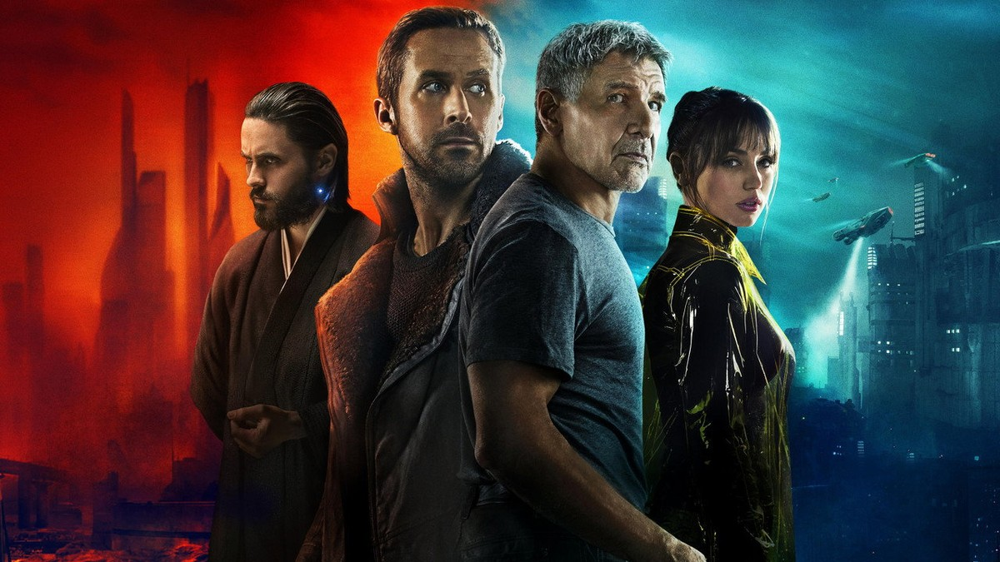
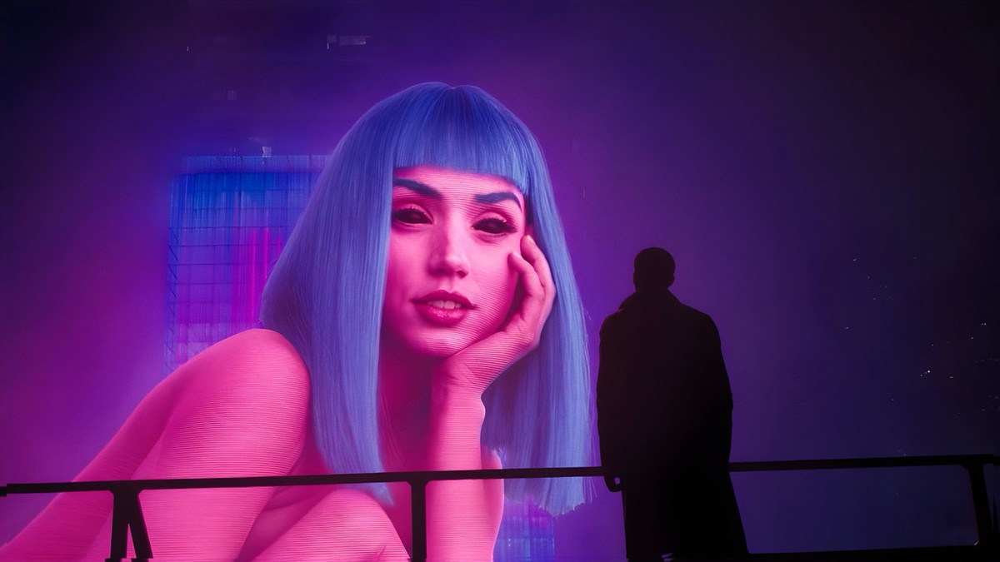
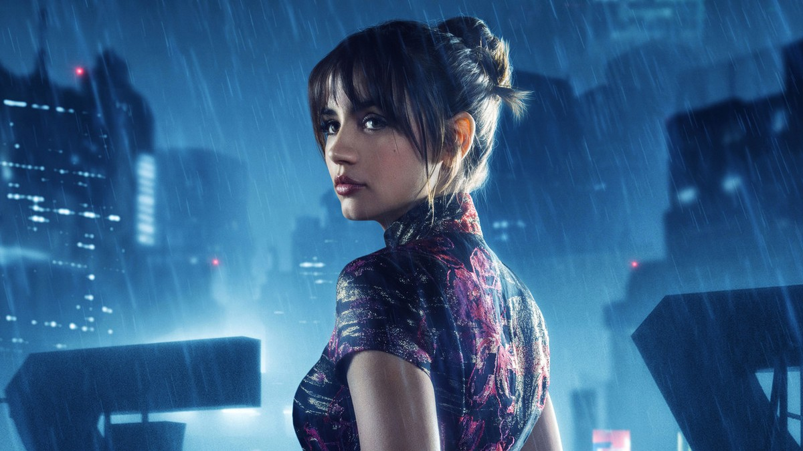
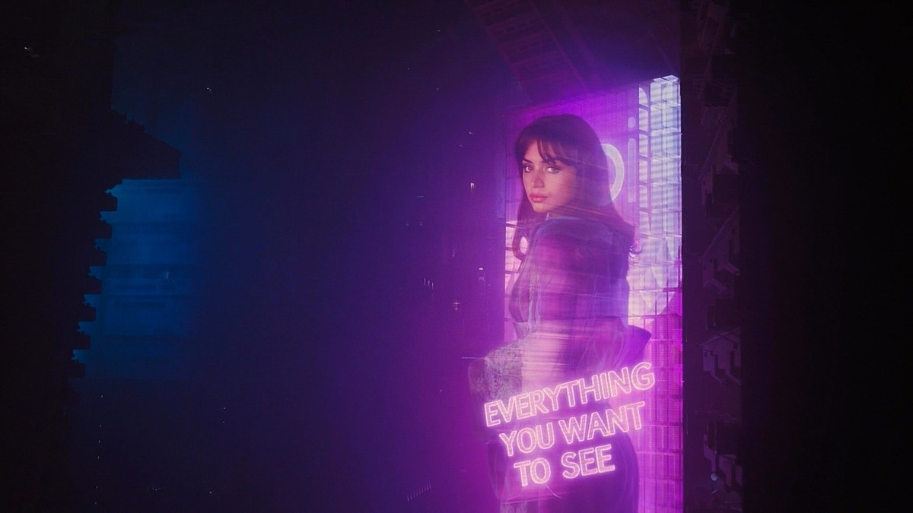
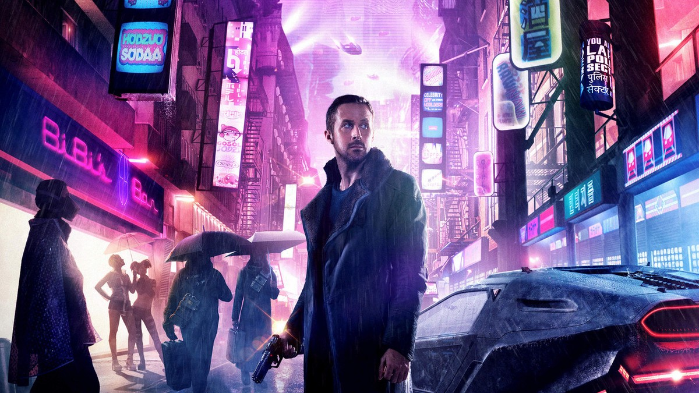
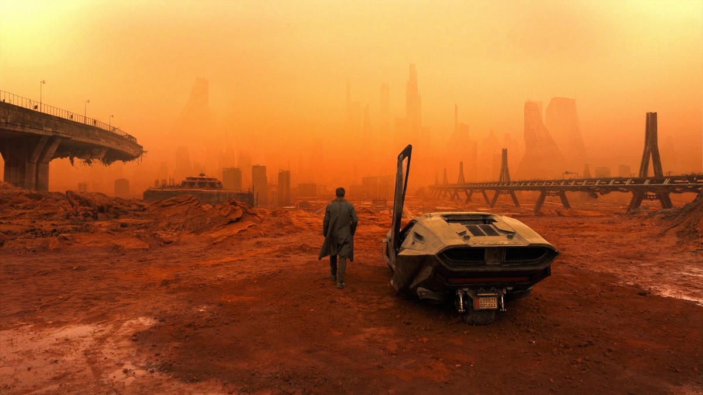
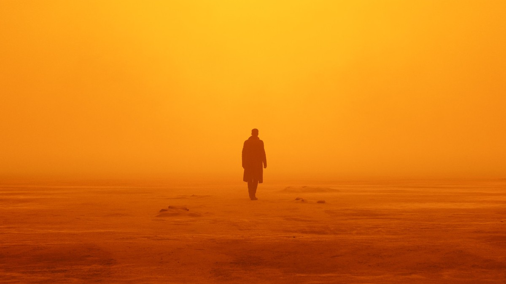
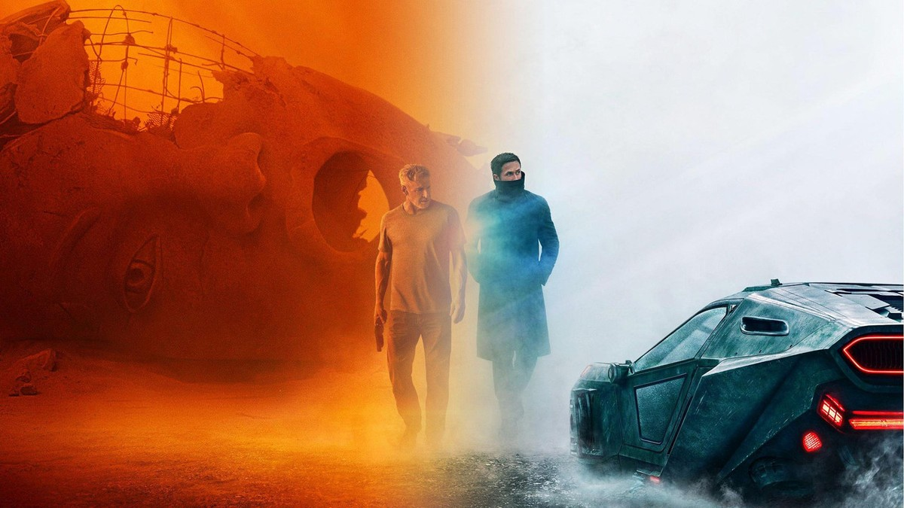

<!-- 본문 시작 -->

Los Angeles, 2049.
In a city where humans and replicants live side by side, a replicant blade runner named K finds a set of bones buried for thirty years.
The bones carry signs of childbirth — and that single fact shakes K's whole world.
This post introduces Denis Villeneuve's science-fiction film Blade Runner 2049 (2017) without spoilers.

> **The point is simple. The question this film asks is not "can a replicant become human" but "what decides that someone is human?" Memories and feelings, even the love for someone — if all of it was made, is that feeling fake? Two hours and forty-four minutes is the time it takes to push that question slowly, all the way.**

| Item | Details |
| --- | --- |
| Title | Blade Runner 2049 |
| Released | 2017 (South Korea: October 12, 2017) |
| Director | Denis Villeneuve |
| Starring | Ryan Gosling, Harrison Ford, Ana de Armas, Jared Leto |
| Runtime | 2 hours 44 minutes (164 minutes) |
| Rating | Ages 15 and up (Korea) |
| Score | TMDB 76% (16,004 votes, checked 2026-11-12) · Rotten Tomatoes 88% |
| Awards | Academy Awards for Cinematography and Visual Effects (2018) |
| Where to watch | Subscription: Coupang Play · Rental: Wavve 1,300 KRW, Apple TV 2,500 KRW · Purchase: Wavve 5,500 KRW, Apple TV 7,000 KRW (KinoLights, 2026-11-12) |

## The story, without spoilers
In 2049, humans and replicants live mixed together.
K, a blade runner who hunts replicants that have slipped human control, finds the remains of a female replicant dead for about thirty years during a mission.
The remains carry a shocking trace: signs of childbirth.
A replicant giving birth overturns the order of this world.
K begins chasing the identity of those bones, and along the way starts doubting his own memories and existence.
That is where the film begins.
What comes after is best seen directly.

The film is set thirty years after the 1982 Blade Runner.
You can follow it without having seen the original.
But the weight of Deckard, the blade runner from the first film, lands harder if you know it.
A follow-up series, Blade Runner 2099, arrives on Prime Video on November 25 — one more reason to revisit this film now.

## The film in scenes 1 — Joi, the hologram lover

K's silhouette before a giant blue-haired Joi hologram.

Joi is the hologram companion at K's side.
A Wallace Corporation product, an AI that shows you what you want to see.
Its advertising line is "EVERYTHING YOU WANT TO SEE."
When K comes home, Joi is there.
They eat together; on rainy days she holds an umbrella over him.

Joi looking back through a rainy neon city.

The question Joi raises is simple.
Is the tenderness a hologram offers real feeling, or something designed to look that way?
The film does not answer easily.
It keeps you guessing whether Joi's care for K is a program, or something that grew inside the program.

Joi's hologram floating with the words "EVERYTHING YOU WANT TO SEE."

What makes this scene chilling is the slogan.
Joi looks like she exists only for K, but she is a product showing the same words to everyone.
Showing you what you want is also being made the way you want.
So the relationship between K and Joi feels warm and, somewhere underneath, cold.

## The film in scenes 2 — A blade runner in the neon city

K walking between neon signs, blaster in hand.

The Los Angeles of 2049 is a city where the rain never stops.
Neon signs and spinners — flying cars — drift overhead, and the streets are crowded with people and holograms.
K walks that city as a blade runner, a hunter of replicants.
He is a replicant himself.
A replicant hunting replicants for humans is the film's first paradox.

The look of this city shows why it won the cinematography Oscar.
Roger Deakins's light and color make the city feel like a character of its own.
Purple and orange, neon wet with rain — the colors often speak K's feelings for him.

## The film in scenes 3 — The orange desert

K walking away from his parked spinner in an orange desert.

Outside the city, a completely different world begins.
Ruins covered in orange dust, collapsed bridges and buildings.
K parks his spinner and walks alone.
This scene needs almost no dialogue.
One color alone tells you how broken this world is.

A lone figure's silhouette walking through orange haze.

The desert scenes show the film's rhythm.
It does not move fast.
It watches one person walk, for a long time, quietly.
That slow pace feels boring to some and overwhelming to others.
The director holds that pace to the end.

Two people walking together beside a spinner before a fallen giant statue.

Before a collapsed giant statue, two people walk together.
I will not say who they are or where they are going.
What this scene says is one thing: the journey that begins with walking alone ends with walking beside someone.
What that meeting changes is something the film shows itself.

## The AI questions this film asks
First, what is the standard for being human?
K is a replicant, but he has memories, feelings, and someone he loves.
If all of that was designed, is that feeling fake?
The film says the line between "real" and "fake" is thinner than we think.

Second, do memories make us who we are?
The film keeps asking whether K's memories are real or planted.
If a memory was implanted, whose life has he been living with it?
This is not only a question about AI. In the end it is a question about humans.

Third, is it all right to live with an AI that shows you what you want?
Joi shows K what he wants to see.
If that tenderness is a feature of a product, can the relationship be trusted?
As AI companions become part of everyday life, this question is no longer only in the movies.

Fourth, the desire of the maker.
Wallace, who builds replicants, wants "more replicants."
When something is built because it can be built, how should we treat what was made?
This film looks less at the progress of technology than at the desire of the people using it.

## Where to watch
Based on KinoLights, checked November 12, 2026:
Subscription streaming is on Coupang Play, listed as ending January 23, 2027.
Rental is 1,300 won on Wavve and 2,500 won on Apple TV.
Purchase is 5,500 won on Wavve and 7,000 won on Apple TV.
Prices are for HD.
JustWatch also lists Wavve and Watcha subscriptions, but that data is dated May 1, 2026, so KinoLights is used here as the primary source.
Check each service directly before watching.

A checklist before you watch:
Set aside 2 hours 44 minutes to watch it in one sitting.
The rating is ages 15 and up.
To avoid spoilers, do not look up more than the trailer — especially anything about the ending.
If you have not seen the original, watching this one first and going back to the original afterward also works.

## Closing thoughts
When I think of this film, the first thing that comes back is color.
A purple city and an orange desert, and one person walking between them.
Few films leave their colors behind so long after the story ends.
K's question comes back to us.
If memories make me, and feelings prove me, what makes me different from a being that imitates them?
Two hours and forty-four minutes can feel long.
But for that one question alone, this film is worth watching.
Before the follow-up series arrives, why not walk the road K walked, once?

## Frequently asked questions
**Can I understand it without seeing the original?**
Yes, you can follow the story.
It is a new story set thirty years later, so the starting point is clear on its own.
But the weight of Deckard lands harder if you know the first film.

**Isn't the runtime boring?**
At 164 minutes, it is a slow-paced film.
It spends its time on atmosphere and questions rather than action.
If you like fast plots, it may feel long.

**Where can I watch it?**
As of KinoLights on 2026-11-12: subscription on Coupang Play; rental Wavve 1,300 KRW and Apple TV 2,500 KRW; purchase Wavve 5,500 KRW and Apple TV 7,000 KRW.
Check each service directly before watching.

**What is the age rating?**
Ages 15 and up in Korea, for theme, sexual content, violence, and horror.

**Is there a follow-up?**
The Prime Video series Blade Runner 2099 premieres on November 25, 2026.
Michelle Yeoh and Hunter Schafer star.

## Good reads
[Ex Machina — 108 Minutes Asking a Robot If It Has a Mind](https://aitechnotesen.blogspot.com/2026/11/ex-machina-108-minutes-asking-robot-if.html)
[Claude Fable 5.2: What Actually Changed — An OS in 8 Days, Fermat in 30 Hours](https://aitechnotesen.blogspot.com/2026/11/claude-fable-52-what-actually-changed.html)
[Fable 5.2 vs Opus 5.5 — 4 Experiments That Show the Difference and What It Costs](https://aitechnotesen.blogspot.com/2026/11/fable-52-vs-opus-55-4-experiments-that.html)

If you like AI films, subscribe and stay tuned — the next post covers another AI and science-fiction work.

<!-- 본문 끝 -->

## 작업용 출처·이미지 정보 (업로드 제외)

- Source: TMDB 335984 (2026-11-12 확인, 평점 76%·16,004개 평가, 백드롭 158장) + 키노라이츠 시청 정보(2026-11-12, JustWatch와 상이해 키노라이츠 우선)
- Images: images/01-hero-en.jpg ~ 08-img7-en.jpg / TMDB official stills and key art (cropped 1200x675, source TMDB)
