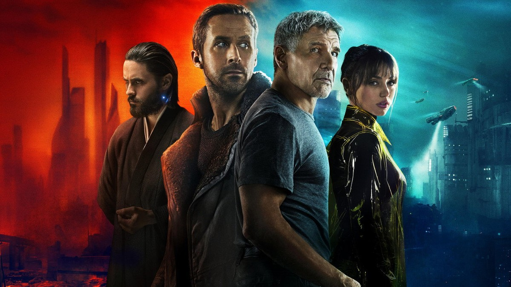
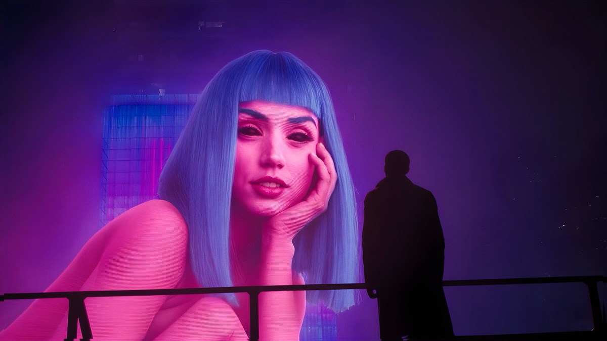
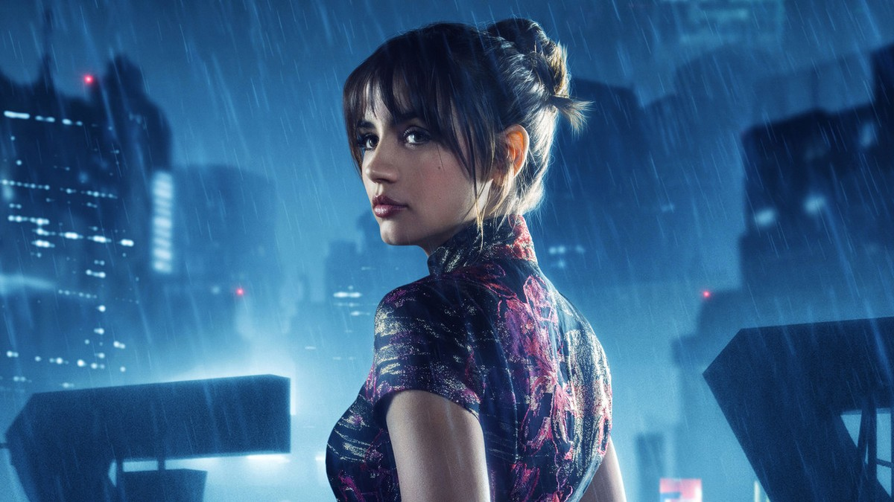
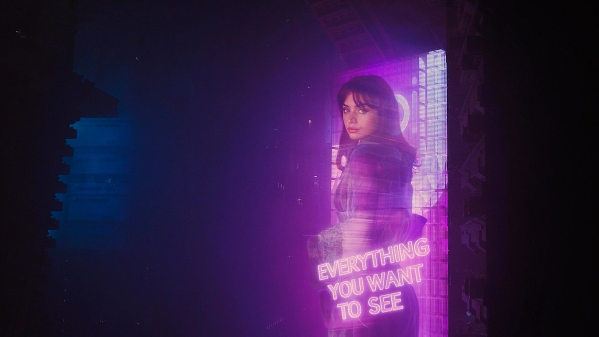
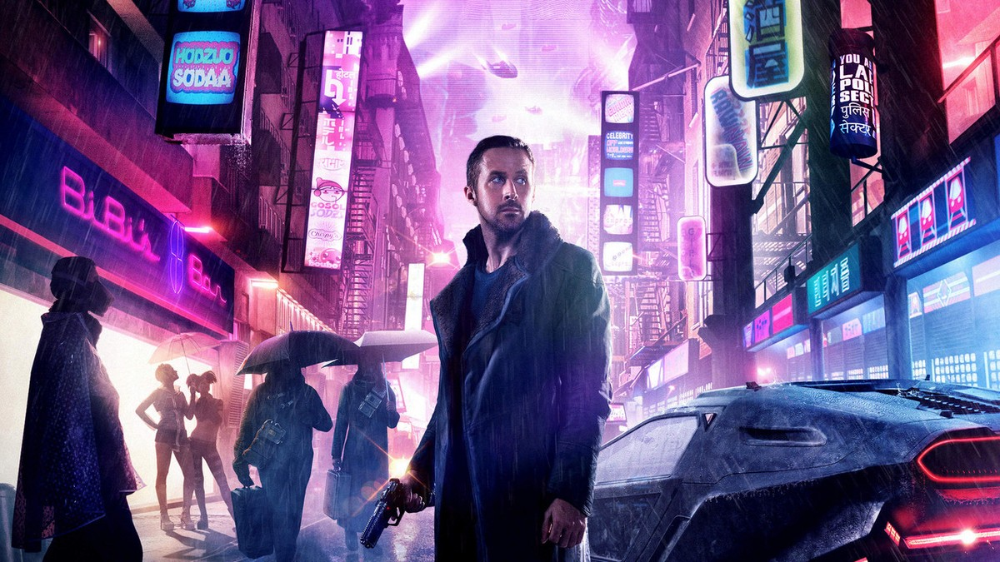
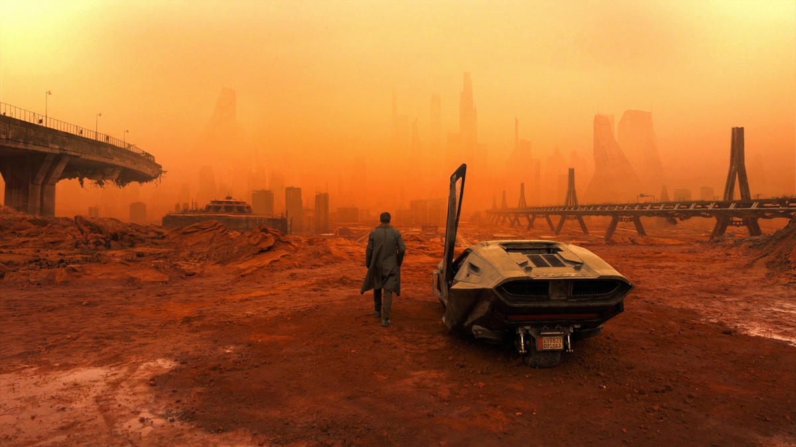
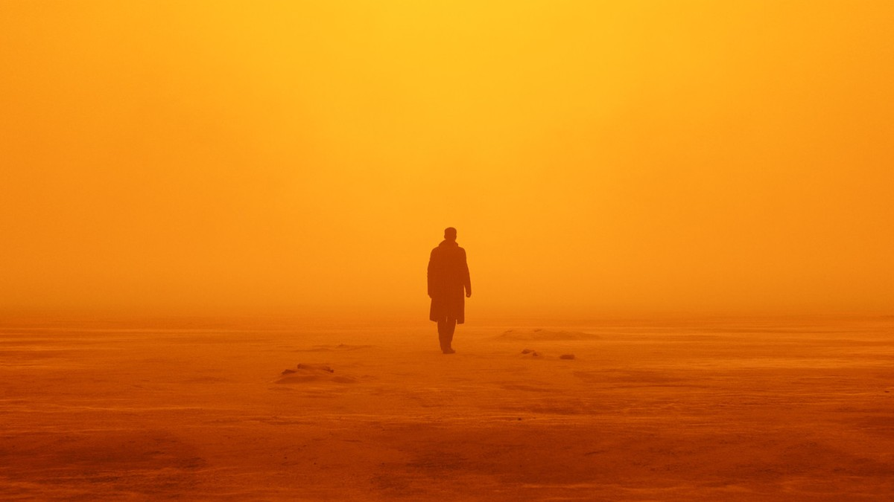
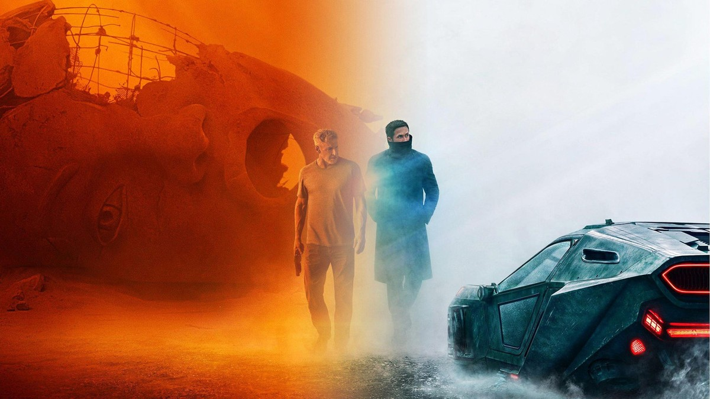

<!-- 본문 시작 -->

2049년, 로스앤젤레스.
인간과 리플리컨트가 섞여 사는 도시에서, 리플리컨트 사냥꾼 K는 30년 전 묻힌 유골 하나를 발견한다.
그 유골에 출산의 흔적이 있다는 사실이, K의 세계를 통째로 흔든다.
이 글은 드니 빌뇌브 감독의 SF 영화 《블레이드 러너 2049》(2017)를 스포일러 없이 소개하는 정리다.

> **핵심은 하나다. 이 영화가 던지는 질문은 "리플리컨트가 인간이 될 수 있나"가 아니라 "인간이란 무엇으로 정해지나"다. 기억과 감정, 그리고 누군가를 사랑하는 마음까지 — 그 모든 게 만들어진 것이라면, 그 마음은 가짜일까. 2시간 44분은 그 질문을 천천히, 끝까지 밀어붙이는 시간이다.**

| 항목 | 내용 |
| --- | --- |
| 제목 | 블레이드 러너 2049 |
| 개봉 | 2017년 (한국 극장 개봉 2017-10-12) |
| 감독 | 드니 빌뇌브 |
| 주요 출연 | 라이언 고슬링, 해리슨 포드, 아나 데 아르마스, 자레드 레토 |
| 러닝타임 | 2시간 44분 (164분) |
| 등급 | 15세 관람가 |
| 평점 | TMDB 76% (16,004개 평가, 2026-11-12 확인) · 로튼토마토 88% |
| 수상 | 아카데미 촬영상·시각효과상 (2018) |
| 시청처 | 정액제 쿠팡플레이 · 대여 웨이브 1,300원·애플TV 2,500원 · 구매 웨이브 5,500원·애플TV 7,000원 (키노라이츠 2026-11-12 기준) |

## 스포일러 없는 줄거리
인간과 리플리컨트가 혼재된 2049년.
인간의 통제를 벗어난 리플리컨트를 쫓는 블레이드 러너 K는 임무 수행 도중 약 30년 전 여성 리플리컨트의 유골을 발견한다.
그런데 그 유골에는 충격적인 흔적이 있다.
출산의 흔적이다.
리플리컨트가 아이를 낳았다는 말은, 이 세계의 질서를 뒤집는 말이다.
K는 그 유골의 정체를 쫓기 시작하고, 그 과정에서 자기 자신의 기억과 존재까지 의심하게 된다.
여기까지가 영화의 출발점이다.
그 뒤에 무엇이 있는지는, 직접 보는 것이 좋다.

이 영화는 1982년작 《블레이드 러너》의 30년 뒤 이야기다.
전편을 안 봤어도 줄기는 따라갈 수 있다.
다만 전편의 블레이드 러너였던 데커드라는 인물이 왜 중요한지는, 전편을 알면 더 크게 다가온다.
11월 25일에는 프라임 비디오에서 후속 시리즈 《블레이드 러너 2099》가 공개될 예정이다.
이 영화를 지금 다시 보는 이유 중 하나다.

## 장면으로 보는 작품 1 — 홀로그램 연인, 조이

거대한 파란 머리 홀로그램 앞에 선 K의 실루엣.

조이는 K의 곁에 있는 홀로그램 동반자다.
월리스 사의 제품으로, 원하는 모습을 보여주는 AI다.
광고 문구는 "EVERYTHING YOU WANT TO SEE", 보고 싶은 모든 것.
K가 집에 돌아오면 조이가 있다.
함께 식사를 하고, 비가 오는 날 우산을 씌워주기도 한다.

빗속 네온 도시를 뒤돌아보는 조이.

조이의 존재가 던지는 질문은 단순하다.
홀로그램이 건네는 다정함은 진짜 감정일까, 아니면 그렇게 보이도록 설계된 것일까.
영화는 이 질문에 쉽게 답하지 않는다.
조이가 K를 위하는 마음이 프로그램인지, 아니면 프로그램 안에서 자라난 것인지 끝까지 가늠하게 한다.

"EVERYTHING YOU WANT TO SEE"라는 문구와 함께 떠 있는 조이의 홀로그램.

이 장면이 무서운 건 문구 때문이다.
조이는 K만을 위한 존재처럼 보이지만, 사실은 누구에게나 같은 문구를 보여주는 상품이다.
원하는 모습을 보여준다는 말은, 원하는 대로 만들어진다는 말이기도 하다.
K와 조이의 관계는 그래서 따뜻하면서도 어딘가 서늘하다.

## 장면으로 보는 작품 2 — 네온 도시의 블레이드 러너

네온 간판 사이를 걷는 K, 손에는 블래스터.

2049년의 LA는 비가 그치지 않는 도시다.
네온 간판과 스피너(나는 차)가 떠다니고, 거리는 사람과 홀로그램으로 붐빈다.
K는 그 도시를 걷는 블레이드 러너, 즉 리플리컨트 사냥꾼이다.
그 자신도 리플리컨트다.
인간을 위해 리플리컨트를 쫓는 리플리컨트라는 설정이, 영화의 첫 번째 역설이다.

이 도시의 풍경은 촬영상을 받은 이유를 보여준다.
로저 디킨스 촬영감독이 만든 빛과 색은, 도시 자체가 하나의 인물처럼 느껴지게 한다.
보라색과 주황색, 비에 젖은 네온이 K의 마음을 대신 말하는 장면이 많다.

## 장면으로 보는 작품 3 — 주황빛 사막

주황빛 사막에 스피너를 세워두고 걸어가는 K.

도시를 벗어나면 전혀 다른 세상이 나온다.
주황빛 먼지로 뒤덮인 폐허, 무너진 다리와 건물들.
K는 스피너를 세워두고 혼자 걸어간다.
이 장면에서는 대사가 거의 필요 없다.
색 하나만으로 이 세계가 얼마나 망가졌는지 알 수 있다.

주황빛 안개 속을 홀로 걷는 인물의 실루엣.

사막 장면은 영화의 호흡을 보여준다.
빠르게 전개되지 않는다.
한 사람이 걸어가는 모습을 오래, 가만히 본다.
이 느린 호흡이 어떤 사람에게는 지루하게, 어떤 사람에게는 압도적으로 느껴진다.
감독은 이 속도를 끝까지 유지한다.

무너진 거상 앞에서 스피너 곁을 함께 걷는 두 사람.

무너진 거대한 조각상 앞에서 두 사람이 걷는다.
누가 누군지, 어디로 가는지는 말하지 않겠다.
이 장면이 말해주는 건 하나다.
이 영화의 여정은 혼자 걷는 길에서 시작해, 결국 누군가와 함께 걷는 길로 이어진다는 것.
그 만남이 무엇을 바꾸는지는 영화가 직접 보여준다.

## 이 작품이 던지는 AI 질문
첫째, 인간의 기준은 무엇인가.
K는 리플리컨트이지만 기억이 있고, 감정이 있고, 누군가를 사랑한다.
그 모든 게 설계된 것이라면, 그 마음은 가짜인가.
영화는 "진짜"와 "가짜"를 가르는 선이 생각보다 얇다고 말한다.

둘째, 기억은 나를 만드는가.
K의 기억이 진짜인지 가짜인지, 영화는 오래 묻는다.
기억이 심어진 것이라면, 그 기억으로 살아온 삶은 누구의 삶인가.
이 질문은 AI의 이야기가 아니라, 결국 인간의 이야기다.

셋째, 원하는 모습을 보여주는 AI와 살아도 되는가.
조이는 K가 원하는 모습을 보여준다.
그 다정함이 상품의 기능이라면, 그 관계를 믿어도 되는가.
AI 동반자가 일상이 되는 지금, 이 질문은 영화 속 이야기가 아니다.

넷째, 만드는 자의 욕망이다.
리플리컨트를 만드는 월리스는 "더 많은 리플리컨트"를 원한다.
만들 수 있다는 이유로 만들 때, 그 존재를 어떻게 대해야 하는가.
이 영화는 기술의 발전보다, 그 기술을 쓰는 사람의 욕망을 본다.

## 어디서 보는지
키노라이츠 2026년 11월 12일 기준으로 정리한다.
정액제로는 쿠팡플레이에서 볼 수 있다.
종료 예정일은 2027년 1월 23일로 표시돼 있다.
대여는 웨이브 1,300원, 애플TV 2,500원이다.
구매는 웨이브 5,500원, 애플TV 7,000원이다.
가격은 HD 기준이다.
다만 JustWatch에는 웨이브와 왓챠 정액제도 표시되는데, 그 데이터는 2026년 5월 1일 기준이라 키노라이츠를 우선으로 적었다.
보기 전에 각 서비스에서 직접 한 번 더 확인하는 것이 좋다.

시청 전 체크리스트도 있다.
러닝타임 2시간 44분이라 한 번에 볼 시간을 잡아야 한다.
등급은 15세 관람가다.
스포일러를 피하려면 예고편 이상은 찾아보지 않는 게 좋다.
특히 결말에 대한 글은 피한다.
전편을 안 봤다면, 이 편을 보고 전편을 거꾸로 보는 것도 방법이다.

## 마무리
이 영화를 떠올리면 가장 먼저 생각나는 건 색이다.
보라색 도시와 주황빛 사막, 그 사이를 걷는 한 사람.
이야기가 끝나고도 색이 오래 남는 영화는 드물다.
K의 질문은 결국 우리에게 돌아온다.
기억이 나를 만들고, 감정이 나를 증명한다면, 그걸 흉내 내는 존재와 나는 뭐가 다른가.
2시간 44분이 길게 느껴질 수도 있다.
하지만 그 질문 하나만으로도, 이 영화는 볼 만한 가치가 있다.
후속 시리즈가 나오기 전에, K가 걸었던 길을 한 번 따라가 보는 건 어떨까.

## 자주 묻는 질문
**전편을 안 봐도 이해할 수 있나요?**
줄기는 따라갈 수 있다.
30년 뒤의 새로운 이야기라, 전편을 몰라도 출발점은 이해된다.
다만 데커드라는 인물의 무게는 전편을 알면 더 크게 다가온다.

**러닝타임이 긴데 지루하지 않나요?**
164분으로 느린 호흡의 영화다.
액션보다 분위기와 질문에 시간을 쓴다.
빠른 전개를 좋아하면 길게 느껴질 수 있다.

**어디서 볼 수 있나요?**
키노라이츠 2026-11-12 기준으로 정액제 쿠팡플레이, 대여 웨이브 1,300원·애플TV 2,500원, 구매 웨이브 5,500원·애플TV 7,000원이다.
보기 전에 각 서비스에서 직접 확인하는 것이 좋다.

**등급은 어떻게 되나요?**
15세 관람가다.
주제·선정성·폭력성·공포 항목이 15세 기준이다.

**후속 작품이 있나요?**
프라임 비디오 시리즈 《블레이드 러너 2099》가 2026년 11월 25일 공개될 예정이다.
미셸 여와 헌터 셰이퍼가 출연한다.

## 함께 읽으면 좋은 글
[엑스 마키나｜로봇에게 마음을 묻는 108분, 튜링 테스트의 진짜 질문](https://aitechnoteskr.tistory.com/156)
[클로드 페이블 5.2, 뭐가 달라졌나 — 8일 만에 운영체제, 30시간 만에 페르마 정리](https://aitechnoteskr.tistory.com/155)
[페이블 5.2 vs 오퍼스 5.5 비교｜실험 4번으로 가려낸 차이와 고르는 기준](https://aitechnoteskr.tistory.com/153)

AI 영화에 관심 있다면 이웃 추가를 눌러두세요.
다음 편에서는 또 다른 AI·SF 작품을 정리해서 가져오겠습니다.

<!-- 본문 끝 -->

## 작업용 출처·이미지 정보 (업로드 제외)

- 자료 출처: TMDB 335984 (2026-11-12 확인, 평점 76%·16,004개 평가, 백드롭 158장) + 키노라이츠 시청 정보(2026-11-12, JustWatch와 상이해 키노라이츠 우선)
- 이미지: images/01-hero.jpg ~ 08-img7.jpg / TMDB 공식 스틸·키아트 (1200x675 크롭, 출처 TMDB)
