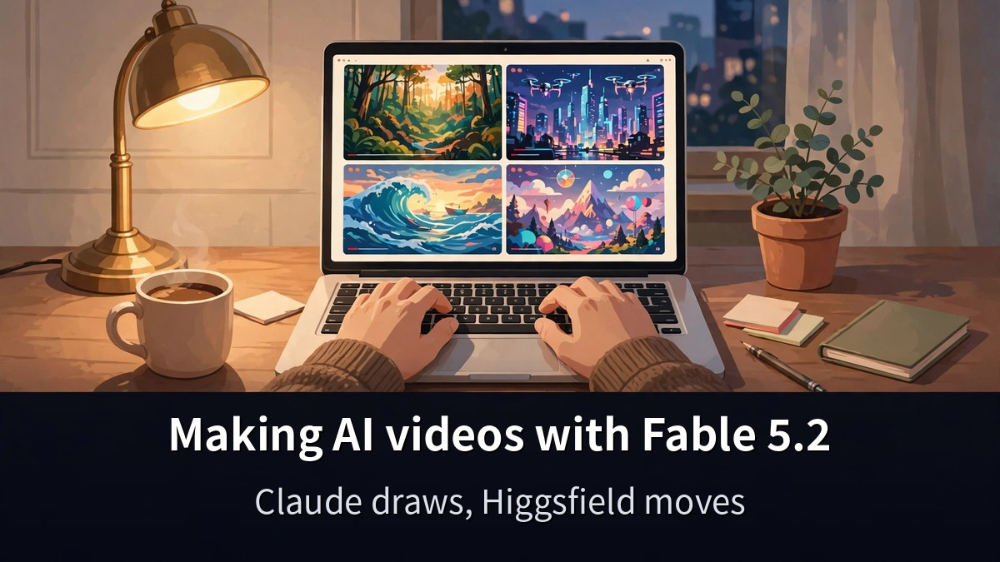
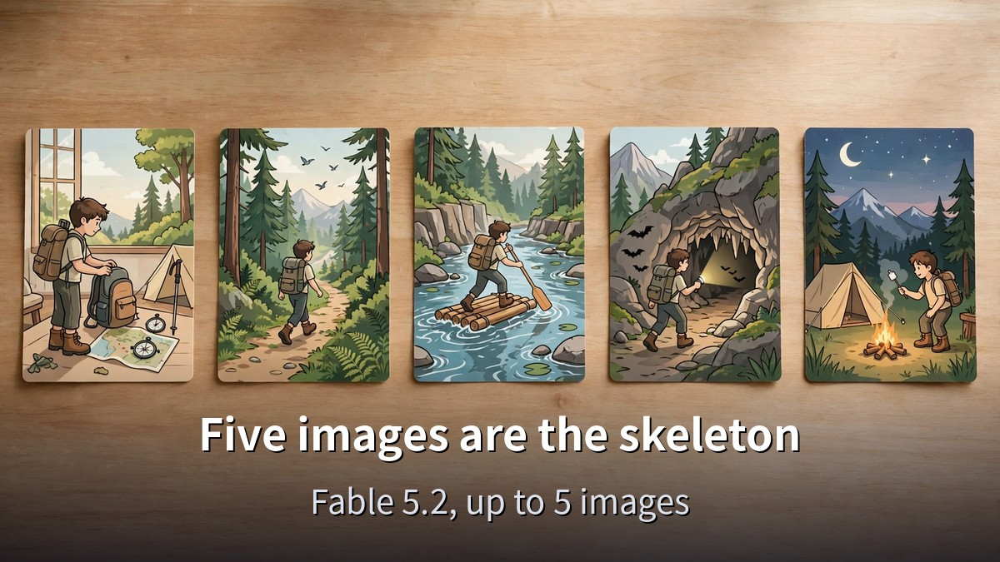
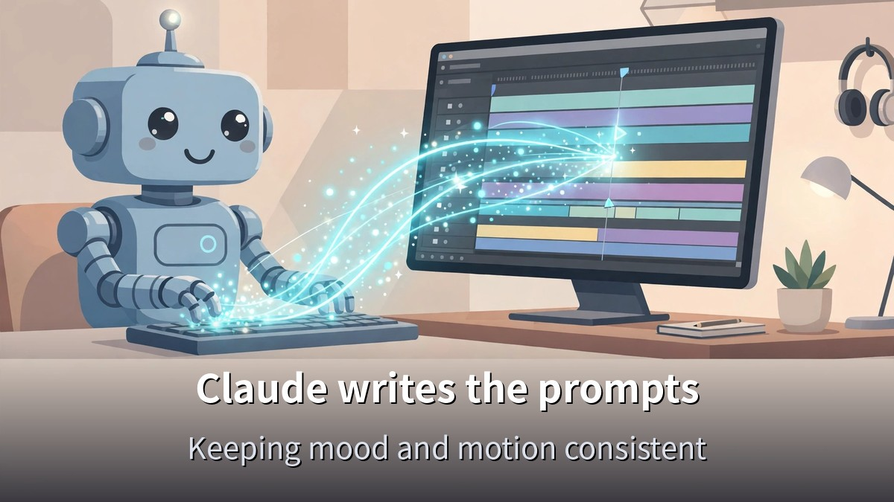
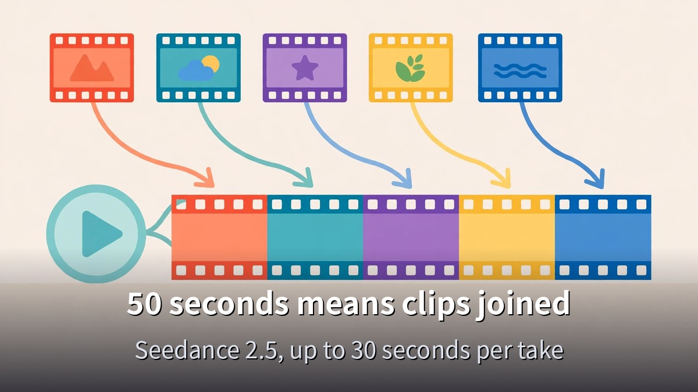

<!-- 본문 시작 -->

Watching AI videos, you may have wondered if you could make one yourself.
This post is based on a video published on November 12, 2026, and walks through how to make a 50-second AI video from start to finish with Claude Fable 5.2 and Higgsfield.

> **The short version: Fable 5.2 draws five images, Claude writes the prompts, and Higgsfield's Seedance turns those images into motion. A 50-second video is not generated in one pass — it is several short clips joined together. Once you know the order, you can make your first video in a day.**

If you want to know why Fable 5.2 is getting attention, [this comparison of Fable 5.2 and Opus 5.5 across four experiments](https://aitechnotesen.blogspot.com/2026/11/fable-52-vs-opus-55-4-experiments-that.html) is a good place to start.

## Why start with Fable 5.2 drawing the pictures?

Claude Fable 5.2 creates the five scene images.
In the video, the creator says the images are made at 8K.
Up to five images can be used.

The images are the skeleton of the video.
Each scene's picture is drawn first.
Characters and backgrounds are decided here.

Why Fable 5.2?
The creator shows a flow that starts image generation inside Claude, without opening a separate image tool.
That keeps the scenes in one place.

One thing to note before moving on.
Pretty pictures do not make a video by themselves.
The story has to be decided first — how the scenes connect and where the story goes.
That is why the next step is the prompt.

## Who writes the prompts? Claude does

You do not write each prompt line by line yourself.
In the video, Claude is asked to write the prompts.
It turns each scene — what moves and how it feels — into words.

That is the core of this workflow.
The same model that drew the images writes the instructions for the video.
The mood and the motion stay consistent from scene to scene.

The 50-second video follows a three-act structure.
Connection, humor, and a twist.
It starts by linking scenes, adds a laugh in the middle, and ends by overturning expectations.

A short video stays in memory because of structure, not length.
A beginning, middle, and end fit inside 50 seconds.
So the three acts come before the scenes are divided.
If you are new to Claude, [how to start Claude for free, and the 5 drawbacks to check first](https://aitechnotesen.blogspot.com/2026/11/start-claude-for-free-what-you-get-what.html) shows which plan you can start on.

## How Higgsfield's Seedance turns images into video

Once the pictures and prompts are ready, the work moves to Higgsfield.
Inside Higgsfield, the Seedance model turns images into video.

Seedance 2.5 is ByteDance's video generation model, released on July 31, 2026.
One generation produces up to 30 seconds of video.
Up to 50 reference assets — images, video, and audio combined — can be included.

Here is a condition you need to know.
Seedance 2.5 makes at most 30 seconds per generation.
But the finished video in the source video is 50 seconds long.
So the 50-second video was not made in one pass — several short clips were generated and joined together.
If you do not know this, you will get stuck wondering why 50 seconds does not come out at once.

Check the plan before you start, too.
Seedance 2.5 is available on Higgsfield's paid Plus plan and above.
The lowest Starter plan includes only Seedance 2.0 Fast and 2.0 Mini.
You cannot start for free and use 2.5 right away.
Check whether your plan includes 2.5 before you begin.

## What to check before you copy this

| Check | What it means |
|---|---|
| Images | Prepare up to 5 scene images with Fable 5.2 |
| Story | Split the 50 seconds into three acts: connection, humor, twist |
| Prompts | Ask Claude to write the movement and mood for each scene |
| Video | Higgsfield Seedance 2.5, up to 30 seconds per generation |
| Plan | Seedance 2.5 starts on the Plus plan; Starter does not include it |
| Finished video | A 50-second video means several clips joined together |

Do not aim for a perfect video on the first try.
The creator in the video stresses making a whole video "in a single day."
The goal for day one is one first video, not a masterpiece.

If a scene looks awkward, fix the prompt and generate again.
If a clip is short, join several together.
That loop is the real work of this workflow.

**What you only get here: the 50-second finished video in the source video is longer than Seedance 2.5's 30-second per-generation limit, so it must be several clips joined together — checked against the model's official specs. Checking the plan and the length limit first saves you from getting stuck on the first try.**

## Frequently asked questions

**Can I make an AI video with Fable 5.2 alone?**
Fable 5.2 can make the images.
But turning images into motion is Seedance's job.
It is a two-tool workflow.

**Can a 50-second video be made in one pass?**
Seedance 2.5 makes at most 30 seconds per generation.
A 50-second video needs several short clips joined together.

**Can I start for free?**
Seedance 2.5 is available on Higgsfield's paid Plus plan and above.
The Starter plan includes only the Seedance 2.0 models.
Check your plan first.

**Must Claude write the prompts?**
The creator in the video hands prompt writing to Claude.
You can write them yourself, but handing it over keeps the mood and motion consistent across scenes.

**What should I do first?**
Decide the three-act structure.
Only once connection, humor, and twist are set do the five images have scenes to show.

## Good reads
[Claude Fable 5.2: What Actually Changed — An OS in 8 Days, Fermat in 30 Hours](https://aitechnotesen.blogspot.com/2026/11/claude-fable-52-what-actually-changed.html)
[Ex Machina — 108 Minutes Asking a Robot If It Has a Mind](https://aitechnotesen.blogspot.com/2026/11/ex-machina-108-minutes-asking-robot-if.html)
[Fable 5.2 vs Opus 5.5 — 4 Experiments That Show the Difference and What It Costs](https://aitechnotesen.blogspot.com/2026/11/fable-52-vs-opus-55-4-experiments-that.html)

Do not put off your first AI video waiting for it to be perfect — start by drawing five images.
To keep following this topic, subscribe and stay tuned — I will cover the next video-tool news the same way.

<!-- 본문 끝 -->

## 작업용 출처·이미지 정보 (업로드 제외)

- Source: 오후다섯씨 영상 oZg6hjEhb9k(2026-11-12, 8분 48초, 자막 패널 확인 — 자동자막 반복 왜곡 구간 있어 확인된 핵심만 사용) + Seedance 2.5 공식 스펙 대조(Higgsfield 블로그·Aliteq, 2026-11-13 검색)
- Images: images/01-hero-en.jpg ~ 04-img3-en.jpg / original illustration + English banner overlay (1200x675)
